<!-- 由 scripts/build.py 生成，请编辑 content/ 内的数据。 -->

[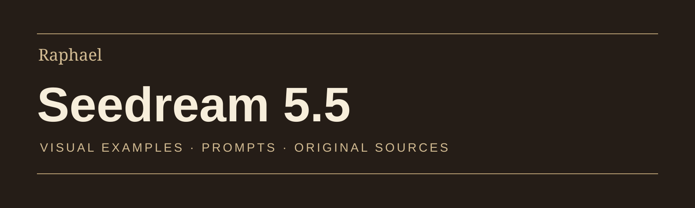](https://raphael.app/?utm_source=github&utm_medium=repository&utm_campaign=seedream_5_5)

# Awesome Seedream 5.5

[](https://awesome.re) [](https://github.com/RaphaelAI-OpenLab/awesome-seedream-5-5) [](https://github.com/RaphaelAI-OpenLab/awesome-seedream-5-5/actions/workflows/validate.yml) [](LICENSE)

[English](README.md) · [简体中文](README.zh-CN.md)

A visual reference collection by Raphael. Official demos, creator-reported outputs and original practice recipes are labeled separately.

**59 sourced cases · 8 categories · 8 original practice recipes · 3 checked social posts (2 distinct media items)**

Cases have not been independently reproduced here. Only reduced single-frame previews are bundled; full images, GIFs and videos are linked at their origins. Third-party media and previews retain their owners’ rights.

[Browse cases](#cases) · [Practice recipes](#recipes) · [Social sources](#social) · [Contribute](CONTRIBUTING.md) · [Source audit](docs/SOURCES.md)

## Model & access

Seedream 5.5 was announced on **2026-11-09**. See the [official model page](https://seed.bytedance.com/en/seedream5_5) and [release announcement](https://seed.bytedance.com/en/blog/more-realistic-images-more-stable-editing-across-100-rounds-introducing-seedream-5-5) for capabilities and rollout.

[Visit Raphael](https://raphael.app/?utm_source=github&utm_medium=repository&utm_campaign=seedream_5_5). This is a brand homepage link. Seedream 5.5 availability on Raphael has not been verified; this collection supplies neither a model API nor weights.

## Collection status

| Item | Count |
| --- | ---: |
| Official-source cases | 20 |
| Creator-reported cases | 39 |
| Complete original source prompts included | 10 |
| Independently reproduced cases | 0 |
| Sources checked | 2026-11-10 |

Edit rounds are grouped as one case. Duplicate social videos do not increase the case count. Source-page demo descriptions are not treated as complete generation prompts.

<a id="categories"></a>
## Browse by category

| Category | Cases |
| --- | ---: |
| [Multi-turn & targeted editing](#multi-turn-editing) | 5 |
| [Transparent assets](#rgba-assets) | 9 |
| [Portraits](#portraits) | 2 |
| [Photography & documentary](#photography) | 20 |
| [Interiors & space](#interiors) | 1 |
| [Text & typography](#typography) | 11 |
| [Infographics & interfaces](#infographics) | 4 |
| [Characters & stickers](#characters) | 7 |

<a id="cases"></a>
## All cases

<a id="multi-turn-editing"></a>
### Multi-turn & targeted editing

#### [Portrait editing](cases/official-portrait-editing/README.md)

<a href="cases/official-portrait-editing/README.md">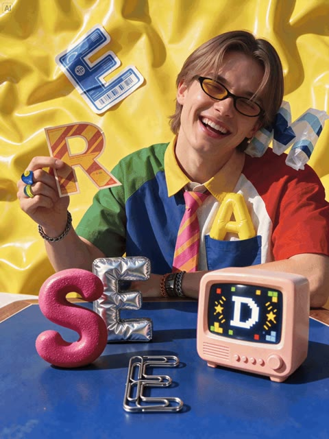</a>

Official demo · ByteDance Seed · [Source](https://seed.bytedance.com/en/seedream5_5) · [Details & prompt status](cases/official-portrait-editing/README.md)

#### [Still-life editing](cases/official-still-life-editing/README.md)

<a href="cases/official-still-life-editing/README.md">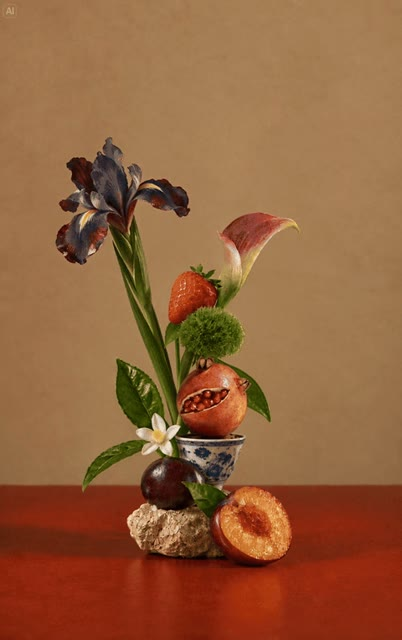</a>

Official demo · ByteDance Seed · [Source](https://seed.bytedance.com/en/seedream5_5) · [Details & prompt status](cases/official-still-life-editing/README.md)

#### [Ink-painting editing](cases/official-ink-painting-editing/README.md)

<a href="cases/official-ink-painting-editing/README.md">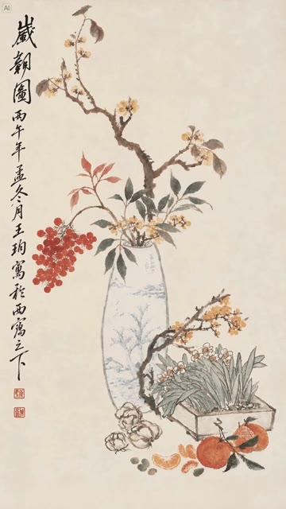</a>

Official demo · ByteDance Seed · [Source](https://seed.bytedance.com/en/seedream5_5) · [Details & prompt status](cases/official-ink-painting-editing/README.md)

#### [Paper-note edit](cases/quantslant-note-edit/README.md)

<a href="cases/quantslant-note-edit/README.md">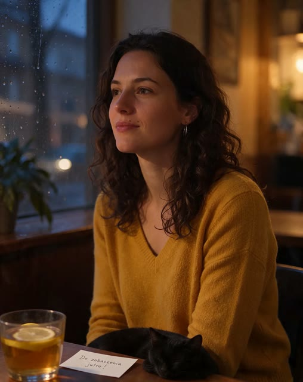</a>

Creator-reported · Piotr Olszewski / QUANTSLANT · [Source](https://quantslant.com/seedream-5-5-features-pricing-benchmarks/) · [Details & prompt status](cases/quantslant-note-edit/README.md)

#### [LLM diagram after 30 edits](cases/socialx-llm-diagram-edits/README.md)

<a href="cases/socialx-llm-diagram-edits/README.md">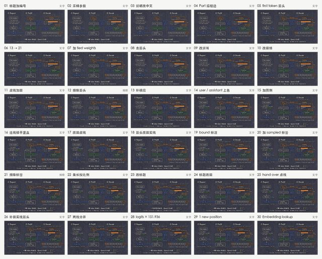</a>

Creator-reported · dongxi_nlp · [Source](https://x.com/dongxi_nlp/status/2120031669893939524) · [Details & prompt status](cases/socialx-llm-diagram-edits/README.md)

> Photos fetched from the author's original X post; local JPEG previews are at most 640px. Model attribution is not an independent reproduction. An LLM explanation diagram that the creator says was revised thirty times.

<a id="rgba-assets"></a>
### Transparent assets

#### [Flamingo layer](cases/official-flamingo-layer/README.md)

<a href="cases/official-flamingo-layer/README.md">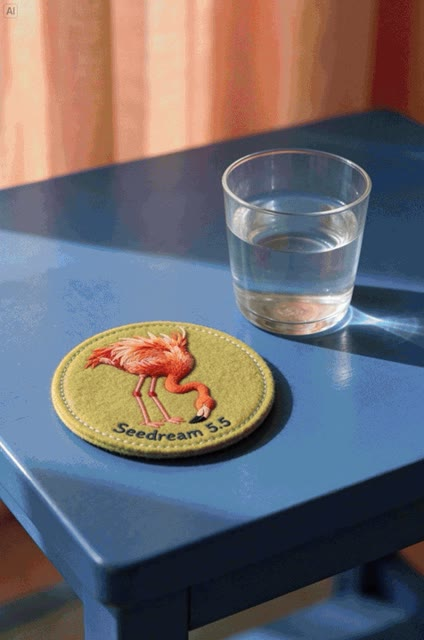</a>

Official demo · ByteDance Seed · [Source](https://seed.bytedance.com/en/seedream5_5) · [Details & prompt status](cases/official-flamingo-layer/README.md)

#### [Owl macro](cases/official-owl-macro/README.md)

<a href="cases/official-owl-macro/README.md">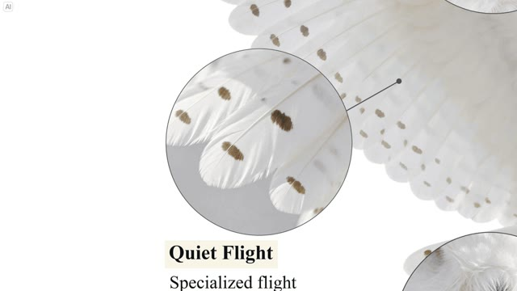</a>

Official demo · ByteDance Seed · [Source](https://seed.bytedance.com/en/seedream5_5) · [Details & prompt status](cases/official-owl-macro/README.md)

#### [Raincoat character](cases/quantslant-raincoat-character/README.md)

<a href="cases/quantslant-raincoat-character/README.md"></a>

Creator-reported · Piotr Olszewski / QUANTSLANT · [Source](https://quantslant.com/seedream-5-5-features-pricing-benchmarks/) · [Details & prompt status](cases/quantslant-raincoat-character/README.md)

> The author reports a milky umbrella; partial transparency remains a limitation.

#### [Amber perfume cutout](cases/social-dheepan-amber-perfume/README.md)

<a href="cases/social-dheepan-amber-perfume/README.md">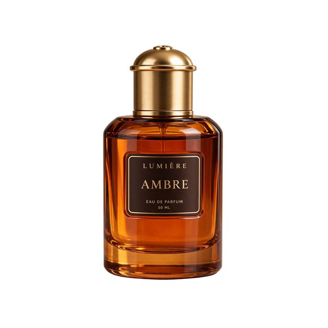</a>

Creator-reported · Dheepanratnam · [Source](https://x.com/Dheepanratnam/status/2119775195573481859) · [Details & prompt status](cases/social-dheepan-amber-perfume/README.md)

> Source-attributed social image and prompt from a public curator; not reproduced here. Reduced preview, not original export. JPEG does not verify the source alpha channel.

#### [Streetwear cutout](cases/social-dheepan-streetwear-cutout/README.md)

<a href="cases/social-dheepan-streetwear-cutout/README.md">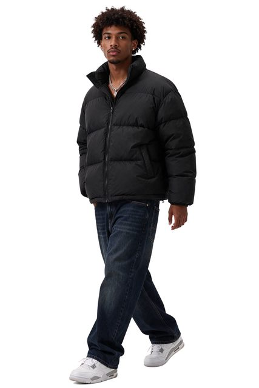</a>

Creator-reported · Dheepanratnam · [Source](https://x.com/Dheepanratnam/status/2119775195573481859) · [Details & prompt status](cases/social-dheepan-streetwear-cutout/README.md)

> Source-attributed social image and prompt from a public curator; not reproduced here. Reduced preview, not original export. JPEG does not verify the source alpha channel.

#### [Transparent character in two finishes](cases/socialx-transparent-character/README.md)

<a href="cases/socialx-transparent-character/README.md">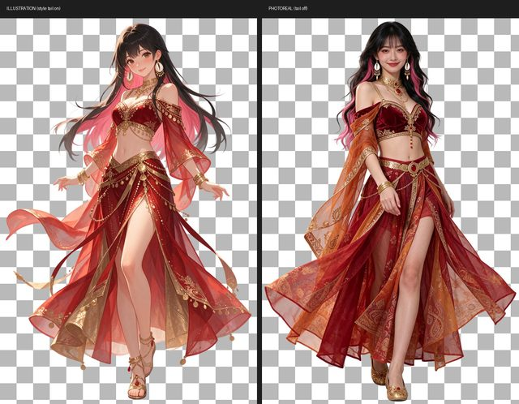</a>

Creator-reported · KakiponzuX · [Source](https://x.com/KakiponzuX/status/2119979776651710778) · [Details & prompt status](cases/socialx-transparent-character/README.md)

> Photos fetched from the author's original X post; local JPEG previews are at most 640px. Model attribution is not an independent reproduction. JPEG preview does not verify original alpha. An illustration/photoreal transparency test. The creator reports some outputs lost alpha; the shown checkerboard is a composite preview.

#### [Glass jellyfish lamp](cases/socialx-glass-jellyfish-lamp/README.md)

<a href="cases/socialx-glass-jellyfish-lamp/README.md">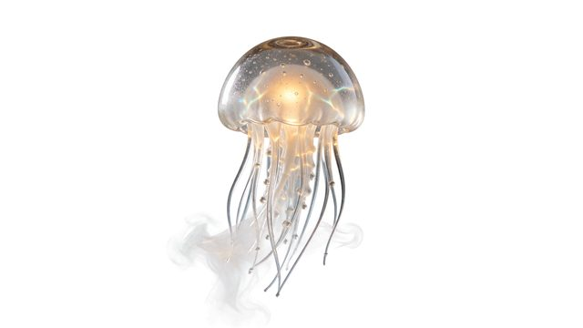</a>

Creator-reported · ahmetmertugrul · [Source](https://x.com/ahmetmertugrul/status/2119920477535719739) · [Details & prompt status](cases/socialx-glass-jellyfish-lamp/README.md)

> Photos fetched from the author's original X post; local JPEG previews are at most 640px. Model attribution is not an independent reproduction. JPEG preview does not verify original alpha. A glass-lamp transparency example with a prompt at source. The displayed image alone does not verify an alpha channel.

#### [Frosted acrylic sheet](cases/social-dheepan-frosted-acrylic/README.md)

<a href="cases/social-dheepan-frosted-acrylic/README.md">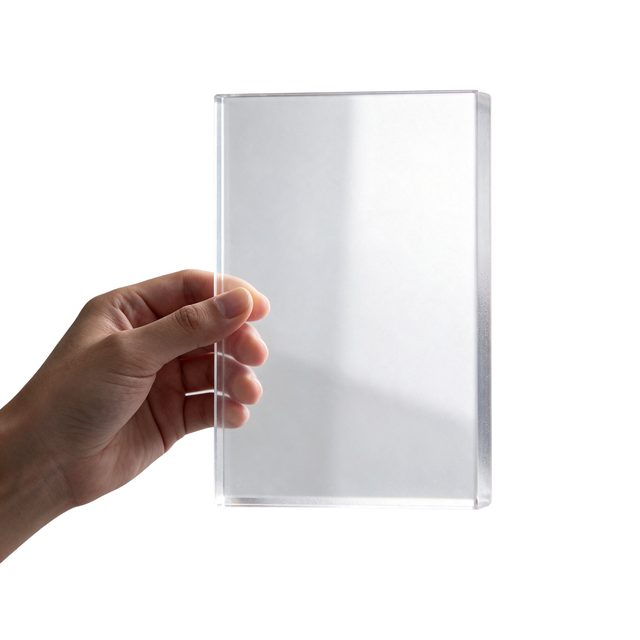</a>

Creator-reported · Dheepanratnam · [Source](https://x.com/Dheepanratnam/status/2119775195573481859) · [Details & prompt status](cases/social-dheepan-frosted-acrylic/README.md)

> Photos fetched from the author's original X post; local JPEG previews are at most 640px. Model attribution is not an independent reproduction. JPEG preview does not verify original alpha.

#### [Chrome ribbon logo](cases/social-dheepan-chrome-ribbon/README.md)

<a href="cases/social-dheepan-chrome-ribbon/README.md">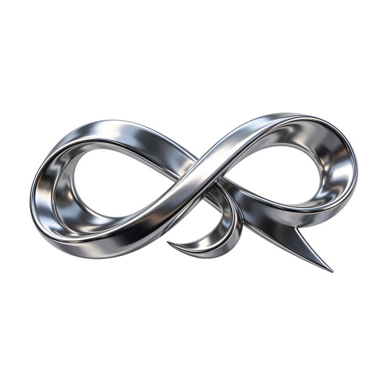</a>

Creator-reported · Dheepanratnam · [Source](https://x.com/Dheepanratnam/status/2119775195573481859) · [Details & prompt status](cases/social-dheepan-chrome-ribbon/README.md)

> Photos fetched from the author's original X post; local JPEG previews are at most 640px. Model attribution is not an independent reproduction. JPEG preview does not verify original alpha.

<a id="portraits"></a>
### Portraits

#### [Beauty editing](cases/official-beauty-editing/README.md)

<a href="cases/official-beauty-editing/README.md">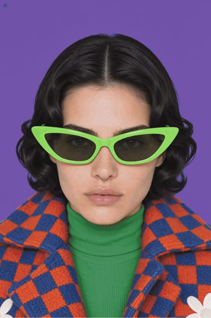</a>

Official demo · ByteDance Seed · [Source](https://seed.bytedance.com/en/seedream5_5) · [Details & prompt status](cases/official-beauty-editing/README.md)

#### [Freckled portrait](cases/quantslant-freckled-portrait/README.md)

<a href="cases/quantslant-freckled-portrait/README.md">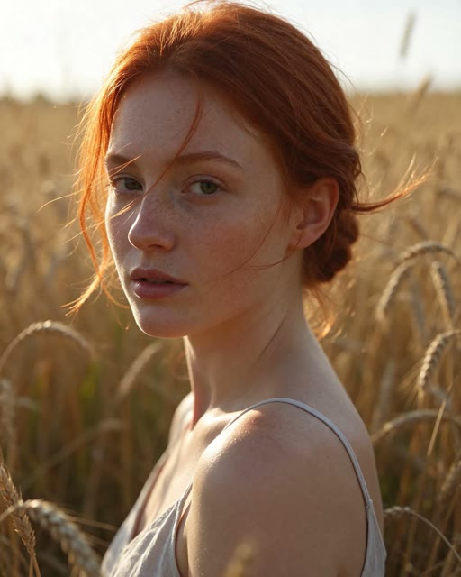</a>

Creator-reported · Piotr Olszewski / QUANTSLANT · [Source](https://quantslant.com/seedream-5-5-features-pricing-benchmarks/) · [Details & prompt status](cases/quantslant-freckled-portrait/README.md)

<a id="photography"></a>
### Photography & documentary

#### [Bar cat](cases/official-bar-cat/README.md)

<a href="cases/official-bar-cat/README.md">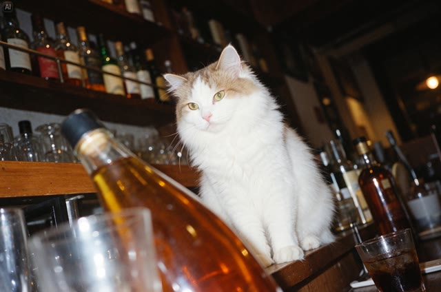</a>

Official demo · ByteDance Seed · [Source](https://seed.bytedance.com/en/seedream5_5) · [Details & prompt status](cases/official-bar-cat/README.md)

#### [Purple-yellow street](cases/official-purple-yellow-street/README.md)

<a href="cases/official-purple-yellow-street/README.md">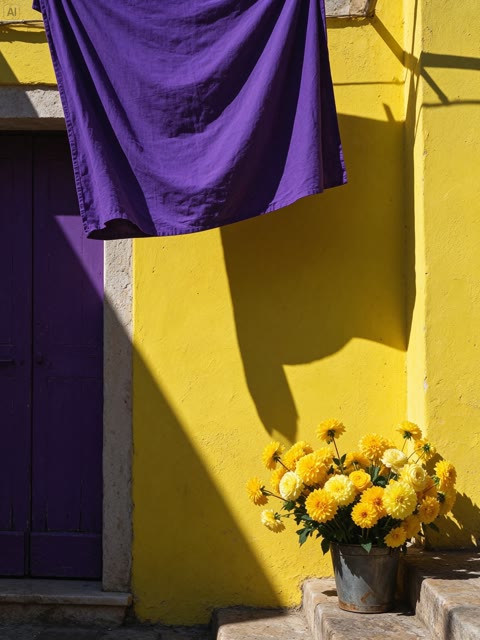</a>

Official demo · ByteDance Seed · [Source](https://seed.bytedance.com/en/seedream5_5) · [Details & prompt status](cases/official-purple-yellow-street/README.md)

#### [Windy street](cases/official-windy-street/README.md)

<a href="cases/official-windy-street/README.md">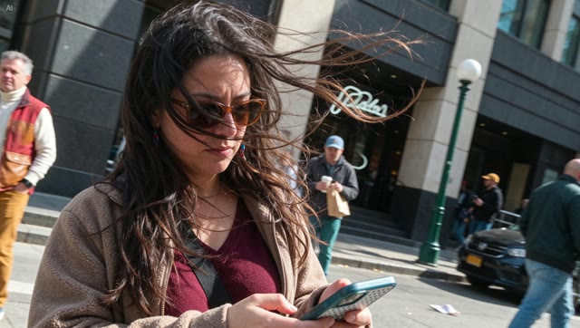</a>

Official demo · ByteDance Seed · [Source](https://seed.bytedance.com/en/seedream5_5) · [Details & prompt status](cases/official-windy-street/README.md)

#### [Bistro](cases/official-bistro/README.md)

<a href="cases/official-bistro/README.md">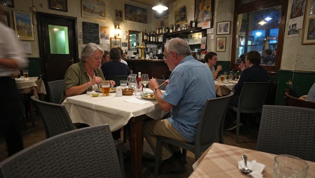</a>

Official demo · ByteDance Seed · [Source](https://seed.bytedance.com/en/seedream5_5) · [Details & prompt status](cases/official-bistro/README.md)

#### [Rain reflections](cases/official-rain-reflections/README.md)

<a href="cases/official-rain-reflections/README.md">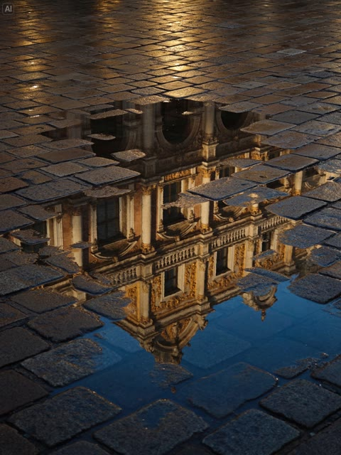</a>

Official demo · ByteDance Seed · [Source](https://seed.bytedance.com/en/seedream5_5) · [Details & prompt status](cases/official-rain-reflections/README.md)

#### [Railway station at dusk](cases/quantslant-railway-station/README.md)

<a href="cases/quantslant-railway-station/README.md">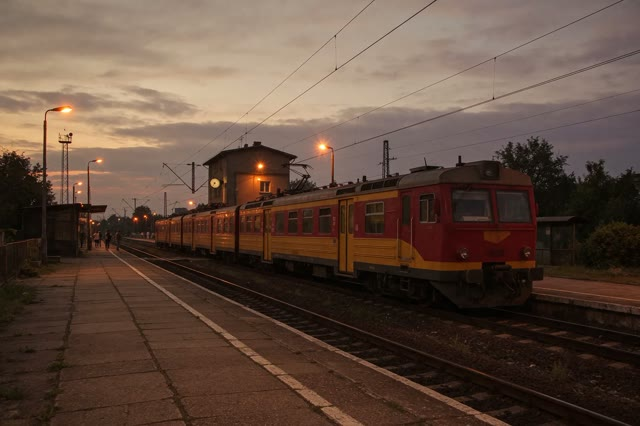</a>

Creator-reported · Piotr Olszewski / QUANTSLANT · [Source](https://quantslant.com/seedream-5-5-features-pricing-benchmarks/) · [Details & prompt status](cases/quantslant-railway-station/README.md)

#### [Japanese deli model comparison](cases/social-genel-japanese-deli/README.md)

<a href="cases/social-genel-japanese-deli/README.md">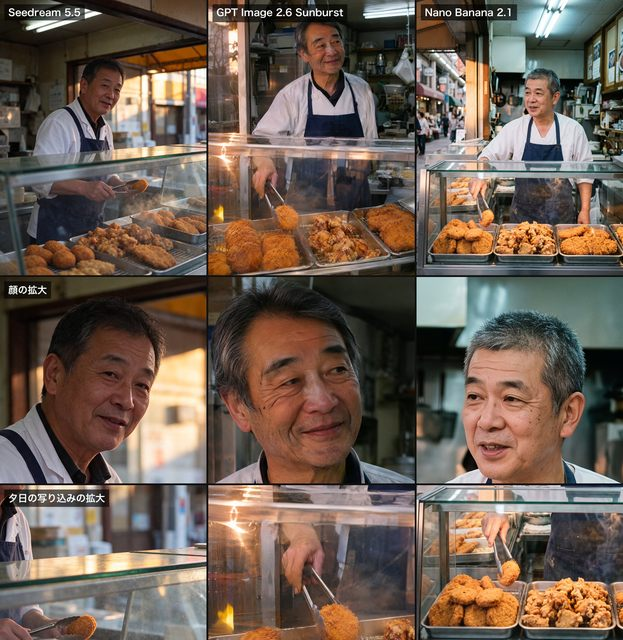</a>

Creator-reported · genel_ai · [Source](https://x.com/genel_ai/status/2119786434567827504) · [Details & prompt status](cases/social-genel-japanese-deli/README.md)

> Source-attributed social image and prompt from a public curator; not reproduced here. Reduced preview, not original export. This is a 3-model collage, with Seedream 5.5 at left.

#### [Skin texture study](cases/socialx-skin-texture-test/README.md)

<a href="cases/socialx-skin-texture-test/README.md">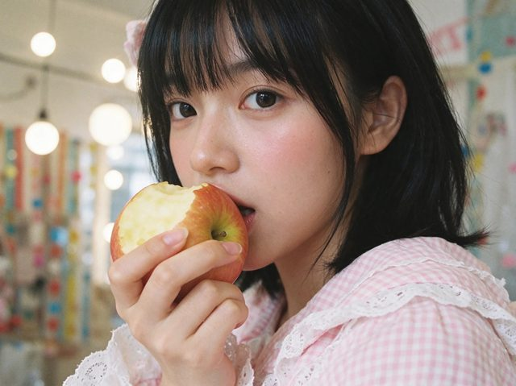</a>

Creator-reported · oden_ai_ai · [Source](https://x.com/oden_ai_ai/status/2120015332530393282) · [Details & prompt status](cases/socialx-skin-texture-test/README.md)

> Photos fetched from the author's original X post; local JPEG previews are at most 640px. Model attribution is not an independent reproduction. A creator-shared image testing the model's skin rendering.

#### [Four-model portrait study](cases/socialx-four-model-portrait/README.md)

<a href="cases/socialx-four-model-portrait/README.md"></a>

Creator-reported · 94vanAI · [Source](https://x.com/94vanAI/status/2119938579078238370) · [Details & prompt status](cases/socialx-four-model-portrait/README.md)

> Photos fetched from the author's original X post; local JPEG previews are at most 640px. Model attribution is not an independent reproduction. This multi-model comparison includes outputs from other models; follow labels at the source. The creator identifies image one as Seedream, followed by ChatGPT, Gemini and Grok, and discusses limitations as well as strengths.

#### [Same-prompt texture comparison](cases/socialx-same-prompt-texture/README.md)

<a href="cases/socialx-same-prompt-texture/README.md">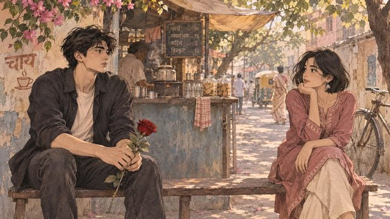</a>

Creator-reported · PowerUpInvest · [Source](https://x.com/PowerUpInvest/status/2119971057650262386) · [Details & prompt status](cases/socialx-same-prompt-texture/README.md)

> Photos fetched from the author's original X post; local JPEG previews are at most 640px. Model attribution is not an independent reproduction. A creator comparison with GPT Image 2.6 focused on image texture; model labels remain as stated in the post.

#### [Three-model output comparison](cases/socialx-three-model-output/README.md)

<a href="cases/socialx-three-model-output/README.md"></a>

Creator-reported · Yuziyyaa · [Source](https://x.com/Yuziyyaa/status/2119991511433814093) · [Details & prompt status](cases/socialx-three-model-output/README.md)

> Photos fetched from the author's original X post; local JPEG previews are at most 640px. Model attribution is not an independent reproduction. This multi-model comparison includes outputs from other models; follow labels at the source. The author lists GPT Images 2.6, Seedream 5.0 Pro and Seedream 5.5 in image order.

#### [Window-light film portrait](cases/socialx-window-light-portrait/README.md)

<a href="cases/socialx-window-light-portrait/README.md">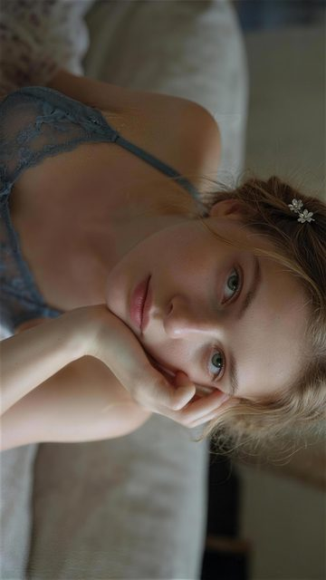</a>

Creator-reported · nima2qisi2 · [Source](https://x.com/nima2qisi2/status/2119983938383106432) · [Details & prompt status](cases/socialx-window-light-portrait/README.md)

> Photos fetched from the author's original X post; local JPEG previews are at most 640px. Model attribution is not an independent reproduction. A portrait series with window lighting and film styling; the source includes the creator's prompt.

#### [Vintage cinematic stills](cases/socialx-vintage-cinema/README.md)

<a href="cases/socialx-vintage-cinema/README.md"></a>

Creator-reported · ChrisGwinnLA · [Source](https://x.com/ChrisGwinnLA/status/2119979699464286506) · [Details & prompt status](cases/socialx-vintage-cinema/README.md)

> Photos fetched from the author's original X post; local JPEG previews are at most 640px. Model attribution is not an independent reproduction. Four vintage-style images in one creator post, counted as one collection example.

#### [Seedream and MiniMax H3 still-frame comparison](cases/socialx-h3-frame-comparison/README.md)

<a href="cases/socialx-h3-frame-comparison/README.md"></a>

Creator-reported · JSFILMZ0412 · [Source](https://x.com/JSFILMZ0412/status/2119889824274640957) · [Details & prompt status](cases/socialx-h3-frame-comparison/README.md)

> Photos fetched from the author's original X post; local JPEG previews are at most 640px. Model attribution is not an independent reproduction. This multi-model comparison includes outputs from other models; follow labels at the source. Two 2K still images without post-processing, as reported by the creator. The separate H3 video is not counted as a Seedream result.

#### [Elf portrait material study](cases/socialx-elf-material-study/README.md)

<a href="cases/socialx-elf-material-study/README.md">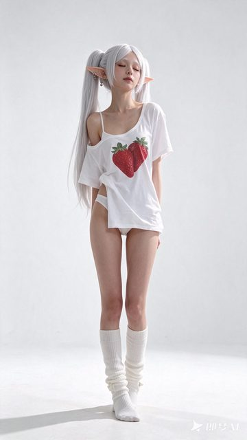</a>

Creator-reported · nanyuan0412 · [Source](https://x.com/nanyuan0412/status/2119879195115332042) · [Details & prompt status](cases/socialx-elf-material-study/README.md)

> Photos fetched from the author's original X post; local JPEG previews are at most 640px. Model attribution is not an independent reproduction. A single-image study of skin, fabric and light; the creator explicitly says extended editing was not tested.

#### [Winter portrait comparison](cases/socialx-winter-portrait-comparison/README.md)

<a href="cases/socialx-winter-portrait-comparison/README.md"></a>

Creator-reported · 0kncn · [Source](https://x.com/0kncn/status/2119878902344823069) · [Details & prompt status](cases/socialx-winter-portrait-comparison/README.md)

> Photos fetched from the author's original X post; local JPEG previews are at most 640px. Model attribution is not an independent reproduction. This multi-model comparison includes outputs from other models; follow labels at the source. The creator compares the same portrait brief across GPT Image 2.5, Seedream 5.5 and Nano Banana 2.1.

#### [Photoreal image set](cases/socialx-photoreal-image-set/README.md)

<a href="cases/socialx-photoreal-image-set/README.md">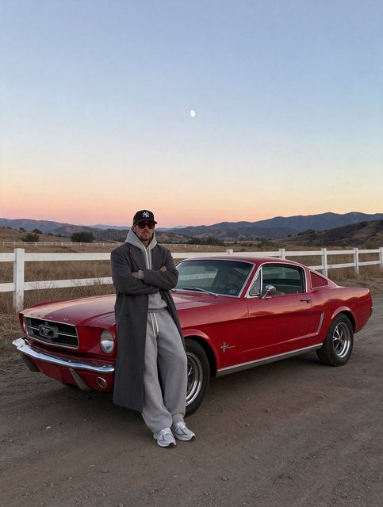</a>

Creator-reported · uixmax · [Source](https://x.com/uixmax/status/2119894564073054374) · [Details & prompt status](cases/socialx-photoreal-image-set/README.md)

> Photos fetched from the author's original X post; local JPEG previews are at most 640px. Model attribution is not an independent reproduction. A creator's four-image photorealism test, kept together as one source example.

#### [Portrait model-order comparison](cases/socialx-three-model-portrait-order/README.md)

<a href="cases/socialx-three-model-portrait-order/README.md">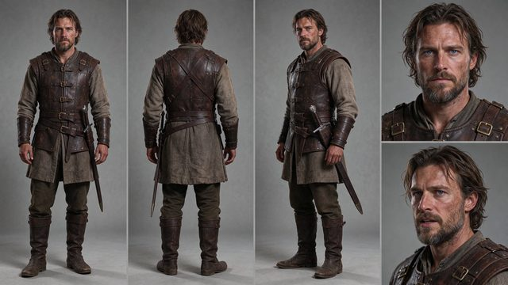</a>

Creator-reported · foretyyt · [Source](https://x.com/foretyyt/status/2119894502588452933) · [Details & prompt status](cases/socialx-three-model-portrait-order/README.md)

> Photos fetched from the author's original X post; local JPEG previews are at most 640px. Model attribution is not an independent reproduction. This multi-model comparison includes outputs from other models; follow labels at the source. The author labels image one Seedream 5.5, image two Image 2.5 and image three Nano Banana 2.1.

#### [Shared brief with GPT Image 2.6](cases/socialx-gpt26-same-brief/README.md)

<a href="cases/socialx-gpt26-same-brief/README.md">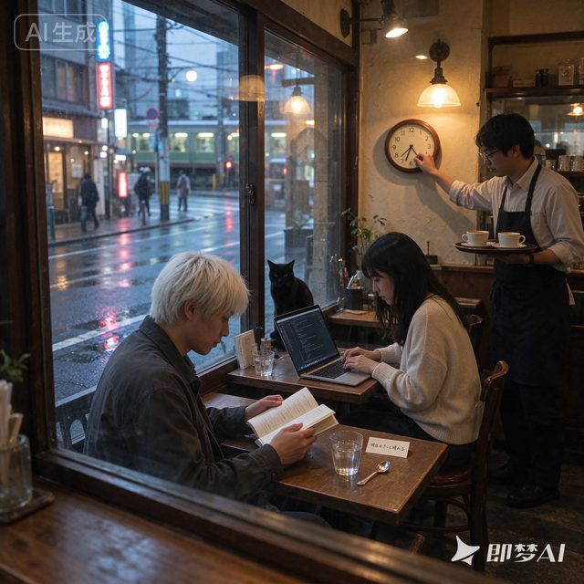</a>

Creator-reported · arito_si · [Source](https://x.com/arito_si/status/2119890337699364975) · [Details & prompt status](cases/socialx-gpt26-same-brief/README.md)

> Photos fetched from the author's original X post; local JPEG previews are at most 640px. Model attribution is not an independent reproduction. This multi-model comparison includes outputs from other models; follow labels at the source. A creator reports testing Seedream 5.5 and GPT Image 2.6 with the same prompt set.

#### [Fisherman at blue hour](cases/socialx-blue-hour-fisherman/README.md)

<a href="cases/socialx-blue-hour-fisherman/README.md">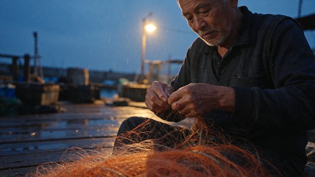</a>

Creator-reported · ahmetmertugrul · [Source](https://x.com/ahmetmertugrul/status/2119922071916757233) · [Details & prompt status](cases/socialx-blue-hour-fisherman/README.md)

> Photos fetched from the author's original X post; local JPEG previews are at most 640px. Model attribution is not an independent reproduction. A documentary-style portrait combining cool ambient light with a warm lamp; the original prompt is at source.

<a id="interiors"></a>
### Interiors & space

#### [Room editing](cases/official-interior-editing/README.md)

<a href="cases/official-interior-editing/README.md">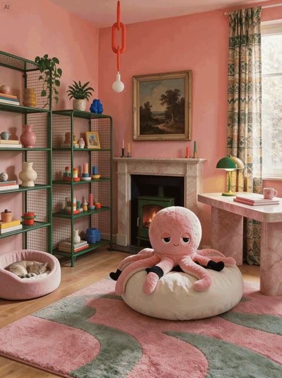</a>

Official demo · ByteDance Seed · [Source](https://seed.bytedance.com/en/seedream5_5) · [Details & prompt status](cases/official-interior-editing/README.md)

<a id="typography"></a>
### Text & typography

#### [Transparent material lettering](cases/official-yarn-lettering/README.md)

<a href="cases/official-yarn-lettering/README.md">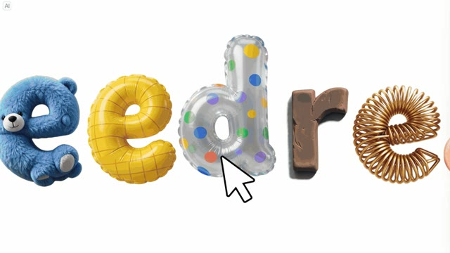</a>

Official demo · ByteDance Seed · [Source](https://seed.bytedance.com/en/seedream5_5) · [Details & prompt status](cases/official-yarn-lettering/README.md)

#### [Shakespeare newspaper](cases/official-shakespeare-newspaper/README.md)

<a href="cases/official-shakespeare-newspaper/README.md">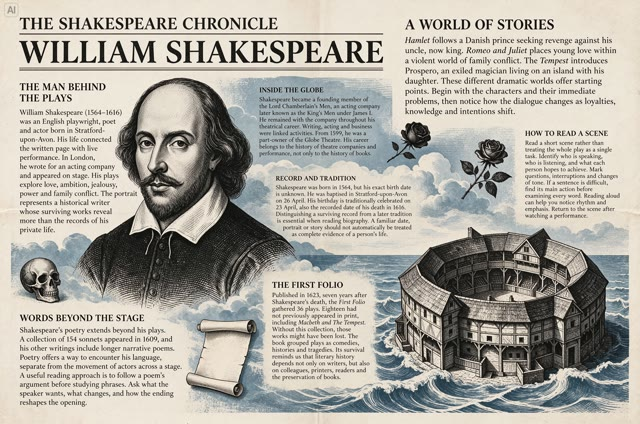</a>

Official demo · ByteDance Seed · [Source](https://seed.bytedance.com/en/blog/more-realistic-images-more-stable-editing-across-100-rounds-introducing-seedream-5-5) · [Details & prompt status](cases/official-shakespeare-newspaper/README.md)

#### [Polish menu](cases/quantslant-polish-menu/README.md)

<a href="cases/quantslant-polish-menu/README.md">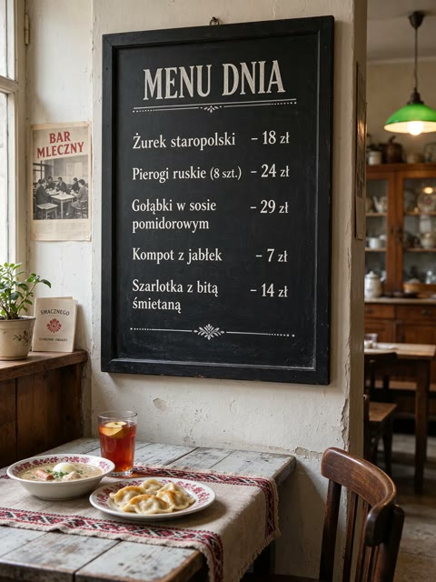</a>

Creator-reported · Piotr Olszewski / QUANTSLANT · [Source](https://quantslant.com/seedream-5-5-features-pricing-benchmarks/) · [Details & prompt status](cases/quantslant-polish-menu/README.md)

#### [Polish pangram](cases/quantslant-polish-pangram/README.md)

<a href="cases/quantslant-polish-pangram/README.md"></a>

Creator-reported · Piotr Olszewski / QUANTSLANT · [Source](https://quantslant.com/seedream-5-5-features-pricing-benchmarks/) · [Details & prompt status](cases/quantslant-polish-pangram/README.md)

#### [Newspaper text-error sample](cases/quantslant-newspaper-errors/README.md)

<a href="cases/quantslant-newspaper-errors/README.md"></a>

Creator-reported · Piotr Olszewski / QUANTSLANT · [Source](https://quantslant.com/seedream-5-5-features-pricing-benchmarks/) · [Details & prompt status](cases/quantslant-newspaper-errors/README.md)

> The author reports text errors; retained as a limitation example.

#### [Magazine cover typography](cases/social-dheepan-magazine-cover/README.md)

<a href="cases/social-dheepan-magazine-cover/README.md"></a>

Creator-reported · Dheepanratnam · [Source](https://x.com/Dheepanratnam/status/2119767938173387065) · [Details & prompt status](cases/social-dheepan-magazine-cover/README.md)

> Source-attributed social image and prompt from a public curator; not reproduced here. Reduced preview, not original export.

#### [Rainy multilingual storefront](cases/social-dheepan-rainy-storefront/README.md)

<a href="cases/social-dheepan-rainy-storefront/README.md">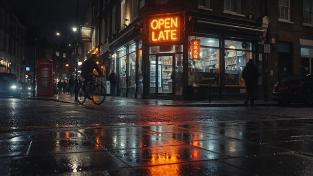</a>

Creator-reported · Dheepanratnam · [Source](https://x.com/Dheepanratnam/status/2119767938173387065) · [Details & prompt status](cases/social-dheepan-rainy-storefront/README.md)

> Source-attributed social image and prompt from a public curator; not reproduced here. Reduced preview, not original export.

#### [Skincare packaging text](cases/social-dheepan-skincare-label/README.md)

<a href="cases/social-dheepan-skincare-label/README.md">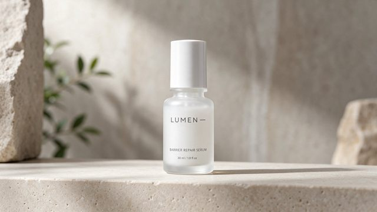</a>

Creator-reported · Dheepanratnam · [Source](https://x.com/Dheepanratnam/status/2119767938173387065) · [Details & prompt status](cases/social-dheepan-skincare-label/README.md)

> Source-attributed social image and prompt from a public curator; not reproduced here. Reduced preview, not original export.

#### [Night Signal event poster](cases/social-dheepan-night-signal-poster/README.md)

<a href="cases/social-dheepan-night-signal-poster/README.md">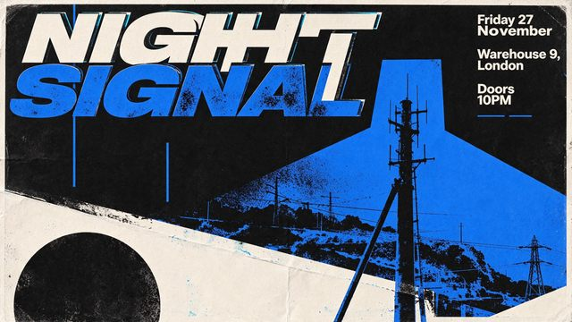</a>

Creator-reported · Dheepanratnam · [Source](https://x.com/Dheepanratnam/status/2119767938173387065) · [Details & prompt status](cases/social-dheepan-night-signal-poster/README.md)

> Source-attributed social image and prompt from a public curator; not reproduced here. Reduced preview, not original export.

#### [Dense text across model versions](cases/socialx-dense-text-comparison/README.md)

<a href="cases/socialx-dense-text-comparison/README.md">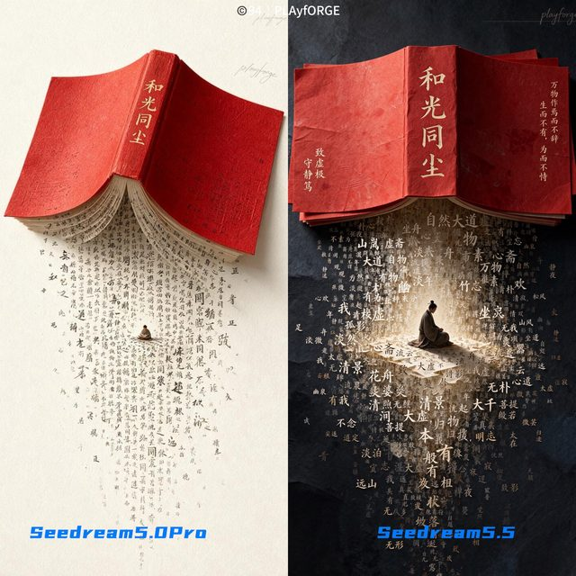</a>

Creator-reported · 94vanAI · [Source](https://x.com/94vanAI/status/2120007470898913320) · [Details & prompt status](cases/socialx-dense-text-comparison/README.md)

> Photos fetched from the author's original X post; local JPEG previews are at most 640px. Model attribution is not an independent reproduction. This multi-model comparison includes outputs from other models; follow labels at the source. A comparison covering Seedream 5.5, 5.0 Pro and GPT Image versions; view the labels in the source.

#### [Deep-sea field-guide infographic](cases/socialx-deep-sea-field-guide/README.md)

<a href="cases/socialx-deep-sea-field-guide/README.md">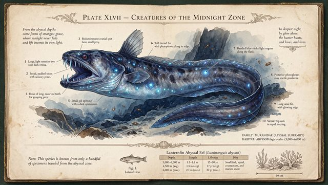</a>

Creator-reported · ahmetmertugrul · [Source](https://x.com/ahmetmertugrul/status/2119915956365369596) · [Details & prompt status](cases/socialx-deep-sea-field-guide/README.md)

> Photos fetched from the author's original X post; local JPEG previews are at most 640px. Model attribution is not an independent reproduction. A fictional creature field-guide page combining labels, a data table and scientific illustration; prompt at source.

<a id="infographics"></a>
### Infographics & interfaces

#### [Snake interface](cases/official-snake-interface/README.md)

<a href="cases/official-snake-interface/README.md">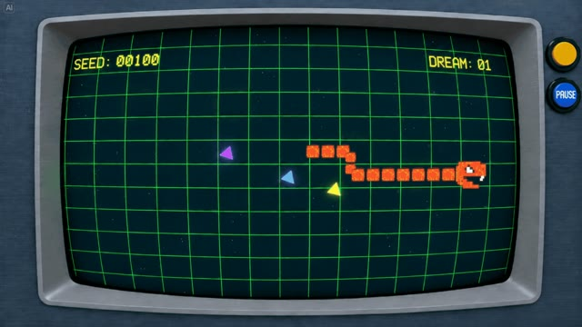</a>

Official demo · ByteDance Seed · [Source](https://seed.bytedance.com/en/seedream5_5) · [Details & prompt status](cases/official-snake-interface/README.md)

#### [Watch interface](cases/official-watch-interface/README.md)

<a href="cases/official-watch-interface/README.md">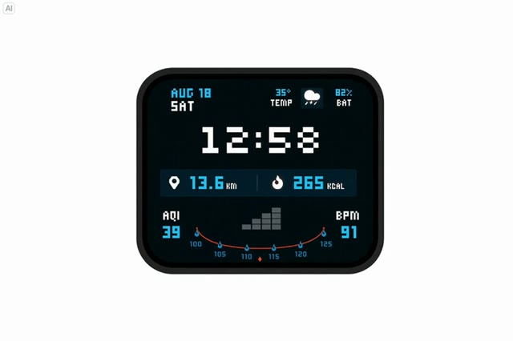</a>

Official demo · ByteDance Seed · [Source](https://seed.bytedance.com/en/seedream5_5) · [Details & prompt status](cases/official-watch-interface/README.md)

#### [Butterfly infographic](cases/official-butterfly-infographic/README.md)

<a href="cases/official-butterfly-infographic/README.md">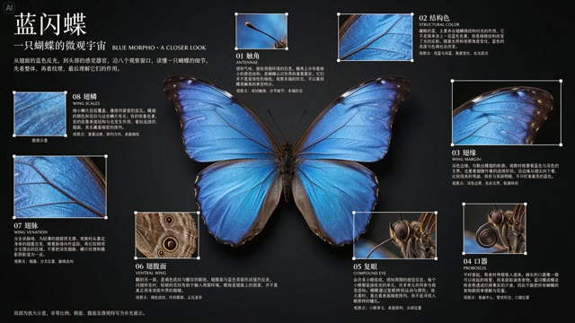</a>

Official demo · ByteDance Seed · [Source](https://seed.bytedance.com/en/blog/more-realistic-images-more-stable-editing-across-100-rounds-introducing-seedream-5-5) · [Details & prompt status](cases/official-butterfly-infographic/README.md)

#### [Coffee infographic](cases/quantslant-coffee-infographic/README.md)

<a href="cases/quantslant-coffee-infographic/README.md">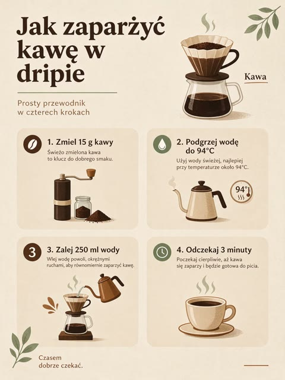</a>

Creator-reported · Piotr Olszewski / QUANTSLANT · [Source](https://quantslant.com/seedream-5-5-features-pricing-benchmarks/) · [Details & prompt status](cases/quantslant-coffee-infographic/README.md)

<a id="characters"></a>
### Characters & stickers

#### [Running character](cases/official-running-character/README.md)

<a href="cases/official-running-character/README.md">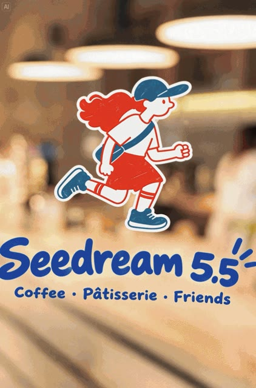</a>

Official demo · ByteDance Seed · [Source](https://seed.bytedance.com/en/seedream5_5) · [Details & prompt status](cases/official-running-character/README.md)

#### [Sticker sheets](cases/official-sticker-sheets/README.md)

<a href="cases/official-sticker-sheets/README.md">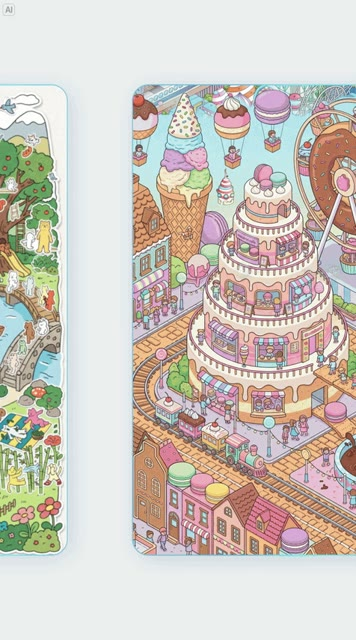</a>

Official demo · ByteDance Seed · [Source](https://seed.bytedance.com/en/seedream5_5) · [Details & prompt status](cases/official-sticker-sheets/README.md)

#### [Plush characters](cases/official-plush-characters/README.md)

<a href="cases/official-plush-characters/README.md">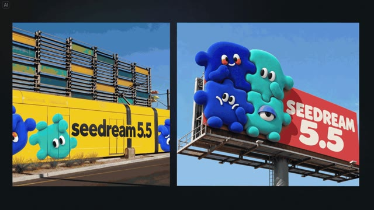</a>

Official demo · ByteDance Seed · [Source](https://seed.bytedance.com/en/seedream5_5) · [Details & prompt status](cases/official-plush-characters/README.md)

#### [Character sheet version comparison](cases/socialx-character-sheet-comparison/README.md)

<a href="cases/socialx-character-sheet-comparison/README.md">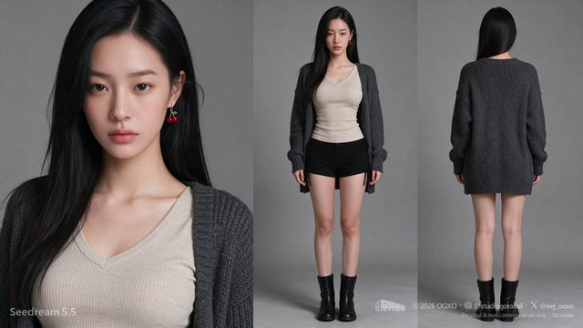</a>

Creator-reported · EEJ_OOXO · [Source](https://x.com/EEJ_OOXO/status/2119780326117716281) · [Details & prompt status](cases/socialx-character-sheet-comparison/README.md)

> Photos fetched from the author's original X post; local JPEG previews are at most 640px. Model attribution is not an independent reproduction. This multi-model comparison includes outputs from other models; follow labels at the source. A character-sheet comparison with Seedream 5.0 Pro; the original post discusses panel consistency and output files.

#### [Photoreal character conversion](cases/socialx-photoreal-conversion/README.md)

<a href="cases/socialx-photoreal-conversion/README.md">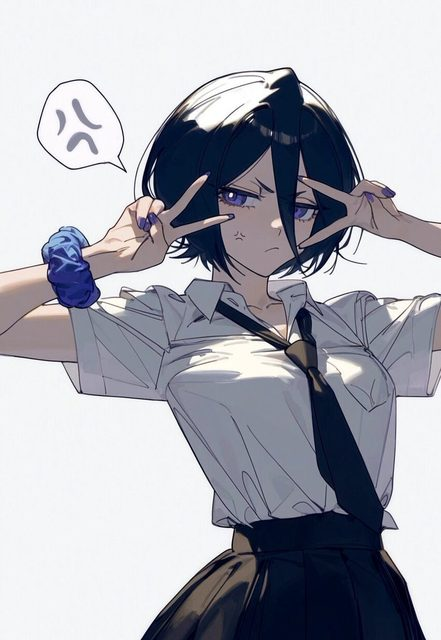</a>

Creator-reported · nanyuan0412 · [Source](https://x.com/nanyuan0412/status/2119949010698137603) · [Details & prompt status](cases/socialx-photoreal-conversion/README.md)

> Photos fetched from the author's original X post; local JPEG previews are at most 640px. Model attribution is not an independent reproduction. A two-image character-to-photoreal study shared as a Seedream 5.5 test.

#### [Character recreation study](cases/socialx-character-recreation/README.md)

<a href="cases/socialx-character-recreation/README.md">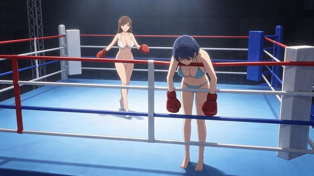</a>

Creator-reported · haungpower · [Source](https://x.com/haungpower/status/2119852896544325859) · [Details & prompt status](cases/socialx-character-recreation/README.md)

> Photos fetched from the author's original X post; local JPEG previews are at most 640px. Model attribution is not an independent reproduction. A creator-labeled recreation test focused on character consistency; reference details remain at the source.

#### [Nature Unseen concept series](cases/socialx-nature-unseen/README.md)

<a href="cases/socialx-nature-unseen/README.md"></a>

Creator-reported · AI_Timemachine · [Source](https://x.com/AI_Timemachine/status/2119930302508286194) · [Details & prompt status](cases/socialx-nature-unseen/README.md)

> Photos fetched from the author's original X post; local JPEG previews are at most 640px. Model attribution is not an independent reproduction. The artist revisits an existing concept series using Seedream 5.5; the four-image album counts once.

<a id="recipes"></a>
## Original practice recipes

These recipes were written for this collection and have not been executed with Seedream 5.5. They are not the original inputs for the sourced images. Each includes Chinese/English instructions and acceptance checks.

| Recipe | Status |
| --- | --- |
| [One-region edit](templates/targeted-edit.md) | Original, not executed |
| [Three-round edit chain](templates/edit-chain.md) | Original, not executed |
| [Isolated transparent asset](templates/transparent-asset.md) | Original, not executed |
| [Partial-transparency test](templates/material-transparency.md) | Original, not executed |
| [Documentary photograph](templates/documentary-photo.md) | Original, not executed |
| [Copy-locked poster](templates/copy-locked-poster.md) | Original, not executed |
| [Character consistency sheet](templates/character-sheet.md) | Original, not executed |
| [Instruction infographic](templates/instruction-infographic.md) | Original, not executed |

<a id="social"></a>
## Original social sources

Account, model version and media URLs were checked through X public oEmbed and syndication responses. Original posts and media are linked without copying full post text.

### ByteDance Seed · @ByteDanceSeed_

[](https://x.com/ByteDanceSeed_/status/2119717948470546446)

[Original post](https://x.com/ByteDanceSeed_/status/2119717948470546446) · [Original media](https://video.twimg.com/amplify_video/2119716100359548928/vid/avc1/1920x1080/yijLvq8WlsqxbemL.mp4)

### Dreamina AI · @dreamina_ai

[](https://x.com/dreamina_ai/status/2119751497282125949)

[Original post](https://x.com/dreamina_ai/status/2119751497282125949) · [Original media](https://pbs.twimg.com/media/HWredl_bAAAkfEk.jpg)

[Additional social research (including pending leads)](docs/SOCIAL-CASES-2026-11-10.md)

[New creator showcase: five social examples (source media pending)](docs/SOCIAL-SHOWCASE-2026-11-10-BATCH2.md)

## Local maintenance

```bash
python3 scripts/build.py
python3 scripts/validate.py
python3 scripts/search.py RGBA
```

Optional: `python3 scripts/check_media.py` checks local previews and requires ffmpeg. `python3 scripts/refresh_previews.py` refreshes reduced representative-frame previews over the network without bundling original media.

## Contributing & licensing

Follow the [contribution guide](CONTRIBUTING.md) with the original post, explicit version evidence and prompt status. Report rights issues through the [issue form](https://github.com/RaphaelAI-OpenLab/awesome-seedream-5-5/issues/new?template=report-problem.yml).

Code and original documentation use [MIT](LICENSE). Third-party prompts and media retain their own rights. Layout follows the [GPT Image 2.6 collection](https://github.com/RaphaelAI-OpenLab/awesome-gpt-image-2-6); see [attribution](docs/ATTRIBUTION.md).
