<!-- 由 scripts/build.py 生成，请编辑 content/ 内的数据。 -->

[](https://raphael.app/?utm_source=github&utm_medium=repository&utm_campaign=seedream_5_5)

# Awesome Seedream 5.5

[](https://awesome.re) [](https://github.com/RaphaelAI-OpenLab/awesome-seedream-5-5) [](https://github.com/RaphaelAI-OpenLab/awesome-seedream-5-5/actions/workflows/validate.yml) [](LICENSE)

[English](README.md) · [简体中文](README.zh-CN.md)

A visual reference collection by Raphael. Official demos, creator-reported outputs and original practice recipes are labeled separately.

**90 sourced cases · 8 categories · 8 original practice recipes · 3 separately tracked launch posts (2 distinct media items)**

Cases have not been independently reproduced. The README directly displays stored image and short-GIF previews plus all collected full prompts. Full-resolution images and long videos remain at source; rights belong to their owners.

[Browse cases](#cases) · [Web reference remake queue](external-references/README.md) · [Practice recipes](#recipes) · [Social sources](#social) · [Contribute](CONTRIBUTING.md) · [Source audit](docs/SOURCES.md)

## Model & access

Seedream 5.5 was announced on **2026-11-09**. See the [official model page](https://seed.bytedance.com/en/seedream5_5) and [release announcement](https://seed.bytedance.com/en/blog/more-realistic-images-more-stable-editing-across-100-rounds-introducing-seedream-5-5) for capabilities and rollout.

[Visit Raphael](https://raphael.app/?utm_source=github&utm_medium=repository&utm_campaign=seedream_5_5). This is a brand homepage link. Seedream 5.5 availability on Raphael has not been verified; this collection supplies neither a model API nor weights.

## Collection status

| Item | Count |
| --- | ---: |
| Official-source cases | 20 |
| Creator-reported cases | 70 |
| Complete original source prompts included | 15 |
| Independently reproduced cases | 0 |
| Sources checked | 2026-11-11 |

Edit rounds are grouped as one case. Duplicate social videos do not increase the case count. Source-page demo descriptions are not treated as complete generation prompts.

Every collected complete prompt appears directly below its image in a copyable text block, preserving the original language and line breaks. Cases without complete prompt text are labeled.

<a id="external-web-references"></a>
## Prompt-first case gallery

**125 cases · 50 with complete prompts · 75 missing prompts**

All available local image/short-GIF previews and published full prompts appear directly in this README. No off-site visit is required to view or copy them; links provide attribution. Website-reported model outputs are not independently reproduced.

The 90 main source cases and 35 website-remake references remain separately counted. Source rights and model attribution need review. Stored images are low-resolution previews, not licensed full-resolution originals.

[External references and remake queue](external-references/README.md) · [Remake workflow](external-references/WORKFLOW.md)

<a id="categories"></a>
## Browse by category

| Category | With prompt | Missing prompt | Total |
| --- | ---: | ---: | ---: |
| [Multi-turn & targeted editing](#multi-turn-editing) | 3 | 14 | 17 |
| [Transparent assets](#rgba-assets) | 9 | 6 | 15 |
| [Portraits](#portraits) | 6 | 8 | 14 |
| [Photography & documentary](#photography) | 12 | 23 | 35 |
| [Interiors & space](#interiors) | 1 | 1 | 2 |
| [Text & typography](#typography) | 14 | 7 | 21 |
| [Infographics & interfaces](#infographics) | 1 | 4 | 5 |
| [Characters & stickers](#characters) | 4 | 12 | 16 |

<a id="cases"></a>
## All cases: prompts first

<a id="with-prompts"></a>
### With published full prompts (50)

<a id="multi-turn-editing"></a>
#### Multi-turn & targeted editing

<a id="quantslant-note-edit"></a>
##### [Paper-note edit](cases/quantslant-note-edit/README.md)

**Website** · Piotr Olszewski / QUANTSLANT · Multi-turn & targeted editing · [Source](https://quantslant.com/seedream-5-5-features-pricing-benchmarks/) · [Case details](cases/quantslant-note-edit/README.md)


**Source-published prompt (not independently reproduced)**

```text
Add a small white paper note on the table with handwritten Polish text “Do zobaczenia jutro!”. Keep everything else unchanged.
```

<a id="web-studio-07"></a>
##### [Three-round café image edit](external-references/cases/web-studio-07/README.md)

**Website · Pending remake** · Seedream Studio · Multi-turn & targeted editing · [Source](https://seedreamv5.com/seedream-5.5) · [Case details](external-references/cases/web-studio-07/README.md)

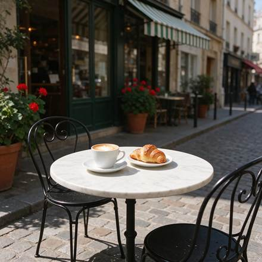

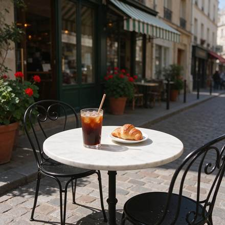

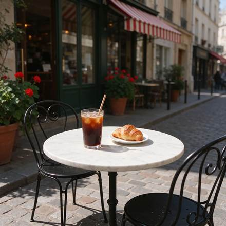

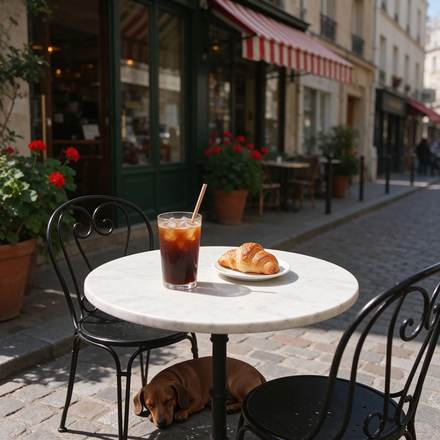

**Source-published prompt (not independently reproduced)**

```text
A sunny street café scene seen from the pavement at table height: a small round white marble bistro table holding a white ceramic cup of cappuccino with heart latte art on a saucer and a golden croissant on a small plate, with two black wrought-iron bistro chairs. Behind the table, the café front has a plain green-and-white striped awning with no lettering, tall glass windows and terracotta pots of red geraniums. A cobblestone street, warm morning sunlight, soft shadows, no people, and no text or signs anywhere. Photorealistic, 35mm lens.
```

**Edit step 1: Swap the cappuccino for an iced coffee**

```text
Replace the cappuccino cup and saucer on the table with a tall clear glass of iced coffee with ice cubes, a paper straw and droplets of condensation, standing in the same spot. Keep everything else exactly as it is: the marble table, the croissant and its plate, both chairs, the green-and-white striped awning, the windows, the geraniums, the cobblestones, the lighting and the camera angle.
```

**Edit step 2: Turn the awning red and white**

```text
Change only the colour of the awning stripes from green-and-white to red-and-white. Keep everything else exactly as it is: the glass of iced coffee, the croissant and its plate, the marble table, both chairs, the windows, the geraniums, the cobblestones, the lighting and the camera angle.
```

**Edit step 3: Add a sleeping dachshund**

```text
Add a small brown dachshund lying curled up asleep on the cobblestones under the table, in the table's shadow. Keep everything else exactly as it is: the glass of iced coffee, the croissant and its plate, the marble table, both chairs, the red-and-white striped awning, the windows, the geraniums, the lighting and the camera angle.
```

> Successive edits each depend on the previous frame, rather than independent generations.

<a id="web-froging-01"></a>
##### [Change a product backdrop](external-references/cases/web-froging-01/README.md)

**Website · Pending remake** · Froging AI · Multi-turn & targeted editing · [Source](https://www.froging.ai/seedream-5-5-ai-image-generator) · [Case details](external-references/cases/web-froging-01/README.md)

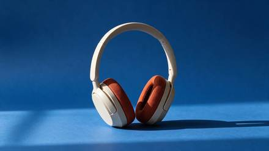

**Source-published prompt (not independently reproduced)**

```text
Replace only the warm-gray seamless paper behind and beneath the headphones with saturated matte cobalt-blue seamless paper. Keep the product in precisely the same position, scale and three-quarter orientation. Preserve the shape of the headband, the ivory plastic, the rust-orange woven cushions, and the original direction of the contact shadow. Keep the same framing and camera angle. Do not add text, accessories, reflections or extra objects.
```

> Original headphones input photo is needed to reproduce this edit.

<a id="rgba-assets"></a>
#### Transparent assets

<a id="social-dheepan-amber-perfume"></a>
##### [Amber perfume cutout](cases/social-dheepan-amber-perfume/README.md)

**Social media · X** · Dheepanratnam · Transparent assets · [Source](https://x.com/Dheepanratnam/status/2119775195573481859) · [Case details](cases/social-dheepan-amber-perfume/README.md)


**Source-published prompt (not independently reproduced)**

```text
Studio product asset of a translucent amber glass perfume bottle with a brushed-gold cap, floating centred in the frame. Fully transparent background with native alpha channel, clean accurate edges around the glass, cap and reflections, no background colour bleed, no white halo, no cut-off shadows. Preserve realistic glass refraction and internal liquid. Commercial e-commerce asset, front-facing composition, high detail, suitable for direct placement onto any design background.
```

> Source-attributed social image and prompt from a public curator; not independently regenerated here. Reduced preview, not original export. JPEG does not verify the source alpha channel.

<a id="social-dheepan-streetwear-cutout"></a>
##### [Streetwear cutout](cases/social-dheepan-streetwear-cutout/README.md)

**Social media · X** · Dheepanratnam · Transparent assets · [Source](https://x.com/Dheepanratnam/status/2119775195573481859) · [Case details](cases/social-dheepan-streetwear-cutout/README.md)


**Source-published prompt (not independently reproduced)**

```text
Full-body cut-out asset of a stylish young Black male streetwear model wearing an oversized charcoal puffer jacket, baggy denim jeans and white trainers, walking casually. Fully transparent background with native alpha channel, precise edges around curly hair, jacket fibres, shoelaces and fingers, no background remnants, no halo, no clipped limbs. Natural stance, studio-quality lighting from front left, suitable for compositing into a fashion campaign.
```

> Source-attributed social image and prompt from a public curator; not independently regenerated here. Reduced preview, not original export. JPEG does not verify the source alpha channel.

<a id="socialx-glass-jellyfish-lamp"></a>
##### [Glass jellyfish lamp](cases/socialx-glass-jellyfish-lamp/README.md)

**Social media · X** · ahmetmertugrul · Transparent assets · [Source](https://x.com/ahmetmertugrul/status/2119920477535719739) · [Case details](cases/socialx-glass-jellyfish-lamp/README.md)


**Source-published prompt (not independently reproduced)**

```text
Transparent background, PNG with alpha channel. A hand-blown glass jellyfish lamp floating in mid-air: semi-transparent frosted bell with visible internal air bubbles, long trailing tentacles made of thin glass threads that fade from fully opaque at the top to almost invisible at the tips, a faint warm amber glow inside the bell, soft caustic refractions, wisps of translucent steam drifting from the tentacle ends. No background, no ground shadow, clean anti-aliased edges, studio product lighting.
```

> Photos fetched from the author's original X post; local JPEG previews are at most 640px. Model attribution is not an independent reproduction. JPEG preview does not verify original alpha. A glass-lamp transparency example with a prompt at source. The displayed image alone does not verify an alpha channel.

<a id="social-dheepan-frosted-acrylic"></a>
##### [Frosted acrylic sheet](cases/social-dheepan-frosted-acrylic/README.md)

**Social media · X** · Dheepanratnam · Transparent assets · [Source](https://x.com/Dheepanratnam/status/2119775195573481859) · [Case details](cases/social-dheepan-frosted-acrylic/README.md)


**Source-published prompt (not independently reproduced)**

```text
PNG asset of a hand holding a clear acrylic sheet with a subtle frosted edge, photographed straight on. The acrylic sheet must have realistic partial transparency, visible refraction and a soft translucent gradient, while the hand and fingers remain fully opaque. Native alpha channel, clean anti-aliased edges, no background, no colour contamination, no harsh cut-out edges. Premium UI/design asset, centred composition.
```

> Photos fetched from the author's original X post; local JPEG previews are at most 640px. Model attribution is not an independent reproduction. JPEG preview does not verify original alpha.

<a id="social-dheepan-chrome-ribbon"></a>
##### [Chrome ribbon logo](cases/social-dheepan-chrome-ribbon/README.md)

**Social media · X** · Dheepanratnam · Transparent assets · [Source](https://x.com/Dheepanratnam/status/2119775195573481859) · [Case details](cases/social-dheepan-chrome-ribbon/README.md)


**Source-published prompt (not independently reproduced)**

```text
Transparent PNG asset of a floating 3D chrome ribbon logo shape, elegantly twisted like liquid metal, with realistic specular highlights and soft internal reflections. Fully transparent background, native alpha channel, crisp edges around every curve, no background glow, no rectangular bounding artefacts, no drop shadow baked in. Minimal premium brand asset, centred, suitable for overlaying on video or web design.
```

> Photos fetched from the author's original X post; local JPEG previews are at most 640px. Model attribution is not an independent reproduction. JPEG preview does not verify original alpha.

<a id="web-flux1-04"></a>
##### [Glass on a transparent background](external-references/cases/web-flux1-04/README.md)

**Website · Pending remake** · Flux1 AI · Transparent assets · [Source](https://flux1.ai/seedream-5-5) · [Case details](external-references/cases/web-flux1-04/README.md)

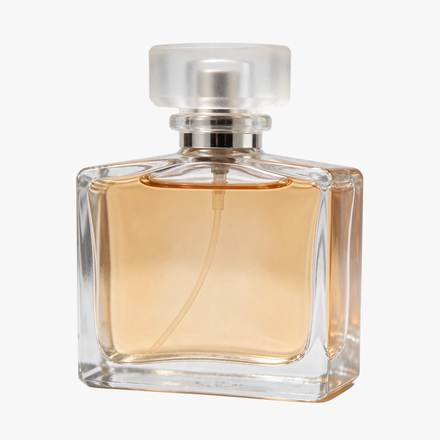

**Source-published prompt (not independently reproduced)**

```text
A clear glass perfume bottle with a frosted glass cap and pale amber liquid, soft reflections and refraction through the glass, studio product shot, isolated object on a transparent background
```

> Source states these are generated samples; edits depend on an original reference image.

<a id="web-flux1-06"></a>
##### [Cut-out from a photo](external-references/cases/web-flux1-06/README.md)

**Website · Pending remake** · Flux1 AI · Transparent assets · [Source](https://flux1.ai/seedream-5-5) · [Case details](external-references/cases/web-flux1-06/README.md)

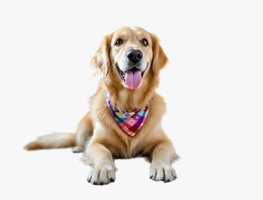

**Source-published prompt (not independently reproduced)**

```text
Cut out the dog with its bandana and return it on a transparent background. Keep the dog, its fur edges, pose and colors exactly as they are.
```

> Source states these are generated samples; edits depend on an original reference image.

<a id="web-studio-06"></a>
##### [A set of nine icons](external-references/cases/web-studio-06/README.md)

**Website · Pending remake** · Seedream Studio · Transparent assets · [Source](https://seedreamv5.com/seedream-5.5) · [Case details](external-references/cases/web-studio-06/README.md)

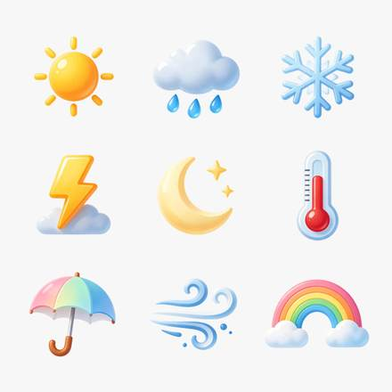

**Source-published prompt (not independently reproduced)**

```text
A set of nine weather icons arranged in a neat 3 by 3 grid: a sun, a cloud with rain, a snowflake, a lightning bolt, a crescent moon with two stars, a thermometer, an open umbrella, a wind swirl and a rainbow. A consistent rounded style with glossy, soft-gradient fills in warm and cool pastel tones, equal sizes and even spacing. Each icon is a standalone design asset on a fully transparent background, with no tiles or frames behind them and no text or letters.
```

> Site presents an exact prompt and the model-generated output.

<a id="web-froging-03"></a>
##### [Create a transparent glass asset](external-references/cases/web-froging-03/README.md)

**Website · Pending remake** · Froging AI · Transparent assets · [Source](https://www.froging.ai/seedream-5-5-ai-image-generator) · [Case details](external-references/cases/web-froging-03/README.md)

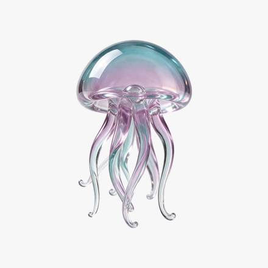

**Source-published prompt (not independently reproduced)**

```text
Create one small seafoam and pale lavender blown-glass jellyfish as an isolated design asset. Show a translucent domed bell and six delicate curved glass tentacles, with polished edges and soft studio highlights. Center the entire silhouette with generous clear margins. Fully transparent background with real alpha outside the object and partial transparency within the thin glass. No floor, no cast shadow, no bubbles, no checkerboard, no frame, no text.
```

> Source claims this is a generated result.

<a id="portraits"></a>
#### Portraits

<a id="web-vdobloom-03"></a>
##### [A realistic portrait](external-references/cases/web-vdobloom-03/README.md)

**Website · Pending remake** · VdoBloom · Portraits · [Source](https://vdobloom.com/blog/seedream-5-5-prompt-guide/) · [Case details](external-references/cases/web-vdobloom-03/README.md)

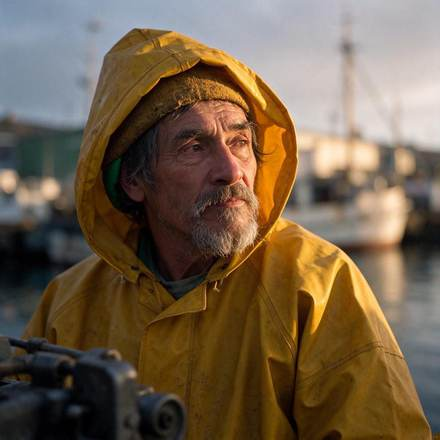

**Source-published prompt (not independently reproduced)**

```text
Close-up portrait photo of an elderly fisherman with a grey beard and a yellow raincoat, standing on a harbour at dawn, weathered skin, natural skin texture, soft morning light, 85mm lens.
```

> VdoBloom claims first-take sample images and shows prompts; independent model execution not audited.

<a id="web-made-01"></a>
##### [Night nap](external-references/cases/web-made-01/README.md)

**Website · Pending remake** · Made · Portraits · [Source](https://www.made.app/models/seedream-5-5) · [Case details](external-references/cases/web-made-01/README.md)

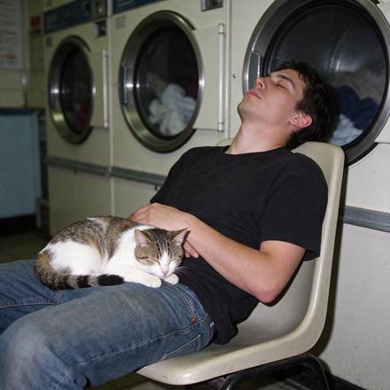

**Source-published prompt (not independently reproduced)**

```text
Candid phone photo with direct on-camera flash: a guy in his twenties asleep sitting up on a plastic chair in a 24-hour laundromat at 3 a.m., a cat curled up asleep on his lap, a row of spinning dryers behind him. Real skin texture, slight motion blur in the dryer drums, slight grain, candid and unposed, no readable text, logos, or watermark.
```

> Made reports in-house model samples with generation record prompts.

<a id="web-made-03"></a>
##### [Inside the dryer](external-references/cases/web-made-03/README.md)

**Website · Pending remake** · Made · Portraits · [Source](https://www.made.app/models/seedream-5-5) · [Case details](external-references/cases/web-made-03/README.md)

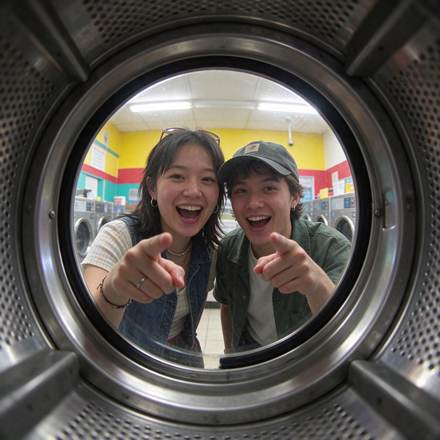

**Source-published prompt (not independently reproduced)**

```text
0.5x ultra-wide phone shot from inside a front-loading dryer drum looking out through the round glass door at two friends laughing and pointing at the camera in a laundromat, fluorescent ceiling lights, warped ultra-wide edges, slight grain, candid and unposed, no readable text, logos, or watermark.
```

> Made reports in-house model samples with generation record prompts.

<a id="web-flux1-01"></a>
##### [Natural portrait](external-references/cases/web-flux1-01/README.md)

**Website · Pending remake** · Flux1 AI · Portraits · [Source](https://flux1.ai/seedream-5-5) · [Case details](external-references/cases/web-flux1-01/README.md)

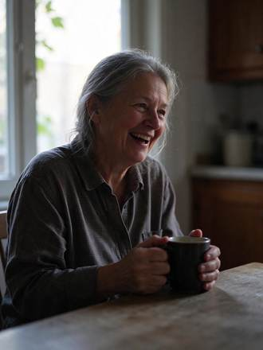

**Source-published prompt (not independently reproduced)**

```text
Candid portrait of a woman in her sixties laughing at a kitchen table by a window, late afternoon side light, visible skin texture and fine lines, loose grey hair catching the backlight, a mug in her hands, 50mm lens, natural colors, documentary photo
```

> Source states these are generated samples; edits depend on an original reference image.

<a id="web-studio-02"></a>
##### [A backlit portrait](external-references/cases/web-studio-02/README.md)

**Website · Pending remake** · Seedream Studio · Portraits · [Source](https://seedreamv5.com/seedream-5.5) · [Case details](external-references/cases/web-studio-02/README.md)

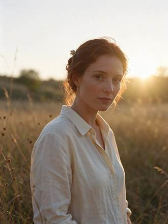

**Source-published prompt (not independently reproduced)**

```text
A backlit portrait of a woman in her early thirties standing in a meadow of tall grass at golden hour. The low sun behind her creates a bright rim light that outlines her loose auburn hair, her shoulders and the edge of her cream linen shirt. Her face is softly lit by warm bounce light, with natural skin texture and light freckles, a calm expression, looking just past the camera. Warm haze, a gentle lens flare, creamy background bokeh. An original, non-famous person. Photorealistic, 85mm lens at f/1.8, shallow depth of field.
```

> Site presents an exact prompt and the model-generated output.

<a id="web-orylia-01"></a>
##### [Editorial portraits](external-references/cases/web-orylia-01/README.md)

**Website · Pending remake** · Orylia · Portraits · [Source](https://orylia.ai/ai-models/seedream-5-5) · [Case details](external-references/cases/web-orylia-01/README.md)

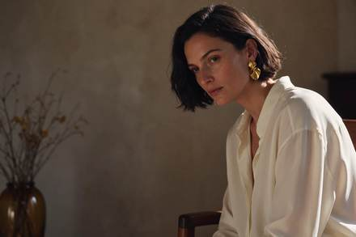

**Source-published prompt (not independently reproduced)**

```text
Luxury fashion editorial photograph, adult woman with natural freckles, short dark bob, brushed gold sculptural earrings and an ivory silk blouse, seated beside an amber glass vase in a sunlit modernist interior. Subject on the right third, expansive softly lit warm charcoal negative space on the left for a website headline. Tangible silk weave, natural pores, delicate flyaway hair, golden afternoon rim light, restrained warm ivory and amber palette, 85mm portrait lens, sophisticated magazine art direction. No text, no logo, no watermark.
```

> Orylia reports this as a Seedream 5.5 research output; not independently generated.

<a id="photography"></a>
#### Photography & documentary

<a id="social-genel-japanese-deli"></a>
##### [Japanese deli model comparison](cases/social-genel-japanese-deli/README.md)

**Social media · X** · genel_ai · Photography & documentary · [Source](https://x.com/genel_ai/status/2119786434567827504) · [Case details](cases/social-genel-japanese-deli/README.md)


**Source-published prompt (not independently reproduced)**

```text
実写の写真。自然なスナップ写真。35mmレンズ、目の高さから撮る。夕方、日本の商店街にある家族経営の小さな惣菜屋の店先。60代前半の日本人男性の店主が、ガラスのショーケースの奥に立っている。ケースの中には、金属のトレイに並んだコロッケ・唐揚げ・とんかつ。店主は白い調理着に紺のエプロン。トングでコロッケを1つ持ち上げ、カメラから少し外れた所を見て、力の抜けた半分の笑顔。光は2種類が混ざる。店の中は青白い蛍光灯、通り側からはオレンジ色の夕日。肌は本物の質感で、しわは控えめに自然に。テカりなし、白飛びなし。ショーケースのガラスに映り込みがある。揚げ物の衣はザクザクした質感が見え、湯気が少し立つ。背景は少しぼかす。営業中の店らしい、日常の雑然さを残す。文字・ロゴは入れない。
```

> Source-attributed social image and prompt from a public curator; not independently regenerated here. Reduced preview, not original export. This is a 3-model collage, with Seedream 5.5 at left.

<a id="socialx-window-light-portrait"></a>
##### [Window-light film portrait](cases/socialx-window-light-portrait/README.md)

**Social media · X** · nima2qisi2 · Photography & documentary · [Source](https://x.com/nima2qisi2/status/2119983938383106432) · [Case details](cases/socialx-window-light-portrait/README.md)


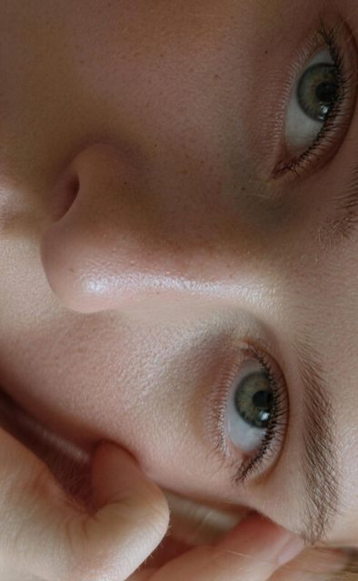

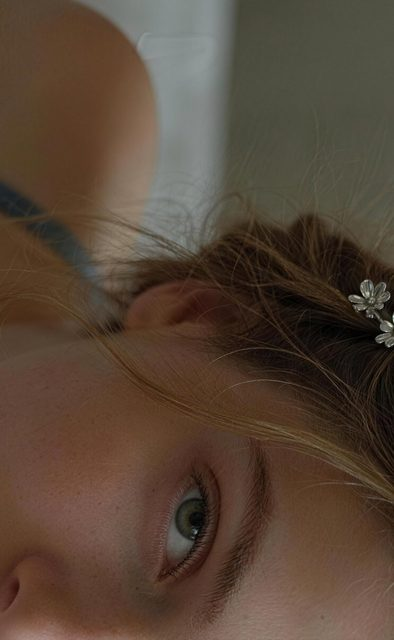

**Source-published prompt (not independently reproduced)**

```text
俯拍人像特写局部，东方/西方 女性 22岁 人物特写半侧脸侧颜看向镜头的自然姿态，窗户光柔肤，富士Astia胶片低婉古调低饱和度，光圈F2.8、快门1/120s、ISO100、点测光脸部，磨砂肌理，暗角聚焦，私房氛围感，细节丰富，无文字、无水印、无Logo、无边框
```

> Photos fetched from the author's original X post; local JPEG previews are at most 640px. Model attribution is not an independent reproduction. A portrait series with window lighting and film styling; the source includes the creator's prompt.

<a id="socialx-blue-hour-fisherman"></a>
##### [Fisherman at blue hour](cases/socialx-blue-hour-fisherman/README.md)

**Social media · X** · ahmetmertugrul · Photography & documentary · [Source](https://x.com/ahmetmertugrul/status/2119922071916757233) · [Case details](cases/socialx-blue-hour-fisherman/README.md)


**Source-published prompt (not independently reproduced)**

```text
Candid documentary photo, 85mm lens, f/2. An elderly fisherman in his seventies mending a tangled orange net on a wooden dock at blue hour. Mixed lighting: cold blue ambient sky from the left, a single warm sodium-vapor streetlamp from behind creating a rim light on his white stubble and the loose net fibers. Visible pores, deep wrinkles, sun spots, slightly chapped lips, a small healed scar on his knuckle. Wet wooden planks with puddles reflecting the lamp. Light drizzle visible only in the backlight. No beauty retouching, natural film grain, slight underexposure in the shadows.
```

> Photos fetched from the author's original X post; local JPEG previews are at most 640px. Model attribution is not an independent reproduction. A documentary-style portrait combining cool ambient light with a warm lamp; the original prompt is at source.

<a id="web-vdobloom-04"></a>
##### [A product photo](external-references/cases/web-vdobloom-04/README.md)

**Website · Pending remake** · VdoBloom · Photography & documentary · [Source](https://vdobloom.com/blog/seedream-5-5-prompt-guide/) · [Case details](external-references/cases/web-vdobloom-04/README.md)

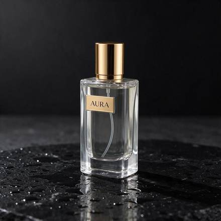

**Source-published prompt (not independently reproduced)**

```text
Studio product photo of a clear glass perfume bottle with a gold cap, the label reads "AURA", standing on wet black stone with small water drops, one soft light from the left, dark background.
```

> VdoBloom claims first-take sample images and shows prompts; independent model execution not audited.

<a id="web-vdobloom-05"></a>
##### [Food from above](external-references/cases/web-vdobloom-05/README.md)

**Website · Pending remake** · VdoBloom · Photography & documentary · [Source](https://vdobloom.com/blog/seedream-5-5-prompt-guide/) · [Case details](external-references/cases/web-vdobloom-05/README.md)

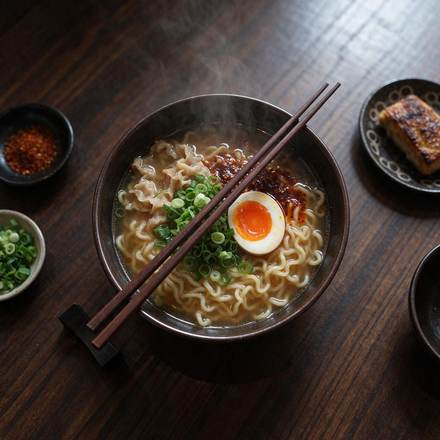

**Source-published prompt (not independently reproduced)**

```text
Overhead food photo of a bowl of ramen with a soft-boiled egg, spring onions and chilli oil on a dark wooden table, chopsticks resting on the bowl, steam visible, natural window light.
```

> VdoBloom claims first-take sample images and shows prompts; independent model execution not audited.

<a id="web-vdobloom-07"></a>
##### [A wide cinematic shot](external-references/cases/web-vdobloom-07/README.md)

**Website · Pending remake** · VdoBloom · Photography & documentary · [Source](https://vdobloom.com/blog/seedream-5-5-prompt-guide/) · [Case details](external-references/cases/web-vdobloom-07/README.md)

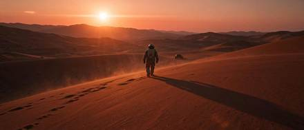

**Source-published prompt (not independently reproduced)**

```text
A lone astronaut walking across red desert dunes at sunset, long shadow, a small rover far behind, dust in the air, cinematic wide shot, anamorphic look.
```

> VdoBloom claims first-take sample images and shows prompts; independent model execution not audited.

<a id="web-vdobloom-09"></a>
##### [An exact number of things](external-references/cases/web-vdobloom-09/README.md)

**Website · Pending remake** · VdoBloom · Photography & documentary · [Source](https://vdobloom.com/blog/seedream-5-5-prompt-guide/) · [Case details](external-references/cases/web-vdobloom-09/README.md)

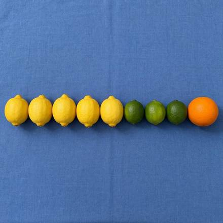

**Source-published prompt (not independently reproduced)**

```text
Top-down photo of exactly five lemons, three limes and one orange arranged in a single neat row on a plain blue tablecloth, even daylight.
```

> VdoBloom claims first-take sample images and shows prompts; independent model execution not audited.

<a id="web-made-04"></a>
##### [Folding table](external-references/cases/web-made-04/README.md)

**Website · Pending remake** · Made · Photography & documentary · [Source](https://www.made.app/models/seedream-5-5) · [Case details](external-references/cases/web-made-04/README.md)

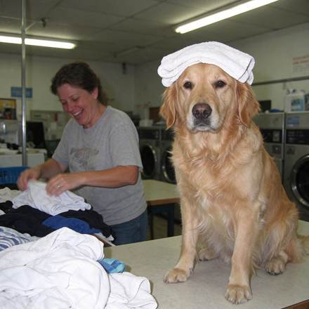

**Source-published prompt (not independently reproduced)**

```text
Phone photo with direct flash of a golden retriever sitting upright on a laundromat folding table wearing a freshly folded towel on its head like a turban, its owner mid-laugh folding shirts beside it, harsh fluorescent light, real fur texture, candid and unposed, no readable text, logos, or watermark.
```

> Made reports in-house model samples with generation record prompts.

<a id="web-studio-03"></a>
##### [Glass, ceramic and copper in a product shot](external-references/cases/web-studio-03/README.md)

**Website · Pending remake** · Seedream Studio · Photography & documentary · [Source](https://seedreamv5.com/seedream-5.5) · [Case details](external-references/cases/web-studio-03/README.md)

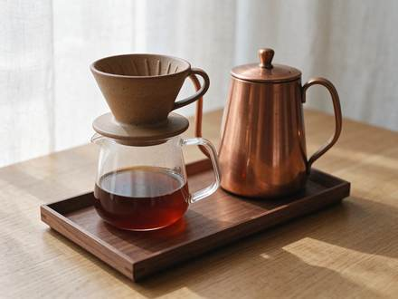

**Source-published prompt (not independently reproduced)**

```text
A studio product photograph of a pour-over coffee set on a pale oak tabletop: a matte speckled stoneware dripper with visible glaze pinholes, a clear borosilicate glass carafe half full of amber coffee, a gooseneck kettle in brushed copper with fine circular grain and a soft reflection of the window, and a small walnut tray with crisp wood grain. Soft diffused window light from the left, gentle shadows, a light linen backdrop. Faithful material rendering: the ceramic, glass, metal and wood each look exactly like themselves. No logos, no text, no brand marks. Photorealistic, 100mm macro lens at f/8.
```

> Site presents an exact prompt and the model-generated output.

<a id="web-studio-04"></a>
##### [An ultra-wide 21:9 landscape](external-references/cases/web-studio-04/README.md)

**Website · Pending remake** · Seedream Studio · Photography & documentary · [Source](https://seedreamv5.com/seedream-5.5) · [Case details](external-references/cases/web-studio-04/README.md)

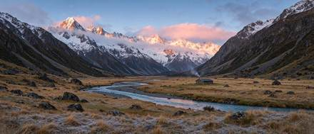

**Source-published prompt (not independently reproduced)**

```text
An ultra-wide 21:9 landscape panorama of a glacier-carved mountain valley at sunrise. Jagged granite peaks dusted with fresh snow catch pink and gold first light, and low clouds cling to the ridgelines. A turquoise braided river winds across a wide valley floor of golden grass and dark boulders, and a single small wooden cabin with a thin line of chimney smoke gives a sense of scale. Crisp detail from the frosted grasses in the foreground to the distant summits. Landscape photography, natural colours, deep focus.
```

> Site presents an exact prompt and the model-generated output.

<a id="web-froging-02"></a>
##### [Freeze a splash for a campaign image](external-references/cases/web-froging-02/README.md)

**Website · Pending remake** · Froging AI · Photography & documentary · [Source](https://www.froging.ai/seedream-5-5-ai-image-generator) · [Case details](external-references/cases/web-froging-02/README.md)

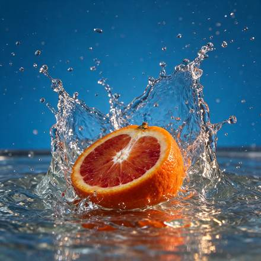

**Source-published prompt (not independently reproduced)**

```text
High-speed editorial food photograph of one cut blood orange half hitting a shallow pool of water, cut surface facing the camera. Capture the moment a translucent crown of water curves around the orange, with individual sharp droplets suspended in the air. Rich ultramarine blue seamless studio backdrop, vivid vermilion pulp and warm side light, natural irregular citrus texture, restrained commercial art direction. Low eye-level camera, square composition, the entire splash inside the frame with breathing room on all sides. One fruit half, no hands, no typography, no logos, no watermark.
```

> Source claims this is a generated result.

<a id="web-orylia-02"></a>
##### [Product photography](external-references/cases/web-orylia-02/README.md)

**Website · Pending remake** · Orylia · Photography & documentary · [Source](https://orylia.ai/ai-models/seedream-5-5) · [Case details](external-references/cases/web-orylia-02/README.md)

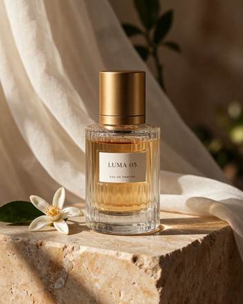

**Source-published prompt (not independently reproduced)**

```text
Premium fragrance campaign still life. A single clear ribbed glass perfume bottle filled with pale amber liquid, brushed gold cylindrical cap, small ivory label reading exactly "LUMA 05" and below it "EAU DE PARFUM". Bottle on warm travertine, sheer ivory fabric behind, one orange blossom beside it. Late afternoon side light, convincing glass refraction and caustics, detailed stone grain, elegant editorial photography. No other lettering. Complete bottle and cap visible.
```

> Orylia reports this as a Seedream 5.5 research output; not independently generated.

<a id="interiors"></a>
#### Interiors & space

<a id="web-vdobloom-06"></a>
##### [A room](external-references/cases/web-vdobloom-06/README.md)

**Website · Pending remake** · VdoBloom · Interiors & space · [Source](https://vdobloom.com/blog/seedream-5-5-prompt-guide/) · [Case details](external-references/cases/web-vdobloom-06/README.md)

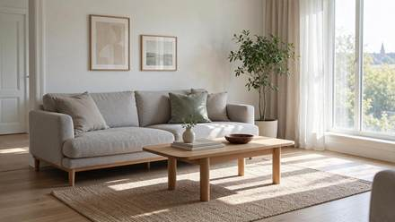

**Source-published prompt (not independently reproduced)**

```text
A bright Scandinavian living room with a light grey sofa, an oak coffee table, a large window with sheer curtains, one green plant in the corner, morning sunlight on the floor, interior design photo.
```

> VdoBloom claims first-take sample images and shows prompts; independent model execution not audited.

<a id="typography"></a>
#### Text & typography

<a id="social-dheepan-magazine-cover"></a>
##### [Magazine cover typography](cases/social-dheepan-magazine-cover/README.md)

**Social media · X** · Dheepanratnam · Text & typography · [Source](https://x.com/Dheepanratnam/status/2119767938173387065) · [Case details](cases/social-dheepan-magazine-cover/README.md)


**Source-published prompt (not independently reproduced)**

```text
Premium magazine cover design titled “THE FUTURE OF CREATIVE TOOLS”, with a realistic portrait of a stylish creative director in the lower third. Dense small cover lines around the edges: “Issue 24”, “AI Workflows”, “Design Systems”, “Cinematic Image Making”, “Inside the Studio”, “November 2026”. Clean modern serif masthead, precise kerning, crisp letterforms, editorial grid, muted cream background, subtle paper texture, high-end print-design layout. All text must be spelled exactly as written, no distorted letters, no duplicated words, no gibberish.
```

> Source-attributed social image and prompt from a public curator; not independently regenerated here. Reduced preview, not original export.

<a id="social-dheepan-rainy-storefront"></a>
##### [Rainy multilingual storefront](cases/social-dheepan-rainy-storefront/README.md)

**Social media · X** · Dheepanratnam · Text & typography · [Source](https://x.com/Dheepanratnam/status/2119767938173387065) · [Case details](cases/social-dheepan-rainy-storefront/README.md)


**Source-published prompt (not independently reproduced)**

```text
Photorealistic street scene in a multicultural London neighbourhood at night. A shopfront sign reads exactly “OPEN LATE” in English, with a smaller hanging sign reading exactly “欢迎光临” in simplified Chinese and another small poster reading exactly “Bienvenue” in French. Realistic neon glow, legible typography, correct character shapes, no duplicated letters, no warped glyphs, natural perspective on the signs, cinematic night photography, wet pavement reflections, no extra invented text.
```

> Source-attributed social image and prompt from a public curator; not independently regenerated here. Reduced preview, not original export.

<a id="social-dheepan-skincare-label"></a>
##### [Skincare packaging text](cases/social-dheepan-skincare-label/README.md)

**Social media · X** · Dheepanratnam · Text & typography · [Source](https://x.com/Dheepanratnam/status/2119767938173387065) · [Case details](cases/social-dheepan-skincare-label/README.md)


**Source-published prompt (not independently reproduced)**

```text
Minimalist skincare packaging mock-up on a pale stone pedestal. A frosted-glass serum bottle has a clean label reading exactly “LUMEN — BARRIER REPAIR SERUM”, with smaller text beneath: “30 ml / 1.0 fl oz”. Elegant sans-serif typography, perfectly straight label alignment, crisp small print, realistic glass refraction, soft studio lighting, subtle shadow, premium cosmetic advertising photography, no misspelled words, no extra branding, no watermark.
```

> Source-attributed social image and prompt from a public curator; not independently regenerated here. Reduced preview, not original export.

<a id="social-dheepan-night-signal-poster"></a>
##### [Night Signal event poster](cases/social-dheepan-night-signal-poster/README.md)

**Social media · X** · Dheepanratnam · Text & typography · [Source](https://x.com/Dheepanratnam/status/2119767938173387065) · [Case details](cases/social-dheepan-night-signal-poster/README.md)


**Source-published prompt (not independently reproduced)**

```text
Bold gig poster for an underground electronic music night. Large headline reads exactly “NIGHT SIGNAL”, with supporting text: “Friday 27 November”, “Warehouse 9, London”, “Doors 10PM”. Experimental Swiss-style layout, high-contrast black, off-white and electric blue, grainy risograph texture, sharp geometric typography, intentional negative space, screen-print aesthetic. All words spelled exactly as specified, no extra text, no warped letters, no AI artefacts.
```

> Source-attributed social image and prompt from a public curator; not independently regenerated here. Reduced preview, not original export.

<a id="socialx-deep-sea-field-guide"></a>
##### [Deep-sea field-guide infographic](cases/socialx-deep-sea-field-guide/README.md)

**Social media · X** · ahmetmertugrul · Text & typography · [Source](https://x.com/ahmetmertugrul/status/2119915956365369596) · [Case details](cases/socialx-deep-sea-field-guide/README.md)


**Source-published prompt (not independently reproduced)**

```text
A vintage naturalist field-guide page, aged cream paper with foxing stains, documenting a fictional deep-sea creature called "Lanternfin Abyssal Eel". Center: a detailed scientific ink-and-watercolor illustration of the eel with bioluminescent spots. Surrounding it, 10 numbered callout labels with thin leader lines, each with a 2-line caption in small serif type (e.g. "3. Photophore cluster — emits pulses at 490 nm to lure prey"). Top header in ornate engraved capitals: "PLATE XLVII — CREATURES OF THE MIDNIGHT ZONE". Bottom: a small data table with columns "Depth", "Length", "Lifespan", "Diet" and three rows of values, plus a tiny scale bar reading "10 cm". Flat top-down scan, every word sharp and legible.
```

> Photos fetched from the author's original X post; local JPEG previews are at most 640px. Model attribution is not an independent reproduction. A fictional creature field-guide page combining labels, a data table and scientific illustration; prompt at source.

<a id="social08-maxescu-ridge-snack"></a>
##### [Ridge Snack packaging across four models](cases/social08-maxescu-ridge-snack/README.md)

**Social media · X** · Alex Patrascu · Text & typography · [Source](https://x.com/maxescu/status/2120078778487505206) · [Case details](cases/social08-maxescu-ridge-snack/README.md)

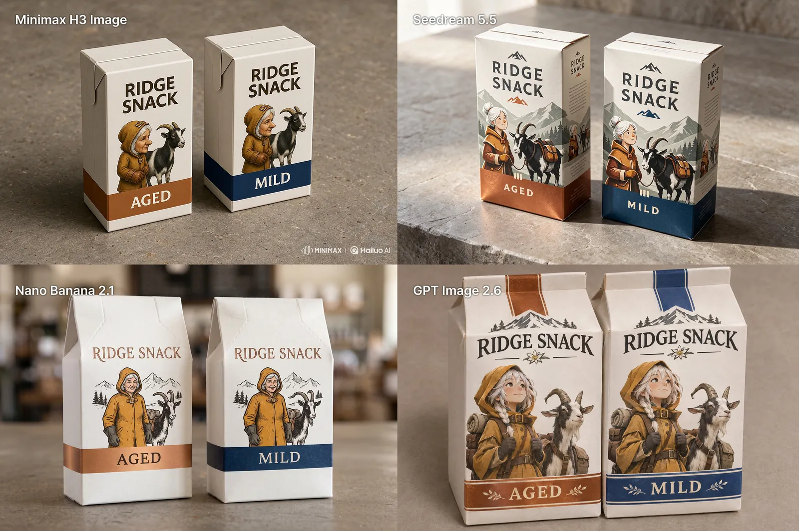

**Source-published prompt (not independently reproduced)**

```text
A realistic on-shelf product mockup of exactly two adjacent milk-white cartons for a fictional Alpine snack brand. Both cartons show the same original white-haired delivery woman mascot in a tiny ochre hooded coat, standing beside a black-and-white pack goat with one bent left horn. Carton on the left has a copper accent band, and carton on the right has a deep blue accent band. Match the mascot's nose, hood buckle, glove shape, and the goat's horn on both cartons. Print exactly “RIDGE SNACK” at the top of each package and “AGED” on the copper band, “MILD” on the blue band. Slight view from above to show both label faces, real folded-paper edges, empty warm gray countertop.
```

> Four quadrants are MiniMax H3, Seedream 5.5, Nano Banana 2.1 and GPT Image 2.6; only upper-right is Seedream. The creator publicly provided the complete shared prompt. Media is a public GitHub gallery WebP preview; original X media IDs were not independently obtained and no redistribution rights are claimed.

<a id="web-vdobloom-01"></a>
##### [A sign with exact words](external-references/cases/web-vdobloom-01/README.md)

**Website · Pending remake** · VdoBloom · Text & typography · [Source](https://vdobloom.com/blog/seedream-5-5-prompt-guide/) · [Case details](external-references/cases/web-vdobloom-01/README.md)

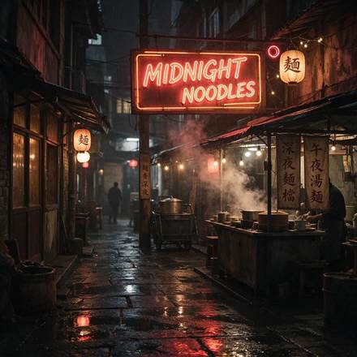

**Source-published prompt (not independently reproduced)**

```text
A neon sign glowing in a rainy night alley that reads "MIDNIGHT NOODLES", steam rising from a food stall below, reflections on wet pavement, cinematic photo.
```

> VdoBloom claims first-take sample images and shows prompts; independent model execution not audited.

<a id="web-vdobloom-02"></a>
##### [A poster with a title and a date](external-references/cases/web-vdobloom-02/README.md)

**Website · Pending remake** · VdoBloom · Text & typography · [Source](https://vdobloom.com/blog/seedream-5-5-prompt-guide/) · [Case details](external-references/cases/web-vdobloom-02/README.md)

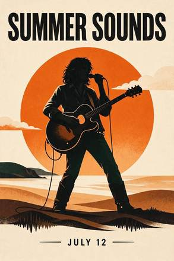

**Source-published prompt (not independently reproduced)**

```text
A minimalist concert poster, cream background, a large orange sun behind a black silhouette of a guitarist, the title "SUMMER SOUNDS" in bold capital letters at the top and "JULY 12" in small letters at the bottom.
```

> VdoBloom claims first-take sample images and shows prompts; independent model execution not audited.

<a id="web-made-02"></a>
##### [Handwritten sign](external-references/cases/web-made-02/README.md)

**Website · Pending remake** · Made · Text & typography · [Source](https://www.made.app/models/seedream-5-5) · [Case details](external-references/cases/web-made-02/README.md)

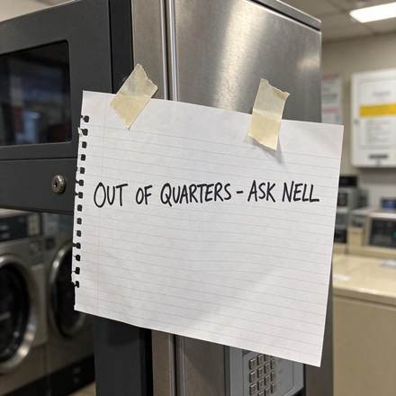

**Source-published prompt (not independently reproduced)**

```text
Close-up phone photo of a handwritten sign taped to a coin change machine in a laundromat, black marker on lined notebook paper reading exactly "OUT OF QUARTERS - ASK NELL", one strip of tape peeling at the corner, harsh fluorescent light, slight grain, sharp legible handwriting, no other words or logos.
```

> Made reports in-house model samples with generation record prompts.

<a id="web-made-05"></a>
##### [Neon sign](external-references/cases/web-made-05/README.md)

**Website · Pending remake** · Made · Text & typography · [Source](https://www.made.app/models/seedream-5-5) · [Case details](external-references/cases/web-made-05/README.md)

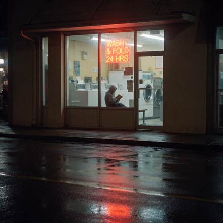

**Source-published prompt (not independently reproduced)**

```text
Laundromat storefront at night seen from across a rainy street, a neon window sign reading exactly "WASH & FOLD 24 HRS", a person in a hoodie reading a paperback on a bench inside, reflections on the wet asphalt, shot on a phone, slight grain, sharp legible sign, no other words or logos.
```

> Made reports in-house model samples with generation record prompts.

<a id="web-made-06"></a>
##### [Lost and found](external-references/cases/web-made-06/README.md)

**Website · Pending remake** · Made · Text & typography · [Source](https://www.made.app/models/seedream-5-5) · [Case details](external-references/cases/web-made-06/README.md)

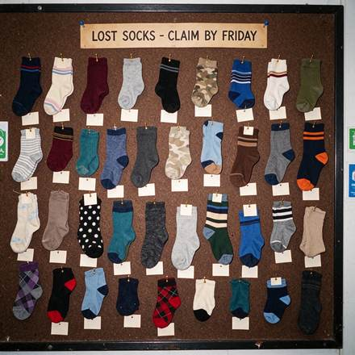

**Source-published prompt (not independently reproduced)**

```text
Flash photo of a corkboard at a laundromat covered in dozens of single mismatched socks pinned up like butterfly specimens, each with a small blank paper tag, a printed header card at the top reading exactly "LOST SOCKS - CLAIM BY FRIDAY", slight grain, sharp legible header, no other words or logos.
```

> Made reports in-house model samples with generation record prompts.

<a id="web-flux1-03"></a>
##### [Chinese and English poster](external-references/cases/web-flux1-03/README.md)

**Website · Pending remake** · Flux1 AI · Text & typography · [Source](https://flux1.ai/seedream-5-5) · [Case details](external-references/cases/web-flux1-03/README.md)

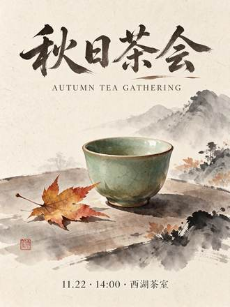

**Source-published prompt (not independently reproduced)**

```text
A minimalist event poster for an autumn tea gathering. Large Chinese title '秋日茶会' at the top, English line 'AUTUMN TEA GATHERING' below it in small spaced caps, and a small line '11.22 · 14:00 · 西湖茶室' at the bottom. A single celadon teacup with a maple leaf beside it in the middle, ink-wash style, warm rice-paper background. No other text.
```

> Source states these are generated samples; edits depend on an original reference image.

<a id="web-studio-01"></a>
##### [English and Chinese text on a poster](external-references/cases/web-studio-01/README.md)

**Website · Pending remake** · Seedream Studio · Text & typography · [Source](https://seedreamv5.com/seedream-5.5) · [Case details](external-references/cases/web-studio-01/README.md)

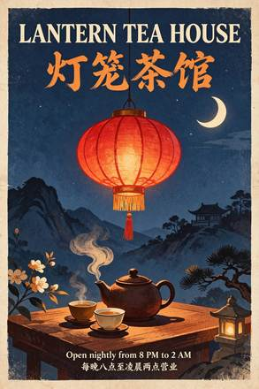

**Source-published prompt (not independently reproduced)**

```text
A vintage screen-print travel poster for a fictional tea house, portrait format. At the top, a large bold serif headline in English reading exactly "LANTERN TEA HOUSE". Directly beneath it, a Chinese title in brush calligraphy reading exactly "灯笼茶馆". In the centre, a flat illustration of a glowing red paper lantern with no writing on it, hanging above a steaming clay teapot and two small cups, under a deep indigo night sky with a single crescent moon and a few stars, with saffron and cream accents and a subtle paper grain. At the bottom, two lines of small, clean sans-serif text: the first reading exactly "Open nightly from 8 PM to 2 AM" and the second reading exactly "每晚八点至凌晨两点营业". These four lines are the only text on the poster, with no signs, labels or characters anywhere else. All lettering crisp, correctly spelled and fully legible, generous margins.
```

> Site presents an exact prompt and the model-generated output.

<a id="web-orylia-03"></a>
##### [Bilingual typography](external-references/cases/web-orylia-03/README.md)

**Website · Pending remake** · Orylia · Text & typography · [Source](https://orylia.ai/ai-models/seedream-5-5) · [Case details](external-references/cases/web-orylia-03/README.md)


**Source-published prompt (not independently reproduced)**

```text
Design a premium bilingual exhibition poster on ivory paper, burnt orange and deep teal geometric still-life shapes, meticulous Swiss editorial grid. Include exactly these text lines, each once, with accurate punctuation: "FORM & LIGHT", "形与光", "DESIGN EXHIBITION", "设计展览", "12–15 NOV 2026", "10:00–18:00", "TICKET ¥128", "SHANGHAI". Clear hierarchy, large elegant headline, perfectly readable smaller information, balanced generous margins. No other text, no decorative fake letters.
```

> Orylia reports this as a Seedream 5.5 research output; not independently generated.

<a id="infographics"></a>
#### Infographics & interfaces

<a id="web-flux1-02"></a>
##### [Infographic with small text](external-references/cases/web-flux1-02/README.md)

**Website · Pending remake** · Flux1 AI · Infographics & interfaces · [Source](https://flux1.ai/seedream-5-5) · [Case details](external-references/cases/web-flux1-02/README.md)

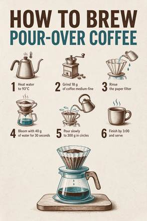

**Source-published prompt (not independently reproduced)**

```text
A clean printed infographic poster titled 'HOW TO BREW POUR-OVER COFFEE'. Six numbered steps with small line icons: '1 Heat water to 93°C', '2 Grind 18 g of coffee medium-fine', '3 Rinse the paper filter', '4 Bloom with 40 g of water for 30 seconds', '5 Pour slowly to 300 g in circles', '6 Finish by 3:00 and serve'. Off-white paper, dark brown and teal ink, generous margins. No other text.
```

> Source states these are generated samples; edits depend on an original reference image.

<a id="characters"></a>
#### Characters & stickers

<a id="web-vdobloom-08"></a>
##### [Anime style](external-references/cases/web-vdobloom-08/README.md)

**Website · Pending remake** · VdoBloom · Characters & stickers · [Source](https://vdobloom.com/blog/seedream-5-5-prompt-guide/) · [Case details](external-references/cases/web-vdobloom-08/README.md)

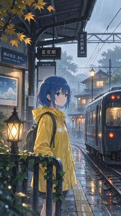

**Source-published prompt (not independently reproduced)**

```text
Anime style illustration of a girl with short blue hair and a yellow raincoat waiting at a train station in the rain, soft glowing lights, detailed background, clean line art.
```

> VdoBloom claims first-take sample images and shows prompts; independent model execution not audited.

<a id="web-vdobloom-10"></a>
##### [A children’s book illustration](external-references/cases/web-vdobloom-10/README.md)

**Website · Pending remake** · VdoBloom · Characters & stickers · [Source](https://vdobloom.com/blog/seedream-5-5-prompt-guide/) · [Case details](external-references/cases/web-vdobloom-10/README.md)

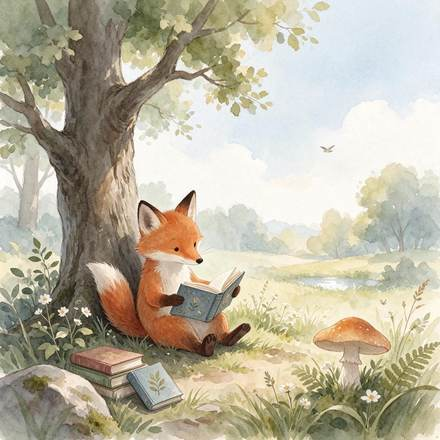

**Source-published prompt (not independently reproduced)**

```text
Children's book watercolour illustration of a small red fox reading a book under a big oak tree, soft pastel colours, gentle paper texture, lots of white space around.
```

> VdoBloom claims first-take sample images and shows prompts; independent model execution not audited.

<a id="web-flux1-05"></a>
##### [Sticker with lettering](external-references/cases/web-flux1-05/README.md)

**Website · Pending remake** · Flux1 AI · Characters & stickers · [Source](https://flux1.ai/seedream-5-5) · [Case details](external-references/cases/web-flux1-05/README.md)


**Source-published prompt (not independently reproduced)**

```text
A die-cut sticker that reads 'FRESH BAKED' in chunky rounded letters above a small smiling croissant, thick white border, flat colors, transparent background
```

> Source states these are generated samples; edits depend on an original reference image.

<a id="web-studio-05"></a>
##### [A die-cut sticker](external-references/cases/web-studio-05/README.md)

**Website · Pending remake** · Seedream Studio · Characters & stickers · [Source](https://seedreamv5.com/seedream-5.5) · [Case details](external-references/cases/web-studio-05/README.md)


**Source-published prompt (not independently reproduced)**

```text
A die-cut sticker of a cheerful ginger cat curled up asleep inside a ramen bowl, with a pair of chopsticks resting on the rim and a few wisps of steam. A bold white outline around the whole design, flat vector colours with soft cel shading. A single standalone sticker asset on a fully transparent background, with no shadow on the background and no text.
```

> Site presents an exact prompt and the model-generated output.

<a id="without-prompts"></a>
### No published full prompts (75)

#### Multi-turn & targeted editing

<a id="official-portrait-editing"></a>
##### [Portrait editing](cases/official-portrait-editing/README.md)

**Official source** · ByteDance Seed · Multi-turn & targeted editing · [Source](https://seed.bytedance.com/en/seedream5_5) · [Case details](cases/official-portrait-editing/README.md)


**Full original prompt: unpublished or unverified**

Local previews appear above; source links do not substitute for original prompts.

<a id="official-still-life-editing"></a>
##### [Still-life editing](cases/official-still-life-editing/README.md)

**Official source** · ByteDance Seed · Multi-turn & targeted editing · [Source](https://seed.bytedance.com/en/seedream5_5) · [Case details](cases/official-still-life-editing/README.md)


**Full original prompt: unpublished or unverified**

Local previews appear above; source links do not substitute for original prompts.

<a id="official-ink-painting-editing"></a>
##### [Ink-painting editing](cases/official-ink-painting-editing/README.md)

**Official source** · ByteDance Seed · Multi-turn & targeted editing · [Source](https://seed.bytedance.com/en/seedream5_5) · [Case details](cases/official-ink-painting-editing/README.md)


**Full original prompt: unpublished or unverified**

Local previews appear above; source links do not substitute for original prompts.

<a id="socialx-llm-diagram-edits"></a>
##### [LLM diagram after 30 edits](cases/socialx-llm-diagram-edits/README.md)

**Social media · X** · dongxi_nlp · Multi-turn & targeted editing · [Source](https://x.com/dongxi_nlp/status/2120031669893939524) · [Case details](cases/socialx-llm-diagram-edits/README.md)


**Full original prompt: unpublished or unverified**

Local previews appear above; source links do not substitute for original prompts.

> Photos fetched from the author's original X post; local JPEG previews are at most 640px. Model attribution is not an independent reproduction. An LLM explanation diagram that the creator says was revised thirty times.

<a id="social05-ddjcxx-desk-edit"></a>
##### [Five-round desk editing comparison](cases/social05-ddjcxx-desk-edit/README.md)

**Social media · X** · DDJCXX · Multi-turn & targeted editing · [Source](https://x.com/DDJCXX/status/2119766551436116358) · [Case details](cases/social05-ddjcxx-desk-edit/README.md)

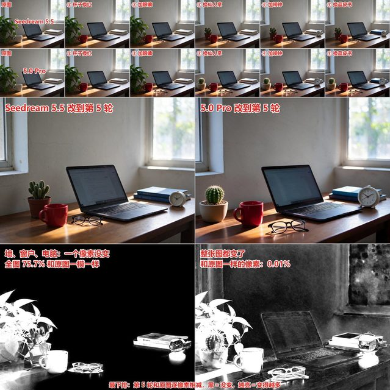

**Full original prompt: unpublished or unverified**

Local previews appear above; source links do not substitute for original prompts.

> Images are reduced previews fetched from the creator's X post; videos are represented by a still and short animated excerpt, with full video at source. Model attribution is source-reported, not independently reproduced. This comparison or mixed workflow includes outputs from other models and is not a Seedream-only result.

<a id="social05-xiaohu-thirty-round-gif"></a>
##### [Thirty-round character and text edit GIF](cases/social05-xiaohu-thirty-round-gif/README.md)

**Social media · X** · xiaohu · Multi-turn & targeted editing · [Source](https://x.com/xiaohu/status/2119774478788141417) · [Case details](cases/social05-xiaohu-thirty-round-gif/README.md)

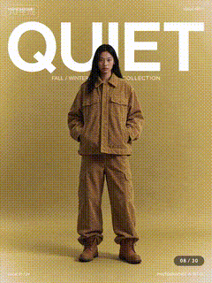

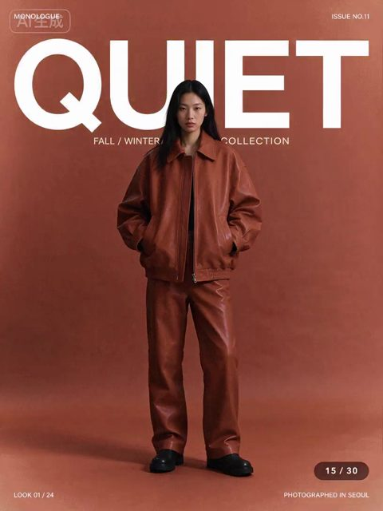

**Full original prompt: unpublished or unverified**

Local previews appear above; source links do not substitute for original prompts.

> Still and short GIF extracted from the original X post video, not a native model GIF. The source link has the full video.

<a id="social05-sjonkerr-street-weather-edit"></a>
##### [Six-step street weather edit to video](cases/social05-sjonkerr-street-weather-edit/README.md)

**Social media · X** · Sjonkerr · Multi-turn & targeted editing · [Source](https://x.com/Sjonkerr/status/2119904922703438173) · [Case details](cases/social05-sjonkerr-street-weather-edit/README.md)

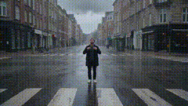

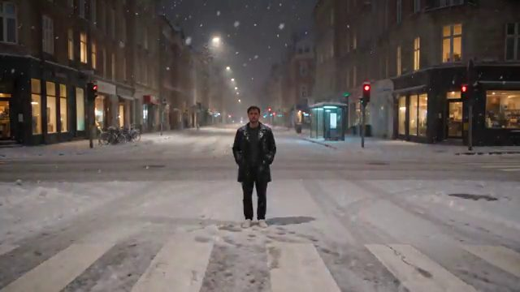

**Full original prompt: unpublished or unverified**

Local previews appear above; source links do not substitute for original prompts.

> Still and short GIF extracted from the original X post video, not a native model GIF. The source link has the full video.

<a id="social05-opener-morphic-character"></a>
##### [Morphic character expression editing](cases/social05-opener-morphic-character/README.md)

**Social media · X** · opener_ai · Multi-turn & targeted editing · [Source](https://x.com/opener_ai/status/2119942433412931907) · [Case details](cases/social05-opener-morphic-character/README.md)

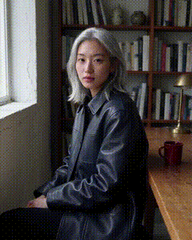

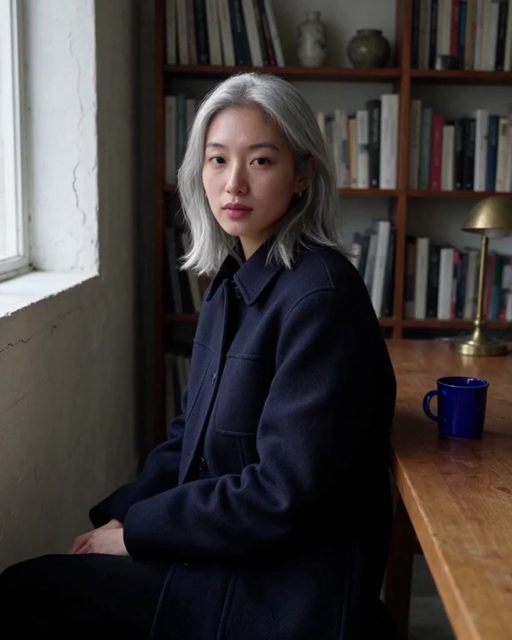

**Full original prompt: unpublished or unverified**

Local previews appear above; source links do not substitute for original prompts.

> Still and short GIF extracted from the original X post video, not a native model GIF. The source link has the full video.

<a id="social05-vortex-fifteen-round-compare"></a>
##### [Five-model 15-round image-edit comparison](cases/social05-vortex-fifteen-round-compare/README.md)

**Social media · X** · VORTEX_Promos · Multi-turn & targeted editing · [Source](https://x.com/VORTEX_Promos/status/2119928374235701452) · [Case details](cases/social05-vortex-fifteen-round-compare/README.md)

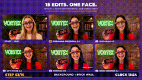

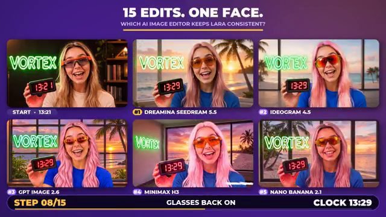

**Full original prompt: unpublished or unverified**

Local previews appear above; source links do not substitute for original prompts.

> Still and short GIF extracted from the original X post video, not a native model GIF. The source link has the full video. This comparison or mixed workflow contains outputs by other models.

<a id="social06-dheepan-three-local-edits"></a>
##### [Flowers, curtains and light: three separate local edits](cases/social06-dheepan-three-local-edits/README.md)

**Social media · X** · Dheepanratnam · Multi-turn & targeted editing · [Source](https://x.com/Dheepanratnam/status/2119803435461599638) · [Case details](cases/social06-dheepan-three-local-edits/README.md)

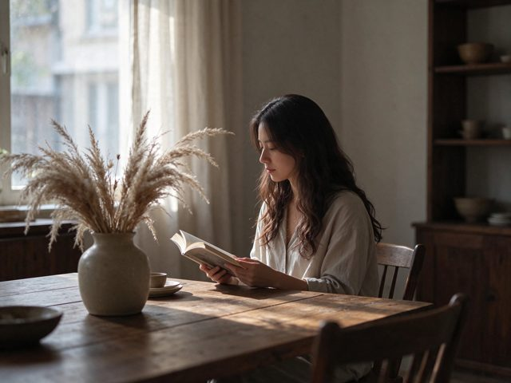

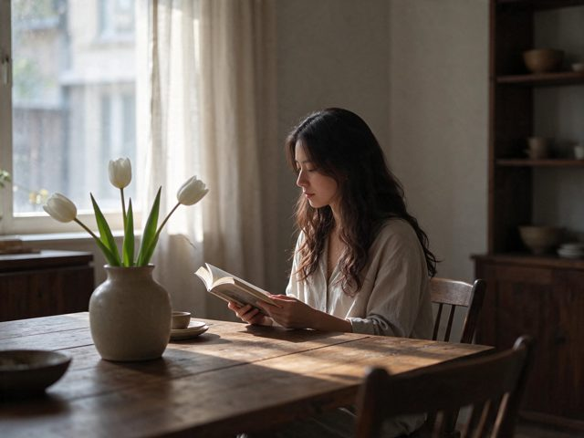

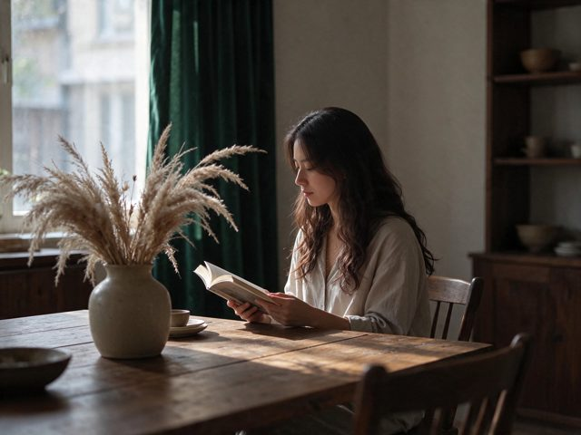


**Full original prompt: unpublished or unverified**

Local previews appear above; source links do not substitute for original prompts.

Published action summaries (not full prompts):

```text
Change the flowers
Change the curtains
Change the lighting
```

> The first image is the base, followed by separate flower, curtain and lighting edits. The author explicitly describes separate edits, not a three-round chain. Published workflow wording: “Change the flowers / Change the curtains / Change the lighting”. These are action summaries, not a verified complete execution prompt.

<a id="social07-alisa-watch-sequence"></a>
##### [Watch display +1 second through 100 edits](cases/social07-alisa-watch-sequence/README.md)

**Social media · X** · alisaqqt · Multi-turn & targeted editing · [Source](https://x.com/alisaqqt/status/2119805701300408634) · [Case details](cases/social07-alisa-watch-sequence/README.md)


**Full original prompt: unpublished or unverified**

Local previews appear above; source links do not substitute for original prompts.

> Source X images saved as compressed previews; video is represented by a brief derived GIF, not model-native animation. Creator assertions are not independently reproduced. Multi-model or external workflow: not every frame is Seedream-only.

<a id="social07-dheepan-blazer-stage"></a>
##### [Blazer, background and lighting edits](cases/social07-dheepan-blazer-stage/README.md)

**Social media · X** · Dheepanratnam · Multi-turn & targeted editing · [Source](https://x.com/Dheepanratnam/status/2120102574569451995) · [Case details](cases/social07-dheepan-blazer-stage/README.md)


**Full original prompt: unpublished or unverified**

Local previews appear above; source links do not substitute for original prompts.

> Source X images saved as compressed previews; video is represented by a brief derived GIF, not model-native animation. Creator assertions are not independently reproduced.

<a id="social07-aiwithsaif-menu-sequence"></a>
##### [Tabletop still life built across local edits](cases/social07-aiwithsaif-menu-sequence/README.md)

**Social media · X** · AiwithSaif7 · Multi-turn & targeted editing · [Source](https://x.com/AiwithSaif7/status/2119807382452908472) · [Case details](cases/social07-aiwithsaif-menu-sequence/README.md)


**Full original prompt: unpublished or unverified**

Local previews appear above; source links do not substitute for original prompts.

> Source X images saved as compressed previews; video is represented by a brief derived GIF, not model-native animation. Creator assertions are not independently reproduced.

<a id="social07-dotey-review-video"></a>
##### [Seedream 5.5 editing demo and creator review](cases/social07-dotey-review-video/README.md)

**Social media · X** · dotey · Multi-turn & targeted editing · [Source](https://x.com/dotey/status/2119823986603299193) · [Case details](cases/social07-dotey-review-video/README.md)


**Full original prompt: unpublished or unverified**

Local previews appear above; source links do not substitute for original prompts.

> Source X images saved as compressed previews; video is represented by a brief derived GIF, not model-native animation. Creator assertions are not independently reproduced. Multi-model or external workflow: not every frame is Seedream-only.

#### Transparent assets

<a id="official-flamingo-layer"></a>
##### [Flamingo layer](cases/official-flamingo-layer/README.md)

**Official source** · ByteDance Seed · Transparent assets · [Source](https://seed.bytedance.com/en/seedream5_5) · [Case details](cases/official-flamingo-layer/README.md)


**Full original prompt: unpublished or unverified**

Local previews appear above; source links do not substitute for original prompts.

<a id="official-owl-macro"></a>
##### [Owl macro](cases/official-owl-macro/README.md)

**Official source** · ByteDance Seed · Transparent assets · [Source](https://seed.bytedance.com/en/seedream5_5) · [Case details](cases/official-owl-macro/README.md)


**Full original prompt: unpublished or unverified**

Local previews appear above; source links do not substitute for original prompts.

<a id="quantslant-raincoat-character"></a>
##### [Raincoat character](cases/quantslant-raincoat-character/README.md)

**Website** · Piotr Olszewski / QUANTSLANT · Transparent assets · [Source](https://quantslant.com/seedream-5-5-features-pricing-benchmarks/) · [Case details](cases/quantslant-raincoat-character/README.md)


**Full original prompt: unpublished or unverified**

Local previews appear above; source links do not substitute for original prompts.

> The author reports a milky umbrella; partial transparency remains a limitation.

<a id="socialx-transparent-character"></a>
##### [Transparent character in two finishes](cases/socialx-transparent-character/README.md)

**Social media · X** · KakiponzuX · Transparent assets · [Source](https://x.com/KakiponzuX/status/2119979776651710778) · [Case details](cases/socialx-transparent-character/README.md)


**Full original prompt: unpublished or unverified**

Local previews appear above; source links do not substitute for original prompts.

> Photos fetched from the author's original X post; local JPEG previews are at most 640px. Model attribution is not an independent reproduction. JPEG preview does not verify original alpha. An illustration/photoreal transparency test. The creator reports some outputs lost alpha; the shown checkerboard is a composite preview. The author shared the transparency prompt suffix, not the entire base identity prompt.

<a id="social05-ddjcxx-transparency"></a>
##### [Transparent steam, spokes and sheer fabric test](cases/social05-ddjcxx-transparency/README.md)

**Social media · X** · DDJCXX · Transparent assets · [Source](https://x.com/DDJCXX/status/2119783562115494336) · [Case details](cases/social05-ddjcxx-transparency/README.md)


**Full original prompt: unpublished or unverified**

Local previews appear above; source links do not substitute for original prompts.

> Images are reduced previews fetched from the creator's X post; videos are represented by a still and short animated excerpt, with full video at source. Model attribution is source-reported, not independently reproduced. This comparison or mixed workflow includes outputs from other models and is not a Seedream-only result. JPEG/GIF preview does not establish native source alpha transparency.

<a id="social09-oxen-layer-separation"></a>
##### [Oxen demonstration of Seedream 5.5 Layers decomposition](cases/social09-oxen-layer-separation/README.md)

**Social media · X** · Greg Schoeninger · Transparent assets · [Source](https://x.com/gregschoeninger/status/2119898943819849963) · [Case details](cases/social09-oxen-layer-separation/README.md)


**Full original prompt: unpublished or unverified**

Local previews appear above; source links do not substitute for original prompts.

> Oxen demonstration of Seedream 5.5 Layers decomposition

#### Portraits

<a id="official-beauty-editing"></a>
##### [Beauty editing](cases/official-beauty-editing/README.md)

**Official source** · ByteDance Seed · Portraits · [Source](https://seed.bytedance.com/en/seedream5_5) · [Case details](cases/official-beauty-editing/README.md)


**Full original prompt: unpublished or unverified**

Local previews appear above; source links do not substitute for original prompts.

<a id="quantslant-freckled-portrait"></a>
##### [Freckled portrait](cases/quantslant-freckled-portrait/README.md)

**Website** · Piotr Olszewski / QUANTSLANT · Portraits · [Source](https://quantslant.com/seedream-5-5-features-pricing-benchmarks/) · [Case details](cases/quantslant-freckled-portrait/README.md)


**Full original prompt: unpublished or unverified**

Local previews appear above; source links do not substitute for original prompts.

<a id="social05-yuzi-eye-detail"></a>
##### [Macro eye detail](cases/social05-yuzi-eye-detail/README.md)

**Social media · X** · Yuziyyaa · Portraits · [Source](https://x.com/Yuziyyaa/status/2119799602580955179) · [Case details](cases/social05-yuzi-eye-detail/README.md)


**Full original prompt: unpublished or unverified**

Local previews appear above; source links do not substitute for original prompts.

> Images are reduced previews fetched from the creator's X post; videos are represented by a still and short animated excerpt, with full video at source. Model attribution is source-reported, not independently reproduced. A curator catalog provides image provenance; refer to the author's original post.

<a id="social06-kakiponzu-painterly-version-test"></a>
##### [Painterly character: 5.0 Pro versus 5.5](cases/social06-kakiponzu-painterly-version-test/README.md)

**Social media · X** · KakiponzuX · Portraits · [Source](https://x.com/KakiponzuX/status/2119772951889224178) · [Case details](cases/social06-kakiponzu-painterly-version-test/README.md)


**Full original prompt: unpublished or unverified**

Local previews appear above; source links do not substitute for original prompts.

> The collage labels the top row 5.0 Pro and the bottom row 5.5. Both use a painterly style suffix. The creator reports three draws per version; neither the complete input nor an independent reproduction is available here.

<a id="social06-kakiponzu-style-tail-control"></a>
##### [Removing the style suffix: illustration versus photoreal](cases/social06-kakiponzu-style-tail-control/README.md)

**Social media · X** · KakiponzuX · Portraits · [Source](https://x.com/KakiponzuX/status/2119799171397906607) · [Case details](cases/social06-kakiponzu-style-tail-control/README.md)


**Full original prompt: unpublished or unverified**

Local previews appear above; source links do not substitute for original prompts.

> The creator reports removing only a painterly style suffix: left includes it and right omits it. This is a same-model style control, not a model ranking. The complete base prompt was not retrieved.

<a id="social07-kakiponzu-photoreal-finisher"></a>
##### [Photoreal portrait finisher and two edits](cases/social07-kakiponzu-photoreal-finisher/README.md)

**Social media · X** · KakiponzuX · Portraits · [Source](https://x.com/KakiponzuX/status/2119801752656531616) · [Case details](cases/social07-kakiponzu-photoreal-finisher/README.md)


**Full original prompt: unpublished or unverified**

Local previews appear above; source links do not substitute for original prompts.

> Source X images saved as compressed previews; video is represented by a brief derived GIF, not model-native animation. Creator assertions are not independently reproduced. Multi-model or external workflow: not every frame is Seedream-only.

<a id="social08-kishen-cinematic-portraits"></a>
##### [Cinematic portrait designs: winter study and summer garden](cases/social08-kishen-cinematic-portraits/README.md)

**Social media · X** · KishenArt · Portraits · [Source](https://x.com/KishenArt/status/2120046624919769591) · [Case details](cases/social08-kishen-cinematic-portraits/README.md)


**Full original prompt: unpublished or unverified**

Local previews appear above; source links do not substitute for original prompts.

> The creator posted long P1/P2 prompts in two replies, also 2120047937673916717; their full texts have not been independently checked and are not transcribed. Media is a public GitHub gallery WebP preview; original X media IDs were not independently obtained and no redistribution rights are claimed.

<a id="social08-aigmudq-fashion-samples"></a>
##### [Portrait trials: blue hair, red dress, white T-shirt](cases/social08-aigmudq-fashion-samples/README.md)

**Social media · X** · 降温计划 · Portraits · [Source](https://x.com/aigmudq/status/2119771043707621711) · [Case details](cases/social08-aigmudq-fashion-samples/README.md)


**Full original prompt: unpublished or unverified**

Local previews appear above; source links do not substitute for original prompts.

> The author explicitly calls this a Seedream 5.5 test. Only three images from the single post are included; an image from a second post is excluded. Prompt unpublished. Media is a public GitHub gallery WebP preview; original X media IDs were not independently obtained and no redistribution rights are claimed.

#### Photography & documentary

<a id="official-bar-cat"></a>
##### [Bar cat](cases/official-bar-cat/README.md)

**Official source** · ByteDance Seed · Photography & documentary · [Source](https://seed.bytedance.com/en/seedream5_5) · [Case details](cases/official-bar-cat/README.md)


**Full original prompt: unpublished or unverified**

Local previews appear above; source links do not substitute for original prompts.

<a id="official-purple-yellow-street"></a>
##### [Purple-yellow street](cases/official-purple-yellow-street/README.md)

**Official source** · ByteDance Seed · Photography & documentary · [Source](https://seed.bytedance.com/en/seedream5_5) · [Case details](cases/official-purple-yellow-street/README.md)


**Full original prompt: unpublished or unverified**

Local previews appear above; source links do not substitute for original prompts.

<a id="official-windy-street"></a>
##### [Windy street](cases/official-windy-street/README.md)

**Official source** · ByteDance Seed · Photography & documentary · [Source](https://seed.bytedance.com/en/seedream5_5) · [Case details](cases/official-windy-street/README.md)


**Full original prompt: unpublished or unverified**

Local previews appear above; source links do not substitute for original prompts.

<a id="official-bistro"></a>
##### [Bistro](cases/official-bistro/README.md)

**Official source** · ByteDance Seed · Photography & documentary · [Source](https://seed.bytedance.com/en/seedream5_5) · [Case details](cases/official-bistro/README.md)


**Full original prompt: unpublished or unverified**

Local previews appear above; source links do not substitute for original prompts.

<a id="official-rain-reflections"></a>
##### [Rain reflections](cases/official-rain-reflections/README.md)

**Official source** · ByteDance Seed · Photography & documentary · [Source](https://seed.bytedance.com/en/seedream5_5) · [Case details](cases/official-rain-reflections/README.md)


**Full original prompt: unpublished or unverified**

Local previews appear above; source links do not substitute for original prompts.

<a id="quantslant-railway-station"></a>
##### [Railway station at dusk](cases/quantslant-railway-station/README.md)

**Website** · Piotr Olszewski / QUANTSLANT · Photography & documentary · [Source](https://quantslant.com/seedream-5-5-features-pricing-benchmarks/) · [Case details](cases/quantslant-railway-station/README.md)


**Full original prompt: unpublished or unverified**

Local previews appear above; source links do not substitute for original prompts.

<a id="socialx-skin-texture-test"></a>
##### [Skin texture study](cases/socialx-skin-texture-test/README.md)

**Social media · X** · oden_ai_ai · Photography & documentary · [Source](https://x.com/oden_ai_ai/status/2120015332530393282) · [Case details](cases/socialx-skin-texture-test/README.md)


**Full original prompt: unpublished or unverified**

Local previews appear above; source links do not substitute for original prompts.

> Photos fetched from the author's original X post; local JPEG previews are at most 640px. Model attribution is not an independent reproduction. A creator-shared image testing the model's skin rendering.

<a id="socialx-four-model-portrait"></a>
##### [Four-model portrait study](cases/socialx-four-model-portrait/README.md)

**Social media · X** · 94vanAI · Photography & documentary · [Source](https://x.com/94vanAI/status/2119938579078238370) · [Case details](cases/socialx-four-model-portrait/README.md)


**Full original prompt: unpublished or unverified**

Local previews appear above; source links do not substitute for original prompts.

> Photos fetched from the author's original X post; local JPEG previews are at most 640px. Model attribution is not an independent reproduction. This multi-model comparison includes outputs from other models; follow labels at the source. The creator identifies image one as Seedream, followed by ChatGPT, Gemini and Grok, and discusses limitations as well as strengths.

<a id="socialx-same-prompt-texture"></a>
##### [Same-prompt texture comparison](cases/socialx-same-prompt-texture/README.md)

**Social media · X** · PowerUpInvest · Photography & documentary · [Source](https://x.com/PowerUpInvest/status/2119971057650262386) · [Case details](cases/socialx-same-prompt-texture/README.md)


**Full original prompt: unpublished or unverified**

Local previews appear above; source links do not substitute for original prompts.

> Photos fetched from the author's original X post; local JPEG previews are at most 640px. Model attribution is not an independent reproduction. A creator comparison with GPT Image 2.6 focused on image texture; model labels remain as stated in the post.

<a id="socialx-three-model-output"></a>
##### [Three-model output comparison](cases/socialx-three-model-output/README.md)

**Social media · X** · Yuziyyaa · Photography & documentary · [Source](https://x.com/Yuziyyaa/status/2119991511433814093) · [Case details](cases/socialx-three-model-output/README.md)


**Full original prompt: unpublished or unverified**

Local previews appear above; source links do not substitute for original prompts.

> Photos fetched from the author's original X post; local JPEG previews are at most 640px. Model attribution is not an independent reproduction. This multi-model comparison includes outputs from other models; follow labels at the source. The author lists GPT Images 2.6, Seedream 5.0 Pro and Seedream 5.5 in image order.

<a id="socialx-vintage-cinema"></a>
##### [Vintage cinematic stills](cases/socialx-vintage-cinema/README.md)

**Social media · X** · ChrisGwinnLA · Photography & documentary · [Source](https://x.com/ChrisGwinnLA/status/2119979699464286506) · [Case details](cases/socialx-vintage-cinema/README.md)


**Full original prompt: unpublished or unverified**

Local previews appear above; source links do not substitute for original prompts.

> Photos fetched from the author's original X post; local JPEG previews are at most 640px. Model attribution is not an independent reproduction. Four vintage-style images in one creator post, counted as one collection example.

<a id="socialx-h3-frame-comparison"></a>
##### [Seedream and MiniMax H3 still-frame comparison](cases/socialx-h3-frame-comparison/README.md)

**Social media · X** · JSFILMZ0412 · Photography & documentary · [Source](https://x.com/JSFILMZ0412/status/2119889824274640957) · [Case details](cases/socialx-h3-frame-comparison/README.md)


**Full original prompt: unpublished or unverified**

Local previews appear above; source links do not substitute for original prompts.

> Photos fetched from the author's original X post; local JPEG previews are at most 640px. Model attribution is not an independent reproduction. This multi-model comparison includes outputs from other models; follow labels at the source. Two 2K still images without post-processing, as reported by the creator. The separate H3 video is not counted as a Seedream result.

<a id="socialx-elf-material-study"></a>
##### [Elf portrait material study](cases/socialx-elf-material-study/README.md)

**Social media · X** · nanyuan0412 · Photography & documentary · [Source](https://x.com/nanyuan0412/status/2119879195115332042) · [Case details](cases/socialx-elf-material-study/README.md)


**Full original prompt: unpublished or unverified**

Local previews appear above; source links do not substitute for original prompts.

> Photos fetched from the author's original X post; local JPEG previews are at most 640px. Model attribution is not an independent reproduction. A single-image study of skin, fabric and light; the creator explicitly says extended editing was not tested.

<a id="socialx-winter-portrait-comparison"></a>
##### [Winter portrait comparison](cases/socialx-winter-portrait-comparison/README.md)

**Social media · X** · 0kncn · Photography & documentary · [Source](https://x.com/0kncn/status/2119878902344823069) · [Case details](cases/socialx-winter-portrait-comparison/README.md)


**Full original prompt: unpublished or unverified**

Local previews appear above; source links do not substitute for original prompts.

> Photos fetched from the author's original X post; local JPEG previews are at most 640px. Model attribution is not an independent reproduction. This multi-model comparison includes outputs from other models; follow labels at the source. The creator compares the same portrait brief across GPT Image 2.5, Seedream 5.5 and Nano Banana 2.1.

<a id="socialx-photoreal-image-set"></a>
##### [Photoreal image set](cases/socialx-photoreal-image-set/README.md)

**Social media · X** · uixmax · Photography & documentary · [Source](https://x.com/uixmax/status/2119894564073054374) · [Case details](cases/socialx-photoreal-image-set/README.md)


**Full original prompt: unpublished or unverified**

Local previews appear above; source links do not substitute for original prompts.

> Photos fetched from the author's original X post; local JPEG previews are at most 640px. Model attribution is not an independent reproduction. A creator's four-image photorealism test, kept together as one source example.

<a id="socialx-three-model-portrait-order"></a>
##### [Portrait model-order comparison](cases/socialx-three-model-portrait-order/README.md)

**Social media · X** · foretyyt · Photography & documentary · [Source](https://x.com/foretyyt/status/2119894502588452933) · [Case details](cases/socialx-three-model-portrait-order/README.md)


**Full original prompt: unpublished or unverified**

Local previews appear above; source links do not substitute for original prompts.

> Photos fetched from the author's original X post; local JPEG previews are at most 640px. Model attribution is not an independent reproduction. This multi-model comparison includes outputs from other models; follow labels at the source. The author labels image one Seedream 5.5, image two Image 2.5 and image three Nano Banana 2.1.

<a id="socialx-gpt26-same-brief"></a>
##### [Shared brief with GPT Image 2.6](cases/socialx-gpt26-same-brief/README.md)

**Social media · X** · arito_si · Photography & documentary · [Source](https://x.com/arito_si/status/2119890337699364975) · [Case details](cases/socialx-gpt26-same-brief/README.md)


**Full original prompt: unpublished or unverified**

Local previews appear above; source links do not substitute for original prompts.

> Photos fetched from the author's original X post; local JPEG previews are at most 640px. Model attribution is not an independent reproduction. This multi-model comparison includes outputs from other models; follow labels at the source. A creator reports testing Seedream 5.5 and GPT Image 2.6 with the same prompt set.

<a id="social05-dheepan-four-photographs"></a>
##### [Four photo studies: cafe, rainy street and breakfast](cases/social05-dheepan-four-photographs/README.md)

**Social media · X** · Dheepanratnam · Photography & documentary · [Source](https://x.com/Dheepanratnam/status/2119762628658462746) · [Case details](cases/social05-dheepan-four-photographs/README.md)


**Full original prompt: unpublished or unverified**

Local previews appear above; source links do not substitute for original prompts.

> Images are reduced previews fetched from the creator's X post; videos are represented by a still and short animated excerpt, with full video at source. Model attribution is source-reported, not independently reproduced. A curator catalog provides image provenance; refer to the author's original post.

<a id="social05-drsadek-cafe-photography"></a>
##### [Street dining and cafe table portrait](cases/social05-drsadek-cafe-photography/README.md)

**Social media · X** · DrSadek_ · Photography & documentary · [Source](https://x.com/DrSadek_/status/2119788316153507886) · [Case details](cases/social05-drsadek-cafe-photography/README.md)


**Full original prompt: unpublished or unverified**

Local previews appear above; source links do not substitute for original prompts.

> Images are reduced previews fetched from the creator's X post; videos are represented by a still and short animated excerpt, with full video at source. Model attribution is source-reported, not independently reproduced. A curator catalog provides image provenance; refer to the author's original post.

<a id="social05-kevin-watchmaker-forest"></a>
##### [Watchmaker, forest floor and fizzy water](cases/social05-kevin-watchmaker-forest/README.md)

**Social media · X** · kevinchin35 · Photography & documentary · [Source](https://x.com/kevinchin35/status/2119747692427628777) · [Case details](cases/social05-kevin-watchmaker-forest/README.md)


**Full original prompt: unpublished or unverified**

Local previews appear above; source links do not substitute for original prompts.

> Images are reduced previews fetched from the creator's X post; videos are represented by a still and short animated excerpt, with full video at source. Model attribution is source-reported, not independently reproduced. A curator catalog provides image provenance; refer to the author's original post.

<a id="social05-ozansihay-four-comparisons"></a>
##### [Four-scene image model comparison](cases/social05-ozansihay-four-comparisons/README.md)

**Social media · X** · ozansihay · Photography & documentary · [Source](https://x.com/ozansihay/status/2119803963738357803) · [Case details](cases/social05-ozansihay-four-comparisons/README.md)


**Full original prompt: unpublished or unverified**

Local previews appear above; source links do not substitute for original prompts.

> Images are reduced previews fetched from the creator's X post; videos are represented by a still and short animated excerpt, with full video at source. Model attribution is source-reported, not independently reproduced. This comparison or mixed workflow includes outputs from other models and is not a Seedream-only result. A curator catalog provides image provenance; refer to the author's original post.

<a id="social07-lyra-release-test"></a>
##### [Seedream 5.5 release-day creator image test](cases/social07-lyra-release-test/README.md)

**Social media · X** · lyraxana · Photography & documentary · [Source](https://x.com/lyraxana/status/2119716289581334969) · [Case details](cases/social07-lyra-release-test/README.md)


**Full original prompt: unpublished or unverified**

Local previews appear above; source links do not substitute for original prompts.

> Source X images saved as compressed previews; video is represented by a brief derived GIF, not model-native animation. Creator assertions are not independently reproduced.

<a id="social08-drsadek-portrait-outpainting"></a>
##### [9:16 outpainting: original, Seedream, GPT Image](cases/social08-drsadek-portrait-outpainting/README.md)

**Social media · X** · DrSadek · Photography & documentary · [Source](https://x.com/DrSadek_/status/2119809560038772808) · [Case details](cases/social08-drsadek-portrait-outpainting/README.md)


**Full original prompt: unpublished or unverified**

Local previews appear above; source links do not substitute for original prompts.

> The source labels image one the original, image two Seedream 5.5, and image three GPT Image 2.6. These are not three Seedream results. Full prompt unpublished. Media is a public GitHub gallery WebP preview; original X media IDs were not independently obtained and no redistribution rights are claimed.

#### Interiors & space

<a id="official-interior-editing"></a>
##### [Room editing](cases/official-interior-editing/README.md)

**Official source** · ByteDance Seed · Interiors & space · [Source](https://seed.bytedance.com/en/seedream5_5) · [Case details](cases/official-interior-editing/README.md)


**Full original prompt: unpublished or unverified**

Local previews appear above; source links do not substitute for original prompts.

#### Text & typography

<a id="official-yarn-lettering"></a>
##### [Transparent material lettering](cases/official-yarn-lettering/README.md)

**Official source** · ByteDance Seed · Text & typography · [Source](https://seed.bytedance.com/en/seedream5_5) · [Case details](cases/official-yarn-lettering/README.md)


**Full original prompt: unpublished or unverified**

Local previews appear above; source links do not substitute for original prompts.

<a id="official-shakespeare-newspaper"></a>
##### [Shakespeare newspaper](cases/official-shakespeare-newspaper/README.md)

**Official source** · ByteDance Seed · Text & typography · [Source](https://seed.bytedance.com/en/blog/more-realistic-images-more-stable-editing-across-100-rounds-introducing-seedream-5-5) · [Case details](cases/official-shakespeare-newspaper/README.md)


**Full original prompt: unpublished or unverified**

Local previews appear above; source links do not substitute for original prompts.

<a id="quantslant-polish-menu"></a>
##### [Polish menu](cases/quantslant-polish-menu/README.md)

**Website** · Piotr Olszewski / QUANTSLANT · Text & typography · [Source](https://quantslant.com/seedream-5-5-features-pricing-benchmarks/) · [Case details](cases/quantslant-polish-menu/README.md)


**Full original prompt: unpublished or unverified**

Local previews appear above; source links do not substitute for original prompts.

<a id="quantslant-polish-pangram"></a>
##### [Polish pangram](cases/quantslant-polish-pangram/README.md)

**Website** · Piotr Olszewski / QUANTSLANT · Text & typography · [Source](https://quantslant.com/seedream-5-5-features-pricing-benchmarks/) · [Case details](cases/quantslant-polish-pangram/README.md)


**Full original prompt: unpublished or unverified**

Local previews appear above; source links do not substitute for original prompts.

<a id="quantslant-newspaper-errors"></a>
##### [Newspaper text-error sample](cases/quantslant-newspaper-errors/README.md)

**Website** · Piotr Olszewski / QUANTSLANT · Text & typography · [Source](https://quantslant.com/seedream-5-5-features-pricing-benchmarks/) · [Case details](cases/quantslant-newspaper-errors/README.md)


**Full original prompt: unpublished or unverified**

Local previews appear above; source links do not substitute for original prompts.

> The author reports text errors; retained as a limitation example.

<a id="socialx-dense-text-comparison"></a>
##### [Dense text across model versions](cases/socialx-dense-text-comparison/README.md)

**Social media · X** · 94vanAI · Text & typography · [Source](https://x.com/94vanAI/status/2120007470898913320) · [Case details](cases/socialx-dense-text-comparison/README.md)


**Full original prompt: unpublished or unverified**

Local previews appear above; source links do not substitute for original prompts.

> Photos fetched from the author's original X post; local JPEG previews are at most 640px. Model attribution is not an independent reproduction. This multi-model comparison includes outputs from other models; follow labels at the source. A comparison covering Seedream 5.5, 5.0 Pro and GPT Image versions; view the labels in the source.

<a id="social05-tqmiracle-city-poster"></a>
##### [Rainy anime city, AI conference poster and portrait](cases/social05-tqmiracle-city-poster/README.md)

**Social media · X** · TqMiracle18260 · Text & typography · [Source](https://x.com/TqMiracle18260/status/2119765639825089008) · [Case details](cases/social05-tqmiracle-city-poster/README.md)


**Full original prompt: unpublished or unverified**

Local previews appear above; source links do not substitute for original prompts.

> Images are reduced previews fetched from the creator's X post; videos are represented by a still and short animated excerpt, with full video at source. Model attribution is source-reported, not independently reproduced. A curator catalog provides image provenance; refer to the author's original post.

#### Infographics & interfaces

<a id="official-snake-interface"></a>
##### [Snake interface](cases/official-snake-interface/README.md)

**Official source** · ByteDance Seed · Infographics & interfaces · [Source](https://seed.bytedance.com/en/seedream5_5) · [Case details](cases/official-snake-interface/README.md)


**Full original prompt: unpublished or unverified**

Local previews appear above; source links do not substitute for original prompts.

<a id="official-watch-interface"></a>
##### [Watch interface](cases/official-watch-interface/README.md)

**Official source** · ByteDance Seed · Infographics & interfaces · [Source](https://seed.bytedance.com/en/seedream5_5) · [Case details](cases/official-watch-interface/README.md)


**Full original prompt: unpublished or unverified**

Local previews appear above; source links do not substitute for original prompts.

<a id="official-butterfly-infographic"></a>
##### [Butterfly infographic](cases/official-butterfly-infographic/README.md)

**Official source** · ByteDance Seed · Infographics & interfaces · [Source](https://seed.bytedance.com/en/blog/more-realistic-images-more-stable-editing-across-100-rounds-introducing-seedream-5-5) · [Case details](cases/official-butterfly-infographic/README.md)


**Full original prompt: unpublished or unverified**

Local previews appear above; source links do not substitute for original prompts.

<a id="quantslant-coffee-infographic"></a>
##### [Coffee infographic](cases/quantslant-coffee-infographic/README.md)

**Website** · Piotr Olszewski / QUANTSLANT · Infographics & interfaces · [Source](https://quantslant.com/seedream-5-5-features-pricing-benchmarks/) · [Case details](cases/quantslant-coffee-infographic/README.md)


**Full original prompt: unpublished or unverified**

Local previews appear above; source links do not substitute for original prompts.

#### Characters & stickers

<a id="official-running-character"></a>
##### [Running character](cases/official-running-character/README.md)

**Official source** · ByteDance Seed · Characters & stickers · [Source](https://seed.bytedance.com/en/seedream5_5) · [Case details](cases/official-running-character/README.md)


**Full original prompt: unpublished or unverified**

Local previews appear above; source links do not substitute for original prompts.

<a id="official-sticker-sheets"></a>
##### [Sticker sheets](cases/official-sticker-sheets/README.md)

**Official source** · ByteDance Seed · Characters & stickers · [Source](https://seed.bytedance.com/en/seedream5_5) · [Case details](cases/official-sticker-sheets/README.md)


**Full original prompt: unpublished or unverified**

Local previews appear above; source links do not substitute for original prompts.

<a id="official-plush-characters"></a>
##### [Plush characters](cases/official-plush-characters/README.md)

**Official source** · ByteDance Seed · Characters & stickers · [Source](https://seed.bytedance.com/en/seedream5_5) · [Case details](cases/official-plush-characters/README.md)


**Full original prompt: unpublished or unverified**

Local previews appear above; source links do not substitute for original prompts.

<a id="socialx-character-sheet-comparison"></a>
##### [Character sheet version comparison](cases/socialx-character-sheet-comparison/README.md)

**Social media · X** · EEJ_OOXO · Characters & stickers · [Source](https://x.com/EEJ_OOXO/status/2119780326117716281) · [Case details](cases/socialx-character-sheet-comparison/README.md)


**Full original prompt: unpublished or unverified**

Local previews appear above; source links do not substitute for original prompts.

> Photos fetched from the author's original X post; local JPEG previews are at most 640px. Model attribution is not an independent reproduction. This multi-model comparison includes outputs from other models; follow labels at the source. A character-sheet comparison with Seedream 5.0 Pro; the original post discusses panel consistency and output files.

<a id="socialx-photoreal-conversion"></a>
##### [Photoreal character conversion](cases/socialx-photoreal-conversion/README.md)

**Social media · X** · nanyuan0412 · Characters & stickers · [Source](https://x.com/nanyuan0412/status/2119949010698137603) · [Case details](cases/socialx-photoreal-conversion/README.md)


**Full original prompt: unpublished or unverified**

Local previews appear above; source links do not substitute for original prompts.

> Photos fetched from the author's original X post; local JPEG previews are at most 640px. Model attribution is not an independent reproduction. A two-image character-to-photoreal study shared as a Seedream 5.5 test.

<a id="socialx-character-recreation"></a>
##### [Character recreation study](cases/socialx-character-recreation/README.md)

**Social media · X** · haungpower · Characters & stickers · [Source](https://x.com/haungpower/status/2119852896544325859) · [Case details](cases/socialx-character-recreation/README.md)


**Full original prompt: unpublished or unverified**

Local previews appear above; source links do not substitute for original prompts.

> Photos fetched from the author's original X post; local JPEG previews are at most 640px. Model attribution is not an independent reproduction. A creator-labeled recreation test focused on character consistency; reference details remain at the source.

<a id="socialx-nature-unseen"></a>
##### [Nature Unseen concept series](cases/socialx-nature-unseen/README.md)

**Social media · X** · AI_Timemachine · Characters & stickers · [Source](https://x.com/AI_Timemachine/status/2119930302508286194) · [Case details](cases/socialx-nature-unseen/README.md)


**Full original prompt: unpublished or unverified**

Local previews appear above; source links do not substitute for original prompts.

> Photos fetched from the author's original X post; local JPEG previews are at most 640px. Model attribution is not an independent reproduction. The artist revisits an existing concept series using Seedream 5.5; the four-image album counts once.

<a id="social05-larklee-turkey-mixed-workflow"></a>
##### [Crayon turkey mixed-model production](cases/social05-larklee-turkey-mixed-workflow/README.md)

**Social media · X** · larklee5 · Characters & stickers · [Source](https://x.com/larklee5/status/2119985661939974450) · [Case details](cases/social05-larklee-turkey-mixed-workflow/README.md)


**Full original prompt: unpublished or unverified**

Local previews appear above; source links do not substitute for original prompts.

> Images are reduced previews fetched from the creator's X post; videos are represented by a still and short animated excerpt, with full video at source. Model attribution is source-reported, not independently reproduced. This comparison or mixed workflow includes outputs from other models and is not a Seedream-only result. The final animation involves other video-generation components.

<a id="social06-lyra-fantasy-three-models"></a>
##### [Fantasy character and small dragon: three-model comparison](cases/social06-lyra-fantasy-three-models/README.md)

**Social media · X** · lyraxana · Characters & stickers · [Source](https://x.com/lyraxana/status/2118884892427551046) · [Case details](cases/social06-lyra-fantasy-three-models/README.md)


**Full original prompt: unpublished or unverified**

Local previews appear above; source links do not substitute for original prompts.

> Source ALT labels identify Seedream 5.5, Nano Banana Pro, then GPT Image 2.6 Sunburst. The latter two are not Seedream outputs. Posted on 2026-11-07 before the official release; attribution is creator-reported and neither backend identity nor prompt parity was independently verified.

<a id="social06-lyra-game-street-sign"></a>
##### [Game-style street scene and distant signage](cases/social06-lyra-game-street-sign/README.md)

**Social media · X** · lyraxana · Characters & stickers · [Source](https://x.com/lyraxana/status/2118896484934668512) · [Case details](cases/social06-lyra-game-street-sign/README.md)


**Full original prompt: unpublished or unverified**

Local previews appear above; source links do not substitute for original prompts.

> The creator attributes this GTA-style image to Seedream 5.5; it is not a verified official game screenshot. The post dates to 2026-11-07 and model attribution is self-reported. A complete prompt was not retrieved.

<a id="social08-taxue-deity-artwork"></a>
##### [Traditional deity-style illustration test](cases/social08-taxue-deity-artwork/README.md)

**Social media · X** · 踏雪寻仙 · Characters & stickers · [Source](https://x.com/TaXue2025/status/2119730457030041723) · [Case details](cases/social08-taxue-deity-artwork/README.md)


**Full original prompt: unpublished or unverified**

Local previews appear above; source links do not substitute for original prompts.

> The author included a screenshot of Seedream 5.5 in the model selector; it is not counted as generated media. Specific per-image comparisons with 5.0 Pro were not verified. Media is a public GitHub gallery WebP preview; original X media IDs were not independently obtained and no redistribution rights are claimed.

<a id="social09-ghostly-seedance-suno"></a>
##### [Seedream character art into Seedance video with Suno music](cases/social09-ghostly-seedance-suno/README.md)

**Social media · X** · Ghostly 愛 · Characters & stickers · [Source](https://x.com/GhostlyXV/status/2119866467717918756) · [Case details](cases/social09-ghostly-seedance-suno/README.md)


**Full original prompt: unpublished or unverified**

Local previews appear above; source links do not substitute for original prompts.

> Seedream character art into Seedance video with Suno music

<a id="recipes"></a>
## Original practice recipes

These recipes were written for this collection and have not been executed with Seedream 5.5. They are not the original inputs for the sourced images. Each includes Chinese/English instructions and acceptance checks.

| Recipe | Status |
| --- | --- |
| [One-region edit](#recipe-targeted-edit) | Original, not executed |
| [Three-round edit chain](#recipe-edit-chain) | Original, not executed |
| [Isolated transparent asset](#recipe-transparent-asset) | Original, not executed |
| [Partial-transparency test](#recipe-material-transparency) | Original, not executed |
| [Documentary photograph](#recipe-documentary-photo) | Original, not executed |
| [Copy-locked poster](#recipe-copy-locked-poster) | Original, not executed |
| [Character consistency sheet](#recipe-character-sheet) | Original, not executed |
| [Instruction infographic](#recipe-instruction-infographic) | Original, not executed |

<a id="recipe-targeted-edit"></a>
### One-region edit

```text
Use the uploaded photograph. Recolor only the handle of the ceramic cup on the left to navy blue. Preserve the cup body, tabletop, background, shadows and framing. Add no text or objects. Keep the input aspect ratio.
```

[Bilingual prompts and acceptance checks](templates/targeted-edit.md)

<a id="recipe-edit-chain"></a>
### Three-round edit chain

```text
Submit one instruction per round, using the preceding output as the next input. Round 1: recolor the bicycle frame forest green; preserve everything else. Round 2: add only a bunch of daisies to the basket. Round 3: add only a brass bell to the handlebar. Preserve the people, background, camera position and lighting.
```

[Bilingual prompts and acceptance checks](templates/edit-chain.md)

<a id="recipe-transparent-asset"></a>
### Isolated transparent asset

```text
Create one hand-carved wooden acorn in a three-quarter view, with fine grain and worn edges. Include only the acorn: no text, scenery, floor or cast shadow. If the service supports it, export a PNG with a real transparent alpha channel.
```

[Bilingual prompts and acceptance checks](templates/transparent-asset.md)

<a id="recipe-material-transparency"></a>
### Partial-transparency test

```text
Create an isolated pale amber glass teapot with a narrow spout and round handle. The background must show through its body. No tabletop, lettering or environment. If supported, preserve partial transparency in the body and export an alpha-channel PNG. Do not simulate transparency with a milky fill.
```

[Bilingual prompts and acceptance checks](templates/material-transparency.md)

<a id="recipe-documentary-photo"></a>
### Documentary photograph

```text
An early-morning bicycle workshop. A middle-aged mechanic bends over a wheel. Cool window light meets a warm task lamp. A trace of grease on the fingers, natural apron folds and a worn workbench. Photograph from waist height with slightly asymmetric framing. Natural skin tones, no beauty smoothing, no invented sign text.
```

[Bilingual prompts and acceptance checks](templates/documentary-photo.md)

<a id="recipe-copy-locked-poster"></a>
### Copy-locked poster

```text
Design a portrait poster for a community bicycle workshop: cream background, dark green type and a simple bicycle line drawing. Use only these exact strings, each once: “修好再出发”; “周末自行车保养”; “2026年11月21日”; “10:00–12:00”; “社区工坊”. Preserve the Chinese copy exactly. Give the title clear hierarchy and keep generous margins. Add no phone number, brand or QR code.
```

[Bilingual prompts and acceptance checks](templates/copy-locked-poster.md)

<a id="recipe-character-sheet"></a>
### Character consistency sheet

```text
Use the orange papercraft fox in the reference as the only character. Make four separate views: front, left profile, back and seated. Preserve ear shape, white chest, tail-tip color, paper folds and body proportions. One character per image, no lettering or new accessories. Use transparent backgrounds if the service supports them.
```

[Bilingual prompts and acceptance checks](templates/character-sheet.md)

<a id="recipe-instruction-infographic"></a>
### Instruction infographic

```text
Create a Chinese mint-care infographic on white, using green outline icons and four equal-width steps. Exact title: “薄荷养护”. Exact step labels: “1. 检查土壤”; “2. 适量浇水”; “3. 保持通风”; “4. 观察叶片”. Match one icon to each step. Add no scientific figures, dosages, guarantees or extra explanatory copy.
```

[Bilingual prompts and acceptance checks](templates/instruction-infographic.md)


<a id="social"></a>
## Original social sources

Account, model version and media URLs were checked through X public oEmbed and syndication responses. Original posts and media are linked without copying full post text.

### ByteDance Seed · @ByteDanceSeed_

[](https://x.com/ByteDanceSeed_/status/2119717948470546446)

[Original post](https://x.com/ByteDanceSeed_/status/2119717948470546446) · [Original media](https://video.twimg.com/amplify_video/2119716100359548928/vid/avc1/1920x1080/yijLvq8WlsqxbemL.mp4)

### Dreamina AI · @dreamina_ai

[](https://x.com/dreamina_ai/status/2119751497282125949)

[Original post](https://x.com/dreamina_ai/status/2119751497282125949) · [Original media](https://pbs.twimg.com/media/HWredl_bAAAkfEk.jpg)

[Additional social research (including pending leads)](docs/SOCIAL-CASES-2026-11-10.md)

[New creator showcase: five social examples (source media pending)](docs/SOCIAL-SHOWCASE-2026-11-10-BATCH2.md)

## Local maintenance

```bash
python3 scripts/build.py
python3 scripts/validate.py
python3 scripts/search.py RGBA
```

Optional: `python3 scripts/check_media.py` checks local previews and requires ffmpeg. `python3 scripts/refresh_previews.py` refreshes reduced representative-frame previews over the network without bundling original media.

## Contributing & licensing

Follow the [contribution guide](CONTRIBUTING.md) with the original post, explicit version evidence and prompt status. Report rights issues through the [issue form](https://github.com/RaphaelAI-OpenLab/awesome-seedream-5-5/issues/new?template=report-problem.yml).

Code and original documentation use [MIT](LICENSE). Third-party prompts and media retain their own rights. Layout follows the [GPT Image 2.6 collection](https://github.com/RaphaelAI-OpenLab/awesome-gpt-image-2-6); see [attribution](docs/ATTRIBUTION.md).
