<!-- 由 scripts/build.py 生成，请编辑 content/ 内的数据。 -->

[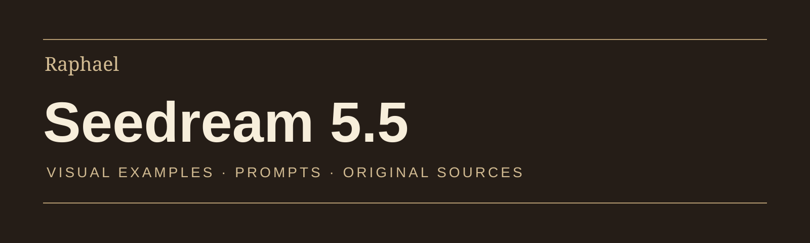](https://raphael.app/?utm_source=github&utm_medium=repository&utm_campaign=seedream_5_5)

# Seedream 5.5 提示词与案例合集

[](https://awesome.re) [](https://github.com/RaphaelAI-OpenLab/awesome-seedream-5-5) [](https://github.com/RaphaelAI-OpenLab/awesome-seedream-5-5/actions/workflows/validate.yml) [](LICENSE)

[English](README.md) · [简体中文](README.zh-CN.md)

由 Raphael 整理的图片与编辑案例库。官方展示、作者自报结果与本仓库编写的练习提示词分别标记。

**90 个来源案例 · 8 个分类 · 8 份原创练习配方 · 3 条独立追踪的发布帖（2 份不同媒体）**

案例未由本仓库独立复现。仓库只保存缩放后的单帧预览，完整图片、GIF 与视频链接至原始地址；第三方媒体及其预览的版权归原权利人。

[浏览案例](#cases) · [全网待重做素材](external-references/README.zh-CN.md) · [练习提示词](#recipes) · [社媒原帖](#social) · [投稿](CONTRIBUTING.md) · [来源与核验](docs/SOURCES.md)

## 模型与入口

Seedream 5.5 的官方发布日期为 **2026-11-09**。能力和入口以[官方模型页](https://seed.bytedance.com/en/seedream5_5)与[中文发布说明](https://seed.bytedance.com/zh/blog/more-realistic-images-more-stable-editing-across-100-rounds-introducing-seedream-5-5)为准。

[访问 Raphael](https://raphael.app/?utm_source=github&utm_medium=repository&utm_campaign=seedream_5_5)。这是品牌主页链接；本仓库尚未核实 Raphael 是否提供 Seedream 5.5，也不提供模型 API 或权重。

## 收录口径

| 项目 | 数量 |
| --- | ---: |
| 官方来源案例 | 20 |
| 作者自报案例 | 70 |
| 仓库内完整原始提示词 | 15 |
| 独立复现案例 | 0 |
| 来源核对日期 | 2026-11-11 |

同一案例的多轮图片不重复计数；重复社媒视频不增加案例总数。来源页中的展示说明不等于实际完整生成提示词。

<a id="external-web-references"></a>
## 全网外部参考素材 · 待重做

已另外整理来自公开网站的图像和来源提示词。它们不是本站已生成的成果，也不计入下面的正式案例数；第三方媒体许可仍需核查。

[进入独立待重做素材库](external-references/README.zh-CN.md) · [重做操作说明](external-references/WORKFLOW.md)

<a id="categories"></a>
## 按分类浏览

| 分类 | 案例数 |
| --- | ---: |
| [多轮与局部编辑](#multi-turn-editing) | 15 |
| [透明素材](#rgba-assets) | 11 |
| [人像](#portraits) | 8 |
| [摄影与纪实](#photography) | 26 |
| [室内与空间](#interiors) | 1 |
| [文字与排版](#typography) | 13 |
| [信息图与界面](#infographics) | 4 |
| [角色与贴纸](#characters) | 12 |

<a id="cases"></a>
## 全部案例

<a id="multi-turn-editing"></a>
### 多轮与局部编辑

#### [人像连续编辑](cases/official-portrait-editing/README.zh-CN.md)

<a href="cases/official-portrait-editing/README.zh-CN.md">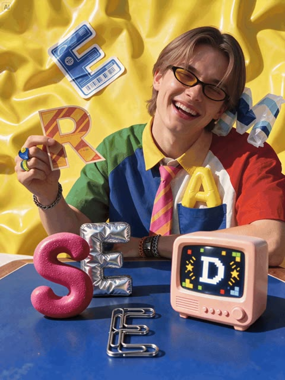</a>

官方展示 · ByteDance Seed · [原始来源](https://seed.bytedance.com/en/seedream5_5) · [详情与提示词状态](cases/official-portrait-editing/README.zh-CN.md)

#### [静物连续编辑](cases/official-still-life-editing/README.zh-CN.md)

<a href="cases/official-still-life-editing/README.zh-CN.md">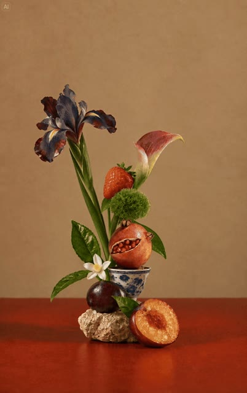</a>

官方展示 · ByteDance Seed · [原始来源](https://seed.bytedance.com/en/seedream5_5) · [详情与提示词状态](cases/official-still-life-editing/README.zh-CN.md)

#### [国画连续编辑](cases/official-ink-painting-editing/README.zh-CN.md)

<a href="cases/official-ink-painting-editing/README.zh-CN.md">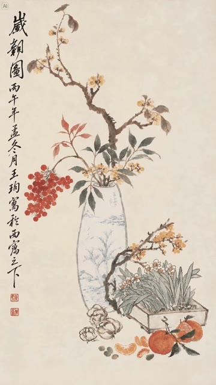</a>

官方展示 · ByteDance Seed · [原始来源](https://seed.bytedance.com/en/seedream5_5) · [详情与提示词状态](cases/official-ink-painting-editing/README.zh-CN.md)

#### [纸条局部编辑](cases/quantslant-note-edit/README.zh-CN.md)

<a href="cases/quantslant-note-edit/README.zh-CN.md">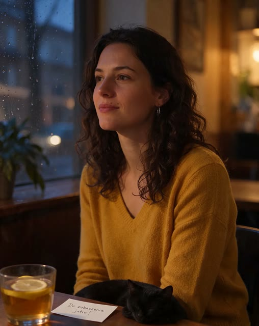</a>

作者自报 · Piotr Olszewski / QUANTSLANT · [原始来源](https://quantslant.com/seedream-5-5-features-pricing-benchmarks/) · [详情与提示词状态](cases/quantslant-note-edit/README.zh-CN.md)

#### [连续修改 30 轮的 LLM 原理图](cases/socialx-llm-diagram-edits/README.zh-CN.md)

<a href="cases/socialx-llm-diagram-edits/README.zh-CN.md">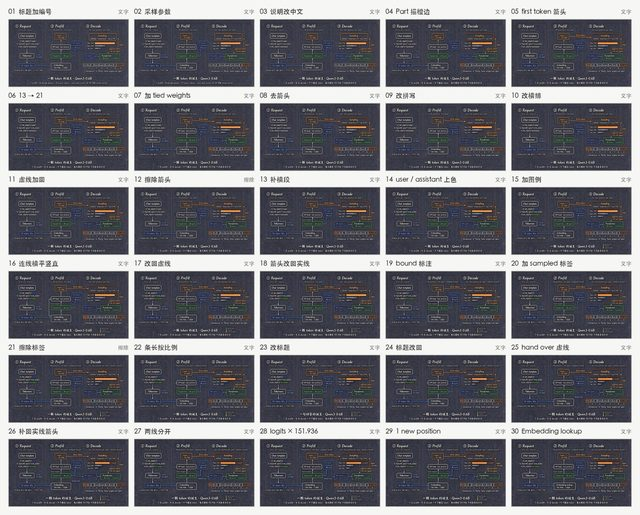</a>

作者自报 · dongxi_nlp · [原始来源](https://x.com/dongxi_nlp/status/2120031669893939524) · [详情与提示词状态](cases/socialx-llm-diagram-edits/README.zh-CN.md)

> 已从作者 X 原帖下载配图，并保存为640px以内的JPEG预览。模型来源归因未经独立生成验证。 作者表示对同一张 LLM 原理图连续修改了三十轮。

#### [书桌五轮编辑对比](cases/social05-ddjcxx-desk-edit/README.zh-CN.md)

<a href="cases/social05-ddjcxx-desk-edit/README.zh-CN.md">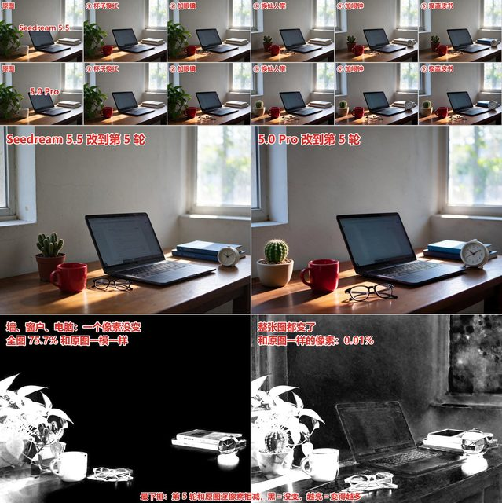</a>

作者自报 · DDJCXX · [原始来源](https://x.com/DDJCXX/status/2119766551436116358) · [详情与提示词状态](cases/social05-ddjcxx-desk-edit/README.zh-CN.md)

> 图片直接从作者 X 原帖媒体下载并缩放；视频只保存抽帧和短动图预览，完整视频请打开原始媒体。模型归因来自作者或署名整理，非本仓库复现。 此帖含其他模型对照或跨模型制作，不能把整组当作 Seedream 独立输出。

#### [多轮编辑人物与小字 GIF](cases/social05-xiaohu-thirty-round-gif/README.zh-CN.md)

<a href="cases/social05-xiaohu-thirty-round-gif/README.zh-CN.md">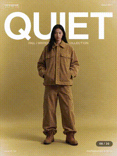</a>

作者自报 · xiaohu · [原始来源](https://x.com/xiaohu/status/2119774478788141417) · [详情与提示词状态](cases/social05-xiaohu-thirty-round-gif/README.zh-CN.md)

> 直接从 X 作者原帖视频抽帧，短GIF为预览而非模型原生 GIF。完整视频见原媒体链接。

#### [街景六次天气场景连续编辑](cases/social05-sjonkerr-street-weather-edit/README.zh-CN.md)

<a href="cases/social05-sjonkerr-street-weather-edit/README.zh-CN.md">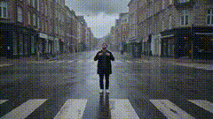</a>

作者自报 · Sjonkerr · [原始来源](https://x.com/Sjonkerr/status/2119904922703438173) · [详情与提示词状态](cases/social05-sjonkerr-street-weather-edit/README.zh-CN.md)

> 直接从 X 作者原帖视频抽帧，短GIF为预览而非模型原生 GIF。完整视频见原媒体链接。

#### [Morphic 中的角色表情多轮编辑](cases/social05-opener-morphic-character/README.zh-CN.md)

<a href="cases/social05-opener-morphic-character/README.zh-CN.md">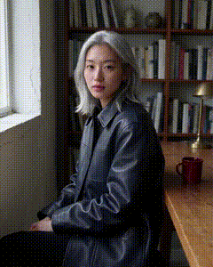</a>

作者自报 · opener_ai · [原始来源](https://x.com/opener_ai/status/2119942433412931907) · [详情与提示词状态](cases/social05-opener-morphic-character/README.zh-CN.md)

> 直接从 X 作者原帖视频抽帧，短GIF为预览而非模型原生 GIF。完整视频见原媒体链接。

#### [五模型15轮连续修图对比](cases/social05-vortex-fifteen-round-compare/README.zh-CN.md)

<a href="cases/social05-vortex-fifteen-round-compare/README.zh-CN.md">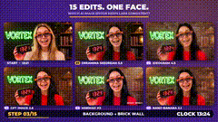</a>

作者自报 · VORTEX_Promos · [原始来源](https://x.com/VORTEX_Promos/status/2119928374235701452) · [详情与提示词状态](cases/social05-vortex-fifteen-round-compare/README.zh-CN.md)

> 直接从 X 作者原帖视频抽帧，短GIF为预览而非模型原生 GIF。完整视频见原媒体链接。 这是跨模型比较/混合工作流，不应全部视为 Seedream 5.5 单模型输出。

#### [花卉、窗帘与光线：三项独立局部编辑](cases/social06-dheepan-three-local-edits/README.zh-CN.md)

<a href="cases/social06-dheepan-three-local-edits/README.zh-CN.md"></a>

作者自报 · Dheepanratnam · [原始来源](https://x.com/Dheepanratnam/status/2119803435461599638) · [详情与提示词状态](cases/social06-dheepan-three-local-edits/README.zh-CN.md)

> 第一张为基础图，其后三张分别修改花卉、窗帘和光线。原作者写明是三项独立编辑，不能据此称为串联三轮实验。原帖公开的步骤原文为 “Change the flowers / Change the curtains / Change the lighting”；这是操作摘要，不是已核实的完整执行提示词。

#### [手表100轮每轮加1秒的连续编辑](cases/social07-alisa-watch-sequence/README.zh-CN.md)

<a href="cases/social07-alisa-watch-sequence/README.zh-CN.md">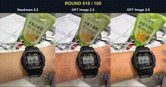</a>

作者自报 · alisaqqt · [原始来源](https://x.com/alisaqqt/status/2119805701300408634) · [详情与提示词状态](cases/social07-alisa-watch-sequence/README.zh-CN.md)

> 图片为从 X 原帖保存的压缩预览；视频为短动图摘要，不是原生 Seedream GIF。模型结果及数据由作者自报，本站未独立复现。 包含跨模型对照/其他生成工具，不能将所有媒体归类为 Seedream 单独生成。

#### [人物外套、布景与照明局部编辑](cases/social07-dheepan-blazer-stage/README.zh-CN.md)

<a href="cases/social07-dheepan-blazer-stage/README.zh-CN.md">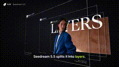</a>

作者自报 · Dheepanratnam · [原始来源](https://x.com/Dheepanratnam/status/2120102574569451995) · [详情与提示词状态](cases/social07-dheepan-blazer-stage/README.zh-CN.md)

> 图片为从 X 原帖保存的压缩预览；视频为短动图摘要，不是原生 Seedream GIF。模型结果及数据由作者自报，本站未独立复现。

#### [桌面静物分步增添元素](cases/social07-aiwithsaif-menu-sequence/README.zh-CN.md)

<a href="cases/social07-aiwithsaif-menu-sequence/README.zh-CN.md">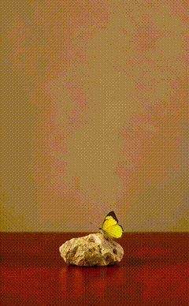</a>

作者自报 · AiwithSaif7 · [原始来源](https://x.com/AiwithSaif7/status/2119807382452908472) · [详情与提示词状态](cases/social07-aiwithsaif-menu-sequence/README.zh-CN.md)

> 图片为从 X 原帖保存的压缩预览；视频为短动图摘要，不是原生 Seedream GIF。模型结果及数据由作者自报，本站未独立复现。

#### [Seedream 5.5 编辑能力视频观察](cases/social07-dotey-review-video/README.zh-CN.md)

<a href="cases/social07-dotey-review-video/README.zh-CN.md">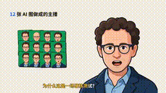</a>

作者自报 · dotey · [原始来源](https://x.com/dotey/status/2119823986603299193) · [详情与提示词状态](cases/social07-dotey-review-video/README.zh-CN.md)

> 图片为从 X 原帖保存的压缩预览；视频为短动图摘要，不是原生 Seedream GIF。模型结果及数据由作者自报，本站未独立复现。 包含跨模型对照/其他生成工具，不能将所有媒体归类为 Seedream 单独生成。

<a id="rgba-assets"></a>
### 透明素材

#### [火烈鸟图层](cases/official-flamingo-layer/README.zh-CN.md)

<a href="cases/official-flamingo-layer/README.zh-CN.md">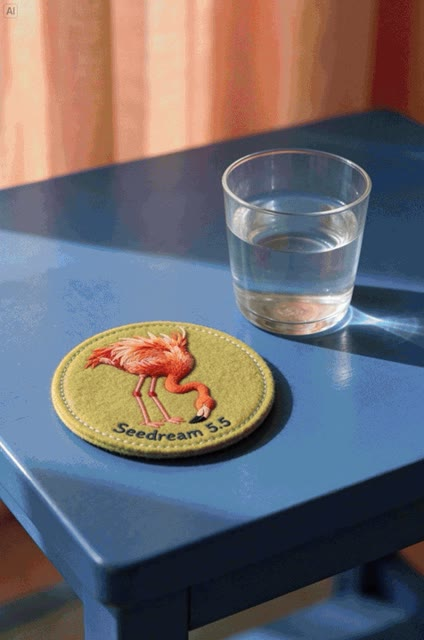</a>

官方展示 · ByteDance Seed · [原始来源](https://seed.bytedance.com/en/seedream5_5) · [详情与提示词状态](cases/official-flamingo-layer/README.zh-CN.md)

#### [雪鸮微距](cases/official-owl-macro/README.zh-CN.md)

<a href="cases/official-owl-macro/README.zh-CN.md">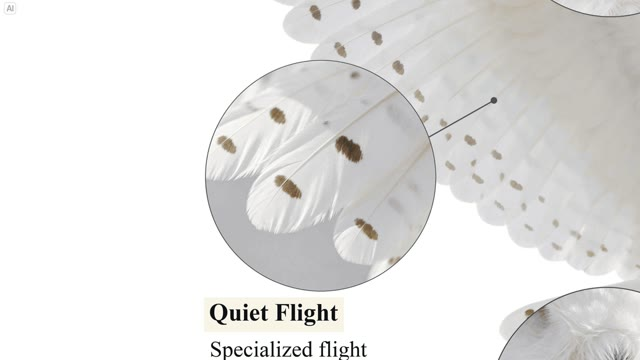</a>

官方展示 · ByteDance Seed · [原始来源](https://seed.bytedance.com/en/seedream5_5) · [详情与提示词状态](cases/official-owl-macro/README.zh-CN.md)

#### [雨衣角色](cases/quantslant-raincoat-character/README.zh-CN.md)

<a href="cases/quantslant-raincoat-character/README.zh-CN.md"></a>

作者自报 · Piotr Olszewski / QUANTSLANT · [原始来源](https://quantslant.com/seedream-5-5-features-pricing-benchmarks/) · [详情与提示词状态](cases/quantslant-raincoat-character/README.zh-CN.md)

> 作者报告伞面呈乳白色，半透明材质表现存在局限。

#### [香水瓶透明背景素材](cases/social-dheepan-amber-perfume/README.zh-CN.md)

<a href="cases/social-dheepan-amber-perfume/README.zh-CN.md">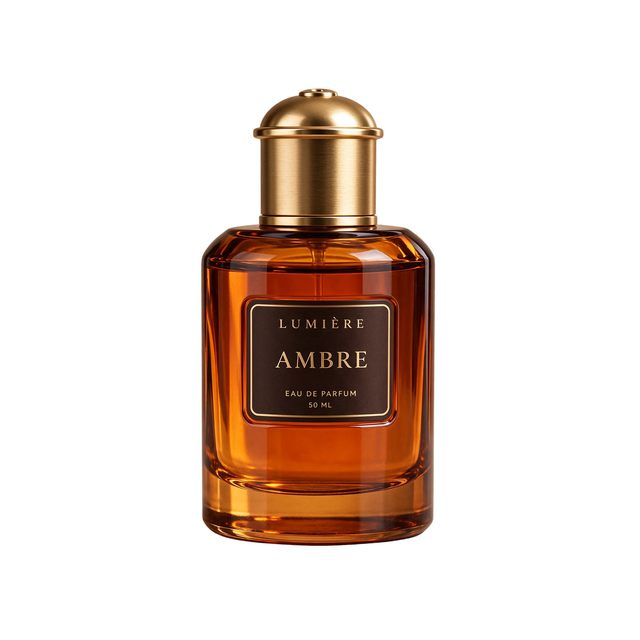</a>

作者自报 · Dheepanratnam · [原始来源](https://x.com/Dheepanratnam/status/2119775195573481859) · [详情与提示词状态](cases/social-dheepan-amber-perfume/README.zh-CN.md)

> 来自公开整理站的作者归因图片与提示词，未在本仓库独立复现。图像为缩小版，非原始导出。 这张 JPEG 不能证明原始 Alpha 透明度。

#### [街头模特透明背景素材](cases/social-dheepan-streetwear-cutout/README.zh-CN.md)

<a href="cases/social-dheepan-streetwear-cutout/README.zh-CN.md">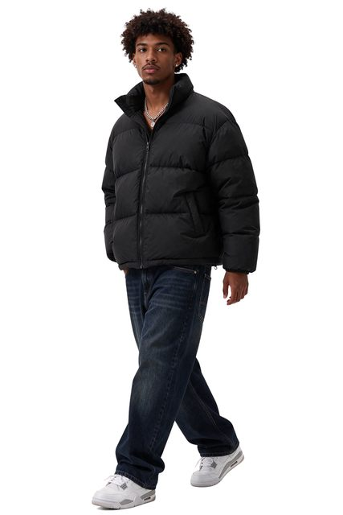</a>

作者自报 · Dheepanratnam · [原始来源](https://x.com/Dheepanratnam/status/2119775195573481859) · [详情与提示词状态](cases/social-dheepan-streetwear-cutout/README.zh-CN.md)

> 来自公开整理站的作者归因图片与提示词，未在本仓库独立复现。图像为缩小版，非原始导出。 这张 JPEG 不能证明原始 Alpha 透明度。

#### [双风格透明角色素材](cases/socialx-transparent-character/README.zh-CN.md)

<a href="cases/socialx-transparent-character/README.zh-CN.md">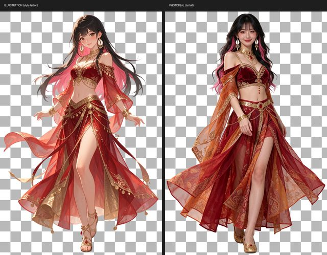</a>

作者自报 · KakiponzuX · [原始来源](https://x.com/KakiponzuX/status/2119979776651710778) · [详情与提示词状态](cases/socialx-transparent-character/README.zh-CN.md)

> 已从作者 X 原帖下载配图，并保存为640px以内的JPEG预览。模型来源归因未经独立生成验证。 缩略图无法证明原始Alpha透明度。 插画与写实风格透明度测试；作者报告部分输出丢失 alpha，棋盘格图片是合成预览。 原帖公开了透明背景提示词后缀，但未提供完整身份设定指令。

#### [玻璃水母灯](cases/socialx-glass-jellyfish-lamp/README.zh-CN.md)

<a href="cases/socialx-glass-jellyfish-lamp/README.zh-CN.md">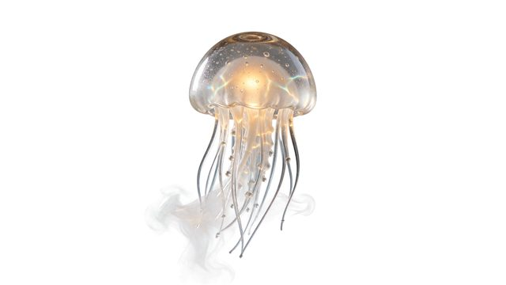</a>

作者自报 · ahmetmertugrul · [原始来源](https://x.com/ahmetmertugrul/status/2119920477535719739) · [详情与提示词状态](cases/socialx-glass-jellyfish-lamp/README.zh-CN.md)

> 已从作者 X 原帖下载配图，并保存为640px以内的JPEG预览。模型来源归因未经独立生成验证。 缩略图无法证明原始Alpha透明度。 原帖附提示词的玻璃灯透明素材示例；仅凭展示图不能验证文件的 alpha 通道。

#### [磨砂亚克力板透明素材](cases/social-dheepan-frosted-acrylic/README.zh-CN.md)

<a href="cases/social-dheepan-frosted-acrylic/README.zh-CN.md">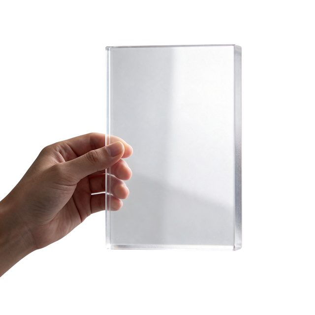</a>

作者自报 · Dheepanratnam · [原始来源](https://x.com/Dheepanratnam/status/2119775195573481859) · [详情与提示词状态](cases/social-dheepan-frosted-acrylic/README.zh-CN.md)

> 已从作者 X 原帖下载配图，并保存为640px以内的JPEG预览。模型来源归因未经独立生成验证。 缩略图无法证明原始Alpha透明度。

#### [铬金属流体丝带透明素材](cases/social-dheepan-chrome-ribbon/README.zh-CN.md)

<a href="cases/social-dheepan-chrome-ribbon/README.zh-CN.md">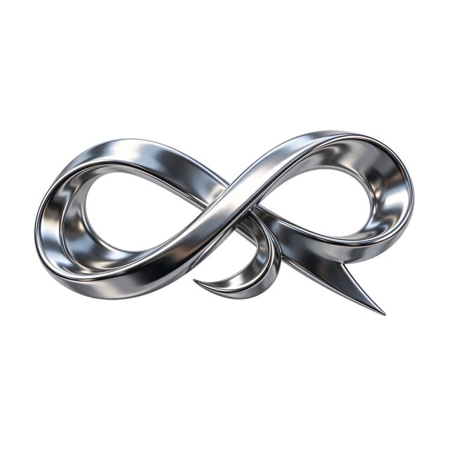</a>

作者自报 · Dheepanratnam · [原始来源](https://x.com/Dheepanratnam/status/2119775195573481859) · [详情与提示词状态](cases/social-dheepan-chrome-ribbon/README.zh-CN.md)

> 已从作者 X 原帖下载配图，并保存为640px以内的JPEG预览。模型来源归因未经独立生成验证。 缩略图无法证明原始Alpha透明度。

#### [透明蒸汽、辐条与薄纱实测](cases/social05-ddjcxx-transparency/README.zh-CN.md)

<a href="cases/social05-ddjcxx-transparency/README.zh-CN.md">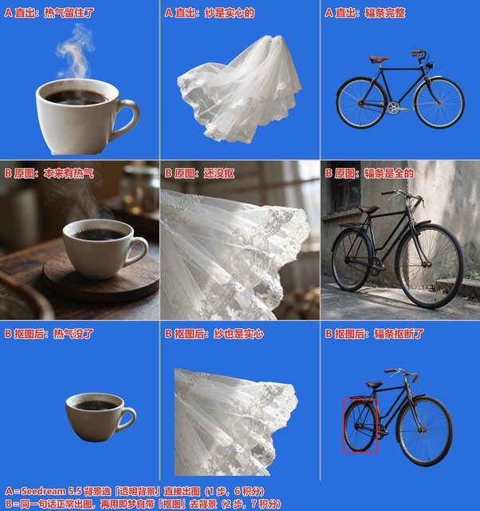</a>

作者自报 · DDJCXX · [原始来源](https://x.com/DDJCXX/status/2119783562115494336) · [详情与提示词状态](cases/social05-ddjcxx-transparency/README.zh-CN.md)

> 图片直接从作者 X 原帖媒体下载并缩放；视频只保存抽帧和短动图预览，完整视频请打开原始媒体。模型归因来自作者或署名整理，非本仓库复现。 此帖含其他模型对照或跨模型制作，不能把整组当作 Seedream 独立输出。 JPEG/GIF预览不能证明原文件的Alpha通道。

#### [Oxen 演示 Seedream 5.5 Layers 场景分层](cases/social09-oxen-layer-separation/README.zh-CN.md)

<a href="cases/social09-oxen-layer-separation/README.zh-CN.md">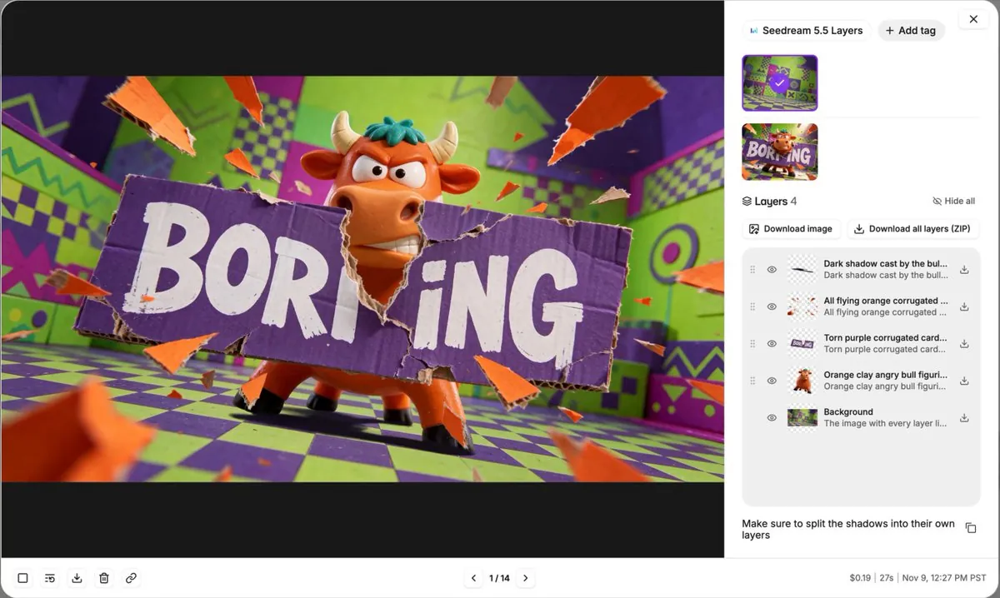</a>

作者自报 · Greg Schoeninger · [原始来源](https://x.com/gregschoeninger/status/2119898943819849963) · [详情与提示词状态](cases/social09-oxen-layer-separation/README.zh-CN.md)

> 作者展示使用 Oxen 的 Seedream 5.5 Layers 把已有图片拆为可编辑图层。此为软件截图，并非直接文字生图，也不证明每层均由基础 Seedream 5.5 生成。公开图库的 WebP 不能视为 X 原始附件，原媒体 ID、完整提示词和转载许可均未核实。

<a id="portraits"></a>
### 人像

#### [妆发连续编辑](cases/official-beauty-editing/README.zh-CN.md)

<a href="cases/official-beauty-editing/README.zh-CN.md">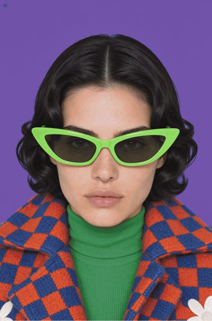</a>

官方展示 · ByteDance Seed · [原始来源](https://seed.bytedance.com/en/seedream5_5) · [详情与提示词状态](cases/official-beauty-editing/README.zh-CN.md)

#### [雀斑人像](cases/quantslant-freckled-portrait/README.zh-CN.md)

<a href="cases/quantslant-freckled-portrait/README.zh-CN.md">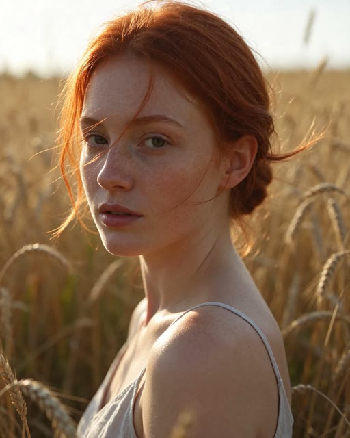</a>

作者自报 · Piotr Olszewski / QUANTSLANT · [原始来源](https://quantslant.com/seedream-5-5-features-pricing-benchmarks/) · [详情与提示词状态](cases/quantslant-freckled-portrait/README.zh-CN.md)

#### [眼部微距质感生成](cases/social05-yuzi-eye-detail/README.zh-CN.md)

<a href="cases/social05-yuzi-eye-detail/README.zh-CN.md">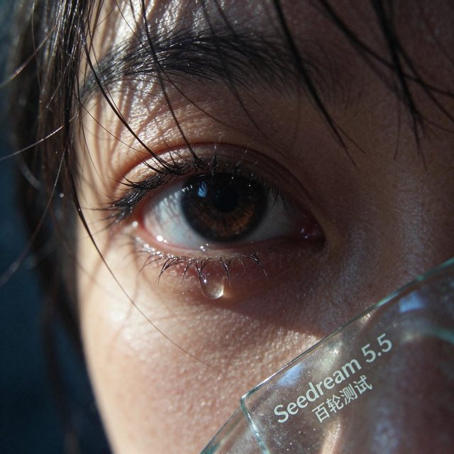</a>

作者自报 · Yuziyyaa · [原始来源](https://x.com/Yuziyyaa/status/2119799602580955179) · [详情与提示词状态](cases/social05-yuzi-eye-detail/README.zh-CN.md)

> 图片直接从作者 X 原帖媒体下载并缩放；视频只保存抽帧和短动图预览，完整视频请打开原始媒体。模型归因来自作者或署名整理，非本仓库复现。 社媒整理站提供了图片对应关系；请以原帖为准。

#### [角色画风：Seedream 5.0 Pro 与 5.5 对照](cases/social06-kakiponzu-painterly-version-test/README.zh-CN.md)

<a href="cases/social06-kakiponzu-painterly-version-test/README.zh-CN.md">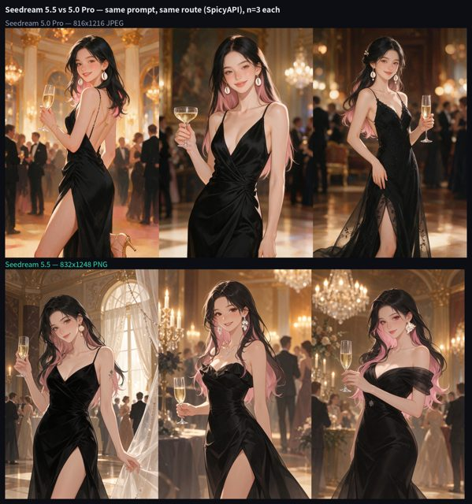</a>

作者自报 · KakiponzuX · [原始来源](https://x.com/KakiponzuX/status/2119772951889224178) · [详情与提示词状态](cases/social06-kakiponzu-painterly-version-test/README.zh-CN.md)

> 拼图上排为 Seedream 5.0 Pro，下排为作者标注的 5.5；两排均含绘画风格后缀。作者报告每版本三次采样，本站未独立复测，也未取得完整输入。

#### [仅移除风格后缀：插画与写实人物对照](cases/social06-kakiponzu-style-tail-control/README.zh-CN.md)

<a href="cases/social06-kakiponzu-style-tail-control/README.zh-CN.md">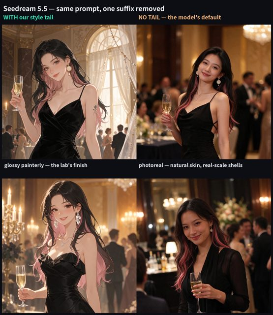</a>

作者自报 · KakiponzuX · [原始来源](https://x.com/KakiponzuX/status/2119799171397906607) · [详情与提示词状态](cases/social06-kakiponzu-style-tail-control/README.zh-CN.md)

> 作者称其控制变量为移除绘画风格后缀，拼图左侧保留后缀、右侧移除后缀。这是同一模型的风格控制实验，不是两个模型的排名；完整基础提示词未核得。

#### [人物写实精修、换红裙与夜间重照明](cases/social07-kakiponzu-photoreal-finisher/README.zh-CN.md)

<a href="cases/social07-kakiponzu-photoreal-finisher/README.zh-CN.md">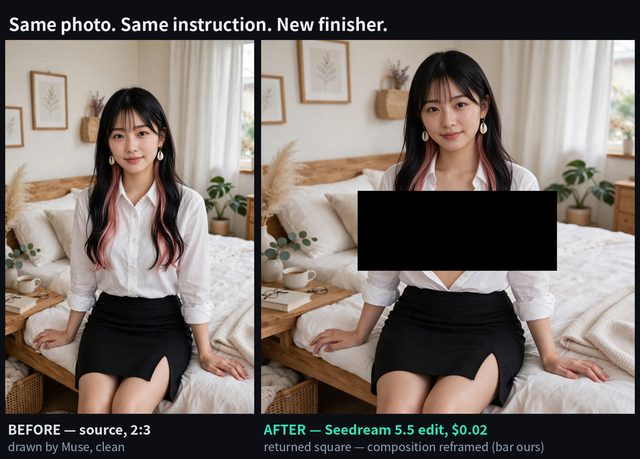</a>

作者自报 · KakiponzuX · [原始来源](https://x.com/KakiponzuX/status/2119801752656531616) · [详情与提示词状态](cases/social07-kakiponzu-photoreal-finisher/README.zh-CN.md)

> 图片为从 X 原帖保存的压缩预览；视频为短动图摘要，不是原生 Seedream GIF。模型结果及数据由作者自报，本站未独立复现。 包含跨模型对照/其他生成工具，不能将所有媒体归类为 Seedream 单独生成。

#### [胶片人像设计：冬日书房与夏日花园](cases/social08-kishen-cinematic-portraits/README.zh-CN.md)

<a href="cases/social08-kishen-cinematic-portraits/README.zh-CN.md"></a>

作者自报 · KishenArt · [原始来源](https://x.com/KishenArt/status/2120046624919769591) · [详情与提示词状态](cases/social08-kishen-cinematic-portraits/README.zh-CN.md)

> P1/P2 长提示词由作者在两条评论中发布，另见 2120047937673916717；本批未逐字复核，故不复制正文。 媒体为公开 GitHub 汇编的 WebP 预览，原帖媒体 ID 未取得；未声称获得再发布许可。

#### [蓝发黑裙、花树红衣与白T：人像试图](cases/social08-aigmudq-fashion-samples/README.zh-CN.md)

<a href="cases/social08-aigmudq-fashion-samples/README.zh-CN.md">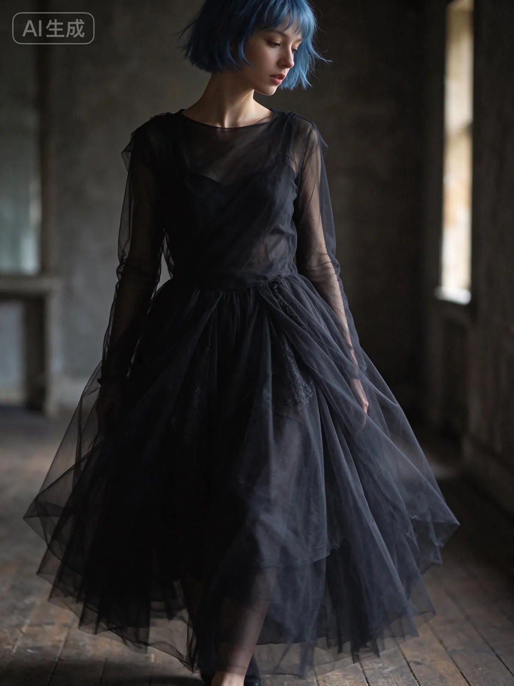</a>

作者自报 · 降温计划 · [原始来源](https://x.com/aigmudq/status/2119771043707621711) · [详情与提示词状态](cases/social08-aigmudq-fashion-samples/README.zh-CN.md)

> 作者明确将这组图称为 Seedream 5.5 试图。仅收录同一原帖的三张图片，另一帖的第4张图已排除。未公开提示词。 媒体为公开 GitHub 汇编的 WebP 预览，原帖媒体 ID 未取得；未声称获得再发布许可。

<a id="photography"></a>
### 摄影与纪实

#### [酒吧白猫](cases/official-bar-cat/README.zh-CN.md)

<a href="cases/official-bar-cat/README.zh-CN.md">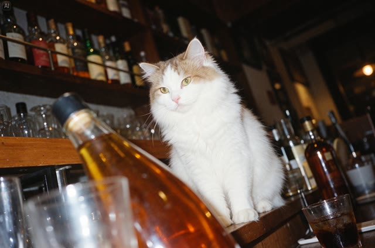</a>

官方展示 · ByteDance Seed · [原始来源](https://seed.bytedance.com/en/seedream5_5) · [详情与提示词状态](cases/official-bar-cat/README.zh-CN.md)

#### [紫黄街景](cases/official-purple-yellow-street/README.zh-CN.md)

<a href="cases/official-purple-yellow-street/README.zh-CN.md">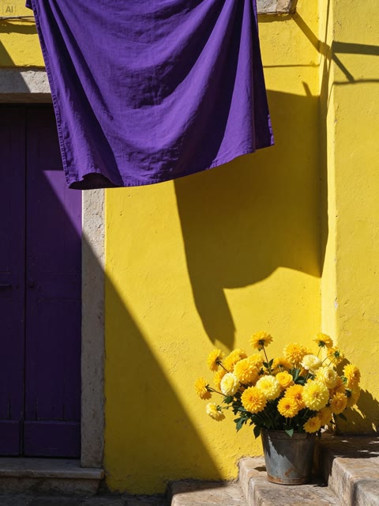</a>

官方展示 · ByteDance Seed · [原始来源](https://seed.bytedance.com/en/seedream5_5) · [详情与提示词状态](cases/official-purple-yellow-street/README.zh-CN.md)

#### [风中街拍](cases/official-windy-street/README.zh-CN.md)

<a href="cases/official-windy-street/README.zh-CN.md">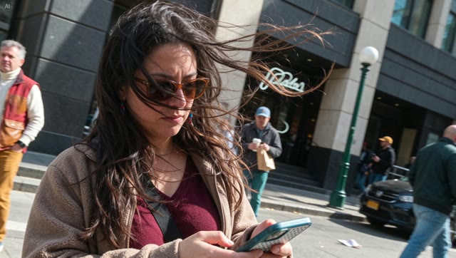</a>

官方展示 · ByteDance Seed · [原始来源](https://seed.bytedance.com/en/seedream5_5) · [详情与提示词状态](cases/official-windy-street/README.zh-CN.md)

#### [小酒馆](cases/official-bistro/README.zh-CN.md)

<a href="cases/official-bistro/README.zh-CN.md">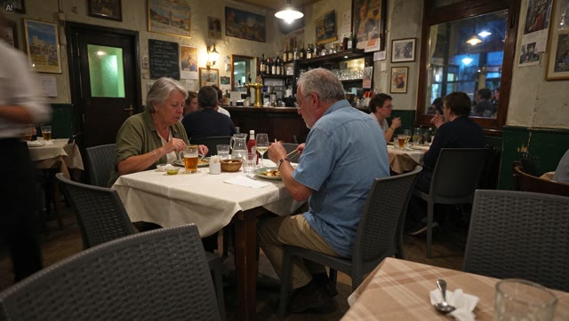</a>

官方展示 · ByteDance Seed · [原始来源](https://seed.bytedance.com/en/seedream5_5) · [详情与提示词状态](cases/official-bistro/README.zh-CN.md)

#### [雨后倒影](cases/official-rain-reflections/README.zh-CN.md)

<a href="cases/official-rain-reflections/README.zh-CN.md">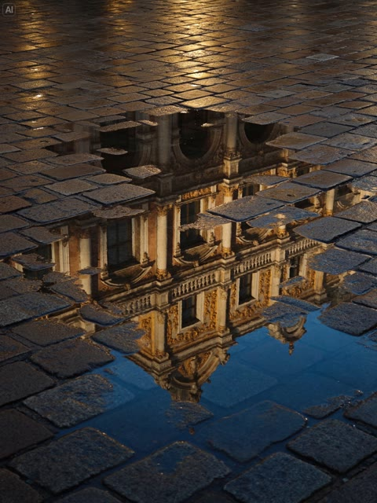</a>

官方展示 · ByteDance Seed · [原始来源](https://seed.bytedance.com/en/seedream5_5) · [详情与提示词状态](cases/official-rain-reflections/README.zh-CN.md)

#### [黄昏火车站](cases/quantslant-railway-station/README.zh-CN.md)

<a href="cases/quantslant-railway-station/README.zh-CN.md">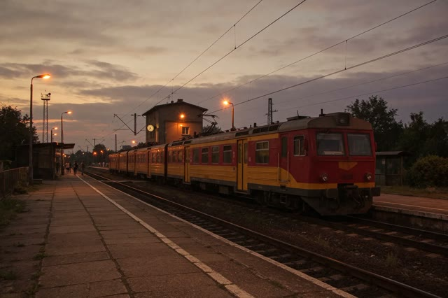</a>

作者自报 · Piotr Olszewski / QUANTSLANT · [原始来源](https://quantslant.com/seedream-5-5-features-pricing-benchmarks/) · [详情与提示词状态](cases/quantslant-railway-station/README.zh-CN.md)

#### [日本熟食店三模型对比](cases/social-genel-japanese-deli/README.zh-CN.md)

<a href="cases/social-genel-japanese-deli/README.zh-CN.md">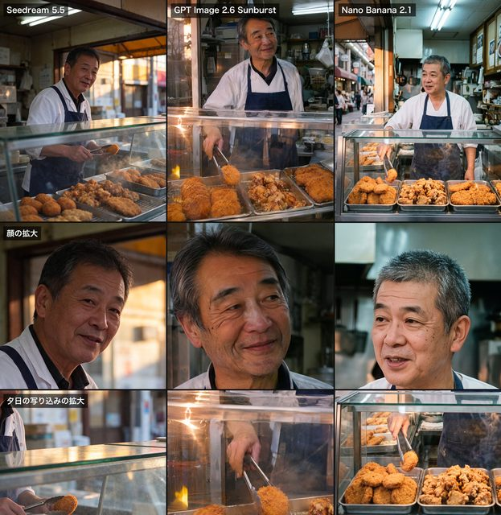</a>

作者自报 · genel_ai · [原始来源](https://x.com/genel_ai/status/2119786434567827504) · [详情与提示词状态](cases/social-genel-japanese-deli/README.zh-CN.md)

> 来自公开整理站的作者归因图片与提示词，未在本仓库独立复现。图像为缩小版，非原始导出。 此图是三模型比较拼图，Seedream 5.5 为左侧列。

#### [肤质表现测试](cases/socialx-skin-texture-test/README.zh-CN.md)

<a href="cases/socialx-skin-texture-test/README.zh-CN.md">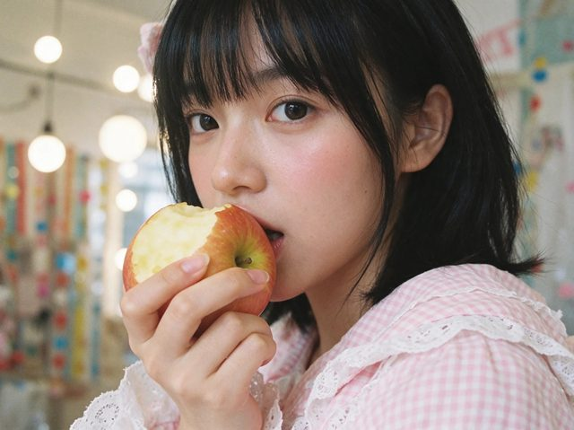</a>

作者自报 · oden_ai_ai · [原始来源](https://x.com/oden_ai_ai/status/2120015332530393282) · [详情与提示词状态](cases/socialx-skin-texture-test/README.zh-CN.md)

> 已从作者 X 原帖下载配图，并保存为640px以内的JPEG预览。模型来源归因未经独立生成验证。 作者分享的图片测试，关注模型对皮肤质感的表现。

#### [四模型人像测试](cases/socialx-four-model-portrait/README.zh-CN.md)

<a href="cases/socialx-four-model-portrait/README.zh-CN.md"></a>

作者自报 · 94vanAI · [原始来源](https://x.com/94vanAI/status/2119938579078238370) · [详情与提示词状态](cases/socialx-four-model-portrait/README.zh-CN.md)

> 已从作者 X 原帖下载配图，并保存为640px以内的JPEG预览。模型来源归因未经独立生成验证。 原帖为多模型对比，部分图片来自其他模型，需按原帖标签区分。 作者注明第一张为 Seedream，其后为 ChatGPT、Gemini、Grok，同时讨论优点与局限。

#### [同提示词纹理对比](cases/socialx-same-prompt-texture/README.zh-CN.md)

<a href="cases/socialx-same-prompt-texture/README.zh-CN.md">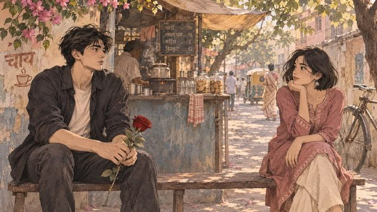</a>

作者自报 · PowerUpInvest · [原始来源](https://x.com/PowerUpInvest/status/2119971057650262386) · [详情与提示词状态](cases/socialx-same-prompt-texture/README.zh-CN.md)

> 已从作者 X 原帖下载配图，并保存为640px以内的JPEG预览。模型来源归因未经独立生成验证。 作者与 GPT Image 2.6 进行图像质感对比；型号归属以原帖说明为准。

#### [三模型出图对比](cases/socialx-three-model-output/README.zh-CN.md)

<a href="cases/socialx-three-model-output/README.zh-CN.md"></a>

作者自报 · Yuziyyaa · [原始来源](https://x.com/Yuziyyaa/status/2119991511433814093) · [详情与提示词状态](cases/socialx-three-model-output/README.zh-CN.md)

> 已从作者 X 原帖下载配图，并保存为640px以内的JPEG预览。模型来源归因未经独立生成验证。 原帖为多模型对比，部分图片来自其他模型，需按原帖标签区分。 作者按图片顺序标注 GPT Images 2.6、Seedream 5.0 Pro、Seedream 5.5。

#### [窗光胶片感人像](cases/socialx-window-light-portrait/README.zh-CN.md)

<a href="cases/socialx-window-light-portrait/README.zh-CN.md">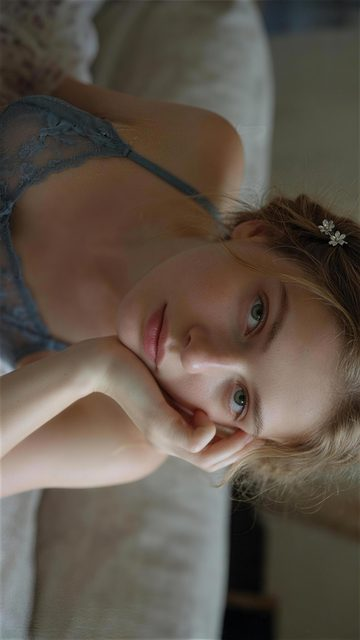</a>

作者自报 · nima2qisi2 · [原始来源](https://x.com/nima2qisi2/status/2119983938383106432) · [详情与提示词状态](cases/socialx-window-light-portrait/README.zh-CN.md)

> 已从作者 X 原帖下载配图，并保存为640px以内的JPEG预览。模型来源归因未经独立生成验证。 使用窗光与胶片风格的人像组图，原帖包含作者提示词。

#### [复古电影静帧](cases/socialx-vintage-cinema/README.zh-CN.md)

<a href="cases/socialx-vintage-cinema/README.zh-CN.md"></a>

作者自报 · ChrisGwinnLA · [原始来源](https://x.com/ChrisGwinnLA/status/2119979699464286506) · [详情与提示词状态](cases/socialx-vintage-cinema/README.zh-CN.md)

> 已从作者 X 原帖下载配图，并保存为640px以内的JPEG预览。模型来源归因未经独立生成验证。 单篇原帖中的四张复古风图片，合并计为一组案例。

#### [Seedream 与 MiniMax H3 静帧对比](cases/socialx-h3-frame-comparison/README.zh-CN.md)

<a href="cases/socialx-h3-frame-comparison/README.zh-CN.md">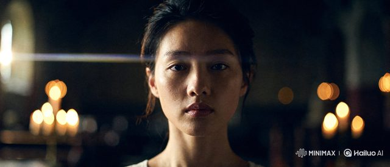</a>

作者自报 · JSFILMZ0412 · [原始来源](https://x.com/JSFILMZ0412/status/2119889824274640957) · [详情与提示词状态](cases/socialx-h3-frame-comparison/README.zh-CN.md)

> 已从作者 X 原帖下载配图，并保存为640px以内的JPEG预览。模型来源归因未经独立生成验证。 原帖为多模型对比，部分图片来自其他模型，需按原帖标签区分。 作者说明为未经后期处理的两张 2K 静帧；另发的 H3 视频不计为 Seedream 成果。

#### [精灵人像材质测试](cases/socialx-elf-material-study/README.zh-CN.md)

<a href="cases/socialx-elf-material-study/README.zh-CN.md">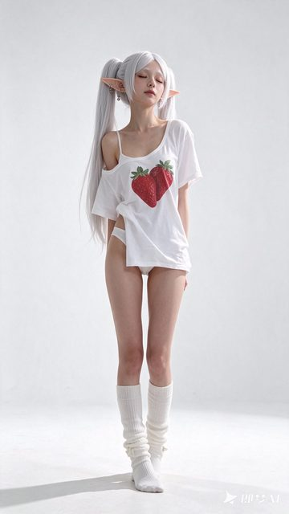</a>

作者自报 · nanyuan0412 · [原始来源](https://x.com/nanyuan0412/status/2119879195115332042) · [详情与提示词状态](cases/socialx-elf-material-study/README.zh-CN.md)

> 已从作者 X 原帖下载配图，并保存为640px以内的JPEG预览。模型来源归因未经独立生成验证。 皮肤、布料与光线的单图测试；作者明确表示尚未深度测试连续编辑。

#### [冬季人像对比](cases/socialx-winter-portrait-comparison/README.zh-CN.md)

<a href="cases/socialx-winter-portrait-comparison/README.zh-CN.md"></a>

作者自报 · 0kncn · [原始来源](https://x.com/0kncn/status/2119878902344823069) · [详情与提示词状态](cases/socialx-winter-portrait-comparison/README.zh-CN.md)

> 已从作者 X 原帖下载配图，并保存为640px以内的JPEG预览。模型来源归因未经独立生成验证。 原帖为多模型对比，部分图片来自其他模型，需按原帖标签区分。 作者用相同人像要求对比 GPT Image 2.5、Seedream 5.5 与 Nano Banana 2.1。

#### [写实图像组](cases/socialx-photoreal-image-set/README.zh-CN.md)

<a href="cases/socialx-photoreal-image-set/README.zh-CN.md">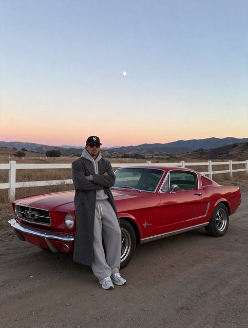</a>

作者自报 · uixmax · [原始来源](https://x.com/uixmax/status/2119894564073054374) · [详情与提示词状态](cases/socialx-photoreal-image-set/README.zh-CN.md)

> 已从作者 X 原帖下载配图，并保存为640px以内的JPEG预览。模型来源归因未经独立生成验证。 作者的四图写实效果测试，保留为一组来源案例。

#### [人像模型顺序对照](cases/socialx-three-model-portrait-order/README.zh-CN.md)

<a href="cases/socialx-three-model-portrait-order/README.zh-CN.md">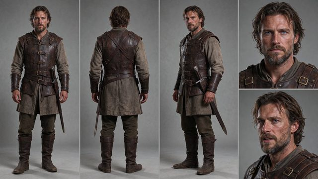</a>

作者自报 · foretyyt · [原始来源](https://x.com/foretyyt/status/2119894502588452933) · [详情与提示词状态](cases/socialx-three-model-portrait-order/README.zh-CN.md)

> 已从作者 X 原帖下载配图，并保存为640px以内的JPEG预览。模型来源归因未经独立生成验证。 原帖为多模型对比，部分图片来自其他模型，需按原帖标签区分。 作者标注图一为 Seedream 5.5，图二 Image 2.5，图三 Nano Banana 2.1。

#### [与 GPT Image 2.6 同要求对比](cases/socialx-gpt26-same-brief/README.zh-CN.md)

<a href="cases/socialx-gpt26-same-brief/README.zh-CN.md">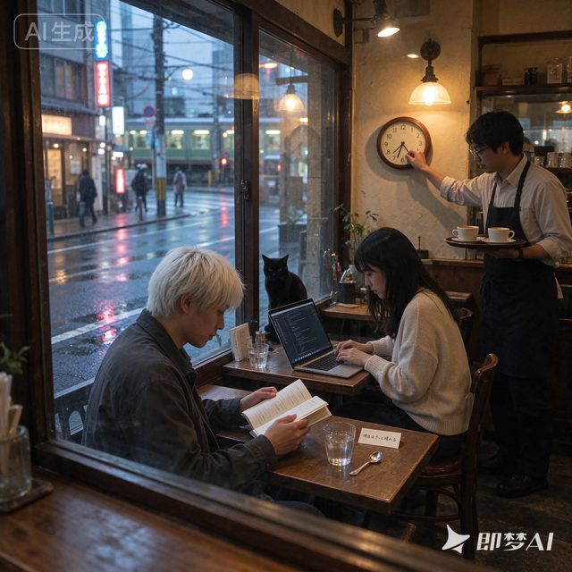</a>

作者自报 · arito_si · [原始来源](https://x.com/arito_si/status/2119890337699364975) · [详情与提示词状态](cases/socialx-gpt26-same-brief/README.zh-CN.md)

> 已从作者 X 原帖下载配图，并保存为640px以内的JPEG预览。模型来源归因未经独立生成验证。 原帖为多模型对比，部分图片来自其他模型，需按原帖标签区分。 作者说明以相同提示词组测试 Seedream 5.5 与 GPT Image 2.6。

#### [蓝调时刻的渔夫](cases/socialx-blue-hour-fisherman/README.zh-CN.md)

<a href="cases/socialx-blue-hour-fisherman/README.zh-CN.md">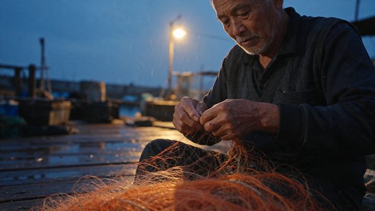</a>

作者自报 · ahmetmertugrul · [原始来源](https://x.com/ahmetmertugrul/status/2119922071916757233) · [详情与提示词状态](cases/socialx-blue-hour-fisherman/README.zh-CN.md)

> 已从作者 X 原帖下载配图，并保存为640px以内的JPEG预览。模型来源归因未经独立生成验证。 冷色环境光与暖灯混合的纪实风格人像；原帖提供提示词。

#### [咖啡馆、人像与雨天街景四图](cases/social05-dheepan-four-photographs/README.zh-CN.md)

<a href="cases/social05-dheepan-four-photographs/README.zh-CN.md"></a>

作者自报 · Dheepanratnam · [原始来源](https://x.com/Dheepanratnam/status/2119762628658462746) · [详情与提示词状态](cases/social05-dheepan-four-photographs/README.zh-CN.md)

> 图片直接从作者 X 原帖媒体下载并缩放；视频只保存抽帧和短动图预览，完整视频请打开原始媒体。模型归因来自作者或署名整理，非本仓库复现。 社媒整理站提供了图片对应关系；请以原帖为准。

#### [街边用餐与咖啡桌人像](cases/social05-drsadek-cafe-photography/README.zh-CN.md)

<a href="cases/social05-drsadek-cafe-photography/README.zh-CN.md">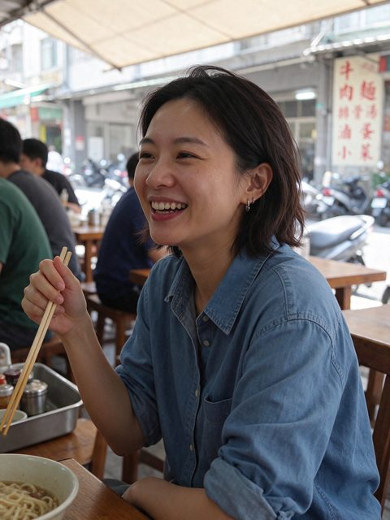</a>

作者自报 · DrSadek_ · [原始来源](https://x.com/DrSadek_/status/2119788316153507886) · [详情与提示词状态](cases/social05-drsadek-cafe-photography/README.zh-CN.md)

> 图片直接从作者 X 原帖媒体下载并缩放；视频只保存抽帧和短动图预览，完整视频请打开原始媒体。模型归因来自作者或署名整理，非本仓库复现。 社媒整理站提供了图片对应关系；请以原帖为准。

#### [钟表匠、森林地表与汽水质感](cases/social05-kevin-watchmaker-forest/README.zh-CN.md)

<a href="cases/social05-kevin-watchmaker-forest/README.zh-CN.md"></a>

作者自报 · kevinchin35 · [原始来源](https://x.com/kevinchin35/status/2119747692427628777) · [详情与提示词状态](cases/social05-kevin-watchmaker-forest/README.zh-CN.md)

> 图片直接从作者 X 原帖媒体下载并缩放；视频只保存抽帧和短动图预览，完整视频请打开原始媒体。模型归因来自作者或署名整理，非本仓库复现。 社媒整理站提供了图片对应关系；请以原帖为准。

#### [四组题材的 Seedream / GPT / Nano Banana 比较](cases/social05-ozansihay-four-comparisons/README.zh-CN.md)

<a href="cases/social05-ozansihay-four-comparisons/README.zh-CN.md">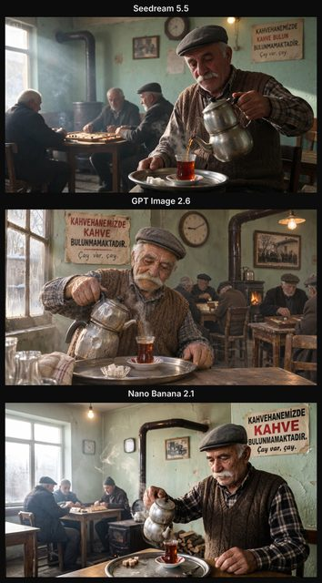</a>

作者自报 · ozansihay · [原始来源](https://x.com/ozansihay/status/2119803963738357803) · [详情与提示词状态](cases/social05-ozansihay-four-comparisons/README.zh-CN.md)

> 图片直接从作者 X 原帖媒体下载并缩放；视频只保存抽帧和短动图预览，完整视频请打开原始媒体。模型归因来自作者或署名整理，非本仓库复现。 此帖含其他模型对照或跨模型制作，不能把整组当作 Seedream 独立输出。 社媒整理站提供了图片对应关系；请以原帖为准。

#### [Seedream 5.5 发布当天写实图片测试](cases/social07-lyra-release-test/README.zh-CN.md)

<a href="cases/social07-lyra-release-test/README.zh-CN.md"></a>

作者自报 · lyraxana · [原始来源](https://x.com/lyraxana/status/2119716289581334969) · [详情与提示词状态](cases/social07-lyra-release-test/README.zh-CN.md)

> 图片为从 X 原帖保存的压缩预览；视频为短动图摘要，不是原生 Seedream GIF。模型结果及数据由作者自报，本站未独立复现。

#### [9:16 延展对比：原图、Seedream、GPT Image](cases/social08-drsadek-portrait-outpainting/README.zh-CN.md)

<a href="cases/social08-drsadek-portrait-outpainting/README.zh-CN.md"></a>

作者自报 · DrSadek · [原始来源](https://x.com/DrSadek_/status/2119809560038772808) · [详情与提示词状态](cases/social08-drsadek-portrait-outpainting/README.zh-CN.md)

> 原帖标明第1张原图、第2张 Seedream 5.5、第3张 GPT Image 2.6；并非三张都是 Seedream 输出。未公开完整提示词。 媒体为公开 GitHub 汇编的 WebP 预览，原帖媒体 ID 未取得；未声称获得再发布许可。

<a id="interiors"></a>
### 室内与空间

#### [室内连续编辑](cases/official-interior-editing/README.zh-CN.md)

<a href="cases/official-interior-editing/README.zh-CN.md"></a>

官方展示 · ByteDance Seed · [原始来源](https://seed.bytedance.com/en/seedream5_5) · [详情与提示词状态](cases/official-interior-editing/README.zh-CN.md)

<a id="typography"></a>
### 文字与排版

#### [透明艺术字与材质](cases/official-yarn-lettering/README.zh-CN.md)

<a href="cases/official-yarn-lettering/README.zh-CN.md"></a>

官方展示 · ByteDance Seed · [原始来源](https://seed.bytedance.com/en/seedream5_5) · [详情与提示词状态](cases/official-yarn-lettering/README.zh-CN.md)

#### [莎士比亚报刊](cases/official-shakespeare-newspaper/README.zh-CN.md)

<a href="cases/official-shakespeare-newspaper/README.zh-CN.md"></a>

官方展示 · ByteDance Seed · [原始来源](https://seed.bytedance.com/en/blog/more-realistic-images-more-stable-editing-across-100-rounds-introducing-seedream-5-5) · [详情与提示词状态](cases/official-shakespeare-newspaper/README.zh-CN.md)

#### [波兰语菜单](cases/quantslant-polish-menu/README.zh-CN.md)

<a href="cases/quantslant-polish-menu/README.zh-CN.md"></a>

作者自报 · Piotr Olszewski / QUANTSLANT · [原始来源](https://quantslant.com/seedream-5-5-features-pricing-benchmarks/) · [详情与提示词状态](cases/quantslant-polish-menu/README.zh-CN.md)

#### [波兰语全字母句](cases/quantslant-polish-pangram/README.zh-CN.md)

<a href="cases/quantslant-polish-pangram/README.zh-CN.md"></a>

作者自报 · Piotr Olszewski / QUANTSLANT · [原始来源](https://quantslant.com/seedream-5-5-features-pricing-benchmarks/) · [详情与提示词状态](cases/quantslant-polish-pangram/README.zh-CN.md)

#### [报纸文字错误样本](cases/quantslant-newspaper-errors/README.zh-CN.md)

<a href="cases/quantslant-newspaper-errors/README.zh-CN.md"></a>

作者自报 · Piotr Olszewski / QUANTSLANT · [原始来源](https://quantslant.com/seedream-5-5-features-pricing-benchmarks/) · [详情与提示词状态](cases/quantslant-newspaper-errors/README.zh-CN.md)

> 作者报告存在文字错误；保留为局限样本。

#### [杂志封面字形](cases/social-dheepan-magazine-cover/README.zh-CN.md)

<a href="cases/social-dheepan-magazine-cover/README.zh-CN.md"></a>

作者自报 · Dheepanratnam · [原始来源](https://x.com/Dheepanratnam/status/2119767938173387065) · [详情与提示词状态](cases/social-dheepan-magazine-cover/README.zh-CN.md)

> 来自公开整理站的作者归因图片与提示词，未在本仓库独立复现。图像为缩小版，非原始导出。

#### [雨夜多语种招牌](cases/social-dheepan-rainy-storefront/README.zh-CN.md)

<a href="cases/social-dheepan-rainy-storefront/README.zh-CN.md"></a>

作者自报 · Dheepanratnam · [原始来源](https://x.com/Dheepanratnam/status/2119767938173387065) · [详情与提示词状态](cases/social-dheepan-rainy-storefront/README.zh-CN.md)

> 来自公开整理站的作者归因图片与提示词，未在本仓库独立复现。图像为缩小版，非原始导出。

#### [护肤品包装小字](cases/social-dheepan-skincare-label/README.zh-CN.md)

<a href="cases/social-dheepan-skincare-label/README.zh-CN.md"></a>

作者自报 · Dheepanratnam · [原始来源](https://x.com/Dheepanratnam/status/2119767938173387065) · [详情与提示词状态](cases/social-dheepan-skincare-label/README.zh-CN.md)

> 来自公开整理站的作者归因图片与提示词，未在本仓库独立复现。图像为缩小版，非原始导出。

#### [夜间电子乐活动海报](cases/social-dheepan-night-signal-poster/README.zh-CN.md)

<a href="cases/social-dheepan-night-signal-poster/README.zh-CN.md"></a>

作者自报 · Dheepanratnam · [原始来源](https://x.com/Dheepanratnam/status/2119767938173387065) · [详情与提示词状态](cases/social-dheepan-night-signal-poster/README.zh-CN.md)

> 来自公开整理站的作者归因图片与提示词，未在本仓库独立复现。图像为缩小版，非原始导出。

#### [跨版本密集文字对比](cases/socialx-dense-text-comparison/README.zh-CN.md)

<a href="cases/socialx-dense-text-comparison/README.zh-CN.md"></a>

作者自报 · 94vanAI · [原始来源](https://x.com/94vanAI/status/2120007470898913320) · [详情与提示词状态](cases/socialx-dense-text-comparison/README.zh-CN.md)

> 已从作者 X 原帖下载配图，并保存为640px以内的JPEG预览。模型来源归因未经独立生成验证。 原帖为多模型对比，部分图片来自其他模型，需按原帖标签区分。 比较 Seedream 5.5、5.0 Pro 与 GPT Image 多个版本，请按原帖标注辨认结果。

#### [深海生物图鉴信息图](cases/socialx-deep-sea-field-guide/README.zh-CN.md)

<a href="cases/socialx-deep-sea-field-guide/README.zh-CN.md"></a>

作者自报 · ahmetmertugrul · [原始来源](https://x.com/ahmetmertugrul/status/2119915956365369596) · [详情与提示词状态](cases/socialx-deep-sea-field-guide/README.zh-CN.md)

> 已从作者 X 原帖下载配图，并保存为640px以内的JPEG预览。模型来源归因未经独立生成验证。 虚构生物图鉴页，组合标注、数据表和科学插图；原帖有提示词。

#### [雨城动漫、AI海报与窗光人像](cases/social05-tqmiracle-city-poster/README.zh-CN.md)

<a href="cases/social05-tqmiracle-city-poster/README.zh-CN.md"></a>

作者自报 · TqMiracle18260 · [原始来源](https://x.com/TqMiracle18260/status/2119765639825089008) · [详情与提示词状态](cases/social05-tqmiracle-city-poster/README.zh-CN.md)

> 图片直接从作者 X 原帖媒体下载并缩放；视频只保存抽帧和短动图预览，完整视频请打开原始媒体。模型归因来自作者或署名整理，非本仓库复现。 社媒整理站提供了图片对应关系；请以原帖为准。

#### [山羊零食包装：四模型同提示词测试](cases/social08-maxescu-ridge-snack/README.zh-CN.md)

<a href="cases/social08-maxescu-ridge-snack/README.zh-CN.md"></a>

作者自报 · Alex Patrascu · [原始来源](https://x.com/maxescu/status/2120078778487505206) · [详情与提示词状态](cases/social08-maxescu-ridge-snack/README.zh-CN.md)

> 四格分别为 MiniMax H3、Seedream 5.5、Nano Banana 2.1 与 GPT Image 2.6；仅右上为 5.5。作者公开完整通用提示词。 媒体为公开 GitHub 汇编的 WebP 预览，原帖媒体 ID 未取得；未声称获得再发布许可。

<a id="infographics"></a>
### 信息图与界面

#### [贪吃蛇界面](cases/official-snake-interface/README.zh-CN.md)

<a href="cases/official-snake-interface/README.zh-CN.md"></a>

官方展示 · ByteDance Seed · [原始来源](https://seed.bytedance.com/en/seedream5_5) · [详情与提示词状态](cases/official-snake-interface/README.zh-CN.md)

#### [手表界面](cases/official-watch-interface/README.zh-CN.md)

<a href="cases/official-watch-interface/README.zh-CN.md"></a>

官方展示 · ByteDance Seed · [原始来源](https://seed.bytedance.com/en/seedream5_5) · [详情与提示词状态](cases/official-watch-interface/README.zh-CN.md)

#### [蝴蝶信息图](cases/official-butterfly-infographic/README.zh-CN.md)

<a href="cases/official-butterfly-infographic/README.zh-CN.md"></a>

官方展示 · ByteDance Seed · [原始来源](https://seed.bytedance.com/en/blog/more-realistic-images-more-stable-editing-across-100-rounds-introducing-seedream-5-5) · [详情与提示词状态](cases/official-butterfly-infographic/README.zh-CN.md)

#### [咖啡信息图](cases/quantslant-coffee-infographic/README.zh-CN.md)

<a href="cases/quantslant-coffee-infographic/README.zh-CN.md"></a>

作者自报 · Piotr Olszewski / QUANTSLANT · [原始来源](https://quantslant.com/seedream-5-5-features-pricing-benchmarks/) · [详情与提示词状态](cases/quantslant-coffee-infographic/README.zh-CN.md)

<a id="characters"></a>
### 角色与贴纸

#### [奔跑角色](cases/official-running-character/README.zh-CN.md)

<a href="cases/official-running-character/README.zh-CN.md"></a>

官方展示 · ByteDance Seed · [原始来源](https://seed.bytedance.com/en/seedream5_5) · [详情与提示词状态](cases/official-running-character/README.zh-CN.md)

#### [贴纸组合](cases/official-sticker-sheets/README.zh-CN.md)

<a href="cases/official-sticker-sheets/README.zh-CN.md"></a>

官方展示 · ByteDance Seed · [原始来源](https://seed.bytedance.com/en/seedream5_5) · [详情与提示词状态](cases/official-sticker-sheets/README.zh-CN.md)

#### [毛绒角色](cases/official-plush-characters/README.zh-CN.md)

<a href="cases/official-plush-characters/README.zh-CN.md"></a>

官方展示 · ByteDance Seed · [原始来源](https://seed.bytedance.com/en/seedream5_5) · [详情与提示词状态](cases/official-plush-characters/README.zh-CN.md)

#### [角色设定表版本对比](cases/socialx-character-sheet-comparison/README.zh-CN.md)

<a href="cases/socialx-character-sheet-comparison/README.zh-CN.md"></a>

作者自报 · EEJ_OOXO · [原始来源](https://x.com/EEJ_OOXO/status/2119780326117716281) · [详情与提示词状态](cases/socialx-character-sheet-comparison/README.zh-CN.md)

> 已从作者 X 原帖下载配图，并保存为640px以内的JPEG预览。模型来源归因未经独立生成验证。 原帖为多模型对比，部分图片来自其他模型，需按原帖标签区分。 与 Seedream 5.0 Pro 的角色设定表对比，原帖讨论分栏一致性和输出文件。

#### [角色真人化测试](cases/socialx-photoreal-conversion/README.zh-CN.md)

<a href="cases/socialx-photoreal-conversion/README.zh-CN.md"></a>

作者自报 · nanyuan0412 · [原始来源](https://x.com/nanyuan0412/status/2119949010698137603) · [详情与提示词状态](cases/socialx-photoreal-conversion/README.zh-CN.md)

> 已从作者 X 原帖下载配图，并保存为640px以内的JPEG预览。模型来源归因未经独立生成验证。 作者分享的双图角色真人化测试，明确标注 Seedream 5.5。

#### [角色重创作测试](cases/socialx-character-recreation/README.zh-CN.md)

<a href="cases/socialx-character-recreation/README.zh-CN.md"></a>

作者自报 · haungpower · [原始来源](https://x.com/haungpower/status/2119852896544325859) · [详情与提示词状态](cases/socialx-character-recreation/README.zh-CN.md)

> 已从作者 X 原帖下载配图，并保存为640px以内的JPEG预览。模型来源归因未经独立生成验证。 作者标注为重创作的角色一致性测试，参考细节以原帖为准。

#### [Nature Unseen 概念系列](cases/socialx-nature-unseen/README.zh-CN.md)

<a href="cases/socialx-nature-unseen/README.zh-CN.md"></a>

作者自报 · AI_Timemachine · [原始来源](https://x.com/AI_Timemachine/status/2119930302508286194) · [详情与提示词状态](cases/socialx-nature-unseen/README.zh-CN.md)

> 已从作者 X 原帖下载配图，并保存为640px以内的JPEG预览。模型来源归因未经独立生成验证。 作者使用 Seedream 5.5 重做既有概念系列；四张组图只计一次。

#### [蜡笔火鸡变成真实火鸡混合模型短片](cases/social05-larklee-turkey-mixed-workflow/README.zh-CN.md)

<a href="cases/social05-larklee-turkey-mixed-workflow/README.zh-CN.md"></a>

作者自报 · larklee5 · [原始来源](https://x.com/larklee5/status/2119985661939974450) · [详情与提示词状态](cases/social05-larklee-turkey-mixed-workflow/README.zh-CN.md)

> 图片直接从作者 X 原帖媒体下载并缩放；视频只保存抽帧和短动图预览，完整视频请打开原始媒体。模型归因来自作者或署名整理，非本仓库复现。 此帖含其他模型对照或跨模型制作，不能把整组当作 Seedream 独立输出。 成片包含其他视频生成模型的制作环节。

#### [奇幻人物与幼龙：三模型配图对比](cases/social06-lyra-fantasy-three-models/README.zh-CN.md)

<a href="cases/social06-lyra-fantasy-three-models/README.zh-CN.md"></a>

作者自报 · lyraxana · [原始来源](https://x.com/lyraxana/status/2118884892427551046) · [详情与提示词状态](cases/social06-lyra-fantasy-three-models/README.zh-CN.md)

> 原帖 ALT 按顺序标为 Seedream 5.5、Nano Banana Pro、GPT Image 2.6 Sunburst；后两张不是 Seedream 输出。帖子发表于 2026-11-07，早于官方发布，版本仅按作者自报记录，后台模型与相同提示词条件未独立核实。

#### [游戏式街景与远景标牌](cases/social06-lyra-game-street-sign/README.zh-CN.md)

<a href="cases/social06-lyra-game-street-sign/README.zh-CN.md"></a>

作者自报 · lyraxana · [原始来源](https://x.com/lyraxana/status/2118896484934668512) · [详情与提示词状态](cases/social06-lyra-game-street-sign/README.zh-CN.md)

> 作者将该图归因于 Seedream 5.5 并称其为 GTA 风格画面；它不是经证实的官方游戏截图。帖子发表于 2026-11-07，模型版本仅为作者自报。完整提示词未核得。

#### [传统神像风插画试图](cases/social08-taxue-deity-artwork/README.zh-CN.md)

<a href="cases/social08-taxue-deity-artwork/README.zh-CN.md"></a>

作者自报 · 踏雪寻仙 · [原始来源](https://x.com/TaXue2025/status/2119730457030041723) · [详情与提示词状态](cases/social08-taxue-deity-artwork/README.zh-CN.md)

> 作者配有 Seedream 5.5 模型选择界面截图；截图不算生成图。是否与 5.0 Pro 逐图对应仍未核实，不作效果优劣判断。 媒体为公开 GitHub 汇编的 WebP 预览，原帖媒体 ID 未取得；未声称获得再发布许可。

#### [Seedream 角色图联动 Seedance 视频与 Suno 配乐](cases/social09-ghostly-seedance-suno/README.zh-CN.md)

<a href="cases/social09-ghostly-seedance-suno/README.zh-CN.md"></a>

作者自报 · Ghostly 愛 · [原始来源](https://x.com/GhostlyXV/status/2119866467717918756) · [详情与提示词状态](cases/social09-ghostly-seedance-suno/README.zh-CN.md)

> 作者明确说明 Seedream 5.5 → Seedance 2.5，并用 Suno 配乐。这里保存的是第三方汇编的视频代表帧，并非 Seedream 原始生图；动态画面由 Seedance 制作，不能证明 Seedream 原生视频。原帖媒体 ID、完整提示词和转载许可均未取得。

<a id="recipes"></a>
## 原创练习提示词

以下配方由本仓库编写，尚未用 Seedream 5.5 执行。它们不对应上方样张的原始输入。每份包含中英文指令和验收项。

| 配方 | 状态 |
| --- | --- |
| [单一区域编辑](templates/targeted-edit.md) | 原创，未执行 |
| [三轮连续编辑](templates/edit-chain.md) | 原创，未执行 |
| [独立透明素材](templates/transparent-asset.md) | 原创，未执行 |
| [半透明材质测试](templates/material-transparency.md) | 原创，未执行 |
| [自然纪实摄影](templates/documentary-photo.md) | 原创，未执行 |
| [固定文案海报](templates/copy-locked-poster.md) | 原创，未执行 |
| [角色一致性设定](templates/character-sheet.md) | 原创，未执行 |
| [步骤信息图](templates/instruction-infographic.md) | 原创，未执行 |

<a id="social"></a>
## 社媒原始素材

通过 X 官方公开嵌入接口与公开 syndication 响应核对账号、版本和媒体地址。保留原帖及原图/视频链接，不复制帖文全文。

### ByteDance Seed · @ByteDanceSeed_

[](https://x.com/ByteDanceSeed_/status/2119717948470546446)

[原始帖子](https://x.com/ByteDanceSeed_/status/2119717948470546446) · [原始媒体](https://video.twimg.com/amplify_video/2119716100359548928/vid/avc1/1920x1080/yijLvq8WlsqxbemL.mp4)

### Dreamina AI · @dreamina_ai

[](https://x.com/dreamina_ai/status/2119751497282125949)

[原始帖子](https://x.com/dreamina_ai/status/2119751497282125949) · [原始媒体](https://pbs.twimg.com/media/HWredl_bAAAkfEk.jpg)

[补充社媒研究（含待核实线索）](docs/SOCIAL-CASES-2026-11-10.md)

[新增 5 个创作者社媒案例（原始媒体待补）](docs/SOCIAL-SHOWCASE-2026-11-10-BATCH2.md)

## 本地维护

```bash
python3 scripts/build.py
python3 scripts/validate.py
python3 scripts/search.py RGBA
```

可选：`python3 scripts/check_media.py` 检查本地预览，需安装 ffmpeg；`python3 scripts/refresh_previews.py` 联网刷新缩放代表帧预览，不打包原始媒体。

## 贡献与许可

按[投稿说明](CONTRIBUTING.md)提供原帖、明确版本证据和提示词状态。版权问题请[提交问题](https://github.com/RaphaelAI-OpenLab/awesome-seedream-5-5/issues/new?template=report-problem.yml)。

代码与原创文档适用 [MIT](LICENSE)；第三方提示词与媒体保留各自权利。README 组织方式参考 [GPT Image 2.6 仓库](https://github.com/RaphaelAI-OpenLab/awesome-gpt-image-2-6)，署名见 [ATTRIBUTION](docs/ATTRIBUTION.md)。
