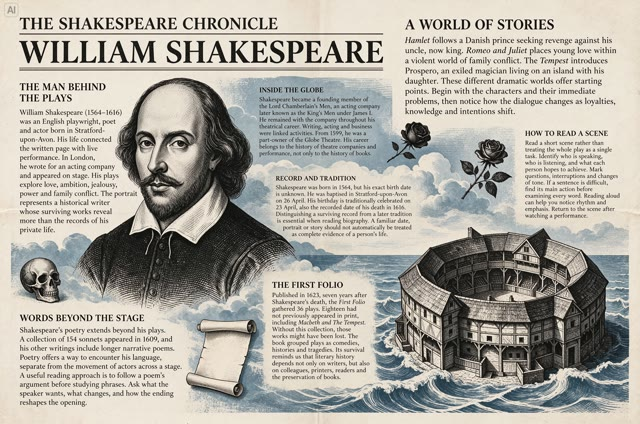

# Shakespeare newspaper

[English](README.md) · [简体中文](README.zh-CN.md)

[Back to cases](../../README.md#cases)

**Official demo · Not independently reproduced**

This is a reduced representative-frame preview, not a complete animation or an exported transparent asset.

[Open original media](https://lf3-static.bytednsdoc.com/obj/eden-cn/lapzild-tss/ljhwZthlaukjlkulzlp/user-upload/4xfa4mw8m2wk9.png)

## Prompt

The source does not publish a complete input prompt for this example. No reconstructed text is labeled as the original prompt.

[View prompt source](https://seed.bytedance.com/en/blog/more-realistic-images-more-stable-editing-across-100-rounds-introducing-seedream-5-5)

## Attribution & limits

- Author: ByteDance Seed
- Source model attribution: Seedream 5.5
- Checked: 2026-11-10
- [Source page](https://seed.bytedance.com/en/blog/more-realistic-images-more-stable-editing-across-100-rounds-introducing-seedream-5-5)

Original media is linked at its source. Only reduced representative-frame JPEG previews are bundled. Owners retain their rights; MIT does not cover this media, previews or source prompts. Demo GIFs do not establish native animation generation; JPEG previews have no alpha channel.
