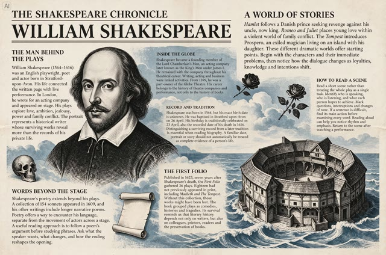

# 莎士比亚报刊

[English](README.md) · [简体中文](README.zh-CN.md)

[返回案例目录](../../README.zh-CN.md#cases)

**官方展示 · 未独立复现**

以上为缩放后的代表帧预览，不是完整动画或可用的透明素材导出文件。

[打开原始媒体](https://lf3-static.bytednsdoc.com/obj/eden-cn/lapzild-tss/ljhwZthlaukjlkulzlp/user-upload/4xfa4mw8m2wk9.png)

## 提示词

该来源没有公开本案例的完整输入提示词；本仓库不补写为原始提示词。

[查看提示词来源](https://seed.bytedance.com/en/blog/more-realistic-images-more-stable-editing-across-100-rounds-introducing-seedream-5-5)

## 出处与边界

- 作者: ByteDance Seed
- 模型来源归因: Seedream 5.5
- 核对日期: 2026-11-10
- [来源页面](https://seed.bytedance.com/en/blog/more-realistic-images-more-stable-editing-across-100-rounds-introducing-seedream-5-5)

原始媒体通过来源地址提供；仓库只保存经缩放的 JPEG 代表帧预览。原权利人保留权利；MIT 许可不覆盖这些媒体、预览与原始提示词。GIF 是展示序列，不代表模型原生生成动画；JPEG 预览不含 Alpha 通道。
