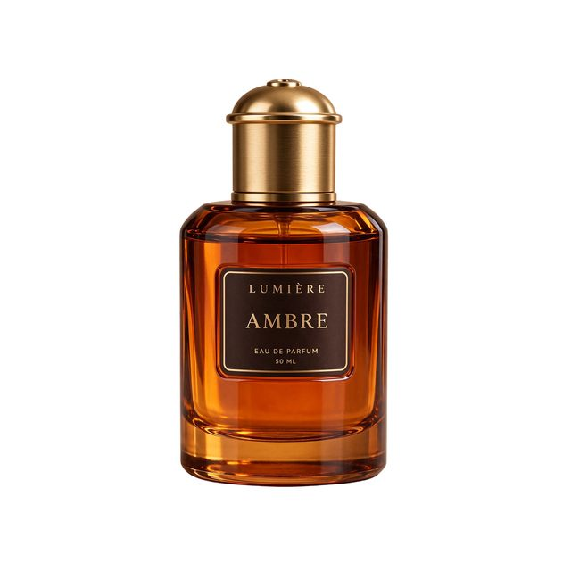

# Amber perfume cutout

[English](README.md) · [简体中文](README.zh-CN.md)

[Back to cases](../../README.md#cases)

**Creator-reported · Not independently reproduced**



This is a reduced representative-frame preview, not a complete animation or an exported transparent asset.

[Open original media](https://cdn.beatapi.io/prompt-gallery/seedream-5-5/730f32a34266b61abe0e1bf743b25d7efe417d3ffd2d4138821c7614afdfc0a1.jpg)

## Prompt

```text
Studio product asset of a translucent amber glass perfume bottle with a brushed-gold cap, floating centred in the frame. Fully transparent background with native alpha channel, clean accurate edges around the glass, cap and reflections, no background colour bleed, no white halo, no cut-off shadows. Preserve realistic glass refraction and internal liquid. Commercial e-commerce asset, front-facing composition, high detail, suitable for direct placement onto any design background.
```

The prompt is attributed to the creator by the source curator; no independent reproduction was performed.

[View prompt source](https://github.com/BeatAPI/awesome-seedream-5-5-prompts/blob/main/cases/dheepan-asset-9.md)

## Attribution & limits

- Author: Dheepanratnam
- Source model attribution: Seedream 5.5
- Checked: 2026-11-10
- [Source page](https://x.com/Dheepanratnam/status/2119775195573481859)

Original media is linked at its source. Only reduced representative-frame JPEG previews are bundled. Owners retain their rights; MIT does not cover this media, previews or source prompts. Demo GIFs do not establish native animation generation; JPEG previews have no alpha channel.

> Source-attributed social image and prompt from a public curator; not reproduced here. Reduced preview, not original export. JPEG does not verify the source alpha channel.
