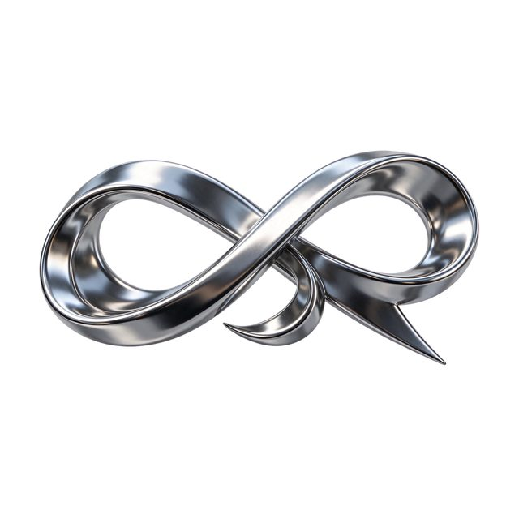

# Chrome ribbon logo

[English](README.md) · [简体中文](README.zh-CN.md)

[Back to cases](../../README.md#cases)

**Creator-reported · Not independently reproduced**



This is a reduced representative-frame preview, not a complete animation or an exported transparent asset.

[Open original media](https://cdn.beatapi.io/prompt-gallery/seedream-5-5/37c7a2fad998200faae7f267f9e5b7d0779e43b712ee0d1e22da46e442447f83.jpg)

## Prompt

```text
Transparent PNG asset of a floating 3D chrome ribbon logo shape, elegantly twisted like liquid metal, with realistic specular highlights and soft internal reflections. Fully transparent background, native alpha channel, crisp edges around every curve, no background glow, no rectangular bounding artefacts, no drop shadow baked in. Minimal premium brand asset, centred, suitable for overlaying on video or web design.
```

The prompt is attributed to the creator by the source curator; no independent reproduction was performed.

[View prompt source](https://github.com/BeatAPI/awesome-seedream-5-5-prompts/blob/main/cases/dheepan-asset-12.md)

## Attribution & limits

- Author: Dheepanratnam
- Source model attribution: Seedream 5.5
- Checked: 2026-11-10
- [Source page](https://x.com/Dheepanratnam/status/2119775195573481859)

Original media is linked at its source. Only reduced representative-frame JPEG previews are bundled. Owners retain their rights; MIT does not cover this media, previews or source prompts. Demo GIFs do not establish native animation generation; JPEG previews have no alpha channel.

> Photos fetched from the author's original X post; local JPEG previews are at most 640px. Model attribution is not an independent reproduction. JPEG preview does not verify original alpha.
