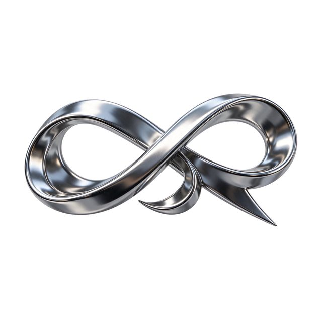

# 铬金属流体丝带透明素材

[English](README.md) · [简体中文](README.zh-CN.md)

[返回案例目录](../../README.zh-CN.md#cases)

**作者自报 · 未独立复现**



以上为缩放后的代表帧预览，不是完整动画或可用的透明素材导出文件。

[打开原始媒体](https://cdn.beatapi.io/prompt-gallery/seedream-5-5/37c7a2fad998200faae7f267f9e5b7d0779e43b712ee0d1e22da46e442447f83.jpg)

## 提示词

```text
Transparent PNG asset of a floating 3D chrome ribbon logo shape, elegantly twisted like liquid metal, with realistic specular highlights and soft internal reflections. Fully transparent background, native alpha channel, crisp edges around every curve, no background glow, no rectangular bounding artefacts, no drop shadow baked in. Minimal premium brand asset, centred, suitable for overlaying on video or web design.
```

以上为来源公开、归因于作者的提示词；本站未独立复现，请对照原作者帖文确认二次转录。

[查看提示词来源](https://github.com/BeatAPI/awesome-seedream-5-5-prompts/blob/main/cases/dheepan-asset-12.md)

## 出处与边界

- 作者: Dheepanratnam
- 模型来源归因: Seedream 5.5
- 核对日期: 2026-11-10
- [来源页面](https://x.com/Dheepanratnam/status/2119775195573481859)

原始媒体通过来源地址提供；仓库只保存经缩放的 JPEG 代表帧预览。原权利人保留权利；MIT 许可不覆盖这些媒体、预览与原始提示词。GIF 是展示序列，不代表模型原生生成动画；JPEG 预览不含 Alpha 通道。

> 已从作者 X 原帖下载配图，并保存为640px以内的JPEG预览。模型来源归因未经独立生成验证。 缩略图无法证明原始Alpha透明度。
