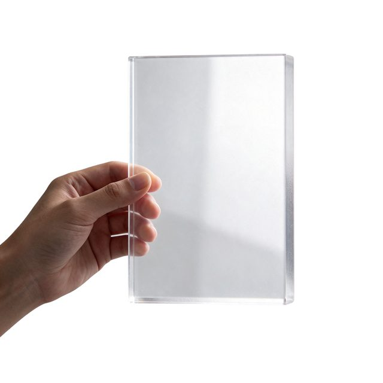

# Frosted acrylic sheet

[English](README.md) · [简体中文](README.zh-CN.md)

[Back to cases](../../README.md#cases)

**Creator-reported · Not independently reproduced**



This is a reduced representative-frame preview, not a complete animation or an exported transparent asset.

[Open original media](https://cdn.beatapi.io/prompt-gallery/seedream-5-5/d9f9549ad1efd94719be54c9b2d2a23c5b205e59323fef90af27ebb3dab91ac8.jpg)

## Prompt

```text
PNG asset of a hand holding a clear acrylic sheet with a subtle frosted edge, photographed straight on. The acrylic sheet must have realistic partial transparency, visible refraction and a soft translucent gradient, while the hand and fingers remain fully opaque. Native alpha channel, clean anti-aliased edges, no background, no colour contamination, no harsh cut-out edges. Premium UI/design asset, centred composition.
```

The prompt is attributed to the creator by the source curator; no independent reproduction was performed.

[View prompt source](https://github.com/BeatAPI/awesome-seedream-5-5-prompts/blob/main/cases/dheepan-asset-11.md)

## Attribution & limits

- Author: Dheepanratnam
- Source model attribution: Seedream 5.5
- Checked: 2026-11-10
- [Source page](https://x.com/Dheepanratnam/status/2119775195573481859)

Original media is linked at its source. Only reduced representative-frame JPEG previews are bundled. Owners retain their rights; MIT does not cover this media, previews or source prompts. Demo GIFs do not establish native animation generation; JPEG previews have no alpha channel.

> Photos fetched from the author's original X post; local JPEG previews are at most 640px. Model attribution is not an independent reproduction. JPEG preview does not verify original alpha.
