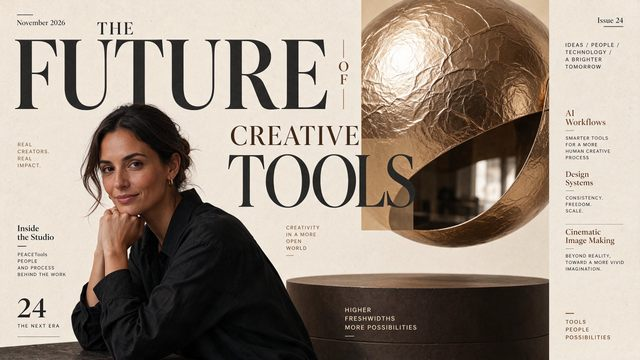

# Magazine cover typography

[English](README.md) · [简体中文](README.zh-CN.md)

[Back to cases](../../README.md#cases)

**Creator-reported · Not independently reproduced**



This is a reduced representative-frame preview, not a complete animation or an exported transparent asset.

[Open original media](https://cdn.beatapi.io/prompt-gallery/seedream-5-5/c2d597c77c52fa73d97cb6dc28d0181e2966d54c721b17a89bc4241ad8bfe386.jpg)

## Prompt

```text
Premium magazine cover design titled “THE FUTURE OF CREATIVE TOOLS”, with a realistic portrait of a stylish creative director in the lower third. Dense small cover lines around the edges: “Issue 24”, “AI Workflows”, “Design Systems”, “Cinematic Image Making”, “Inside the Studio”, “November 2026”. Clean modern serif masthead, precise kerning, crisp letterforms, editorial grid, muted cream background, subtle paper texture, high-end print-design layout. All text must be spelled exactly as written, no distorted letters, no duplicated words, no gibberish.
```

The prompt is attributed to the creator by the source curator; no independent reproduction was performed.

[View prompt source](https://github.com/BeatAPI/awesome-seedream-5-5-prompts/blob/main/cases/dheepan-typography-5.md)

## Attribution & limits

- Author: Dheepanratnam
- Source model attribution: Seedream 5.5
- Checked: 2026-11-10
- [Source page](https://x.com/Dheepanratnam/status/2119767938173387065)

Original media is linked at its source. Only reduced representative-frame JPEG previews are bundled. Owners retain their rights; MIT does not cover this media, previews or source prompts. Demo GIFs do not establish native animation generation; JPEG previews have no alpha channel.

> Source-attributed social image and prompt from a public curator; not reproduced here. Reduced preview, not original export.
