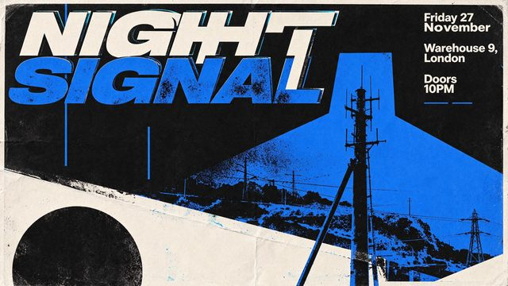

# Night Signal event poster

[English](README.md) · [简体中文](README.zh-CN.md)

[Back to cases](../../README.md#cases)

**Creator-reported · Not independently reproduced**



This is a reduced representative-frame preview, not a complete animation or an exported transparent asset.

[Open original media](https://cdn.beatapi.io/prompt-gallery/seedream-5-5/c5f0ad2019f4f9d98d5b307e1c06dc1d9d671defffba7c080c0cd8d690d35c60.jpg)

## Prompt

```text
Bold gig poster for an underground electronic music night. Large headline reads exactly “NIGHT SIGNAL”, with supporting text: “Friday 27 November”, “Warehouse 9, London”, “Doors 10PM”. Experimental Swiss-style layout, high-contrast black, off-white and electric blue, grainy risograph texture, sharp geometric typography, intentional negative space, screen-print aesthetic. All words spelled exactly as specified, no extra text, no warped letters, no AI artefacts.
```

The prompt is attributed to the creator by the source curator; no independent reproduction was performed.

[View prompt source](https://github.com/BeatAPI/awesome-seedream-5-5-prompts/blob/main/cases/dheepan-typography-8.md)

## Attribution & limits

- Author: Dheepanratnam
- Source model attribution: Seedream 5.5
- Checked: 2026-11-10
- [Source page](https://x.com/Dheepanratnam/status/2119767938173387065)

Original media is linked at its source. Only reduced representative-frame JPEG previews are bundled. Owners retain their rights; MIT does not cover this media, previews or source prompts. Demo GIFs do not establish native animation generation; JPEG previews have no alpha channel.

> Source-attributed social image and prompt from a public curator; not reproduced here. Reduced preview, not original export.
