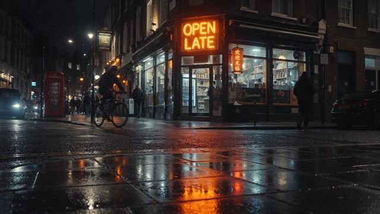

# Rainy multilingual storefront

[English](README.md) · [简体中文](README.zh-CN.md)

[Back to cases](../../README.md#cases)

**Creator-reported · Not independently reproduced**



This is a reduced representative-frame preview, not a complete animation or an exported transparent asset.

[Open original media](https://cdn.beatapi.io/prompt-gallery/seedream-5-5/8ad02f55c33d972cb1769866a9bed8b68765c2576dea86f53c40a928cbb422e5.jpg)

## Prompt

```text
Photorealistic street scene in a multicultural London neighbourhood at night. A shopfront sign reads exactly “OPEN LATE” in English, with a smaller hanging sign reading exactly “欢迎光临” in simplified Chinese and another small poster reading exactly “Bienvenue” in French. Realistic neon glow, legible typography, correct character shapes, no duplicated letters, no warped glyphs, natural perspective on the signs, cinematic night photography, wet pavement reflections, no extra invented text.
```

The prompt is attributed to the creator by the source curator; no independent reproduction was performed.

[View prompt source](https://github.com/BeatAPI/awesome-seedream-5-5-prompts/blob/main/cases/dheepan-typography-6.md)

## Attribution & limits

- Author: Dheepanratnam
- Source model attribution: Seedream 5.5
- Checked: 2026-11-10
- [Source page](https://x.com/Dheepanratnam/status/2119767938173387065)

Original media is linked at its source. Only reduced representative-frame JPEG previews are bundled. Owners retain their rights; MIT does not cover this media, previews or source prompts. Demo GIFs do not establish native animation generation; JPEG previews have no alpha channel.

> Source-attributed social image and prompt from a public curator; not independently regenerated here. Reduced preview, not original export.
