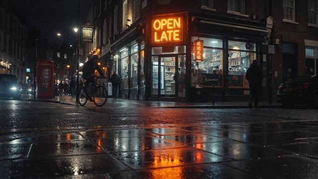

# 雨夜多语种招牌

[English](README.md) · [简体中文](README.zh-CN.md)

[返回案例目录](../../README.zh-CN.md#cases)

**作者自报 · 未独立复现**



以上为缩放后的代表帧预览，不是完整动画或可用的透明素材导出文件。

[打开原始媒体](https://cdn.beatapi.io/prompt-gallery/seedream-5-5/8ad02f55c33d972cb1769866a9bed8b68765c2576dea86f53c40a928cbb422e5.jpg)

## 提示词

```text
Photorealistic street scene in a multicultural London neighbourhood at night. A shopfront sign reads exactly “OPEN LATE” in English, with a smaller hanging sign reading exactly “欢迎光临” in simplified Chinese and another small poster reading exactly “Bienvenue” in French. Realistic neon glow, legible typography, correct character shapes, no duplicated letters, no warped glyphs, natural perspective on the signs, cinematic night photography, wet pavement reflections, no extra invented text.
```

以上为来源公开、归因于作者的提示词；本站未独立复现，请对照原作者帖文确认二次转录。

[查看提示词来源](https://github.com/BeatAPI/awesome-seedream-5-5-prompts/blob/main/cases/dheepan-typography-6.md)

## 出处与边界

- 作者: Dheepanratnam
- 模型来源归因: Seedream 5.5
- 核对日期: 2026-11-10
- [来源页面](https://x.com/Dheepanratnam/status/2119767938173387065)

原始媒体通过来源地址提供；仓库只保存经缩放的 JPEG 代表帧预览。原权利人保留权利；MIT 许可不覆盖这些媒体、预览与原始提示词。GIF 是展示序列，不代表模型原生生成动画；JPEG 预览不含 Alpha 通道。

> 来自公开整理站的作者归因图片与提示词，未在本仓库独立复现。图像为缩小版，非原始导出。
