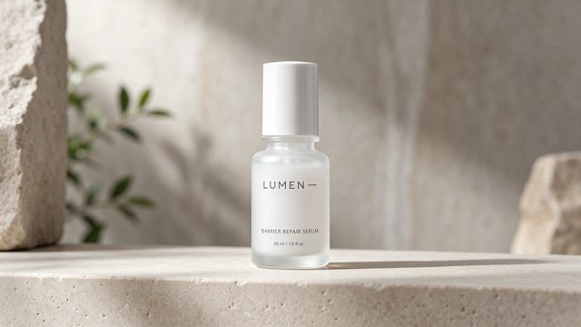

# Skincare packaging text

[English](README.md) · [简体中文](README.zh-CN.md)

[Back to cases](../../README.md#cases)

**Creator-reported · Not independently reproduced**



This is a reduced representative-frame preview, not a complete animation or an exported transparent asset.

[Open original media](https://cdn.beatapi.io/prompt-gallery/seedream-5-5/ed5c2e7d4b3ffb274b5ca4896acd8d5fd38333be39f6caab92192d7e3d7011fc.jpg)

## Prompt

```text
Minimalist skincare packaging mock-up on a pale stone pedestal. A frosted-glass serum bottle has a clean label reading exactly “LUMEN — BARRIER REPAIR SERUM”, with smaller text beneath: “30 ml / 1.0 fl oz”. Elegant sans-serif typography, perfectly straight label alignment, crisp small print, realistic glass refraction, soft studio lighting, subtle shadow, premium cosmetic advertising photography, no misspelled words, no extra branding, no watermark.
```

The prompt is attributed to the creator by the source curator; no independent reproduction was performed.

[View prompt source](https://github.com/BeatAPI/awesome-seedream-5-5-prompts/blob/main/cases/dheepan-typography-7.md)

## Attribution & limits

- Author: Dheepanratnam
- Source model attribution: Seedream 5.5
- Checked: 2026-11-10
- [Source page](https://x.com/Dheepanratnam/status/2119767938173387065)

Original media is linked at its source. Only reduced representative-frame JPEG previews are bundled. Owners retain their rights; MIT does not cover this media, previews or source prompts. Demo GIFs do not establish native animation generation; JPEG previews have no alpha channel.

> Source-attributed social image and prompt from a public curator; not independently regenerated here. Reduced preview, not original export.
