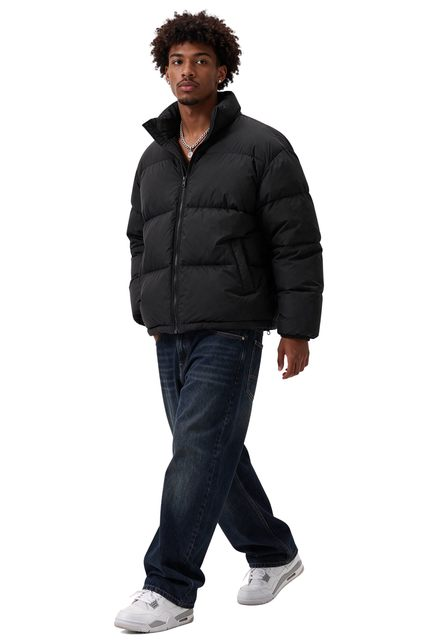

# Streetwear cutout

[English](README.md) · [简体中文](README.zh-CN.md)

[Back to cases](../../README.md#cases)

**Creator-reported · Not independently reproduced**



This is a reduced representative-frame preview, not a complete animation or an exported transparent asset.

[Open original media](https://cdn.beatapi.io/prompt-gallery/seedream-5-5/e0e9f10be4539649b5940138a4f241da96ca0a7ce43d18881cd590b266a1a66a.jpg)

## Prompt

```text
Full-body cut-out asset of a stylish young Black male streetwear model wearing an oversized charcoal puffer jacket, baggy denim jeans and white trainers, walking casually. Fully transparent background with native alpha channel, precise edges around curly hair, jacket fibres, shoelaces and fingers, no background remnants, no halo, no clipped limbs. Natural stance, studio-quality lighting from front left, suitable for compositing into a fashion campaign.
```

The prompt is attributed to the creator by the source curator; no independent reproduction was performed.

[View prompt source](https://github.com/BeatAPI/awesome-seedream-5-5-prompts/blob/main/cases/dheepan-asset-10.md)

## Attribution & limits

- Author: Dheepanratnam
- Source model attribution: Seedream 5.5
- Checked: 2026-11-10
- [Source page](https://x.com/Dheepanratnam/status/2119775195573481859)

Original media is linked at its source. Only reduced representative-frame JPEG previews are bundled. Owners retain their rights; MIT does not cover this media, previews or source prompts. Demo GIFs do not establish native animation generation; JPEG previews have no alpha channel.

> Source-attributed social image and prompt from a public curator; not independently regenerated here. Reduced preview, not original export. JPEG does not verify the source alpha channel.
