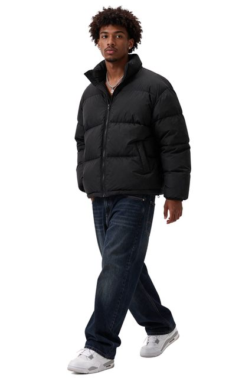

# 街头模特透明背景素材

[English](README.md) · [简体中文](README.zh-CN.md)

[返回案例目录](../../README.zh-CN.md#cases)

**作者自报 · 未独立复现**



以上为缩放后的代表帧预览，不是完整动画或可用的透明素材导出文件。

[打开原始媒体](https://cdn.beatapi.io/prompt-gallery/seedream-5-5/e0e9f10be4539649b5940138a4f241da96ca0a7ce43d18881cd590b266a1a66a.jpg)

## 提示词

```text
Full-body cut-out asset of a stylish young Black male streetwear model wearing an oversized charcoal puffer jacket, baggy denim jeans and white trainers, walking casually. Fully transparent background with native alpha channel, precise edges around curly hair, jacket fibres, shoelaces and fingers, no background remnants, no halo, no clipped limbs. Natural stance, studio-quality lighting from front left, suitable for compositing into a fashion campaign.
```

以上为来源公开、归因于作者的提示词；本站未独立复现，请对照原作者帖文确认二次转录。

[查看提示词来源](https://github.com/BeatAPI/awesome-seedream-5-5-prompts/blob/main/cases/dheepan-asset-10.md)

## 出处与边界

- 作者: Dheepanratnam
- 模型来源归因: Seedream 5.5
- 核对日期: 2026-11-10
- [来源页面](https://x.com/Dheepanratnam/status/2119775195573481859)

原始媒体通过来源地址提供；仓库只保存经缩放的 JPEG 代表帧预览。原权利人保留权利；MIT 许可不覆盖这些媒体、预览与原始提示词。GIF 是展示序列，不代表模型原生生成动画；JPEG 预览不含 Alpha 通道。

> 来自公开整理站的作者归因图片与提示词，未在本仓库独立复现。图像为缩小版，非原始导出。 这张 JPEG 不能证明原始 Alpha 透明度。
