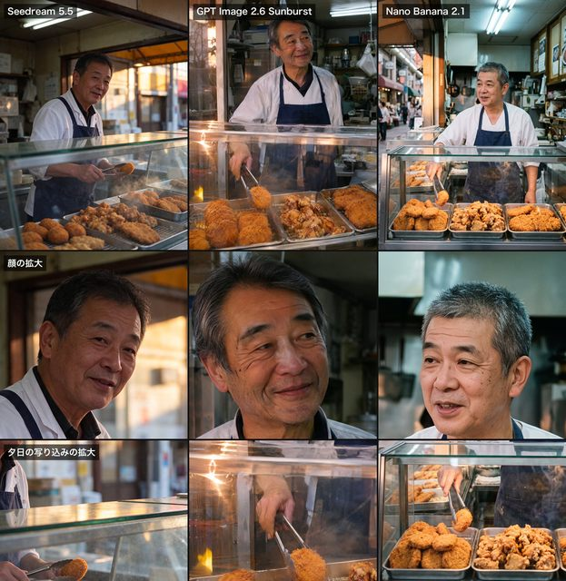

# Japanese deli model comparison

[English](README.md) · [简体中文](README.zh-CN.md)

[Back to cases](../../README.md#cases)

**Creator-reported · Not independently reproduced**



This is a reduced representative-frame preview, not a complete animation or an exported transparent asset.

[Open original media](https://cdn.beatapi.io/prompt-gallery/seedream-5-5/3448341778ba5e9734d6c2d9e24480995ce212affbbdc54e05cffc461ee3557d.jpg)

## Prompt

```text
実写の写真。自然なスナップ写真。35mmレンズ、目の高さから撮る。夕方、日本の商店街にある家族経営の小さな惣菜屋の店先。60代前半の日本人男性の店主が、ガラスのショーケースの奥に立っている。ケースの中には、金属のトレイに並んだコロッケ・唐揚げ・とんかつ。店主は白い調理着に紺のエプロン。トングでコロッケを1つ持ち上げ、カメラから少し外れた所を見て、力の抜けた半分の笑顔。光は2種類が混ざる。店の中は青白い蛍光灯、通り側からはオレンジ色の夕日。肌は本物の質感で、しわは控えめに自然に。テカりなし、白飛びなし。ショーケースのガラスに映り込みがある。揚げ物の衣はザクザクした質感が見え、湯気が少し立つ。背景は少しぼかす。営業中の店らしい、日常の雑然さを残す。文字・ロゴは入れない。
```

The prompt is attributed to the creator by the source curator; no independent reproduction was performed.

[View prompt source](https://github.com/BeatAPI/awesome-seedream-5-5-prompts/blob/main/cases/genel-japanese-deli-comparison.md)

## Attribution & limits

- Author: genel_ai
- Source model attribution: Seedream 5.5
- Checked: 2026-11-10
- [Source page](https://x.com/genel_ai/status/2119786434567827504)

Original media is linked at its source. Only reduced representative-frame JPEG previews are bundled. Owners retain their rights; MIT does not cover this media, previews or source prompts. Demo GIFs do not establish native animation generation; JPEG previews have no alpha channel.

> Source-attributed social image and prompt from a public curator; not independently regenerated here. Reduced preview, not original export. This is a 3-model collage, with Seedream 5.5 at left.
