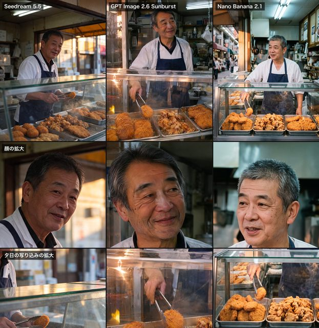

# 日本熟食店三模型对比

[English](README.md) · [简体中文](README.zh-CN.md)

[返回案例目录](../../README.zh-CN.md#cases)

**作者自报 · 未独立复现**



以上为缩放后的代表帧预览，不是完整动画或可用的透明素材导出文件。

[打开原始媒体](https://cdn.beatapi.io/prompt-gallery/seedream-5-5/3448341778ba5e9734d6c2d9e24480995ce212affbbdc54e05cffc461ee3557d.jpg)

## 提示词

```text
実写の写真。自然なスナップ写真。35mmレンズ、目の高さから撮る。夕方、日本の商店街にある家族経営の小さな惣菜屋の店先。60代前半の日本人男性の店主が、ガラスのショーケースの奥に立っている。ケースの中には、金属のトレイに並んだコロッケ・唐揚げ・とんかつ。店主は白い調理着に紺のエプロン。トングでコロッケを1つ持ち上げ、カメラから少し外れた所を見て、力の抜けた半分の笑顔。光は2種類が混ざる。店の中は青白い蛍光灯、通り側からはオレンジ色の夕日。肌は本物の質感で、しわは控えめに自然に。テカりなし、白飛びなし。ショーケースのガラスに映り込みがある。揚げ物の衣はザクザクした質感が見え、湯気が少し立つ。背景は少しぼかす。営業中の店らしい、日常の雑然さを残す。文字・ロゴは入れない。
```

以上为来源公开、归因于作者的提示词；本站未独立复现，请对照原作者帖文确认二次转录。

[查看提示词来源](https://github.com/BeatAPI/awesome-seedream-5-5-prompts/blob/main/cases/genel-japanese-deli-comparison.md)

## 出处与边界

- 作者: genel_ai
- 模型来源归因: Seedream 5.5
- 核对日期: 2026-11-10
- [来源页面](https://x.com/genel_ai/status/2119786434567827504)

原始媒体通过来源地址提供；仓库只保存经缩放的 JPEG 代表帧预览。原权利人保留权利；MIT 许可不覆盖这些媒体、预览与原始提示词。GIF 是展示序列，不代表模型原生生成动画；JPEG 预览不含 Alpha 通道。

> 来自公开整理站的作者归因图片与提示词，未在本仓库独立复现。图像为缩小版，非原始导出。 此图是三模型比较拼图，Seedream 5.5 为左侧列。
