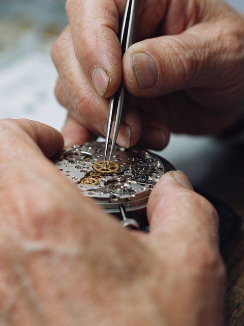
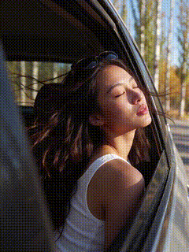
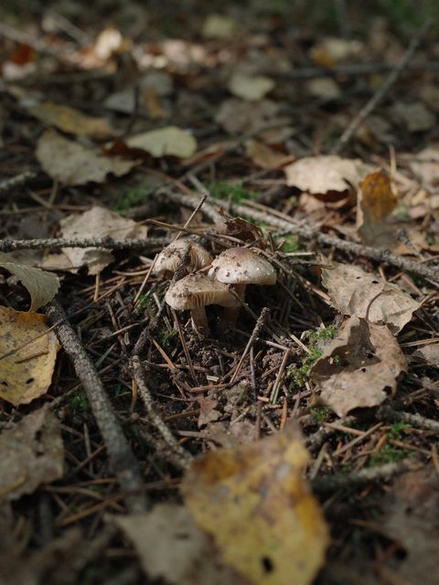
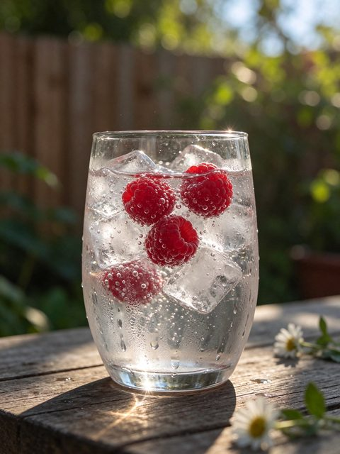
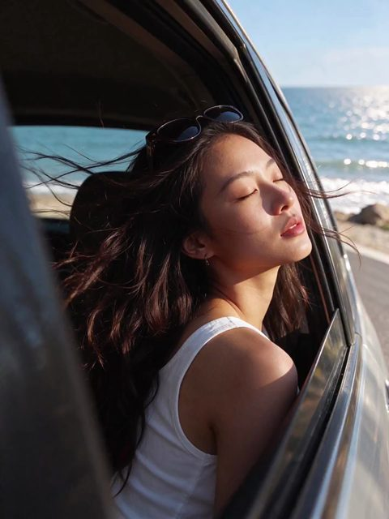

# Watchmaker, forest floor and fizzy water

[English](README.md) · [简体中文](README.zh-CN.md)

[Back to cases](../../README.md#cases)

**Creator-reported · Not independently reproduced**

This is a reduced representative-frame preview, not a complete animation or an exported transparent asset.

[Open original media](https://pbs.twimg.com/media/HWrahiWbUAAe4ma.jpg?name=orig)

## Animated excerpt from X video

Low-resolution excerpt of the source post video, not a native Seedream GIF. Open original media for the full video.

## More photos from the original post

**Image 2**

[Source media](https://pbs.twimg.com/media/HWrakfOawAEZGis.jpg?name=orig)

**Image 3**

[Source media](https://pbs.twimg.com/media/HWra8BKa4AA9spQ.jpg?name=orig)

**Image 4**

[Source media](https://video.twimg.com/amplify_video/2119747057913311232/vid/avc1/720x960/pvYxTQmjCe3zpFv3.mp4?tag=29)

## Prompt

The source does not publish a complete input prompt for this example. No reconstructed text is labeled as the original prompt.

[View prompt source](https://x.com/kevinchin35/status/2119747692427628777)

## Attribution & limits

- Author: kevinchin35
- Source model attribution: Seedream 5.5
- Checked: 2026-11-10
- [Source page](https://x.com/kevinchin35/status/2119747692427628777)

Original media is linked at its source. Only reduced representative-frame JPEG previews are bundled. Owners retain their rights; MIT does not cover this media, previews or source prompts. Demo GIFs do not establish native animation generation; JPEG previews have no alpha channel.

> Images are reduced previews fetched from the creator's X post; videos are represented by a still and short animated excerpt, with full video at source. Model attribution is source-reported, not independently reproduced. A curator catalog provides image provenance; refer to the author's original post.
