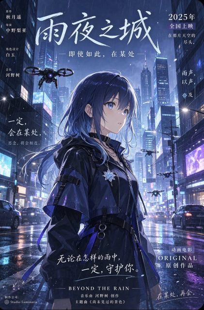
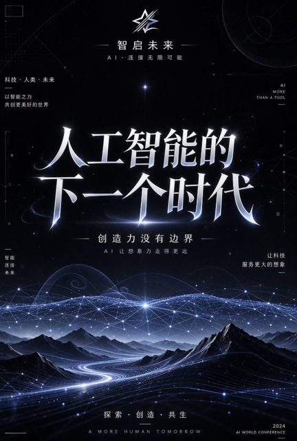

# 雨城动漫、AI海报与窗光人像

[English](README.md) · [简体中文](README.zh-CN.md)

[返回案例目录](../../README.zh-CN.md#cases)

**作者自报 · 未独立复现**

以上为缩放后的代表帧预览，不是完整动画或可用的透明素材导出文件。

[打开原始媒体](https://pbs.twimg.com/media/HWrp7fpbYAAg-yf.jpg?name=orig)

## 同一原帖的更多图片

**配图 2**

[原媒体](https://pbs.twimg.com/media/HWrqC4Ub0AAuQ3f.jpg?name=orig)

**配图 3**

[原媒体](https://pbs.twimg.com/media/HWrqFyCaUAI0mSN.jpg?name=orig)

**配图 4**

[原媒体](https://pbs.twimg.com/media/HWrqI7NacAAt6d0.png?name=orig)

## 提示词

该来源没有公开本案例的完整输入提示词；本仓库不补写为原始提示词。

[查看提示词来源](https://x.com/TqMiracle18260/status/2119765639825089008)

## 出处与边界

- 作者: TqMiracle18260
- 模型来源归因: Seedream 5.5
- 核对日期: 2026-11-10
- [来源页面](https://x.com/TqMiracle18260/status/2119765639825089008)

原始媒体通过来源地址提供；仓库只保存经缩放的 JPEG 代表帧预览。原权利人保留权利；MIT 许可不覆盖这些媒体、预览与原始提示词。GIF 是展示序列，不代表模型原生生成动画；JPEG 预览不含 Alpha 通道。

> 图片直接从作者 X 原帖媒体下载并缩放；视频只保存抽帧和短动图预览，完整视频请打开原始媒体。模型归因来自作者或署名整理，非本仓库复现。 社媒整理站提供了图片对应关系；请以原帖为准。
