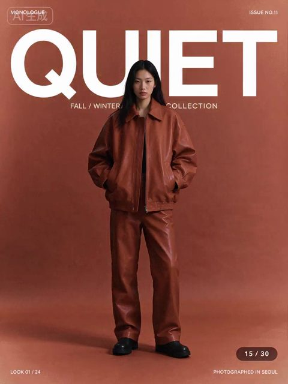
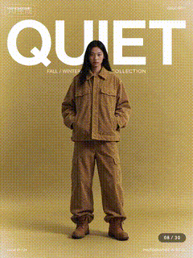

# Thirty-round character and text edit GIF

[English](README.md) · [简体中文](README.zh-CN.md)

[Back to cases](../../README.md#cases)

**Creator-reported · Not independently reproduced**

This is a reduced representative-frame preview, not a complete animation or an exported transparent asset.

[Open original media](https://video.twimg.com/tweet_video/HWrwXJeboAEJIj6.mp4)

## Animated excerpt from X video

Low-resolution excerpt of the source post video, not a native Seedream GIF. Open original media for the full video.

## Prompt

The source does not publish a complete input prompt for this example. No reconstructed text is labeled as the original prompt.

[View prompt source](https://x.com/xiaohu/status/2119774478788141417)

## Attribution & limits

- Author: xiaohu
- Source model attribution: Seedream 5.5
- Checked: 2026-11-10
- [Source page](https://x.com/xiaohu/status/2119774478788141417)

Original media is linked at its source. Only reduced representative-frame JPEG previews are bundled. Owners retain their rights; MIT does not cover this media, previews or source prompts. Demo GIFs do not establish native animation generation; JPEG previews have no alpha channel.

> Still and short GIF extracted from the original X post video, not a native model GIF. The source link has the full video.
