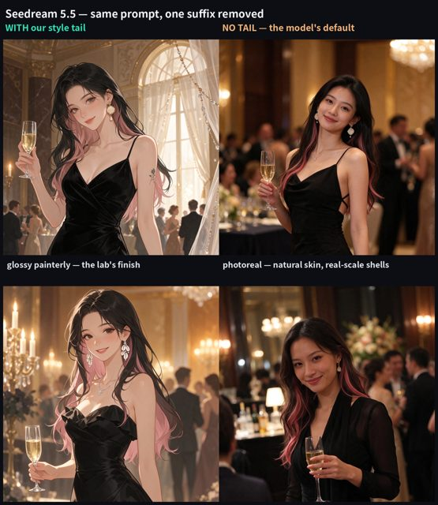

# Removing the style suffix: illustration versus photoreal

[English](README.md) · [简体中文](README.zh-CN.md)

[Back to cases](../../README.md#cases)

**Creator-reported · Not independently reproduced**

This is a reduced representative-frame preview, not a complete animation or an exported transparent asset.

[Open original media](https://pbs.twimg.com/media/HWsKG9qWsAEjV9t.jpg?name=orig)

## Prompt

Prompt text or demo descriptions are available at the source. The full text is not copied here; demo descriptions are not presented as complete model inputs.

[View prompt source](https://x.com/KakiponzuX/status/2119799171397906607)

## Attribution & limits

- Author: KakiponzuX
- Source model attribution: Seedream 5.5
- Checked: 2026-11-10
- [Source page](https://x.com/KakiponzuX/status/2119799171397906607)

Original media is linked at its source. Only reduced representative-frame JPEG previews are bundled. Owners retain their rights; MIT does not cover this media, previews or source prompts. Demo GIFs do not establish native animation generation; JPEG previews have no alpha channel.

> The creator reports removing only a painterly style suffix: left includes it and right omits it. This is a same-model style control, not a model ranking. The complete base prompt was not retrieved.
