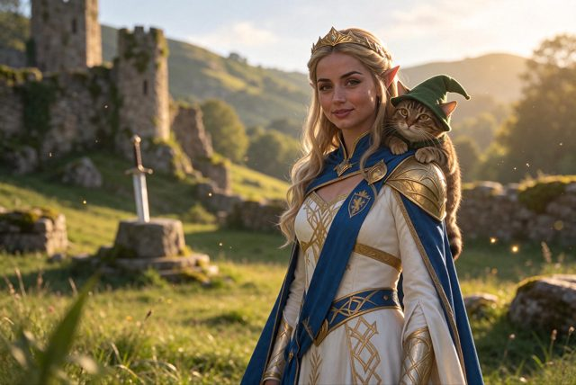
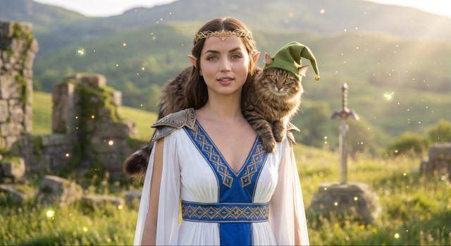
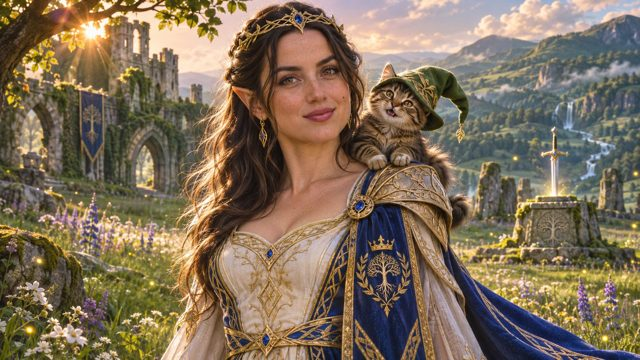

# Fantasy character and small dragon: three-model comparison

[English](README.md) · [简体中文](README.zh-CN.md)

[Back to cases](../../README.md#cases)

**Creator-reported · Not independently reproduced**

This is a reduced representative-frame preview, not a complete animation or an exported transparent asset.

[Open original media](https://pbs.twimg.com/media/HWfKk2sXkAA5Zcm.jpg?name=orig)

## More photos from the original post

**Image 2**

[Source media](https://pbs.twimg.com/media/HWfKk2qWcAAOzkN.jpg?name=orig)

**Image 3**

[Source media](https://pbs.twimg.com/media/HWfKk22W4AEVIdn.jpg?name=orig)

## Prompt

Complete original prompt pending verification; the current record contains only a source link or demo description.

[View prompt source](https://x.com/lyraxana/status/2118884892427551046)

## Attribution & limits

- Author: lyraxana
- Source model attribution: Seedream 5.5
- Checked: 2026-11-10
- [Source page](https://x.com/lyraxana/status/2118884892427551046)

Original media is linked at its source. Only reduced representative-frame JPEG previews are bundled. Owners retain their rights; MIT does not cover this media, previews or source prompts. Demo GIFs do not establish native animation generation; JPEG previews have no alpha channel.

> Source ALT labels identify Seedream 5.5, Nano Banana Pro, then GPT Image 2.6 Sunburst. The latter two are not Seedream outputs. Posted on 2026-11-07 before the official release; attribution is creator-reported and neither backend identity nor prompt parity was independently verified.
