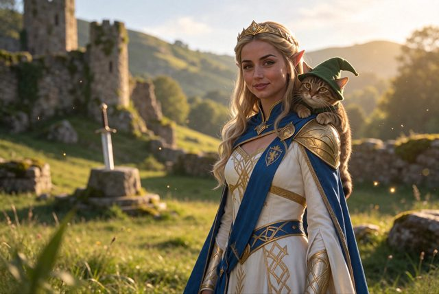
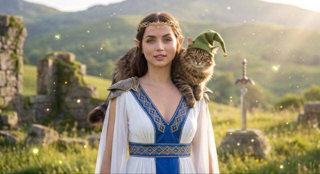
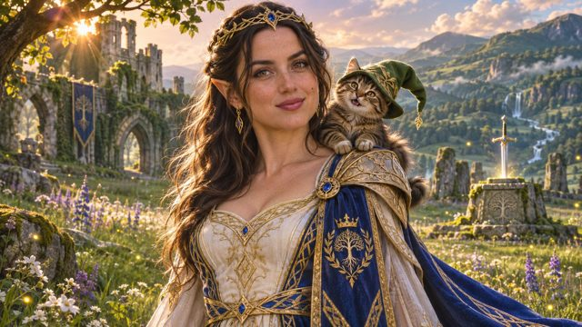

# 奇幻人物与幼龙：三模型配图对比

[English](README.md) · [简体中文](README.zh-CN.md)

[返回案例目录](../../README.zh-CN.md#cases)

**作者自报 · 未独立复现**

以上为缩放后的代表帧预览，不是完整动画或可用的透明素材导出文件。

[打开原始媒体](https://pbs.twimg.com/media/HWfKk2sXkAA5Zcm.jpg?name=orig)

## 同一原帖的更多图片

**配图 2**

[原媒体](https://pbs.twimg.com/media/HWfKk2qWcAAOzkN.jpg?name=orig)

**配图 3**

[原媒体](https://pbs.twimg.com/media/HWfKk22W4AEVIdn.jpg?name=orig)

## 提示词

完整原始提示词待核实；现有记录仅包含来源链接或展示说明。

[查看提示词来源](https://x.com/lyraxana/status/2118884892427551046)

## 出处与边界

- 作者: lyraxana
- 模型来源归因: Seedream 5.5
- 核对日期: 2026-11-10
- [来源页面](https://x.com/lyraxana/status/2118884892427551046)

原始媒体通过来源地址提供；仓库只保存经缩放的 JPEG 代表帧预览。原权利人保留权利；MIT 许可不覆盖这些媒体、预览与原始提示词。GIF 是展示序列，不代表模型原生生成动画；JPEG 预览不含 Alpha 通道。

> 原帖 ALT 按顺序标为 Seedream 5.5、Nano Banana Pro、GPT Image 2.6 Sunburst；后两张不是 Seedream 输出。帖子发表于 2026-11-07，早于官方发布，版本仅按作者自报记录，后台模型与相同提示词条件未独立核实。
