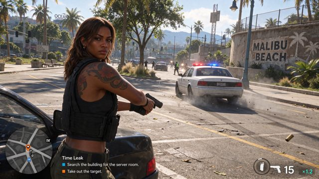

# Game-style street scene and distant signage

[English](README.md) · [简体中文](README.zh-CN.md)

[Back to cases](../../README.md#cases)

**Creator-reported · Not independently reproduced**

This is a reduced representative-frame preview, not a complete animation or an exported transparent asset.

[Open original media](https://pbs.twimg.com/media/HWfUpcdWoAAyKB0.jpg?name=orig)

## Prompt

Complete original prompt pending verification; the current record contains only a source link or demo description.

[View prompt source](https://x.com/lyraxana/status/2118896484934668512)

## Attribution & limits

- Author: lyraxana
- Source model attribution: Seedream 5.5
- Checked: 2026-11-10
- [Source page](https://x.com/lyraxana/status/2118896484934668512)

Original media is linked at its source. Only reduced representative-frame JPEG previews are bundled. Owners retain their rights; MIT does not cover this media, previews or source prompts. Demo GIFs do not establish native animation generation; JPEG previews have no alpha channel.

> The creator attributes this GTA-style image to Seedream 5.5; it is not a verified official game screenshot. The post dates to 2026-11-07 and model attribution is self-reported. A complete prompt was not retrieved.
