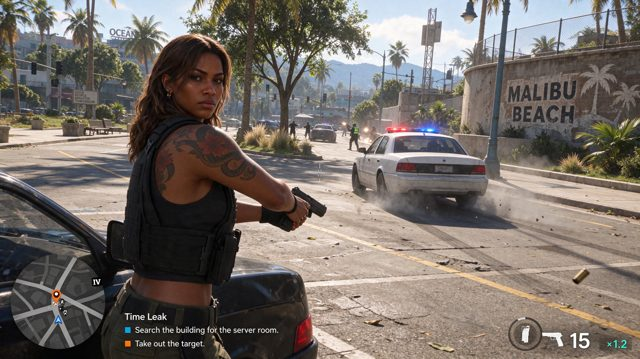

# 游戏式街景与远景标牌

[English](README.md) · [简体中文](README.zh-CN.md)

[返回案例目录](../../README.zh-CN.md#cases)

**作者自报 · 未独立复现**

以上为缩放后的代表帧预览，不是完整动画或可用的透明素材导出文件。

[打开原始媒体](https://pbs.twimg.com/media/HWfUpcdWoAAyKB0.jpg?name=orig)

## 提示词

提示词或展示说明位于原始来源；本页不复制全文，不把展示说明标为实际完整输入。

[查看提示词来源](https://x.com/lyraxana/status/2118896484934668512)

## 出处与边界

- 作者: lyraxana
- 模型来源归因: Seedream 5.5
- 核对日期: 2026-11-10
- [来源页面](https://x.com/lyraxana/status/2118896484934668512)

原始媒体通过来源地址提供；仓库只保存经缩放的 JPEG 代表帧预览。原权利人保留权利；MIT 许可不覆盖这些媒体、预览与原始提示词。GIF 是展示序列，不代表模型原生生成动画；JPEG 预览不含 Alpha 通道。

> 作者将该图归因于 Seedream 5.5 并称其为 GTA 风格画面；它不是经证实的官方游戏截图。帖子发表于 2026-11-07，模型版本仅为作者自报。完整提示词未核得。
