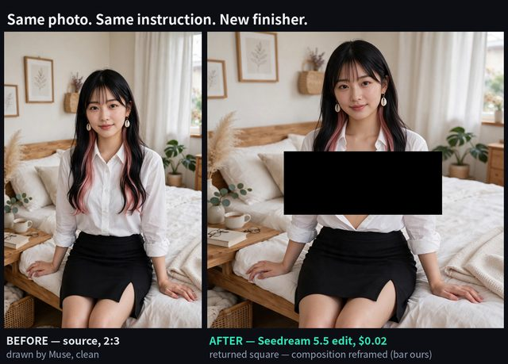

# 人物写实精修、换红裙与夜间重照明

[English](README.md) · [简体中文](README.zh-CN.md)

[返回案例目录](../../README.zh-CN.md#cases)

**作者自报 · 未独立复现**

以上为缩放后的代表帧预览，不是完整动画或可用的透明素材导出文件。

[打开原始媒体](https://pbs.twimg.com/media/HWsMdXybQAApYl8.jpg?name=orig)

## 提示词

该来源没有公开本案例的完整输入提示词；本仓库不补写为原始提示词。

[查看提示词来源](https://x.com/KakiponzuX/status/2119801752656531616)

## 出处与边界

- 作者: KakiponzuX
- 模型来源归因: Seedream 5.5
- 核对日期: 2026-11-11
- [来源页面](https://x.com/KakiponzuX/status/2119801752656531616)

原始媒体通过来源地址提供；仓库只保存经缩放的 JPEG 代表帧预览。原权利人保留权利；MIT 许可不覆盖这些媒体、预览与原始提示词。GIF 是展示序列，不代表模型原生生成动画；JPEG 预览不含 Alpha 通道。

> 图片为从 X 原帖保存的压缩预览；视频为短动图摘要，不是原生 Seedream GIF。模型结果及数据由作者自报，本站未独立复现。 包含跨模型对照/其他生成工具，不能将所有媒体归类为 Seedream 单独生成。
