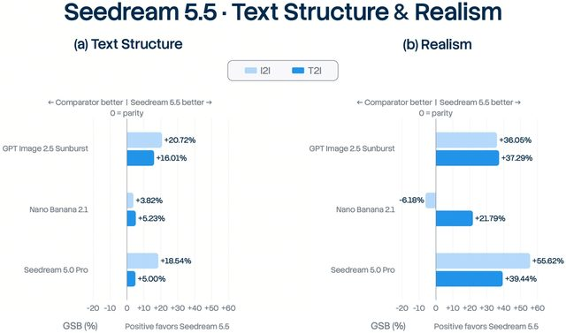

# Seedream 5.5 release-day creator image test

[English](README.md) · [简体中文](README.zh-CN.md)

[Back to cases](../../README.md#cases)

**Creator-reported · Not independently reproduced**

This is a reduced representative-frame preview, not a complete animation or an exported transparent asset.

[Open original media](https://pbs.twimg.com/media/HWq-Wi0XEAAxurH.jpg?name=orig)

## Prompt

The source does not publish a complete input prompt for this example. No reconstructed text is labeled as the original prompt.

[View prompt source](https://x.com/lyraxana/status/2119716289581334969)

## Attribution & limits

- Author: lyraxana
- Source model attribution: Seedream 5.5
- Checked: 2026-11-11
- [Source page](https://x.com/lyraxana/status/2119716289581334969)

Original media is linked at its source. Only reduced representative-frame JPEG previews are bundled. Owners retain their rights; MIT does not cover this media, previews or source prompts. Demo GIFs do not establish native animation generation; JPEG previews have no alpha channel.

> Source X images saved as compressed previews; video is represented by a brief derived GIF, not model-native animation. Creator assertions are not independently reproduced.
