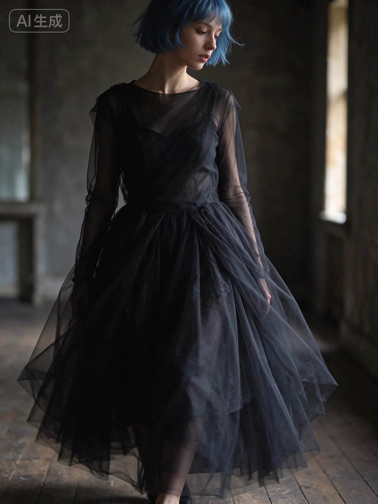
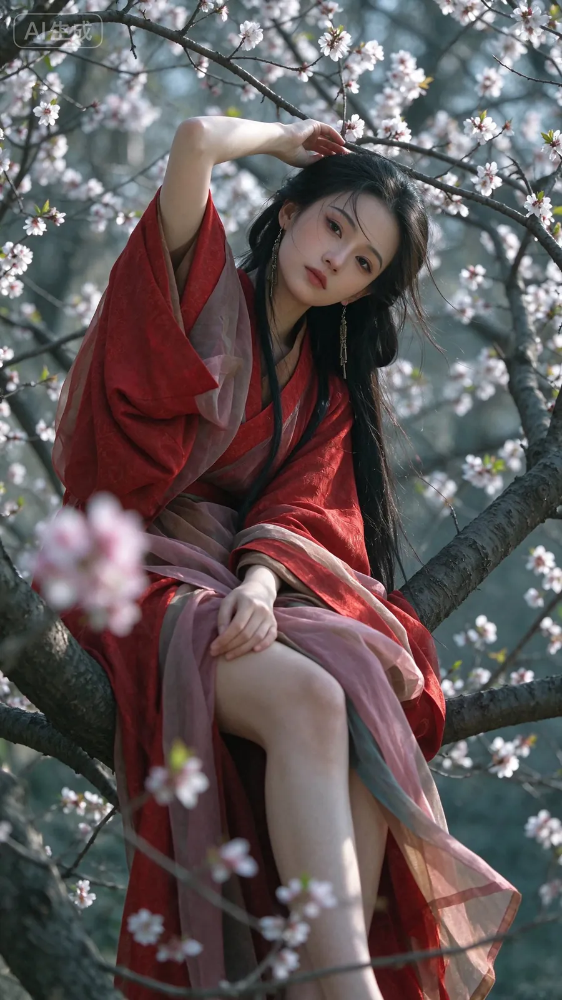
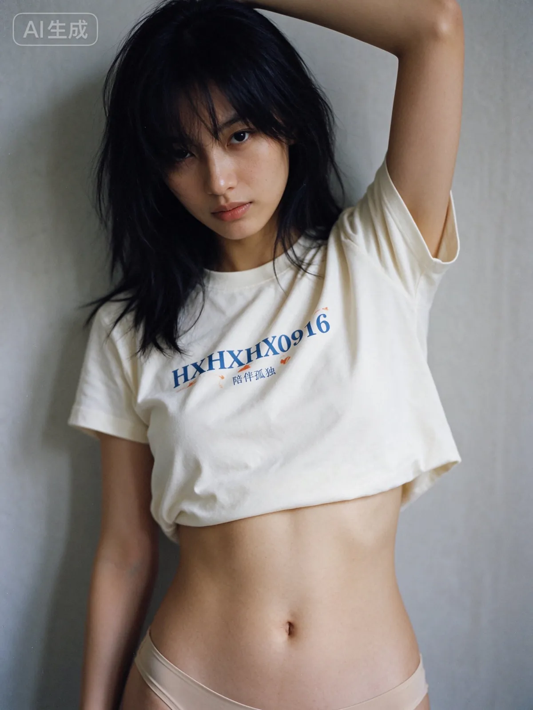

# Portrait trials: blue hair, red dress, white T-shirt

[English](README.md) · [简体中文](README.zh-CN.md)

[Back to cases](../../README.md#cases)

**Creator-reported · Not independently reproduced**

This is a WebP preview from an attributed public gallery, not original media or an exported transparent asset.

[Open gallery preview](https://raw.githubusercontent.com/aiwonderful/yiailearning/master/public/images/seedream-5-5/aigmudq-tests-01.webp)

## More photos from the original post

**Image 2**

[Gallery preview](https://raw.githubusercontent.com/aiwonderful/yiailearning/master/public/images/seedream-5-5/aigmudq-tests-02.webp)

**Image 3**

[Gallery preview](https://raw.githubusercontent.com/aiwonderful/yiailearning/master/public/images/seedream-5-5/aigmudq-tests-03.webp)

## Prompt

The source does not publish a complete input prompt for this example. No reconstructed text is labeled as the original prompt.

[View prompt source](https://x.com/aigmudq/status/2119771043707621711)

## Attribution & limits

- Author: 降温计划
- Source model attribution: Seedream 5.5
- Checked: 2026-11-11
- [Source page](https://x.com/aigmudq/status/2119771043707621711)

Original post is linked above. This WebP comes from an attributed public third-party gallery: no redistribution license, raw-media status, or model reproduction is implied. Owners retain rights to images, previews and prompts; MIT does not cover them.

> The author explicitly calls this a Seedream 5.5 test. Only three images from the single post are included; an image from a second post is excluded. Prompt unpublished. Media is a public GitHub gallery WebP preview; original X media IDs were not independently obtained and no redistribution rights are claimed.
