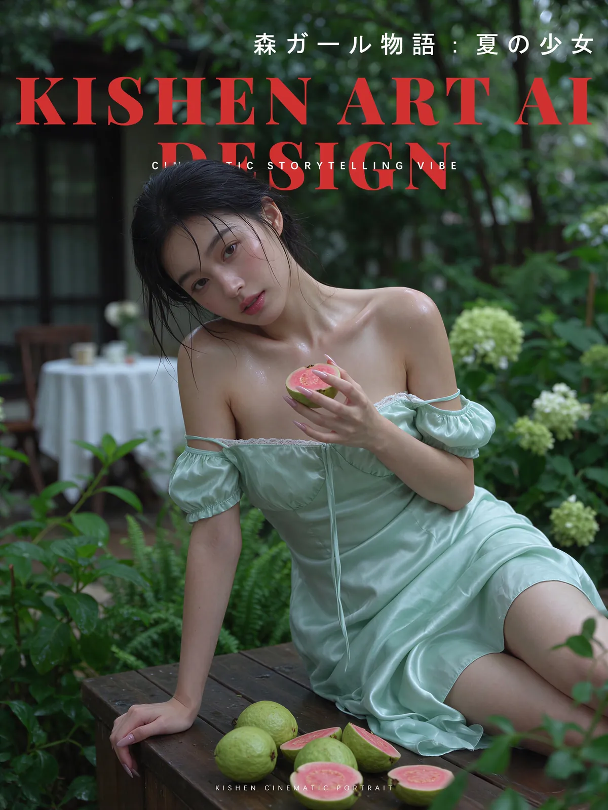

# Cinematic portrait designs: winter study and summer garden

[English](README.md) · [简体中文](README.zh-CN.md)

[Back to cases](../../README.md#cases)

**Creator-reported · Not independently reproduced**

This is a WebP preview from an attributed public gallery, not original media or an exported transparent asset.

[Open gallery preview](https://raw.githubusercontent.com/aiwonderful/yiailearning/master/public/images/seedream-5-5/kishen-film-portraits-01.webp)

## More photos from the original post

**Image 2**

[Gallery preview](https://raw.githubusercontent.com/aiwonderful/yiailearning/master/public/images/seedream-5-5/kishen-film-portraits-02.webp)

## Prompt

Prompt text or demo descriptions are available at the source. The full text is not copied here; demo descriptions are not presented as complete model inputs.

[View prompt source](https://x.com/KishenArt/status/2120047577957867826)

## Attribution & limits

- Author: KishenArt
- Source model attribution: Seedream 5.5
- Checked: 2026-11-11
- [Source page](https://x.com/KishenArt/status/2120046624919769591)

Original post is linked above. This WebP comes from an attributed public third-party gallery: no redistribution license, raw-media status, or model reproduction is implied. Owners retain rights to images, previews and prompts; MIT does not cover them.

> The creator posted long P1/P2 prompts in two replies, also 2120047937673916717; their full texts have not been independently checked and are not transcribed. Media is a public GitHub gallery WebP preview; original X media IDs were not independently obtained and no redistribution rights are claimed.
