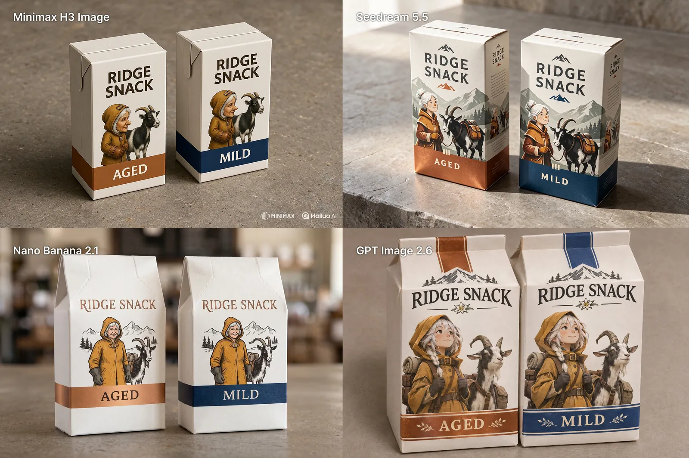

# Ridge Snack packaging across four models

[English](README.md) · [简体中文](README.zh-CN.md)

[Back to cases](../../README.md#cases)

**Creator-reported · Not independently reproduced**



This is a WebP preview from an attributed public gallery, not original media or an exported transparent asset.

[Open gallery preview](https://raw.githubusercontent.com/aiwonderful/yiailearning/master/public/images/seedream-5-5/maxescu-goat-compare-01.webp)

## Prompt

```text
A realistic on-shelf product mockup of exactly two adjacent milk-white cartons for a fictional Alpine snack brand. Both cartons show the same original white-haired delivery woman mascot in a tiny ochre hooded coat, standing beside a black-and-white pack goat with one bent left horn. Carton on the left has a copper accent band, and carton on the right has a deep blue accent band. Match the mascot's nose, hood buckle, glove shape, and the goat's horn on both cartons. Print exactly “RIDGE SNACK” at the top of each package and “AGED” on the copper band, “MILD” on the blue band. Slight view from above to show both label faces, real folded-paper edges, empty warm gray countertop.
```

The prompt is attributed to the creator by the source curator; no independent reproduction was performed.

[View prompt source](https://x.com/maxescu/status/2120078778487505206)

## Attribution & limits

- Author: Alex Patrascu
- Source model attribution: Seedream 5.5
- Checked: 2026-11-11
- [Source page](https://x.com/maxescu/status/2120078778487505206)

Original post is linked above. This WebP comes from an attributed public third-party gallery: no redistribution license, raw-media status, or model reproduction is implied. Owners retain rights to images, previews and prompts; MIT does not cover them.

> Four quadrants are MiniMax H3, Seedream 5.5, Nano Banana 2.1 and GPT Image 2.6; only upper-right is Seedream. The creator publicly provided the complete shared prompt. Media is a public GitHub gallery WebP preview; original X media IDs were not independently obtained and no redistribution rights are claimed.
