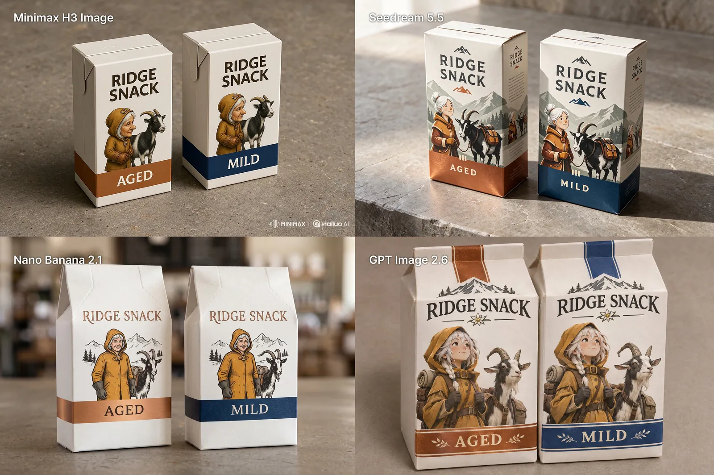

# 山羊零食包装：四模型同提示词测试

[English](README.md) · [简体中文](README.zh-CN.md)

[返回案例目录](../../README.zh-CN.md#cases)

**作者自报 · 未独立复现**



这是来源注明出处的公开案例汇编的 WebP 预览，并非原始媒体或透明素材导出。

[打开汇编预览](https://raw.githubusercontent.com/aiwonderful/yiailearning/master/public/images/seedream-5-5/maxescu-goat-compare-01.webp)

## 提示词

```text
A realistic on-shelf product mockup of exactly two adjacent milk-white cartons for a fictional Alpine snack brand. Both cartons show the same original white-haired delivery woman mascot in a tiny ochre hooded coat, standing beside a black-and-white pack goat with one bent left horn. Carton on the left has a copper accent band, and carton on the right has a deep blue accent band. Match the mascot's nose, hood buckle, glove shape, and the goat's horn on both cartons. Print exactly “RIDGE SNACK” at the top of each package and “AGED” on the copper band, “MILD” on the blue band. Slight view from above to show both label faces, real folded-paper edges, empty warm gray countertop.
```

以上为来源公开、归因于作者的提示词；本站未独立复现，请对照原作者帖文确认二次转录。

[查看提示词来源](https://x.com/maxescu/status/2120078778487505206)

## 出处与边界

- 作者: Alex Patrascu
- 模型来源归因: Seedream 5.5
- 核对日期: 2026-11-11
- [来源页面](https://x.com/maxescu/status/2120078778487505206)

原帖在上方链接。WebP 来自注明出处的公开第三方汇编，不代表有转载许可、拿到原始附件或独立复现。媒体、预览、提示词版权仍属原作者，MIT 许可不覆盖。

> 四格分别为 MiniMax H3、Seedream 5.5、Nano Banana 2.1 与 GPT Image 2.6；仅右上为 5.5。作者公开完整通用提示词。 媒体为公开 GitHub 汇编的 WebP 预览，原帖媒体 ID 未取得；未声称获得再发布许可。
