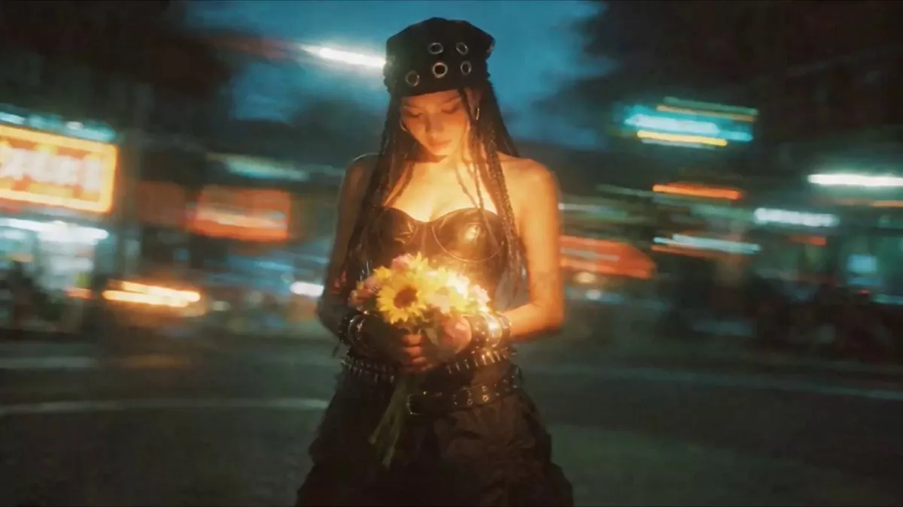

# Seedream 角色图联动 Seedance 视频与 Suno 配乐

[English](README.md) · [简体中文](README.zh-CN.md)

[返回案例目录](../../README.zh-CN.md#cases)

**作者自报 · 未独立复现**

这是来源注明出处的公开案例汇编的 WebP 预览，并非原始媒体或透明素材导出。

[打开汇编预览](https://raw.githubusercontent.com/aiwonderful/yiailearning/master/public/images/seedream-5-5/ghostly-seedance-mixed-01.webp)

## 提示词

该来源没有公开本案例的完整输入提示词；本仓库不补写为原始提示词。

[查看提示词来源](https://x.com/GhostlyXV/status/2119866467717918756)

## 出处与边界

- 作者: Ghostly 愛
- 模型来源归因: Seedream 5.5
- 核对日期: 2026-11-11
- [来源页面](https://x.com/GhostlyXV/status/2119866467717918756)

原帖在上方链接。WebP 来自注明出处的公开第三方汇编，不代表有转载许可、拿到原始附件或独立复现。媒体、预览、提示词版权仍属原作者，MIT 许可不覆盖。

> 作者明确说明 Seedream 5.5 → Seedance 2.5，并用 Suno 配乐。这里保存的是第三方汇编的视频代表帧，并非 Seedream 原始生图；动态画面由 Seedance 制作，不能证明 Seedream 原生视频。原帖媒体 ID、完整提示词和转载许可均未取得。
