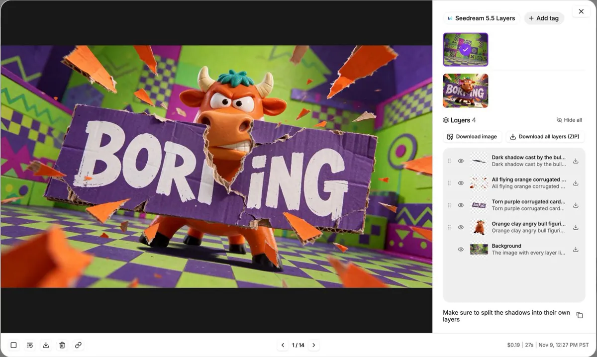

# Oxen 演示 Seedream 5.5 Layers 场景分层

[English](README.md) · [简体中文](README.zh-CN.md)

[返回案例目录](../../README.zh-CN.md#cases)

**作者自报 · 未独立复现**

这是来源注明出处的公开案例汇编的 WebP 预览，并非原始媒体或透明素材导出。

[打开汇编预览](https://raw.githubusercontent.com/aiwonderful/yiailearning/master/public/images/seedream-5-5/oxen-layers-01.webp)

## 提示词

该来源没有公开本案例的完整输入提示词；本仓库不补写为原始提示词。

[查看提示词来源](https://x.com/gregschoeninger/status/2119898943819849963)

## 出处与边界

- 作者: Greg Schoeninger
- 模型来源归因: Seedream 5.5
- 核对日期: 2026-11-11
- [来源页面](https://x.com/gregschoeninger/status/2119898943819849963)

原帖在上方链接。WebP 来自注明出处的公开第三方汇编，不代表有转载许可、拿到原始附件或独立复现。媒体、预览、提示词版权仍属原作者，MIT 许可不覆盖。

> 作者展示使用 Oxen 的 Seedream 5.5 Layers 把已有图片拆为可编辑图层。此为软件截图，并非直接文字生图，也不证明每层均由基础 Seedream 5.5 生成。公开图库的 WebP 不能视为 X 原始附件，原媒体 ID、完整提示词和转载许可均未核实。
