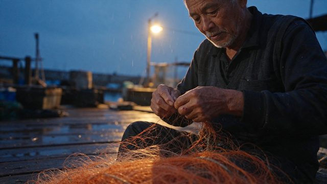

# Fisherman at blue hour

[English](README.md) · [简体中文](README.zh-CN.md)

[Back to cases](../../README.md#cases)

**Creator-reported · Not independently reproduced**



This is a reduced representative-frame preview, not a complete animation or an exported transparent asset.

[Open original media](https://pbs.twimg.com/media/HWt5iRSW8AI00rA.jpg?name=orig)

## Prompt

```text
Candid documentary photo, 85mm lens, f/2. An elderly fisherman in his seventies mending a tangled orange net on a wooden dock at blue hour. Mixed lighting: cold blue ambient sky from the left, a single warm sodium-vapor streetlamp from behind creating a rim light on his white stubble and the loose net fibers. Visible pores, deep wrinkles, sun spots, slightly chapped lips, a small healed scar on his knuckle. Wet wooden planks with puddles reflecting the lamp. Light drizzle visible only in the backlight. No beauty retouching, natural film grain, slight underexposure in the shadows.
```

The prompt is attributed to the creator by the source curator; no independent reproduction was performed.

[View prompt source](https://x.com/ahmetmertugrul/status/2119922071916757233)

## Attribution & limits

- Author: ahmetmertugrul
- Source model attribution: Seedream 5.5
- Checked: 2026-11-10
- [Source page](https://x.com/ahmetmertugrul/status/2119922071916757233)

Original media is linked at its source. Only reduced representative-frame JPEG previews are bundled. Owners retain their rights; MIT does not cover this media, previews or source prompts. Demo GIFs do not establish native animation generation; JPEG previews have no alpha channel.

> Photos fetched from the author's original X post; local JPEG previews are at most 640px. Model attribution is not an independent reproduction. A documentary-style portrait combining cool ambient light with a warm lamp; the original prompt is at source.
