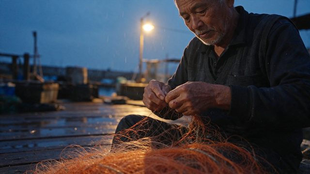

# 蓝调时刻的渔夫

[English](README.md) · [简体中文](README.zh-CN.md)

[返回案例目录](../../README.zh-CN.md#cases)

**作者自报 · 未独立复现**



以上为缩放后的代表帧预览，不是完整动画或可用的透明素材导出文件。

[打开原始媒体](https://pbs.twimg.com/media/HWt5iRSW8AI00rA.jpg?name=orig)

## 提示词

```text
Candid documentary photo, 85mm lens, f/2. An elderly fisherman in his seventies mending a tangled orange net on a wooden dock at blue hour. Mixed lighting: cold blue ambient sky from the left, a single warm sodium-vapor streetlamp from behind creating a rim light on his white stubble and the loose net fibers. Visible pores, deep wrinkles, sun spots, slightly chapped lips, a small healed scar on his knuckle. Wet wooden planks with puddles reflecting the lamp. Light drizzle visible only in the backlight. No beauty retouching, natural film grain, slight underexposure in the shadows.
```

以上为来源公开、归因于作者的提示词；本站未独立复现，请对照原作者帖文确认二次转录。

[查看提示词来源](https://x.com/ahmetmertugrul/status/2119922071916757233)

## 出处与边界

- 作者: ahmetmertugrul
- 模型来源归因: Seedream 5.5
- 核对日期: 2026-11-10
- [来源页面](https://x.com/ahmetmertugrul/status/2119922071916757233)

原始媒体通过来源地址提供；仓库只保存经缩放的 JPEG 代表帧预览。原权利人保留权利；MIT 许可不覆盖这些媒体、预览与原始提示词。GIF 是展示序列，不代表模型原生生成动画；JPEG 预览不含 Alpha 通道。

> 已从作者 X 原帖下载配图，并保存为640px以内的JPEG预览。模型来源归因未经独立生成验证。 冷色环境光与暖灯混合的纪实风格人像；原帖提供提示词。
