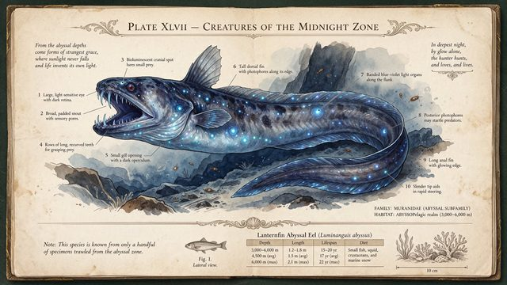

# Deep-sea field-guide infographic

[English](README.md) · [简体中文](README.zh-CN.md)

[Back to cases](../../README.md#cases)

**Creator-reported · Not independently reproduced**



This is a reduced representative-frame preview, not a complete animation or an exported transparent asset.

[Open original media](https://pbs.twimg.com/media/HWtzn3zXMAAoUyb.jpg?name=orig)

## Prompt

```text
A vintage naturalist field-guide page, aged cream paper with foxing stains, documenting a fictional deep-sea creature called "Lanternfin Abyssal Eel". Center: a detailed scientific ink-and-watercolor illustration of the eel with bioluminescent spots. Surrounding it, 10 numbered callout labels with thin leader lines, each with a 2-line caption in small serif type (e.g. "3. Photophore cluster — emits pulses at 490 nm to lure prey"). Top header in ornate engraved capitals: "PLATE XLVII — CREATURES OF THE MIDNIGHT ZONE". Bottom: a small data table with columns "Depth", "Length", "Lifespan", "Diet" and three rows of values, plus a tiny scale bar reading "10 cm". Flat top-down scan, every word sharp and legible.
```

The prompt is attributed to the creator by the source curator; no independent reproduction was performed.

[View prompt source](https://x.com/ahmetmertugrul/status/2119915956365369596)

## Attribution & limits

- Author: ahmetmertugrul
- Source model attribution: Seedream 5.5
- Checked: 2026-11-10
- [Source page](https://x.com/ahmetmertugrul/status/2119915956365369596)

Original media is linked at its source. Only reduced representative-frame JPEG previews are bundled. Owners retain their rights; MIT does not cover this media, previews or source prompts. Demo GIFs do not establish native animation generation; JPEG previews have no alpha channel.

> Photos fetched from the author's original X post; local JPEG previews are at most 640px. Model attribution is not an independent reproduction. A fictional creature field-guide page combining labels, a data table and scientific illustration; prompt at source.
