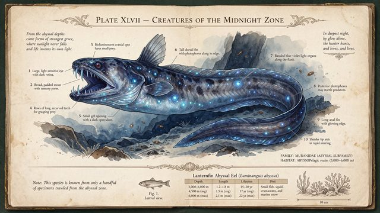

# 深海生物图鉴信息图

[English](README.md) · [简体中文](README.zh-CN.md)

[返回案例目录](../../README.zh-CN.md#cases)

**作者自报 · 未独立复现**



以上为缩放后的代表帧预览，不是完整动画或可用的透明素材导出文件。

[打开原始媒体](https://pbs.twimg.com/media/HWtzn3zXMAAoUyb.jpg?name=orig)

## 提示词

```text
A vintage naturalist field-guide page, aged cream paper with foxing stains, documenting a fictional deep-sea creature called "Lanternfin Abyssal Eel". Center: a detailed scientific ink-and-watercolor illustration of the eel with bioluminescent spots. Surrounding it, 10 numbered callout labels with thin leader lines, each with a 2-line caption in small serif type (e.g. "3. Photophore cluster — emits pulses at 490 nm to lure prey"). Top header in ornate engraved capitals: "PLATE XLVII — CREATURES OF THE MIDNIGHT ZONE". Bottom: a small data table with columns "Depth", "Length", "Lifespan", "Diet" and three rows of values, plus a tiny scale bar reading "10 cm". Flat top-down scan, every word sharp and legible.
```

以上为来源公开、归因于作者的提示词；本站未独立复现，请对照原作者帖文确认二次转录。

[查看提示词来源](https://x.com/ahmetmertugrul/status/2119915956365369596)

## 出处与边界

- 作者: ahmetmertugrul
- 模型来源归因: Seedream 5.5
- 核对日期: 2026-11-10
- [来源页面](https://x.com/ahmetmertugrul/status/2119915956365369596)

原始媒体通过来源地址提供；仓库只保存经缩放的 JPEG 代表帧预览。原权利人保留权利；MIT 许可不覆盖这些媒体、预览与原始提示词。GIF 是展示序列，不代表模型原生生成动画；JPEG 预览不含 Alpha 通道。

> 已从作者 X 原帖下载配图，并保存为640px以内的JPEG预览。模型来源归因未经独立生成验证。 虚构生物图鉴页，组合标注、数据表和科学插图；原帖有提示词。
