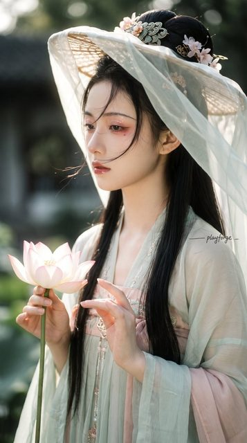

# Four-model portrait study

[English](README.md) · [简体中文](README.zh-CN.md)

[Back to cases](../../README.md#cases)

**Creator-reported · Not independently reproduced**

This is a reduced representative-frame preview, not a complete animation or an exported transparent asset.

[Open original media](https://pbs.twimg.com/media/HWuI5ZLbgAA9kF0.jpg?name=orig)

## More photos from the original post

**Image 2**

[Source media](https://pbs.twimg.com/media/HWuI5ZHbcAElRIS.jpg?name=orig)

**Image 3**

[Source media](https://pbs.twimg.com/media/HWuI5ZQa8AAe5hD.jpg?name=orig)

**Image 4**

[Source media](https://pbs.twimg.com/media/HWuI5ZMaoAAL39U.jpg?name=orig)

## Prompt

The source does not publish a complete input prompt for this example. No reconstructed text is labeled as the original prompt.

[View prompt source](https://x.com/94vanAI/status/2119938579078238370)

## Attribution & limits

- Author: 94vanAI
- Source model attribution: Seedream 5.5
- Checked: 2026-11-10
- [Source page](https://x.com/94vanAI/status/2119938579078238370)

Original media is linked at its source. Only reduced representative-frame JPEG previews are bundled. Owners retain their rights; MIT does not cover this media, previews or source prompts. Demo GIFs do not establish native animation generation; JPEG previews have no alpha channel.

> Photos fetched from the author's original X post; local JPEG previews are at most 640px. Model attribution is not an independent reproduction. This multi-model comparison includes outputs from other models; follow labels at the source. The creator identifies image one as Seedream, followed by ChatGPT, Gemini and Grok, and discusses limitations as well as strengths.
