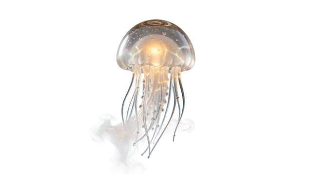

# 玻璃水母灯

[English](README.md) · [简体中文](README.zh-CN.md)

[返回案例目录](../../README.zh-CN.md#cases)

**作者自报 · 未独立复现**



以上为缩放后的代表帧预览，不是完整动画或可用的透明素材导出文件。

[打开原始媒体](https://pbs.twimg.com/media/HWt4BjuWgAAxGSk.jpg?name=orig)

## 提示词

```text
Transparent background, PNG with alpha channel. A hand-blown glass jellyfish lamp floating in mid-air: semi-transparent frosted bell with visible internal air bubbles, long trailing tentacles made of thin glass threads that fade from fully opaque at the top to almost invisible at the tips, a faint warm amber glow inside the bell, soft caustic refractions, wisps of translucent steam drifting from the tentacle ends. No background, no ground shadow, clean anti-aliased edges, studio product lighting.
```

以上为来源公开、归因于作者的提示词；本站未独立复现，请对照原作者帖文确认二次转录。

[查看提示词来源](https://x.com/ahmetmertugrul/status/2119920477535719739)

## 出处与边界

- 作者: ahmetmertugrul
- 模型来源归因: Seedream 5.5
- 核对日期: 2026-11-10
- [来源页面](https://x.com/ahmetmertugrul/status/2119920477535719739)

原始媒体通过来源地址提供；仓库只保存经缩放的 JPEG 代表帧预览。原权利人保留权利；MIT 许可不覆盖这些媒体、预览与原始提示词。GIF 是展示序列，不代表模型原生生成动画；JPEG 预览不含 Alpha 通道。

> 已从作者 X 原帖下载配图，并保存为640px以内的JPEG预览。模型来源归因未经独立生成验证。 缩略图无法证明原始Alpha透明度。 原帖附提示词的玻璃灯透明素材示例；仅凭展示图不能验证文件的 alpha 通道。
