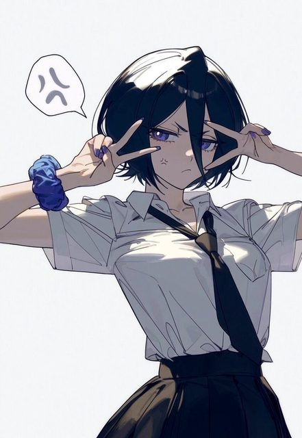
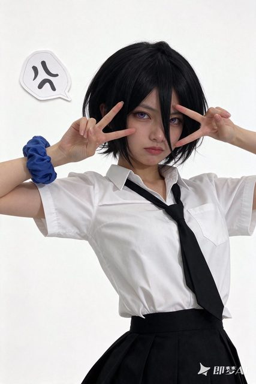

# Photoreal character conversion

[English](README.md) · [简体中文](README.zh-CN.md)

[Back to cases](../../README.md#cases)

**Creator-reported · Not independently reproduced**

This is a reduced representative-frame preview, not a complete animation or an exported transparent asset.

[Open original media](https://pbs.twimg.com/media/HWuSLW_acAAqPzf.jpg?name=orig)

## More photos from the original post

**Image 2**

[Source media](https://pbs.twimg.com/media/HWuSLeuaMAAx5mD.jpg?name=orig)

## Prompt

The source does not publish a complete input prompt for this example. No reconstructed text is labeled as the original prompt.

[View prompt source](https://x.com/nanyuan0412/status/2119949010698137603)

## Attribution & limits

- Author: nanyuan0412
- Source model attribution: Seedream 5.5
- Checked: 2026-11-10
- [Source page](https://x.com/nanyuan0412/status/2119949010698137603)

Original media is linked at its source. Only reduced representative-frame JPEG previews are bundled. Owners retain their rights; MIT does not cover this media, previews or source prompts. Demo GIFs do not establish native animation generation; JPEG previews have no alpha channel.

> Photos fetched from the author's original X post; local JPEG previews are at most 640px. Model attribution is not an independent reproduction. A two-image character-to-photoreal study shared as a Seedream 5.5 test.
