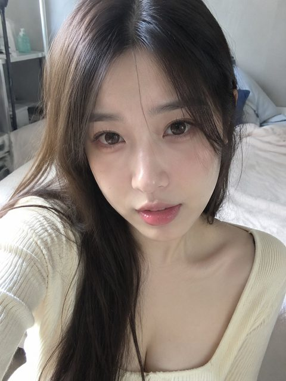
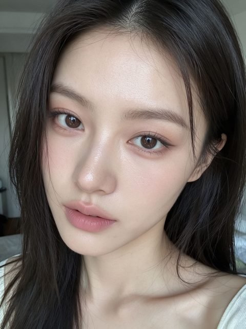
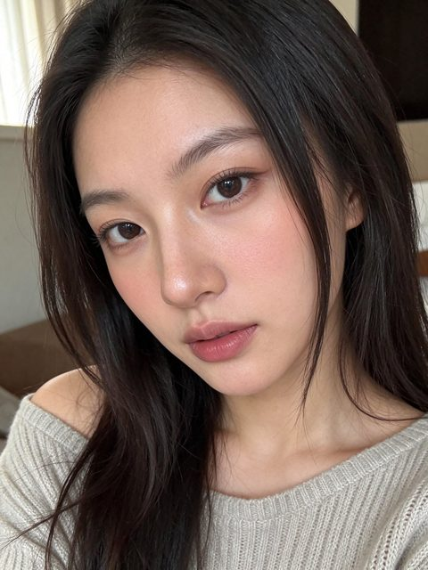

# 三模型出图对比

[English](README.md) · [简体中文](README.zh-CN.md)

[返回案例目录](../../README.zh-CN.md#cases)

**作者自报 · 未独立复现**

以上为缩放后的代表帧预览，不是完整动画或可用的透明素材导出文件。

[打开原始媒体](https://pbs.twimg.com/media/HWu3cRnasAA1m-O.jpg?name=orig)

## 同一原帖的更多图片

**配图 2**

[原媒体](https://pbs.twimg.com/media/HWu3fCQa8AAzkj1.jpg?name=orig)

**配图 3**

[原媒体](https://pbs.twimg.com/media/HWu4dQabsAAArVl.jpg?name=orig)

## 提示词

该来源没有公开本案例的完整输入提示词；本仓库不补写为原始提示词。

[查看提示词来源](https://x.com/Yuziyyaa/status/2119991511433814093)

## 出处与边界

- 作者: Yuziyyaa
- 模型来源归因: Seedream 5.5
- 核对日期: 2026-11-10
- [来源页面](https://x.com/Yuziyyaa/status/2119991511433814093)

原始媒体通过来源地址提供；仓库只保存经缩放的 JPEG 代表帧预览。原权利人保留权利；MIT 许可不覆盖这些媒体、预览与原始提示词。GIF 是展示序列，不代表模型原生生成动画；JPEG 预览不含 Alpha 通道。

> 已从作者 X 原帖下载配图，并保存为640px以内的JPEG预览。模型来源归因未经独立生成验证。 原帖为多模型对比，部分图片来自其他模型，需按原帖标签区分。 作者按图片顺序标注 GPT Images 2.6、Seedream 5.0 Pro、Seedream 5.5。
