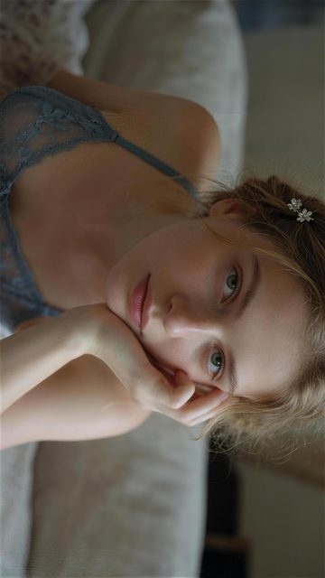
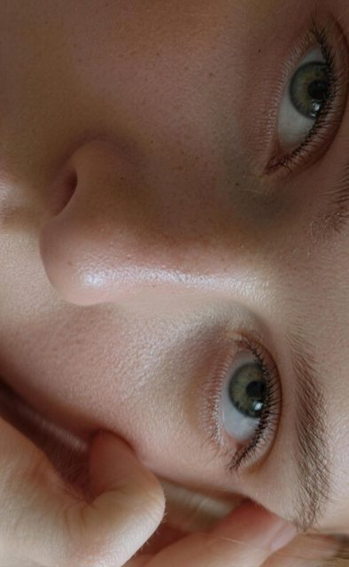
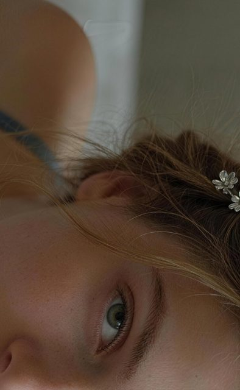

# Window-light film portrait

[English](README.md) · [简体中文](README.zh-CN.md)

[Back to cases](../../README.md#cases)

**Creator-reported · Not independently reproduced**



This is a reduced representative-frame preview, not a complete animation or an exported transparent asset.

[Open original media](https://pbs.twimg.com/media/HWux49Ra4AAumFz.jpg?name=orig)


## More photos from the original post

**Image 2**



[Source media](https://pbs.twimg.com/media/HWux5F0aUAA7e6t.jpg?name=orig)

**Image 3**



[Source media](https://pbs.twimg.com/media/HWuyDFqbMAAWAfz.jpg?name=orig)

## Prompt

```text
俯拍人像特写局部，东方/西方 女性 22岁 人物特写半侧脸侧颜看向镜头的自然姿态，窗户光柔肤，富士Astia胶片低婉古调低饱和度，光圈F2.8、快门1/120s、ISO100、点测光脸部，磨砂肌理，暗角聚焦，私房氛围感，细节丰富，无文字、无水印、无Logo、无边框
```

The prompt is attributed to the creator by the source curator; no independent reproduction was performed.

[View prompt source](https://x.com/nima2qisi2/status/2119983938383106432)

## Attribution & limits

- Author: nima2qisi2
- Source model attribution: Seedream 5.5
- Checked: 2026-11-10
- [Source page](https://x.com/nima2qisi2/status/2119983938383106432)

Original media is linked at its source. Only reduced representative-frame JPEG previews are bundled. Owners retain their rights; MIT does not cover this media, previews or source prompts. Demo GIFs do not establish native animation generation; JPEG previews have no alpha channel.

> Photos fetched from the author's original X post; local JPEG previews are at most 640px. Model attribution is not an independent reproduction. A portrait series with window lighting and film styling; the source includes the creator's prompt.
