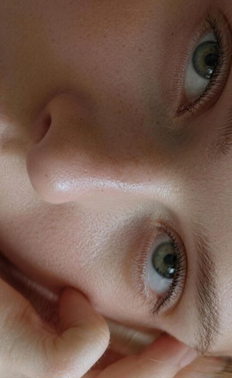

# 窗光胶片感人像

[English](README.md) · [简体中文](README.zh-CN.md)

[返回案例目录](../../README.zh-CN.md#cases)

**作者自报 · 未独立复现**


以上为缩放后的代表帧预览，不是完整动画或可用的透明素材导出文件。

[打开原始媒体](https://pbs.twimg.com/media/HWux49Ra4AAumFz.jpg?name=orig)


## 同一原帖的更多图片

**配图 2**



[原媒体](https://pbs.twimg.com/media/HWux5F0aUAA7e6t.jpg?name=orig)

**配图 3**


[原媒体](https://pbs.twimg.com/media/HWuyDFqbMAAWAfz.jpg?name=orig)

## 提示词

```text
俯拍人像特写局部，东方/西方 女性 22岁 人物特写半侧脸侧颜看向镜头的自然姿态，窗户光柔肤，富士Astia胶片低婉古调低饱和度，光圈F2.8、快门1/120s、ISO100、点测光脸部，磨砂肌理，暗角聚焦，私房氛围感，细节丰富，无文字、无水印、无Logo、无边框
```

以上为来源公开、归因于作者的提示词；本站未独立复现，请对照原作者帖文确认二次转录。

[查看提示词来源](https://x.com/nima2qisi2/status/2119983938383106432)

## 出处与边界

- 作者: nima2qisi2
- 模型来源归因: Seedream 5.5
- 核对日期: 2026-11-10
- [来源页面](https://x.com/nima2qisi2/status/2119983938383106432)

原始媒体通过来源地址提供；仓库只保存经缩放的 JPEG 代表帧预览。原权利人保留权利；MIT 许可不覆盖这些媒体、预览与原始提示词。GIF 是展示序列，不代表模型原生生成动画；JPEG 预览不含 Alpha 通道。

> 已从作者 X 原帖下载配图，并保存为640px以内的JPEG预览。模型来源归因未经独立生成验证。 使用窗光与胶片风格的人像组图，原帖包含作者提示词。
