<!-- Generated: edit cases.json, then run scripts/build_external_refs.py -->

# Seedream 5.5 web-wide reference and remake queue

[English](README.md) · [简体中文](README.zh-CN.md)

This separate collection contains third-party images and public prompts. These are not main collection cases or Raphael-generated outputs.

**References: 35 · Local low-res previews: 38 · Recreated: 0**

**Rights:** Public URLs do not grant rehosting rights. Source previews are research references only. Remove or license them before public promotion. A new generation is not automatically free of likeness, trademark or other rights issues.

[Remake workflow](WORKFLOW.md) · [Raw data](cases.json) · [Back to main](../README.md)

## Source websites

| Source host | Cases | Local preview files |
| --- | ---: | ---: |
| [flux1.ai](#source-flux1-ai) | 6 | 6 |
| [orylia.ai](#source-orylia-ai) | 3 | 3 |
| [seedreamv5.com](#source-seedreamv5-com) | 7 | 10 |
| [vdobloom.com](#source-vdobloom-com) | 10 | 10 |
| [www.froging.ai](#source-www-froging-ai) | 3 | 3 |
| [www.made.app](#source-www-made-app) | 6 | 6 |

## Categories

- [Typography and posters (8)](#typography)
- [Portraits (6)](#portraits)
- [Photography and products (9)](#photography)
- [Interior design (1)](#interiors)
- [Characters and illustrations (4)](#characters)
- [Infographics (1)](#infographics)
- [Transparent assets (4)](#rgba-assets)
- [Multi-turn editing (2)](#multi-turn-editing)

<a id="typography"></a>
### Typography and posters

| Case | Source |
| --- | --- |
| [A sign with exact words](#web-vdobloom-01) | VdoBloom |
| [A poster with a title and a date](#web-vdobloom-02) | VdoBloom |
| [Handwritten sign](#web-made-02) | Made |
| [Neon sign](#web-made-05) | Made |
| [Lost and found](#web-made-06) | Made |
| [Chinese and English poster](#web-flux1-03) | Flux1 AI |
| [English and Chinese text on a poster](#web-studio-01) | Seedream Studio |
| [Bilingual typography](#web-orylia-03) | Orylia |

<a id="portraits"></a>
### Portraits

| Case | Source |
| --- | --- |
| [A realistic portrait](#web-vdobloom-03) | VdoBloom |
| [Night nap](#web-made-01) | Made |
| [Inside the dryer](#web-made-03) | Made |
| [Natural portrait](#web-flux1-01) | Flux1 AI |
| [A backlit portrait](#web-studio-02) | Seedream Studio |
| [Editorial portraits](#web-orylia-01) | Orylia |

<a id="photography"></a>
### Photography and products

| Case | Source |
| --- | --- |
| [A product photo](#web-vdobloom-04) | VdoBloom |
| [Food from above](#web-vdobloom-05) | VdoBloom |
| [A wide cinematic shot](#web-vdobloom-07) | VdoBloom |
| [An exact number of things](#web-vdobloom-09) | VdoBloom |
| [Folding table](#web-made-04) | Made |
| [Glass, ceramic and copper in a product shot](#web-studio-03) | Seedream Studio |
| [An ultra-wide 21:9 landscape](#web-studio-04) | Seedream Studio |
| [Freeze a splash for a campaign image](#web-froging-02) | Froging AI |
| [Product photography](#web-orylia-02) | Orylia |

<a id="interiors"></a>
### Interior design

| Case | Source |
| --- | --- |
| [A room](#web-vdobloom-06) | VdoBloom |

<a id="characters"></a>
### Characters and illustrations

| Case | Source |
| --- | --- |
| [Anime style](#web-vdobloom-08) | VdoBloom |
| [A children’s book illustration](#web-vdobloom-10) | VdoBloom |
| [Sticker with lettering](#web-flux1-05) | Flux1 AI |
| [A die-cut sticker](#web-studio-05) | Seedream Studio |

<a id="infographics"></a>
### Infographics

| Case | Source |
| --- | --- |
| [Infographic with small text](#web-flux1-02) | Flux1 AI |

<a id="rgba-assets"></a>
### Transparent assets

| Case | Source |
| --- | --- |
| [Glass on a transparent background](#web-flux1-04) | Flux1 AI |
| [Cut-out from a photo](#web-flux1-06) | Flux1 AI |
| [A set of nine icons](#web-studio-06) | Seedream Studio |
| [Create a transparent glass asset](#web-froging-03) | Froging AI |

<a id="multi-turn-editing"></a>
### Multi-turn editing

| Case | Source |
| --- | --- |
| [Three-round café image edit](#web-studio-07) | Seedream Studio |
| [Change a product backdrop](#web-froging-01) | Froging AI |

<a id="all-cases"></a>
## All external cases and prompts

<a id="source-flux1-ai"></a>
### flux1.ai

| Case | Source author / website | Local preview files | Prompt status | Original source |
| --- | --- | ---: | --- | --- |
| [Natural portrait](#web-flux1-01) | Flux1 AI | 1 | Full original prompt below | [View source](https://flux1.ai/seedream-5-5) |
| [Infographic with small text](#web-flux1-02) | Flux1 AI | 1 | Full original prompt below | [View source](https://flux1.ai/seedream-5-5) |
| [Chinese and English poster](#web-flux1-03) | Flux1 AI | 1 | Full original prompt below | [View source](https://flux1.ai/seedream-5-5) |
| [Glass on a transparent background](#web-flux1-04) | Flux1 AI | 1 | Full original prompt below | [View source](https://flux1.ai/seedream-5-5) |
| [Sticker with lettering](#web-flux1-05) | Flux1 AI | 1 | Full original prompt below | [View source](https://flux1.ai/seedream-5-5) |
| [Cut-out from a photo](#web-flux1-06) | Flux1 AI | 1 | Full original prompt below | [View source](https://flux1.ai/seedream-5-5) |

<a id="web-flux1-01"></a>
#### [Natural portrait](cases/web-flux1-01/README.md)

<a href="cases/web-flux1-01/README.md">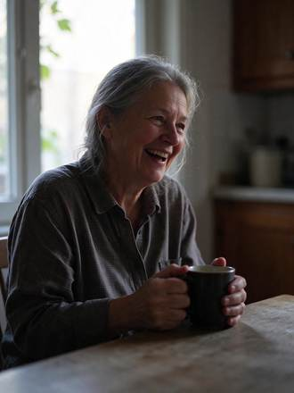</a>

**Flux1 AI** · Pending · [Source](https://flux1.ai/seedream-5-5)

##### Source-published prompt

```text
Candid portrait of a woman in her sixties laughing at a kitchen table by a window, late afternoon side light, visible skin texture and fine lines, loose grey hair catching the backlight, a mug in her hands, 50mm lens, natural colors, documentary photo
```

[Check original source](https://flux1.ai/seedream-5-5)

<a id="web-flux1-02"></a>
#### [Infographic with small text](cases/web-flux1-02/README.md)

<a href="cases/web-flux1-02/README.md">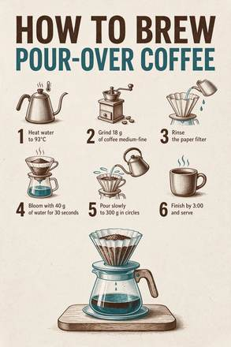</a>

**Flux1 AI** · Pending · [Source](https://flux1.ai/seedream-5-5)

##### Source-published prompt

```text
A clean printed infographic poster titled 'HOW TO BREW POUR-OVER COFFEE'. Six numbered steps with small line icons: '1 Heat water to 93°C', '2 Grind 18 g of coffee medium-fine', '3 Rinse the paper filter', '4 Bloom with 40 g of water for 30 seconds', '5 Pour slowly to 300 g in circles', '6 Finish by 3:00 and serve'. Off-white paper, dark brown and teal ink, generous margins. No other text.
```

[Check original source](https://flux1.ai/seedream-5-5)

<a id="web-flux1-03"></a>
#### [Chinese and English poster](cases/web-flux1-03/README.md)

<a href="cases/web-flux1-03/README.md">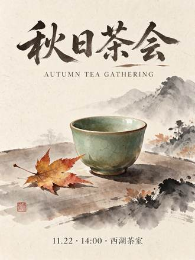</a>

**Flux1 AI** · Pending · [Source](https://flux1.ai/seedream-5-5)

##### Source-published prompt

```text
A minimalist event poster for an autumn tea gathering. Large Chinese title '秋日茶会' at the top, English line 'AUTUMN TEA GATHERING' below it in small spaced caps, and a small line '11.22 · 14:00 · 西湖茶室' at the bottom. A single celadon teacup with a maple leaf beside it in the middle, ink-wash style, warm rice-paper background. No other text.
```

[Check original source](https://flux1.ai/seedream-5-5)

<a id="web-flux1-04"></a>
#### [Glass on a transparent background](cases/web-flux1-04/README.md)

<a href="cases/web-flux1-04/README.md">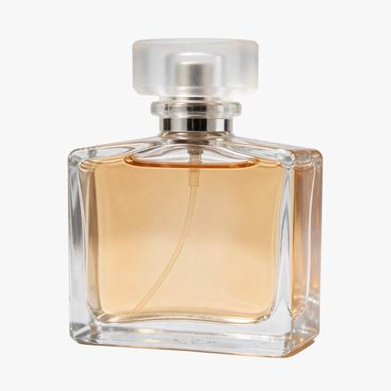</a>

**Flux1 AI** · Pending · [Source](https://flux1.ai/seedream-5-5)

##### Source-published prompt

```text
A clear glass perfume bottle with a frosted glass cap and pale amber liquid, soft reflections and refraction through the glass, studio product shot, isolated object on a transparent background
```

[Check original source](https://flux1.ai/seedream-5-5)

<a id="web-flux1-05"></a>
#### [Sticker with lettering](cases/web-flux1-05/README.md)

<a href="cases/web-flux1-05/README.md"></a>

**Flux1 AI** · Pending · [Source](https://flux1.ai/seedream-5-5)

##### Source-published prompt

```text
A die-cut sticker that reads 'FRESH BAKED' in chunky rounded letters above a small smiling croissant, thick white border, flat colors, transparent background
```

[Check original source](https://flux1.ai/seedream-5-5)

<a id="web-flux1-06"></a>
#### [Cut-out from a photo](cases/web-flux1-06/README.md)

<a href="cases/web-flux1-06/README.md">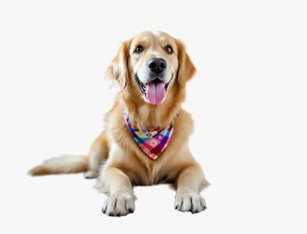</a>

**Flux1 AI** · Pending · [Source](https://flux1.ai/seedream-5-5)

##### Source-published prompt

```text
Cut out the dog with its bandana and return it on a transparent background. Keep the dog, its fur edges, pose and colors exactly as they are.
```

[Check original source](https://flux1.ai/seedream-5-5)

<a id="source-orylia-ai"></a>
### orylia.ai

| Case | Source author / website | Local preview files | Prompt status | Original source |
| --- | --- | ---: | --- | --- |
| [Editorial portraits](#web-orylia-01) | Orylia | 1 | Full original prompt below | [View source](https://orylia.ai/ai-models/seedream-5-5) |
| [Product photography](#web-orylia-02) | Orylia | 1 | Full original prompt below | [View source](https://orylia.ai/ai-models/seedream-5-5) |
| [Bilingual typography](#web-orylia-03) | Orylia | 1 | Full original prompt below | [View source](https://orylia.ai/ai-models/seedream-5-5) |

<a id="web-orylia-01"></a>
#### [Editorial portraits](cases/web-orylia-01/README.md)

<a href="cases/web-orylia-01/README.md"></a>

**Orylia** · Pending · [Source](https://orylia.ai/ai-models/seedream-5-5)

##### Source-published prompt

```text
Luxury fashion editorial photograph, adult woman with natural freckles, short dark bob, brushed gold sculptural earrings and an ivory silk blouse, seated beside an amber glass vase in a sunlit modernist interior. Subject on the right third, expansive softly lit warm charcoal negative space on the left for a website headline. Tangible silk weave, natural pores, delicate flyaway hair, golden afternoon rim light, restrained warm ivory and amber palette, 85mm portrait lens, sophisticated magazine art direction. No text, no logo, no watermark.
```

[Check original source](https://orylia.ai/ai-models/seedream-5-5)

<a id="web-orylia-02"></a>
#### [Product photography](cases/web-orylia-02/README.md)

<a href="cases/web-orylia-02/README.md">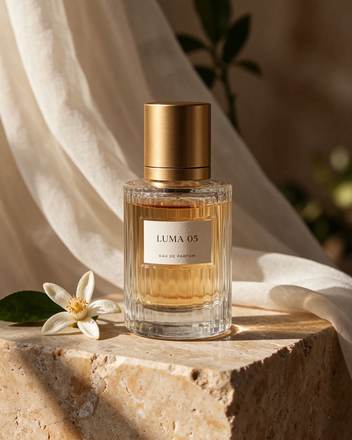</a>

**Orylia** · Pending · [Source](https://orylia.ai/ai-models/seedream-5-5)

##### Source-published prompt

```text
Premium fragrance campaign still life. A single clear ribbed glass perfume bottle filled with pale amber liquid, brushed gold cylindrical cap, small ivory label reading exactly "LUMA 05" and below it "EAU DE PARFUM". Bottle on warm travertine, sheer ivory fabric behind, one orange blossom beside it. Late afternoon side light, convincing glass refraction and caustics, detailed stone grain, elegant editorial photography. No other lettering. Complete bottle and cap visible.
```

[Check original source](https://orylia.ai/ai-models/seedream-5-5)

<a id="web-orylia-03"></a>
#### [Bilingual typography](cases/web-orylia-03/README.md)

<a href="cases/web-orylia-03/README.md"></a>

**Orylia** · Pending · [Source](https://orylia.ai/ai-models/seedream-5-5)

##### Source-published prompt

```text
Design a premium bilingual exhibition poster on ivory paper, burnt orange and deep teal geometric still-life shapes, meticulous Swiss editorial grid. Include exactly these text lines, each once, with accurate punctuation: "FORM & LIGHT", "形与光", "DESIGN EXHIBITION", "设计展览", "12–15 NOV 2026", "10:00–18:00", "TICKET ¥128", "SHANGHAI". Clear hierarchy, large elegant headline, perfectly readable smaller information, balanced generous margins. No other text, no decorative fake letters.
```

[Check original source](https://orylia.ai/ai-models/seedream-5-5)

<a id="source-seedreamv5-com"></a>
### seedreamv5.com

| Case | Source author / website | Local preview files | Prompt status | Original source |
| --- | --- | ---: | --- | --- |
| [English and Chinese text on a poster](#web-studio-01) | Seedream Studio | 1 | Full original prompt below | [View source](https://seedreamv5.com/seedream-5.5) |
| [A backlit portrait](#web-studio-02) | Seedream Studio | 1 | Full original prompt below | [View source](https://seedreamv5.com/seedream-5.5) |
| [Glass, ceramic and copper in a product shot](#web-studio-03) | Seedream Studio | 1 | Full original prompt below | [View source](https://seedreamv5.com/seedream-5.5) |
| [An ultra-wide 21:9 landscape](#web-studio-04) | Seedream Studio | 1 | Full original prompt below | [View source](https://seedreamv5.com/seedream-5.5) |
| [A die-cut sticker](#web-studio-05) | Seedream Studio | 1 | Full original prompt below | [View source](https://seedreamv5.com/seedream-5.5) |
| [A set of nine icons](#web-studio-06) | Seedream Studio | 1 | Full original prompt below | [View source](https://seedreamv5.com/seedream-5.5) |
| [Three-round café image edit](#web-studio-07) | Seedream Studio | 4 | Full original prompt below, including edit steps | [View source](https://seedreamv5.com/seedream-5.5) |

<a id="web-studio-01"></a>
#### [English and Chinese text on a poster](cases/web-studio-01/README.md)

<a href="cases/web-studio-01/README.md">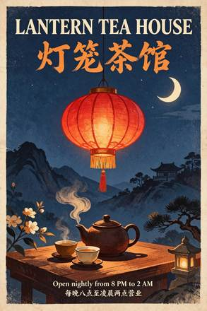</a>

**Seedream Studio** · Pending · [Source](https://seedreamv5.com/seedream-5.5)

##### Source-published prompt

```text
A vintage screen-print travel poster for a fictional tea house, portrait format. At the top, a large bold serif headline in English reading exactly "LANTERN TEA HOUSE". Directly beneath it, a Chinese title in brush calligraphy reading exactly "灯笼茶馆". In the centre, a flat illustration of a glowing red paper lantern with no writing on it, hanging above a steaming clay teapot and two small cups, under a deep indigo night sky with a single crescent moon and a few stars, with saffron and cream accents and a subtle paper grain. At the bottom, two lines of small, clean sans-serif text: the first reading exactly "Open nightly from 8 PM to 2 AM" and the second reading exactly "每晚八点至凌晨两点营业". These four lines are the only text on the poster, with no signs, labels or characters anywhere else. All lettering crisp, correctly spelled and fully legible, generous margins.
```

[Check original source](https://seedreamv5.com/seedream-5.5)

<a id="web-studio-02"></a>
#### [A backlit portrait](cases/web-studio-02/README.md)

<a href="cases/web-studio-02/README.md">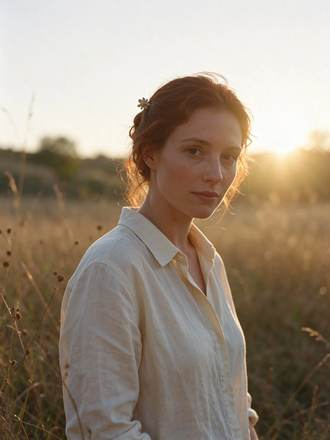</a>

**Seedream Studio** · Pending · [Source](https://seedreamv5.com/seedream-5.5)

##### Source-published prompt

```text
A backlit portrait of a woman in her early thirties standing in a meadow of tall grass at golden hour. The low sun behind her creates a bright rim light that outlines her loose auburn hair, her shoulders and the edge of her cream linen shirt. Her face is softly lit by warm bounce light, with natural skin texture and light freckles, a calm expression, looking just past the camera. Warm haze, a gentle lens flare, creamy background bokeh. An original, non-famous person. Photorealistic, 85mm lens at f/1.8, shallow depth of field.
```

[Check original source](https://seedreamv5.com/seedream-5.5)

<a id="web-studio-03"></a>
#### [Glass, ceramic and copper in a product shot](cases/web-studio-03/README.md)

<a href="cases/web-studio-03/README.md">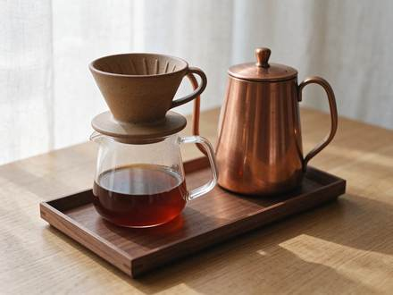</a>

**Seedream Studio** · Pending · [Source](https://seedreamv5.com/seedream-5.5)

##### Source-published prompt

```text
A studio product photograph of a pour-over coffee set on a pale oak tabletop: a matte speckled stoneware dripper with visible glaze pinholes, a clear borosilicate glass carafe half full of amber coffee, a gooseneck kettle in brushed copper with fine circular grain and a soft reflection of the window, and a small walnut tray with crisp wood grain. Soft diffused window light from the left, gentle shadows, a light linen backdrop. Faithful material rendering: the ceramic, glass, metal and wood each look exactly like themselves. No logos, no text, no brand marks. Photorealistic, 100mm macro lens at f/8.
```

[Check original source](https://seedreamv5.com/seedream-5.5)

<a id="web-studio-04"></a>
#### [An ultra-wide 21:9 landscape](cases/web-studio-04/README.md)

<a href="cases/web-studio-04/README.md">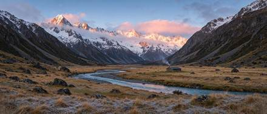</a>

**Seedream Studio** · Pending · [Source](https://seedreamv5.com/seedream-5.5)

##### Source-published prompt

```text
An ultra-wide 21:9 landscape panorama of a glacier-carved mountain valley at sunrise. Jagged granite peaks dusted with fresh snow catch pink and gold first light, and low clouds cling to the ridgelines. A turquoise braided river winds across a wide valley floor of golden grass and dark boulders, and a single small wooden cabin with a thin line of chimney smoke gives a sense of scale. Crisp detail from the frosted grasses in the foreground to the distant summits. Landscape photography, natural colours, deep focus.
```

[Check original source](https://seedreamv5.com/seedream-5.5)

<a id="web-studio-05"></a>
#### [A die-cut sticker](cases/web-studio-05/README.md)

<a href="cases/web-studio-05/README.md"></a>

**Seedream Studio** · Pending · [Source](https://seedreamv5.com/seedream-5.5)

##### Source-published prompt

```text
A die-cut sticker of a cheerful ginger cat curled up asleep inside a ramen bowl, with a pair of chopsticks resting on the rim and a few wisps of steam. A bold white outline around the whole design, flat vector colours with soft cel shading. A single standalone sticker asset on a fully transparent background, with no shadow on the background and no text.
```

[Check original source](https://seedreamv5.com/seedream-5.5)

<a id="web-studio-06"></a>
#### [A set of nine icons](cases/web-studio-06/README.md)

<a href="cases/web-studio-06/README.md">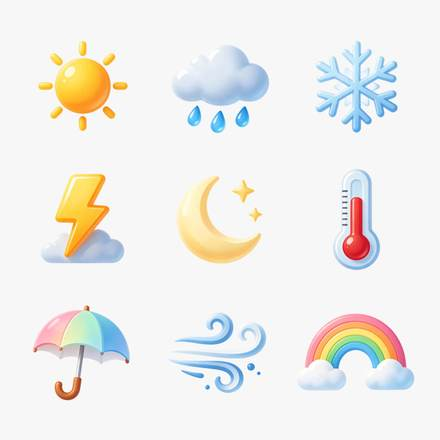</a>

**Seedream Studio** · Pending · [Source](https://seedreamv5.com/seedream-5.5)

##### Source-published prompt

```text
A set of nine weather icons arranged in a neat 3 by 3 grid: a sun, a cloud with rain, a snowflake, a lightning bolt, a crescent moon with two stars, a thermometer, an open umbrella, a wind swirl and a rainbow. A consistent rounded style with glossy, soft-gradient fills in warm and cool pastel tones, equal sizes and even spacing. Each icon is a standalone design asset on a fully transparent background, with no tiles or frames behind them and no text or letters.
```

[Check original source](https://seedreamv5.com/seedream-5.5)

<a id="web-studio-07"></a>
#### [Three-round café image edit](cases/web-studio-07/README.md)

<a href="cases/web-studio-07/README.md">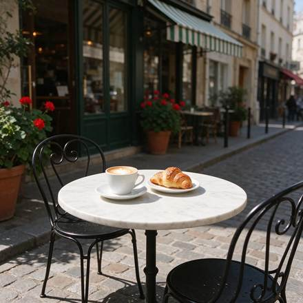</a>

**Seedream Studio** · Pending · [Source](https://seedreamv5.com/seedream-5.5)

##### Source-published prompt

```text
A sunny street café scene seen from the pavement at table height: a small round white marble bistro table holding a white ceramic cup of cappuccino with heart latte art on a saucer and a golden croissant on a small plate, with two black wrought-iron bistro chairs. Behind the table, the café front has a plain green-and-white striped awning with no lettering, tall glass windows and terracotta pots of red geraniums. A cobblestone street, warm morning sunlight, soft shadows, no people, and no text or signs anywhere. Photorealistic, 35mm lens.
```

[Check original source](https://seedreamv5.com/seedream-5.5)

##### Edit step 1: Swap the cappuccino for an iced coffee

<a href="cases/web-studio-07/README.md">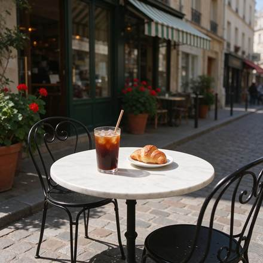</a>

```text
Replace the cappuccino cup and saucer on the table with a tall clear glass of iced coffee with ice cubes, a paper straw and droplets of condensation, standing in the same spot. Keep everything else exactly as it is: the marble table, the croissant and its plate, both chairs, the green-and-white striped awning, the windows, the geraniums, the cobblestones, the lighting and the camera angle.
```

##### Edit step 2: Turn the awning red and white

<a href="cases/web-studio-07/README.md">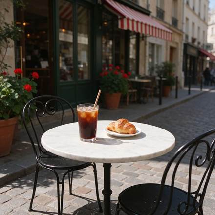</a>

```text
Change only the colour of the awning stripes from green-and-white to red-and-white. Keep everything else exactly as it is: the glass of iced coffee, the croissant and its plate, the marble table, both chairs, the windows, the geraniums, the cobblestones, the lighting and the camera angle.
```

##### Edit step 3: Add a sleeping dachshund

<a href="cases/web-studio-07/README.md">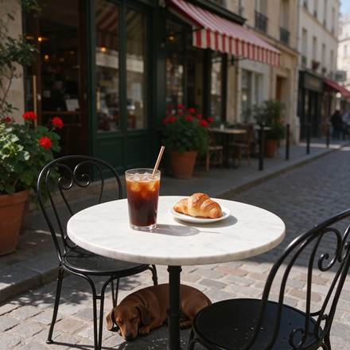</a>

```text
Add a small brown dachshund lying curled up asleep on the cobblestones under the table, in the table's shadow. Keep everything else exactly as it is: the glass of iced coffee, the croissant and its plate, the marble table, both chairs, the red-and-white striped awning, the windows, the geraniums, the lighting and the camera angle.
```

<a id="source-vdobloom-com"></a>
### vdobloom.com

| Case | Source author / website | Local preview files | Prompt status | Original source |
| --- | --- | ---: | --- | --- |
| [A sign with exact words](#web-vdobloom-01) | VdoBloom | 1 | Full original prompt below | [View source](https://vdobloom.com/blog/seedream-5-5-prompt-guide/) |
| [A poster with a title and a date](#web-vdobloom-02) | VdoBloom | 1 | Full original prompt below | [View source](https://vdobloom.com/blog/seedream-5-5-prompt-guide/) |
| [A realistic portrait](#web-vdobloom-03) | VdoBloom | 1 | Full original prompt below | [View source](https://vdobloom.com/blog/seedream-5-5-prompt-guide/) |
| [A product photo](#web-vdobloom-04) | VdoBloom | 1 | Full original prompt below | [View source](https://vdobloom.com/blog/seedream-5-5-prompt-guide/) |
| [Food from above](#web-vdobloom-05) | VdoBloom | 1 | Full original prompt below | [View source](https://vdobloom.com/blog/seedream-5-5-prompt-guide/) |
| [A room](#web-vdobloom-06) | VdoBloom | 1 | Full original prompt below | [View source](https://vdobloom.com/blog/seedream-5-5-prompt-guide/) |
| [A wide cinematic shot](#web-vdobloom-07) | VdoBloom | 1 | Full original prompt below | [View source](https://vdobloom.com/blog/seedream-5-5-prompt-guide/) |
| [Anime style](#web-vdobloom-08) | VdoBloom | 1 | Full original prompt below | [View source](https://vdobloom.com/blog/seedream-5-5-prompt-guide/) |
| [An exact number of things](#web-vdobloom-09) | VdoBloom | 1 | Full original prompt below | [View source](https://vdobloom.com/blog/seedream-5-5-prompt-guide/) |
| [A children’s book illustration](#web-vdobloom-10) | VdoBloom | 1 | Full original prompt below | [View source](https://vdobloom.com/blog/seedream-5-5-prompt-guide/) |

<a id="web-vdobloom-01"></a>
#### [A sign with exact words](cases/web-vdobloom-01/README.md)

<a href="cases/web-vdobloom-01/README.md">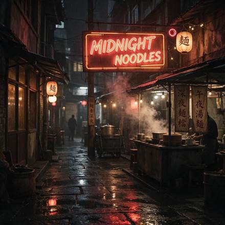</a>

**VdoBloom** · Pending · [Source](https://vdobloom.com/blog/seedream-5-5-prompt-guide/)

##### Source-published prompt

```text
A neon sign glowing in a rainy night alley that reads "MIDNIGHT NOODLES", steam rising from a food stall below, reflections on wet pavement, cinematic photo.
```

[Check original source](https://vdobloom.com/blog/seedream-5-5-prompt-guide/)

<a id="web-vdobloom-02"></a>
#### [A poster with a title and a date](cases/web-vdobloom-02/README.md)

<a href="cases/web-vdobloom-02/README.md">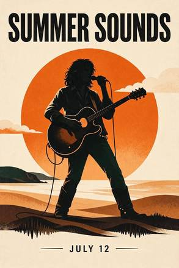</a>

**VdoBloom** · Pending · [Source](https://vdobloom.com/blog/seedream-5-5-prompt-guide/)

##### Source-published prompt

```text
A minimalist concert poster, cream background, a large orange sun behind a black silhouette of a guitarist, the title "SUMMER SOUNDS" in bold capital letters at the top and "JULY 12" in small letters at the bottom.
```

[Check original source](https://vdobloom.com/blog/seedream-5-5-prompt-guide/)

<a id="web-vdobloom-03"></a>
#### [A realistic portrait](cases/web-vdobloom-03/README.md)

<a href="cases/web-vdobloom-03/README.md">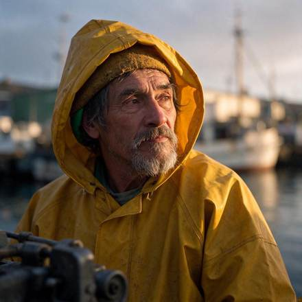</a>

**VdoBloom** · Pending · [Source](https://vdobloom.com/blog/seedream-5-5-prompt-guide/)

##### Source-published prompt

```text
Close-up portrait photo of an elderly fisherman with a grey beard and a yellow raincoat, standing on a harbour at dawn, weathered skin, natural skin texture, soft morning light, 85mm lens.
```

[Check original source](https://vdobloom.com/blog/seedream-5-5-prompt-guide/)

<a id="web-vdobloom-04"></a>
#### [A product photo](cases/web-vdobloom-04/README.md)

<a href="cases/web-vdobloom-04/README.md">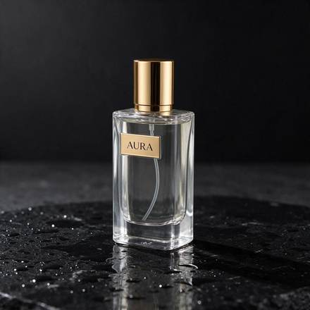</a>

**VdoBloom** · Pending · [Source](https://vdobloom.com/blog/seedream-5-5-prompt-guide/)

##### Source-published prompt

```text
Studio product photo of a clear glass perfume bottle with a gold cap, the label reads "AURA", standing on wet black stone with small water drops, one soft light from the left, dark background.
```

[Check original source](https://vdobloom.com/blog/seedream-5-5-prompt-guide/)

<a id="web-vdobloom-05"></a>
#### [Food from above](cases/web-vdobloom-05/README.md)

<a href="cases/web-vdobloom-05/README.md">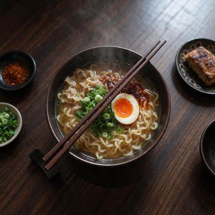</a>

**VdoBloom** · Pending · [Source](https://vdobloom.com/blog/seedream-5-5-prompt-guide/)

##### Source-published prompt

```text
Overhead food photo of a bowl of ramen with a soft-boiled egg, spring onions and chilli oil on a dark wooden table, chopsticks resting on the bowl, steam visible, natural window light.
```

[Check original source](https://vdobloom.com/blog/seedream-5-5-prompt-guide/)

<a id="web-vdobloom-06"></a>
#### [A room](cases/web-vdobloom-06/README.md)

<a href="cases/web-vdobloom-06/README.md">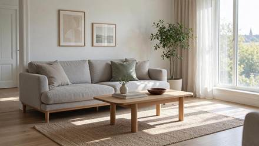</a>

**VdoBloom** · Pending · [Source](https://vdobloom.com/blog/seedream-5-5-prompt-guide/)

##### Source-published prompt

```text
A bright Scandinavian living room with a light grey sofa, an oak coffee table, a large window with sheer curtains, one green plant in the corner, morning sunlight on the floor, interior design photo.
```

[Check original source](https://vdobloom.com/blog/seedream-5-5-prompt-guide/)

<a id="web-vdobloom-07"></a>
#### [A wide cinematic shot](cases/web-vdobloom-07/README.md)

<a href="cases/web-vdobloom-07/README.md">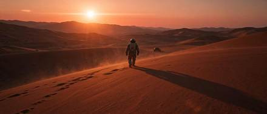</a>

**VdoBloom** · Pending · [Source](https://vdobloom.com/blog/seedream-5-5-prompt-guide/)

##### Source-published prompt

```text
A lone astronaut walking across red desert dunes at sunset, long shadow, a small rover far behind, dust in the air, cinematic wide shot, anamorphic look.
```

[Check original source](https://vdobloom.com/blog/seedream-5-5-prompt-guide/)

<a id="web-vdobloom-08"></a>
#### [Anime style](cases/web-vdobloom-08/README.md)

<a href="cases/web-vdobloom-08/README.md">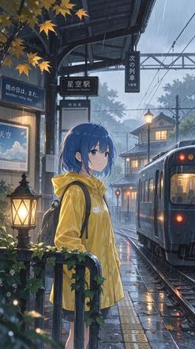</a>

**VdoBloom** · Pending · [Source](https://vdobloom.com/blog/seedream-5-5-prompt-guide/)

##### Source-published prompt

```text
Anime style illustration of a girl with short blue hair and a yellow raincoat waiting at a train station in the rain, soft glowing lights, detailed background, clean line art.
```

[Check original source](https://vdobloom.com/blog/seedream-5-5-prompt-guide/)

<a id="web-vdobloom-09"></a>
#### [An exact number of things](cases/web-vdobloom-09/README.md)

<a href="cases/web-vdobloom-09/README.md">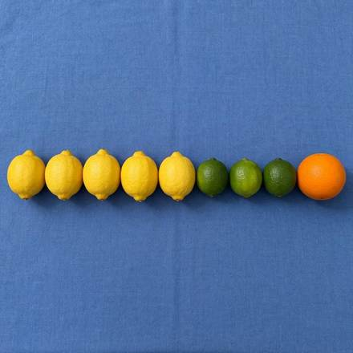</a>

**VdoBloom** · Pending · [Source](https://vdobloom.com/blog/seedream-5-5-prompt-guide/)

##### Source-published prompt

```text
Top-down photo of exactly five lemons, three limes and one orange arranged in a single neat row on a plain blue tablecloth, even daylight.
```

[Check original source](https://vdobloom.com/blog/seedream-5-5-prompt-guide/)

<a id="web-vdobloom-10"></a>
#### [A children’s book illustration](cases/web-vdobloom-10/README.md)

<a href="cases/web-vdobloom-10/README.md">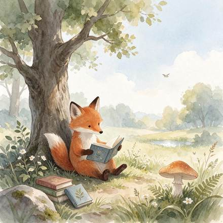</a>

**VdoBloom** · Pending · [Source](https://vdobloom.com/blog/seedream-5-5-prompt-guide/)

##### Source-published prompt

```text
Children's book watercolour illustration of a small red fox reading a book under a big oak tree, soft pastel colours, gentle paper texture, lots of white space around.
```

[Check original source](https://vdobloom.com/blog/seedream-5-5-prompt-guide/)

<a id="source-www-froging-ai"></a>
### www.froging.ai

| Case | Source author / website | Local preview files | Prompt status | Original source |
| --- | --- | ---: | --- | --- |
| [Change a product backdrop](#web-froging-01) | Froging AI | 1 | Full original prompt below | [View source](https://www.froging.ai/seedream-5-5-ai-image-generator) |
| [Freeze a splash for a campaign image](#web-froging-02) | Froging AI | 1 | Full original prompt below | [View source](https://www.froging.ai/seedream-5-5-ai-image-generator) |
| [Create a transparent glass asset](#web-froging-03) | Froging AI | 1 | Full original prompt below | [View source](https://www.froging.ai/seedream-5-5-ai-image-generator) |

<a id="web-froging-01"></a>
#### [Change a product backdrop](cases/web-froging-01/README.md)

<a href="cases/web-froging-01/README.md">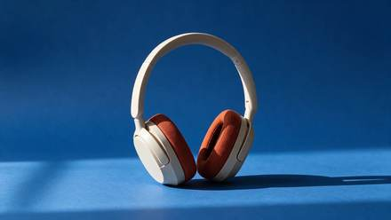</a>

**Froging AI** · Pending · [Source](https://www.froging.ai/seedream-5-5-ai-image-generator)

##### Source-published prompt

```text
Replace only the warm-gray seamless paper behind and beneath the headphones with saturated matte cobalt-blue seamless paper. Keep the product in precisely the same position, scale and three-quarter orientation. Preserve the shape of the headband, the ivory plastic, the rust-orange woven cushions, and the original direction of the contact shadow. Keep the same framing and camera angle. Do not add text, accessories, reflections or extra objects.
```

[Check original source](https://www.froging.ai/seedream-5-5-ai-image-generator)

<a id="web-froging-02"></a>
#### [Freeze a splash for a campaign image](cases/web-froging-02/README.md)

<a href="cases/web-froging-02/README.md">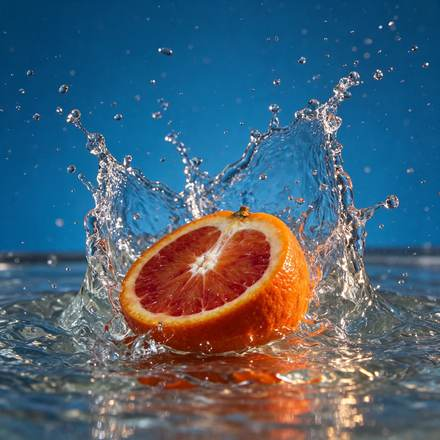</a>

**Froging AI** · Pending · [Source](https://www.froging.ai/seedream-5-5-ai-image-generator)

##### Source-published prompt

```text
High-speed editorial food photograph of one cut blood orange half hitting a shallow pool of water, cut surface facing the camera. Capture the moment a translucent crown of water curves around the orange, with individual sharp droplets suspended in the air. Rich ultramarine blue seamless studio backdrop, vivid vermilion pulp and warm side light, natural irregular citrus texture, restrained commercial art direction. Low eye-level camera, square composition, the entire splash inside the frame with breathing room on all sides. One fruit half, no hands, no typography, no logos, no watermark.
```

[Check original source](https://www.froging.ai/seedream-5-5-ai-image-generator)

<a id="web-froging-03"></a>
#### [Create a transparent glass asset](cases/web-froging-03/README.md)

<a href="cases/web-froging-03/README.md">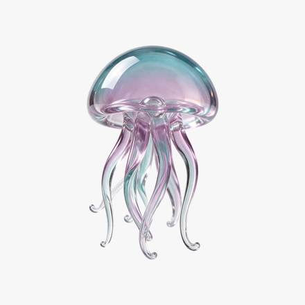</a>

**Froging AI** · Pending · [Source](https://www.froging.ai/seedream-5-5-ai-image-generator)

##### Source-published prompt

```text
Create one small seafoam and pale lavender blown-glass jellyfish as an isolated design asset. Show a translucent domed bell and six delicate curved glass tentacles, with polished edges and soft studio highlights. Center the entire silhouette with generous clear margins. Fully transparent background with real alpha outside the object and partial transparency within the thin glass. No floor, no cast shadow, no bubbles, no checkerboard, no frame, no text.
```

[Check original source](https://www.froging.ai/seedream-5-5-ai-image-generator)

<a id="source-www-made-app"></a>
### www.made.app

| Case | Source author / website | Local preview files | Prompt status | Original source |
| --- | --- | ---: | --- | --- |
| [Night nap](#web-made-01) | Made | 1 | Full original prompt below | [View source](https://www.made.app/models/seedream-5-5) |
| [Handwritten sign](#web-made-02) | Made | 1 | Full original prompt below | [View source](https://www.made.app/models/seedream-5-5) |
| [Inside the dryer](#web-made-03) | Made | 1 | Full original prompt below | [View source](https://www.made.app/models/seedream-5-5) |
| [Folding table](#web-made-04) | Made | 1 | Full original prompt below | [View source](https://www.made.app/models/seedream-5-5) |
| [Neon sign](#web-made-05) | Made | 1 | Full original prompt below | [View source](https://www.made.app/models/seedream-5-5) |
| [Lost and found](#web-made-06) | Made | 1 | Full original prompt below | [View source](https://www.made.app/models/seedream-5-5) |

<a id="web-made-01"></a>
#### [Night nap](cases/web-made-01/README.md)

<a href="cases/web-made-01/README.md">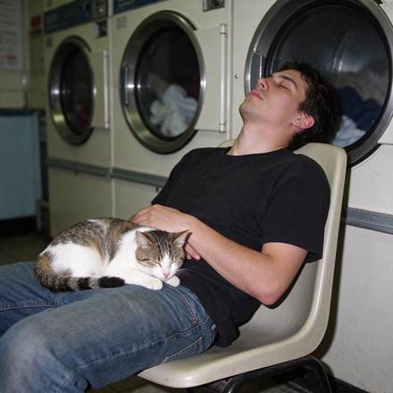</a>

**Made** · Pending · [Source](https://www.made.app/models/seedream-5-5)

##### Source-published prompt

```text
Candid phone photo with direct on-camera flash: a guy in his twenties asleep sitting up on a plastic chair in a 24-hour laundromat at 3 a.m., a cat curled up asleep on his lap, a row of spinning dryers behind him. Real skin texture, slight motion blur in the dryer drums, slight grain, candid and unposed, no readable text, logos, or watermark.
```

[Check original source](https://www.made.app/models/seedream-5-5)

<a id="web-made-02"></a>
#### [Handwritten sign](cases/web-made-02/README.md)

<a href="cases/web-made-02/README.md">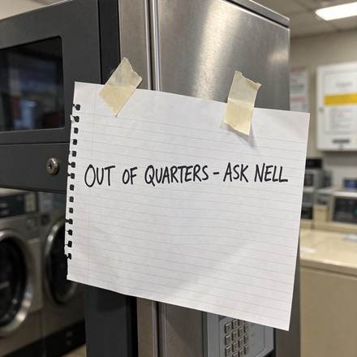</a>

**Made** · Pending · [Source](https://www.made.app/models/seedream-5-5)

##### Source-published prompt

```text
Close-up phone photo of a handwritten sign taped to a coin change machine in a laundromat, black marker on lined notebook paper reading exactly "OUT OF QUARTERS - ASK NELL", one strip of tape peeling at the corner, harsh fluorescent light, slight grain, sharp legible handwriting, no other words or logos.
```

[Check original source](https://www.made.app/models/seedream-5-5)

<a id="web-made-03"></a>
#### [Inside the dryer](cases/web-made-03/README.md)

<a href="cases/web-made-03/README.md">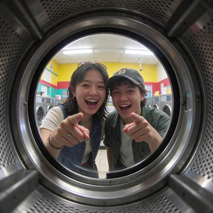</a>

**Made** · Pending · [Source](https://www.made.app/models/seedream-5-5)

##### Source-published prompt

```text
0.5x ultra-wide phone shot from inside a front-loading dryer drum looking out through the round glass door at two friends laughing and pointing at the camera in a laundromat, fluorescent ceiling lights, warped ultra-wide edges, slight grain, candid and unposed, no readable text, logos, or watermark.
```

[Check original source](https://www.made.app/models/seedream-5-5)

<a id="web-made-04"></a>
#### [Folding table](cases/web-made-04/README.md)

<a href="cases/web-made-04/README.md">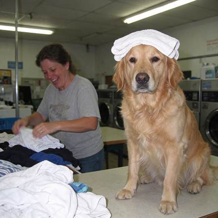</a>

**Made** · Pending · [Source](https://www.made.app/models/seedream-5-5)

##### Source-published prompt

```text
Phone photo with direct flash of a golden retriever sitting upright on a laundromat folding table wearing a freshly folded towel on its head like a turban, its owner mid-laugh folding shirts beside it, harsh fluorescent light, real fur texture, candid and unposed, no readable text, logos, or watermark.
```

[Check original source](https://www.made.app/models/seedream-5-5)

<a id="web-made-05"></a>
#### [Neon sign](cases/web-made-05/README.md)

<a href="cases/web-made-05/README.md">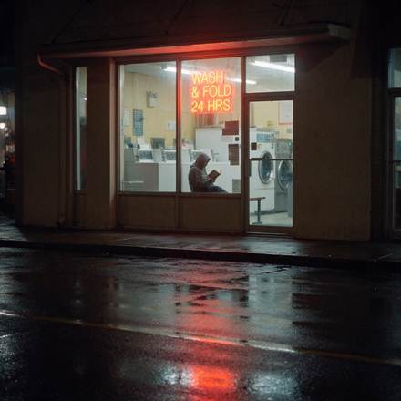</a>

**Made** · Pending · [Source](https://www.made.app/models/seedream-5-5)

##### Source-published prompt

```text
Laundromat storefront at night seen from across a rainy street, a neon window sign reading exactly "WASH & FOLD 24 HRS", a person in a hoodie reading a paperback on a bench inside, reflections on the wet asphalt, shot on a phone, slight grain, sharp legible sign, no other words or logos.
```

[Check original source](https://www.made.app/models/seedream-5-5)

<a id="web-made-06"></a>
#### [Lost and found](cases/web-made-06/README.md)

<a href="cases/web-made-06/README.md">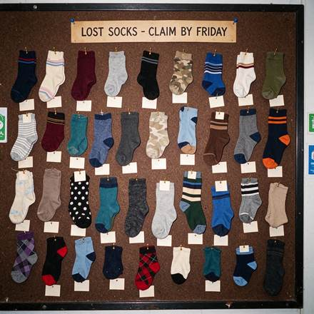</a>

**Made** · Pending · [Source](https://www.made.app/models/seedream-5-5)

##### Source-published prompt

```text
Flash photo of a corkboard at a laundromat covered in dozens of single mismatched socks pinned up like butterfly specimens, each with a small blank paper tag, a printed header card at the top reading exactly "LOST SOCKS - CLAIM BY FRIDAY", slight grain, sharp legible header, no other words or logos.
```

[Check original source](https://www.made.app/models/seedream-5-5)
