<!-- Generated: edit cases.json, then run scripts/build_external_refs.py -->

# Seedream 5.5 全网外部参考 · 待重做

[English](README.md) · [简体中文](README.zh-CN.md)

这是独立的第三方图片和公开提示词整理区，不属于主 README 的正式案例，也不是 Raphael 自行生成的结果。

**待重做参考: 35 · 本地低清预览: 38 · 已重做: 0**

**版权：** 公开网页不代表可授权转载。图片可能受版权保护，本文仅供素材核对；正式宣传前须取得许可或移除参考预览。重新生成也不自动消除对他人作品、商标、肖像等权利的影响。

[查看重做流程](WORKFLOW.md) · [查看原始数据](cases.json) · [返回主仓库](../README.zh-CN.md)

## 来源网站

| 来源页主机 | 案例数 | 本地预览文件数 |
| --- | ---: | ---: |
| [flux1.ai](#source-flux1-ai) | 6 | 6 |
| [orylia.ai](#source-orylia-ai) | 3 | 3 |
| [seedreamv5.com](#source-seedreamv5-com) | 7 | 10 |
| [vdobloom.com](#source-vdobloom-com) | 10 | 10 |
| [www.froging.ai](#source-www-froging-ai) | 3 | 3 |
| [www.made.app](#source-www-made-app) | 6 | 6 |

## 按分类浏览

- [文字与海报 (8)](#typography)
- [人物与肖像 (6)](#portraits)
- [摄影与商品 (9)](#photography)
- [室内设计 (1)](#interiors)
- [角色与插画 (4)](#characters)
- [信息图 (1)](#infographics)
- [透明素材 (4)](#rgba-assets)
- [多轮编辑 (2)](#multi-turn-editing)

<a id="typography"></a>
### 文字与海报

| 案例 | 来源 |
| --- | --- |
| [霓虹面馆英文招牌](#web-vdobloom-01) | VdoBloom |
| [极简夏季音乐会海报](#web-vdobloom-02) | VdoBloom |
| [零钱兑换机手写告示](#web-made-02) | Made |
| [雨夜洗衣店霓虹招牌](#web-made-05) | Made |
| [袜子失物招领展示板](#web-made-06) | Made |
| [秋日茶会中英海报](#web-flux1-03) | Flux1 AI |
| [中英双语灯笼茶馆海报](#web-studio-01) | Seedream Studio |
| [FORM & LIGHT 中英双语展览海报](#web-orylia-03) | Orylia |

<a id="portraits"></a>
### 人物与肖像

| 案例 | 来源 |
| --- | --- |
| [港口黄雨衣渔夫人像](#web-vdobloom-03) | VdoBloom |
| [凌晨洗衣店睡着的男子与猫](#web-made-01) | Made |
| [烘干机内超广角朋友合照](#web-made-03) | Made |
| [逆光自然皱纹人像](#web-flux1-01) | Flux1 AI |
| [草地金色逆光人像](#web-studio-02) | Seedream Studio |
| [杂志时装人像与留白](#web-orylia-01) | Orylia |

<a id="photography"></a>
### 摄影与商品

| 案例 | 来源 |
| --- | --- |
| [黑石玻璃香水瓶](#web-vdobloom-04) | VdoBloom |
| [俯拍拉面美食](#web-vdobloom-05) | VdoBloom |
| [荒漠宇航员超宽幅电影剧照](#web-vdobloom-07) | VdoBloom |
| [指定数量柑橘](#web-vdobloom-09) | VdoBloom |
| [叠衣台戴毛巾金毛犬](#web-made-04) | Made |
| [铜壶陶瓷滤杯手冲套装](#web-studio-03) | Seedream Studio |
| [宽幅冰川峡谷日出](#web-studio-04) | Seedream Studio |
| [血橙水花商业静物](#web-froging-02) | Froging AI |
| [LUMA 05 玻璃香水广告](#web-orylia-02) | Orylia |

<a id="interiors"></a>
### 室内设计

| 案例 | 来源 |
| --- | --- |
| [北欧客厅](#web-vdobloom-06) | VdoBloom |

<a id="characters"></a>
### 角色与插画

| 案例 | 来源 |
| --- | --- |
| [雨中蓝发动漫女孩](#web-vdobloom-08) | VdoBloom |
| [树下读书的小狐狸水彩](#web-vdobloom-10) | VdoBloom |
| [FRESH BAKED 贴纸](#web-flux1-05) | Flux1 AI |
| [拉面碗里的猫咪透明贴纸](#web-studio-05) | Seedream Studio |

<a id="infographics"></a>
### 信息图

| 案例 | 来源 |
| --- | --- |
| [手冲咖啡六步骤图解](#web-flux1-02) | Flux1 AI |

<a id="rgba-assets"></a>
### 透明素材

| 案例 | 来源 |
| --- | --- |
| [玻璃香水瓶透明素材](#web-flux1-04) | Flux1 AI |
| [宠物围巾透明抠图](#web-flux1-06) | Flux1 AI |
| [九枚透明天气图标](#web-studio-06) | Seedream Studio |
| [透明玻璃水母](#web-froging-03) | Froging AI |

<a id="multi-turn-editing"></a>
### 多轮编辑

| 案例 | 来源 |
| --- | --- |
| [咖啡馆三轮编辑：饮品、遮阳篷和小狗](#web-studio-07) | Seedream Studio |
| [耳机背景局部修改](#web-froging-01) | Froging AI |

<a id="all-cases"></a>
## 全部外站案例与提示词

<a id="source-flux1-ai"></a>
### flux1.ai

| 案例 | 来源作者 / 网站 | 本地预览文件数 | 提示词状态 | 原始来源 |
| --- | --- | ---: | --- | --- |
| [逆光自然皱纹人像](#web-flux1-01) | Flux1 AI | 1 | 原提示词全文见下方 | [查看来源](https://flux1.ai/seedream-5-5) |
| [手冲咖啡六步骤图解](#web-flux1-02) | Flux1 AI | 1 | 原提示词全文见下方 | [查看来源](https://flux1.ai/seedream-5-5) |
| [秋日茶会中英海报](#web-flux1-03) | Flux1 AI | 1 | 原提示词全文见下方 | [查看来源](https://flux1.ai/seedream-5-5) |
| [玻璃香水瓶透明素材](#web-flux1-04) | Flux1 AI | 1 | 原提示词全文见下方 | [查看来源](https://flux1.ai/seedream-5-5) |
| [FRESH BAKED 贴纸](#web-flux1-05) | Flux1 AI | 1 | 原提示词全文见下方 | [查看来源](https://flux1.ai/seedream-5-5) |
| [宠物围巾透明抠图](#web-flux1-06) | Flux1 AI | 1 | 原提示词全文见下方 | [查看来源](https://flux1.ai/seedream-5-5) |

<a id="web-flux1-01"></a>
#### [逆光自然皱纹人像](cases/web-flux1-01/README.zh-CN.md)

<a href="cases/web-flux1-01/README.zh-CN.md">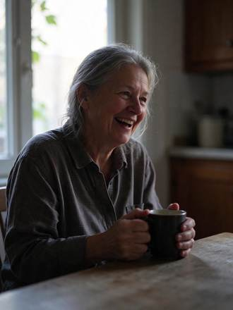</a>

**Flux1 AI** · 待重做 · [来源](https://flux1.ai/seedream-5-5)

##### 来源公开 Prompt

```text
Candid portrait of a woman in her sixties laughing at a kitchen table by a window, late afternoon side light, visible skin texture and fine lines, loose grey hair catching the backlight, a mug in her hands, 50mm lens, natural colors, documentary photo
```

[核对来源原文](https://flux1.ai/seedream-5-5)

<a id="web-flux1-02"></a>
#### [手冲咖啡六步骤图解](cases/web-flux1-02/README.zh-CN.md)

<a href="cases/web-flux1-02/README.zh-CN.md">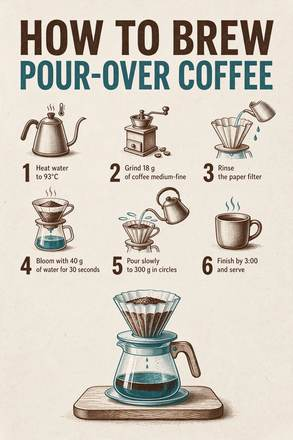</a>

**Flux1 AI** · 待重做 · [来源](https://flux1.ai/seedream-5-5)

##### 来源公开 Prompt

```text
A clean printed infographic poster titled 'HOW TO BREW POUR-OVER COFFEE'. Six numbered steps with small line icons: '1 Heat water to 93°C', '2 Grind 18 g of coffee medium-fine', '3 Rinse the paper filter', '4 Bloom with 40 g of water for 30 seconds', '5 Pour slowly to 300 g in circles', '6 Finish by 3:00 and serve'. Off-white paper, dark brown and teal ink, generous margins. No other text.
```

[核对来源原文](https://flux1.ai/seedream-5-5)

<a id="web-flux1-03"></a>
#### [秋日茶会中英海报](cases/web-flux1-03/README.zh-CN.md)

<a href="cases/web-flux1-03/README.zh-CN.md">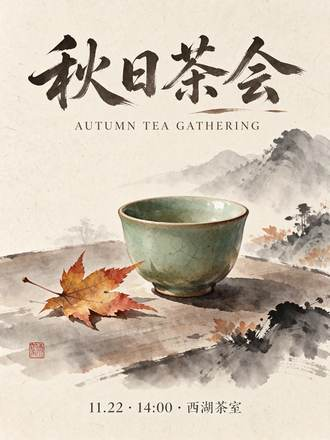</a>

**Flux1 AI** · 待重做 · [来源](https://flux1.ai/seedream-5-5)

##### 来源公开 Prompt

```text
A minimalist event poster for an autumn tea gathering. Large Chinese title '秋日茶会' at the top, English line 'AUTUMN TEA GATHERING' below it in small spaced caps, and a small line '11.22 · 14:00 · 西湖茶室' at the bottom. A single celadon teacup with a maple leaf beside it in the middle, ink-wash style, warm rice-paper background. No other text.
```

[核对来源原文](https://flux1.ai/seedream-5-5)

<a id="web-flux1-04"></a>
#### [玻璃香水瓶透明素材](cases/web-flux1-04/README.zh-CN.md)

<a href="cases/web-flux1-04/README.zh-CN.md">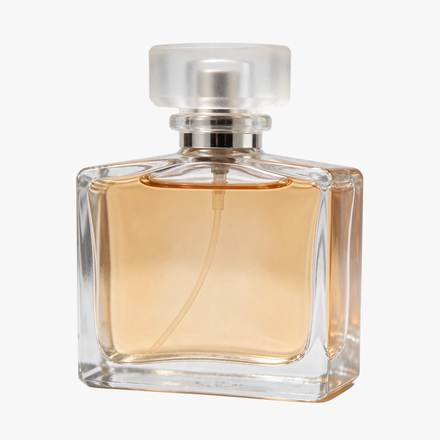</a>

**Flux1 AI** · 待重做 · [来源](https://flux1.ai/seedream-5-5)

##### 来源公开 Prompt

```text
A clear glass perfume bottle with a frosted glass cap and pale amber liquid, soft reflections and refraction through the glass, studio product shot, isolated object on a transparent background
```

[核对来源原文](https://flux1.ai/seedream-5-5)

<a id="web-flux1-05"></a>
#### [FRESH BAKED 贴纸](cases/web-flux1-05/README.zh-CN.md)

<a href="cases/web-flux1-05/README.zh-CN.md"></a>

**Flux1 AI** · 待重做 · [来源](https://flux1.ai/seedream-5-5)

##### 来源公开 Prompt

```text
A die-cut sticker that reads 'FRESH BAKED' in chunky rounded letters above a small smiling croissant, thick white border, flat colors, transparent background
```

[核对来源原文](https://flux1.ai/seedream-5-5)

<a id="web-flux1-06"></a>
#### [宠物围巾透明抠图](cases/web-flux1-06/README.zh-CN.md)

<a href="cases/web-flux1-06/README.zh-CN.md">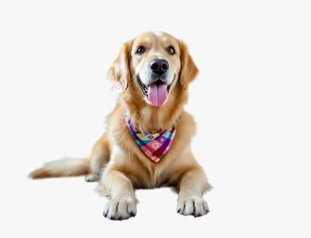</a>

**Flux1 AI** · 待重做 · [来源](https://flux1.ai/seedream-5-5)

##### 来源公开 Prompt

```text
Cut out the dog with its bandana and return it on a transparent background. Keep the dog, its fur edges, pose and colors exactly as they are.
```

[核对来源原文](https://flux1.ai/seedream-5-5)

<a id="source-orylia-ai"></a>
### orylia.ai

| 案例 | 来源作者 / 网站 | 本地预览文件数 | 提示词状态 | 原始来源 |
| --- | --- | ---: | --- | --- |
| [杂志时装人像与留白](#web-orylia-01) | Orylia | 1 | 原提示词全文见下方 | [查看来源](https://orylia.ai/ai-models/seedream-5-5) |
| [LUMA 05 玻璃香水广告](#web-orylia-02) | Orylia | 1 | 原提示词全文见下方 | [查看来源](https://orylia.ai/ai-models/seedream-5-5) |
| [FORM & LIGHT 中英双语展览海报](#web-orylia-03) | Orylia | 1 | 原提示词全文见下方 | [查看来源](https://orylia.ai/ai-models/seedream-5-5) |

<a id="web-orylia-01"></a>
#### [杂志时装人像与留白](cases/web-orylia-01/README.zh-CN.md)

<a href="cases/web-orylia-01/README.zh-CN.md"></a>

**Orylia** · 待重做 · [来源](https://orylia.ai/ai-models/seedream-5-5)

##### 来源公开 Prompt

```text
Luxury fashion editorial photograph, adult woman with natural freckles, short dark bob, brushed gold sculptural earrings and an ivory silk blouse, seated beside an amber glass vase in a sunlit modernist interior. Subject on the right third, expansive softly lit warm charcoal negative space on the left for a website headline. Tangible silk weave, natural pores, delicate flyaway hair, golden afternoon rim light, restrained warm ivory and amber palette, 85mm portrait lens, sophisticated magazine art direction. No text, no logo, no watermark.
```

[核对来源原文](https://orylia.ai/ai-models/seedream-5-5)

<a id="web-orylia-02"></a>
#### [LUMA 05 玻璃香水广告](cases/web-orylia-02/README.zh-CN.md)

<a href="cases/web-orylia-02/README.zh-CN.md">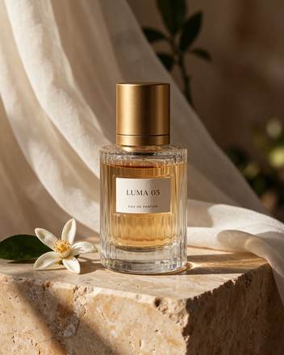</a>

**Orylia** · 待重做 · [来源](https://orylia.ai/ai-models/seedream-5-5)

##### 来源公开 Prompt

```text
Premium fragrance campaign still life. A single clear ribbed glass perfume bottle filled with pale amber liquid, brushed gold cylindrical cap, small ivory label reading exactly "LUMA 05" and below it "EAU DE PARFUM". Bottle on warm travertine, sheer ivory fabric behind, one orange blossom beside it. Late afternoon side light, convincing glass refraction and caustics, detailed stone grain, elegant editorial photography. No other lettering. Complete bottle and cap visible.
```

[核对来源原文](https://orylia.ai/ai-models/seedream-5-5)

<a id="web-orylia-03"></a>
#### [FORM & LIGHT 中英双语展览海报](cases/web-orylia-03/README.zh-CN.md)

<a href="cases/web-orylia-03/README.zh-CN.md">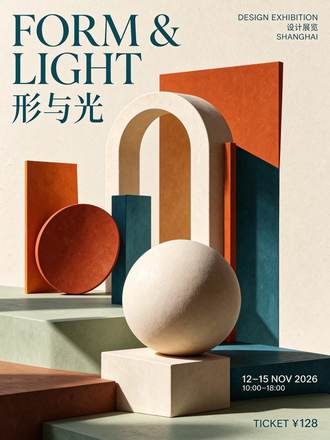</a>

**Orylia** · 待重做 · [来源](https://orylia.ai/ai-models/seedream-5-5)

##### 来源公开 Prompt

```text
Design a premium bilingual exhibition poster on ivory paper, burnt orange and deep teal geometric still-life shapes, meticulous Swiss editorial grid. Include exactly these text lines, each once, with accurate punctuation: "FORM & LIGHT", "形与光", "DESIGN EXHIBITION", "设计展览", "12–15 NOV 2026", "10:00–18:00", "TICKET ¥128", "SHANGHAI". Clear hierarchy, large elegant headline, perfectly readable smaller information, balanced generous margins. No other text, no decorative fake letters.
```

[核对来源原文](https://orylia.ai/ai-models/seedream-5-5)

<a id="source-seedreamv5-com"></a>
### seedreamv5.com

| 案例 | 来源作者 / 网站 | 本地预览文件数 | 提示词状态 | 原始来源 |
| --- | --- | ---: | --- | --- |
| [中英双语灯笼茶馆海报](#web-studio-01) | Seedream Studio | 1 | 原提示词全文见下方 | [查看来源](https://seedreamv5.com/seedream-5.5) |
| [草地金色逆光人像](#web-studio-02) | Seedream Studio | 1 | 原提示词全文见下方 | [查看来源](https://seedreamv5.com/seedream-5.5) |
| [铜壶陶瓷滤杯手冲套装](#web-studio-03) | Seedream Studio | 1 | 原提示词全文见下方 | [查看来源](https://seedreamv5.com/seedream-5.5) |
| [宽幅冰川峡谷日出](#web-studio-04) | Seedream Studio | 1 | 原提示词全文见下方 | [查看来源](https://seedreamv5.com/seedream-5.5) |
| [拉面碗里的猫咪透明贴纸](#web-studio-05) | Seedream Studio | 1 | 原提示词全文见下方 | [查看来源](https://seedreamv5.com/seedream-5.5) |
| [九枚透明天气图标](#web-studio-06) | Seedream Studio | 1 | 原提示词全文见下方 | [查看来源](https://seedreamv5.com/seedream-5.5) |
| [咖啡馆三轮编辑：饮品、遮阳篷和小狗](#web-studio-07) | Seedream Studio | 4 | 原提示词全文见下方，含编辑步骤 | [查看来源](https://seedreamv5.com/seedream-5.5) |

<a id="web-studio-01"></a>
#### [中英双语灯笼茶馆海报](cases/web-studio-01/README.zh-CN.md)

<a href="cases/web-studio-01/README.zh-CN.md">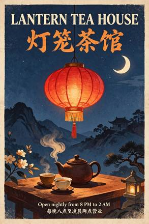</a>

**Seedream Studio** · 待重做 · [来源](https://seedreamv5.com/seedream-5.5)

##### 来源公开 Prompt

```text
A vintage screen-print travel poster for a fictional tea house, portrait format. At the top, a large bold serif headline in English reading exactly "LANTERN TEA HOUSE". Directly beneath it, a Chinese title in brush calligraphy reading exactly "灯笼茶馆". In the centre, a flat illustration of a glowing red paper lantern with no writing on it, hanging above a steaming clay teapot and two small cups, under a deep indigo night sky with a single crescent moon and a few stars, with saffron and cream accents and a subtle paper grain. At the bottom, two lines of small, clean sans-serif text: the first reading exactly "Open nightly from 8 PM to 2 AM" and the second reading exactly "每晚八点至凌晨两点营业". These four lines are the only text on the poster, with no signs, labels or characters anywhere else. All lettering crisp, correctly spelled and fully legible, generous margins.
```

[核对来源原文](https://seedreamv5.com/seedream-5.5)

<a id="web-studio-02"></a>
#### [草地金色逆光人像](cases/web-studio-02/README.zh-CN.md)

<a href="cases/web-studio-02/README.zh-CN.md">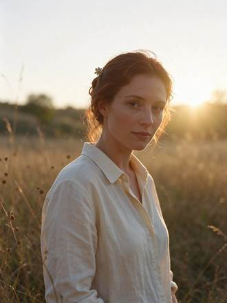</a>

**Seedream Studio** · 待重做 · [来源](https://seedreamv5.com/seedream-5.5)

##### 来源公开 Prompt

```text
A backlit portrait of a woman in her early thirties standing in a meadow of tall grass at golden hour. The low sun behind her creates a bright rim light that outlines her loose auburn hair, her shoulders and the edge of her cream linen shirt. Her face is softly lit by warm bounce light, with natural skin texture and light freckles, a calm expression, looking just past the camera. Warm haze, a gentle lens flare, creamy background bokeh. An original, non-famous person. Photorealistic, 85mm lens at f/1.8, shallow depth of field.
```

[核对来源原文](https://seedreamv5.com/seedream-5.5)

<a id="web-studio-03"></a>
#### [铜壶陶瓷滤杯手冲套装](cases/web-studio-03/README.zh-CN.md)

<a href="cases/web-studio-03/README.zh-CN.md">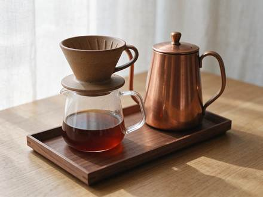</a>

**Seedream Studio** · 待重做 · [来源](https://seedreamv5.com/seedream-5.5)

##### 来源公开 Prompt

```text
A studio product photograph of a pour-over coffee set on a pale oak tabletop: a matte speckled stoneware dripper with visible glaze pinholes, a clear borosilicate glass carafe half full of amber coffee, a gooseneck kettle in brushed copper with fine circular grain and a soft reflection of the window, and a small walnut tray with crisp wood grain. Soft diffused window light from the left, gentle shadows, a light linen backdrop. Faithful material rendering: the ceramic, glass, metal and wood each look exactly like themselves. No logos, no text, no brand marks. Photorealistic, 100mm macro lens at f/8.
```

[核对来源原文](https://seedreamv5.com/seedream-5.5)

<a id="web-studio-04"></a>
#### [宽幅冰川峡谷日出](cases/web-studio-04/README.zh-CN.md)

<a href="cases/web-studio-04/README.zh-CN.md"></a>

**Seedream Studio** · 待重做 · [来源](https://seedreamv5.com/seedream-5.5)

##### 来源公开 Prompt

```text
An ultra-wide 21:9 landscape panorama of a glacier-carved mountain valley at sunrise. Jagged granite peaks dusted with fresh snow catch pink and gold first light, and low clouds cling to the ridgelines. A turquoise braided river winds across a wide valley floor of golden grass and dark boulders, and a single small wooden cabin with a thin line of chimney smoke gives a sense of scale. Crisp detail from the frosted grasses in the foreground to the distant summits. Landscape photography, natural colours, deep focus.
```

[核对来源原文](https://seedreamv5.com/seedream-5.5)

<a id="web-studio-05"></a>
#### [拉面碗里的猫咪透明贴纸](cases/web-studio-05/README.zh-CN.md)

<a href="cases/web-studio-05/README.zh-CN.md"></a>

**Seedream Studio** · 待重做 · [来源](https://seedreamv5.com/seedream-5.5)

##### 来源公开 Prompt

```text
A die-cut sticker of a cheerful ginger cat curled up asleep inside a ramen bowl, with a pair of chopsticks resting on the rim and a few wisps of steam. A bold white outline around the whole design, flat vector colours with soft cel shading. A single standalone sticker asset on a fully transparent background, with no shadow on the background and no text.
```

[核对来源原文](https://seedreamv5.com/seedream-5.5)

<a id="web-studio-06"></a>
#### [九枚透明天气图标](cases/web-studio-06/README.zh-CN.md)

<a href="cases/web-studio-06/README.zh-CN.md">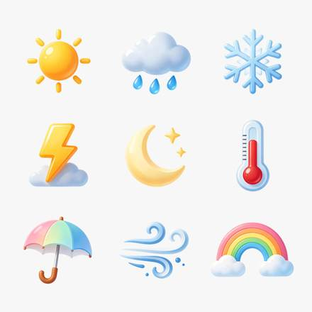</a>

**Seedream Studio** · 待重做 · [来源](https://seedreamv5.com/seedream-5.5)

##### 来源公开 Prompt

```text
A set of nine weather icons arranged in a neat 3 by 3 grid: a sun, a cloud with rain, a snowflake, a lightning bolt, a crescent moon with two stars, a thermometer, an open umbrella, a wind swirl and a rainbow. A consistent rounded style with glossy, soft-gradient fills in warm and cool pastel tones, equal sizes and even spacing. Each icon is a standalone design asset on a fully transparent background, with no tiles or frames behind them and no text or letters.
```

[核对来源原文](https://seedreamv5.com/seedream-5.5)

<a id="web-studio-07"></a>
#### [咖啡馆三轮编辑：饮品、遮阳篷和小狗](cases/web-studio-07/README.zh-CN.md)

<a href="cases/web-studio-07/README.zh-CN.md">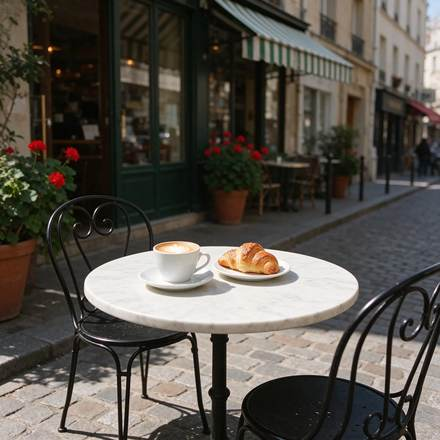</a>

**Seedream Studio** · 待重做 · [来源](https://seedreamv5.com/seedream-5.5)

##### 来源公开 Prompt

```text
A sunny street café scene seen from the pavement at table height: a small round white marble bistro table holding a white ceramic cup of cappuccino with heart latte art on a saucer and a golden croissant on a small plate, with two black wrought-iron bistro chairs. Behind the table, the café front has a plain green-and-white striped awning with no lettering, tall glass windows and terracotta pots of red geraniums. A cobblestone street, warm morning sunlight, soft shadows, no people, and no text or signs anywhere. Photorealistic, 35mm lens.
```

[核对来源原文](https://seedreamv5.com/seedream-5.5)

##### 编辑步骤 1: Swap the cappuccino for an iced coffee

<a href="cases/web-studio-07/README.zh-CN.md">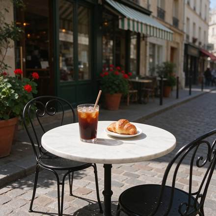</a>

```text
Replace the cappuccino cup and saucer on the table with a tall clear glass of iced coffee with ice cubes, a paper straw and droplets of condensation, standing in the same spot. Keep everything else exactly as it is: the marble table, the croissant and its plate, both chairs, the green-and-white striped awning, the windows, the geraniums, the cobblestones, the lighting and the camera angle.
```

##### 编辑步骤 2: Turn the awning red and white

<a href="cases/web-studio-07/README.zh-CN.md">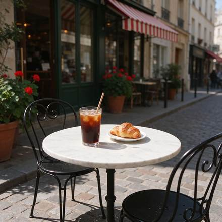</a>

```text
Change only the colour of the awning stripes from green-and-white to red-and-white. Keep everything else exactly as it is: the glass of iced coffee, the croissant and its plate, the marble table, both chairs, the windows, the geraniums, the cobblestones, the lighting and the camera angle.
```

##### 编辑步骤 3: Add a sleeping dachshund

<a href="cases/web-studio-07/README.zh-CN.md">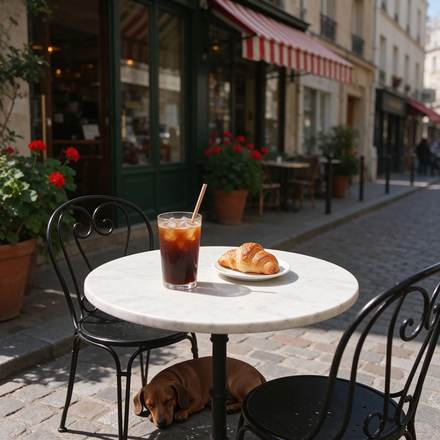</a>

```text
Add a small brown dachshund lying curled up asleep on the cobblestones under the table, in the table's shadow. Keep everything else exactly as it is: the glass of iced coffee, the croissant and its plate, the marble table, both chairs, the red-and-white striped awning, the windows, the geraniums, the lighting and the camera angle.
```

<a id="source-vdobloom-com"></a>
### vdobloom.com

| 案例 | 来源作者 / 网站 | 本地预览文件数 | 提示词状态 | 原始来源 |
| --- | --- | ---: | --- | --- |
| [霓虹面馆英文招牌](#web-vdobloom-01) | VdoBloom | 1 | 原提示词全文见下方 | [查看来源](https://vdobloom.com/blog/seedream-5-5-prompt-guide/) |
| [极简夏季音乐会海报](#web-vdobloom-02) | VdoBloom | 1 | 原提示词全文见下方 | [查看来源](https://vdobloom.com/blog/seedream-5-5-prompt-guide/) |
| [港口黄雨衣渔夫人像](#web-vdobloom-03) | VdoBloom | 1 | 原提示词全文见下方 | [查看来源](https://vdobloom.com/blog/seedream-5-5-prompt-guide/) |
| [黑石玻璃香水瓶](#web-vdobloom-04) | VdoBloom | 1 | 原提示词全文见下方 | [查看来源](https://vdobloom.com/blog/seedream-5-5-prompt-guide/) |
| [俯拍拉面美食](#web-vdobloom-05) | VdoBloom | 1 | 原提示词全文见下方 | [查看来源](https://vdobloom.com/blog/seedream-5-5-prompt-guide/) |
| [北欧客厅](#web-vdobloom-06) | VdoBloom | 1 | 原提示词全文见下方 | [查看来源](https://vdobloom.com/blog/seedream-5-5-prompt-guide/) |
| [荒漠宇航员超宽幅电影剧照](#web-vdobloom-07) | VdoBloom | 1 | 原提示词全文见下方 | [查看来源](https://vdobloom.com/blog/seedream-5-5-prompt-guide/) |
| [雨中蓝发动漫女孩](#web-vdobloom-08) | VdoBloom | 1 | 原提示词全文见下方 | [查看来源](https://vdobloom.com/blog/seedream-5-5-prompt-guide/) |
| [指定数量柑橘](#web-vdobloom-09) | VdoBloom | 1 | 原提示词全文见下方 | [查看来源](https://vdobloom.com/blog/seedream-5-5-prompt-guide/) |
| [树下读书的小狐狸水彩](#web-vdobloom-10) | VdoBloom | 1 | 原提示词全文见下方 | [查看来源](https://vdobloom.com/blog/seedream-5-5-prompt-guide/) |

<a id="web-vdobloom-01"></a>
#### [霓虹面馆英文招牌](cases/web-vdobloom-01/README.zh-CN.md)

<a href="cases/web-vdobloom-01/README.zh-CN.md">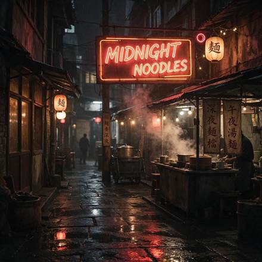</a>

**VdoBloom** · 待重做 · [来源](https://vdobloom.com/blog/seedream-5-5-prompt-guide/)

##### 来源公开 Prompt

```text
A neon sign glowing in a rainy night alley that reads "MIDNIGHT NOODLES", steam rising from a food stall below, reflections on wet pavement, cinematic photo.
```

[核对来源原文](https://vdobloom.com/blog/seedream-5-5-prompt-guide/)

<a id="web-vdobloom-02"></a>
#### [极简夏季音乐会海报](cases/web-vdobloom-02/README.zh-CN.md)

<a href="cases/web-vdobloom-02/README.zh-CN.md">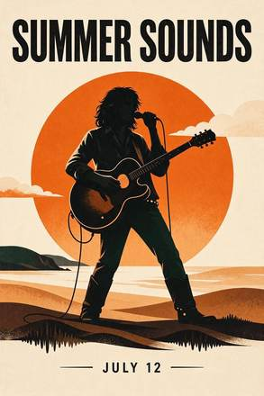</a>

**VdoBloom** · 待重做 · [来源](https://vdobloom.com/blog/seedream-5-5-prompt-guide/)

##### 来源公开 Prompt

```text
A minimalist concert poster, cream background, a large orange sun behind a black silhouette of a guitarist, the title "SUMMER SOUNDS" in bold capital letters at the top and "JULY 12" in small letters at the bottom.
```

[核对来源原文](https://vdobloom.com/blog/seedream-5-5-prompt-guide/)

<a id="web-vdobloom-03"></a>
#### [港口黄雨衣渔夫人像](cases/web-vdobloom-03/README.zh-CN.md)

<a href="cases/web-vdobloom-03/README.zh-CN.md">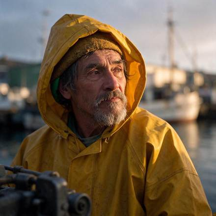</a>

**VdoBloom** · 待重做 · [来源](https://vdobloom.com/blog/seedream-5-5-prompt-guide/)

##### 来源公开 Prompt

```text
Close-up portrait photo of an elderly fisherman with a grey beard and a yellow raincoat, standing on a harbour at dawn, weathered skin, natural skin texture, soft morning light, 85mm lens.
```

[核对来源原文](https://vdobloom.com/blog/seedream-5-5-prompt-guide/)

<a id="web-vdobloom-04"></a>
#### [黑石玻璃香水瓶](cases/web-vdobloom-04/README.zh-CN.md)

<a href="cases/web-vdobloom-04/README.zh-CN.md">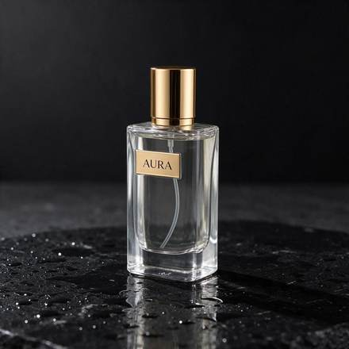</a>

**VdoBloom** · 待重做 · [来源](https://vdobloom.com/blog/seedream-5-5-prompt-guide/)

##### 来源公开 Prompt

```text
Studio product photo of a clear glass perfume bottle with a gold cap, the label reads "AURA", standing on wet black stone with small water drops, one soft light from the left, dark background.
```

[核对来源原文](https://vdobloom.com/blog/seedream-5-5-prompt-guide/)

<a id="web-vdobloom-05"></a>
#### [俯拍拉面美食](cases/web-vdobloom-05/README.zh-CN.md)

<a href="cases/web-vdobloom-05/README.zh-CN.md">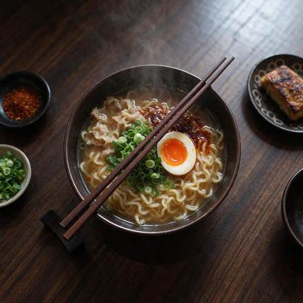</a>

**VdoBloom** · 待重做 · [来源](https://vdobloom.com/blog/seedream-5-5-prompt-guide/)

##### 来源公开 Prompt

```text
Overhead food photo of a bowl of ramen with a soft-boiled egg, spring onions and chilli oil on a dark wooden table, chopsticks resting on the bowl, steam visible, natural window light.
```

[核对来源原文](https://vdobloom.com/blog/seedream-5-5-prompt-guide/)

<a id="web-vdobloom-06"></a>
#### [北欧客厅](cases/web-vdobloom-06/README.zh-CN.md)

<a href="cases/web-vdobloom-06/README.zh-CN.md">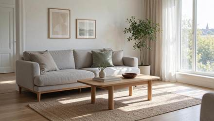</a>

**VdoBloom** · 待重做 · [来源](https://vdobloom.com/blog/seedream-5-5-prompt-guide/)

##### 来源公开 Prompt

```text
A bright Scandinavian living room with a light grey sofa, an oak coffee table, a large window with sheer curtains, one green plant in the corner, morning sunlight on the floor, interior design photo.
```

[核对来源原文](https://vdobloom.com/blog/seedream-5-5-prompt-guide/)

<a id="web-vdobloom-07"></a>
#### [荒漠宇航员超宽幅电影剧照](cases/web-vdobloom-07/README.zh-CN.md)

<a href="cases/web-vdobloom-07/README.zh-CN.md">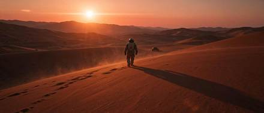</a>

**VdoBloom** · 待重做 · [来源](https://vdobloom.com/blog/seedream-5-5-prompt-guide/)

##### 来源公开 Prompt

```text
A lone astronaut walking across red desert dunes at sunset, long shadow, a small rover far behind, dust in the air, cinematic wide shot, anamorphic look.
```

[核对来源原文](https://vdobloom.com/blog/seedream-5-5-prompt-guide/)

<a id="web-vdobloom-08"></a>
#### [雨中蓝发动漫女孩](cases/web-vdobloom-08/README.zh-CN.md)

<a href="cases/web-vdobloom-08/README.zh-CN.md">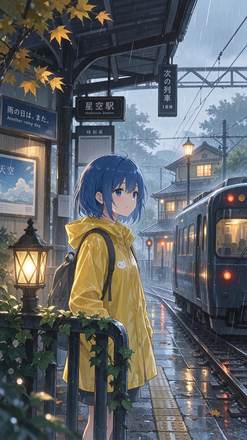</a>

**VdoBloom** · 待重做 · [来源](https://vdobloom.com/blog/seedream-5-5-prompt-guide/)

##### 来源公开 Prompt

```text
Anime style illustration of a girl with short blue hair and a yellow raincoat waiting at a train station in the rain, soft glowing lights, detailed background, clean line art.
```

[核对来源原文](https://vdobloom.com/blog/seedream-5-5-prompt-guide/)

<a id="web-vdobloom-09"></a>
#### [指定数量柑橘](cases/web-vdobloom-09/README.zh-CN.md)

<a href="cases/web-vdobloom-09/README.zh-CN.md">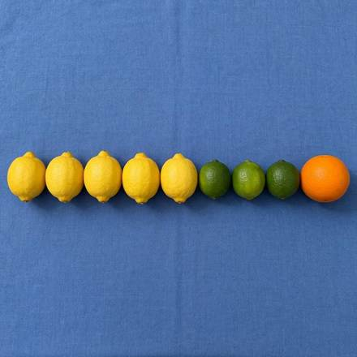</a>

**VdoBloom** · 待重做 · [来源](https://vdobloom.com/blog/seedream-5-5-prompt-guide/)

##### 来源公开 Prompt

```text
Top-down photo of exactly five lemons, three limes and one orange arranged in a single neat row on a plain blue tablecloth, even daylight.
```

[核对来源原文](https://vdobloom.com/blog/seedream-5-5-prompt-guide/)

<a id="web-vdobloom-10"></a>
#### [树下读书的小狐狸水彩](cases/web-vdobloom-10/README.zh-CN.md)

<a href="cases/web-vdobloom-10/README.zh-CN.md">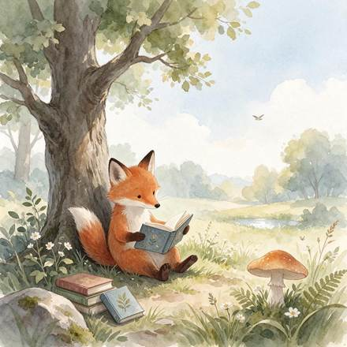</a>

**VdoBloom** · 待重做 · [来源](https://vdobloom.com/blog/seedream-5-5-prompt-guide/)

##### 来源公开 Prompt

```text
Children's book watercolour illustration of a small red fox reading a book under a big oak tree, soft pastel colours, gentle paper texture, lots of white space around.
```

[核对来源原文](https://vdobloom.com/blog/seedream-5-5-prompt-guide/)

<a id="source-www-froging-ai"></a>
### www.froging.ai

| 案例 | 来源作者 / 网站 | 本地预览文件数 | 提示词状态 | 原始来源 |
| --- | --- | ---: | --- | --- |
| [耳机背景局部修改](#web-froging-01) | Froging AI | 1 | 原提示词全文见下方 | [查看来源](https://www.froging.ai/seedream-5-5-ai-image-generator) |
| [血橙水花商业静物](#web-froging-02) | Froging AI | 1 | 原提示词全文见下方 | [查看来源](https://www.froging.ai/seedream-5-5-ai-image-generator) |
| [透明玻璃水母](#web-froging-03) | Froging AI | 1 | 原提示词全文见下方 | [查看来源](https://www.froging.ai/seedream-5-5-ai-image-generator) |

<a id="web-froging-01"></a>
#### [耳机背景局部修改](cases/web-froging-01/README.zh-CN.md)

<a href="cases/web-froging-01/README.zh-CN.md">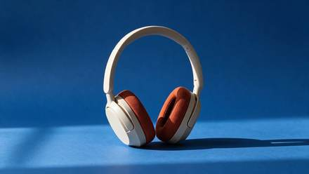</a>

**Froging AI** · 待重做 · [来源](https://www.froging.ai/seedream-5-5-ai-image-generator)

##### 来源公开 Prompt

```text
Replace only the warm-gray seamless paper behind and beneath the headphones with saturated matte cobalt-blue seamless paper. Keep the product in precisely the same position, scale and three-quarter orientation. Preserve the shape of the headband, the ivory plastic, the rust-orange woven cushions, and the original direction of the contact shadow. Keep the same framing and camera angle. Do not add text, accessories, reflections or extra objects.
```

[核对来源原文](https://www.froging.ai/seedream-5-5-ai-image-generator)

<a id="web-froging-02"></a>
#### [血橙水花商业静物](cases/web-froging-02/README.zh-CN.md)

<a href="cases/web-froging-02/README.zh-CN.md">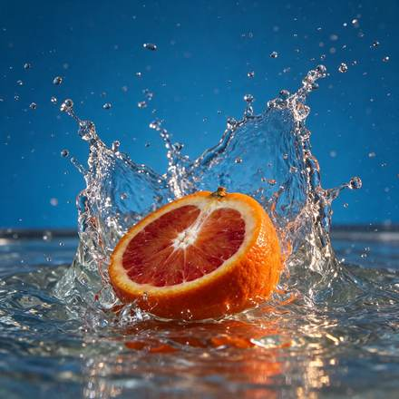</a>

**Froging AI** · 待重做 · [来源](https://www.froging.ai/seedream-5-5-ai-image-generator)

##### 来源公开 Prompt

```text
High-speed editorial food photograph of one cut blood orange half hitting a shallow pool of water, cut surface facing the camera. Capture the moment a translucent crown of water curves around the orange, with individual sharp droplets suspended in the air. Rich ultramarine blue seamless studio backdrop, vivid vermilion pulp and warm side light, natural irregular citrus texture, restrained commercial art direction. Low eye-level camera, square composition, the entire splash inside the frame with breathing room on all sides. One fruit half, no hands, no typography, no logos, no watermark.
```

[核对来源原文](https://www.froging.ai/seedream-5-5-ai-image-generator)

<a id="web-froging-03"></a>
#### [透明玻璃水母](cases/web-froging-03/README.zh-CN.md)

<a href="cases/web-froging-03/README.zh-CN.md">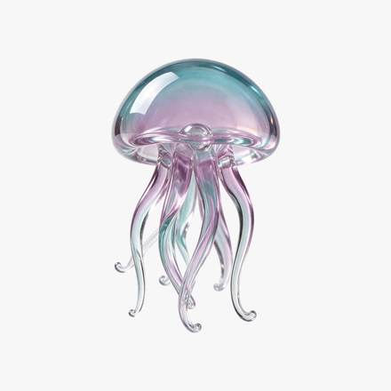</a>

**Froging AI** · 待重做 · [来源](https://www.froging.ai/seedream-5-5-ai-image-generator)

##### 来源公开 Prompt

```text
Create one small seafoam and pale lavender blown-glass jellyfish as an isolated design asset. Show a translucent domed bell and six delicate curved glass tentacles, with polished edges and soft studio highlights. Center the entire silhouette with generous clear margins. Fully transparent background with real alpha outside the object and partial transparency within the thin glass. No floor, no cast shadow, no bubbles, no checkerboard, no frame, no text.
```

[核对来源原文](https://www.froging.ai/seedream-5-5-ai-image-generator)

<a id="source-www-made-app"></a>
### www.made.app

| 案例 | 来源作者 / 网站 | 本地预览文件数 | 提示词状态 | 原始来源 |
| --- | --- | ---: | --- | --- |
| [凌晨洗衣店睡着的男子与猫](#web-made-01) | Made | 1 | 原提示词全文见下方 | [查看来源](https://www.made.app/models/seedream-5-5) |
| [零钱兑换机手写告示](#web-made-02) | Made | 1 | 原提示词全文见下方 | [查看来源](https://www.made.app/models/seedream-5-5) |
| [烘干机内超广角朋友合照](#web-made-03) | Made | 1 | 原提示词全文见下方 | [查看来源](https://www.made.app/models/seedream-5-5) |
| [叠衣台戴毛巾金毛犬](#web-made-04) | Made | 1 | 原提示词全文见下方 | [查看来源](https://www.made.app/models/seedream-5-5) |
| [雨夜洗衣店霓虹招牌](#web-made-05) | Made | 1 | 原提示词全文见下方 | [查看来源](https://www.made.app/models/seedream-5-5) |
| [袜子失物招领展示板](#web-made-06) | Made | 1 | 原提示词全文见下方 | [查看来源](https://www.made.app/models/seedream-5-5) |

<a id="web-made-01"></a>
#### [凌晨洗衣店睡着的男子与猫](cases/web-made-01/README.zh-CN.md)

<a href="cases/web-made-01/README.zh-CN.md">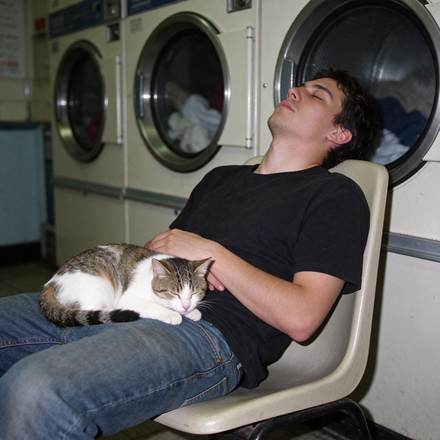</a>

**Made** · 待重做 · [来源](https://www.made.app/models/seedream-5-5)

##### 来源公开 Prompt

```text
Candid phone photo with direct on-camera flash: a guy in his twenties asleep sitting up on a plastic chair in a 24-hour laundromat at 3 a.m., a cat curled up asleep on his lap, a row of spinning dryers behind him. Real skin texture, slight motion blur in the dryer drums, slight grain, candid and unposed, no readable text, logos, or watermark.
```

[核对来源原文](https://www.made.app/models/seedream-5-5)

<a id="web-made-02"></a>
#### [零钱兑换机手写告示](cases/web-made-02/README.zh-CN.md)

<a href="cases/web-made-02/README.zh-CN.md">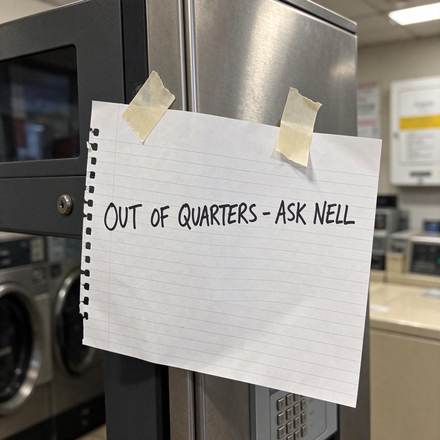</a>

**Made** · 待重做 · [来源](https://www.made.app/models/seedream-5-5)

##### 来源公开 Prompt

```text
Close-up phone photo of a handwritten sign taped to a coin change machine in a laundromat, black marker on lined notebook paper reading exactly "OUT OF QUARTERS - ASK NELL", one strip of tape peeling at the corner, harsh fluorescent light, slight grain, sharp legible handwriting, no other words or logos.
```

[核对来源原文](https://www.made.app/models/seedream-5-5)

<a id="web-made-03"></a>
#### [烘干机内超广角朋友合照](cases/web-made-03/README.zh-CN.md)

<a href="cases/web-made-03/README.zh-CN.md">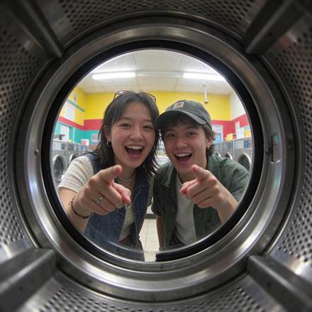</a>

**Made** · 待重做 · [来源](https://www.made.app/models/seedream-5-5)

##### 来源公开 Prompt

```text
0.5x ultra-wide phone shot from inside a front-loading dryer drum looking out through the round glass door at two friends laughing and pointing at the camera in a laundromat, fluorescent ceiling lights, warped ultra-wide edges, slight grain, candid and unposed, no readable text, logos, or watermark.
```

[核对来源原文](https://www.made.app/models/seedream-5-5)

<a id="web-made-04"></a>
#### [叠衣台戴毛巾金毛犬](cases/web-made-04/README.zh-CN.md)

<a href="cases/web-made-04/README.zh-CN.md">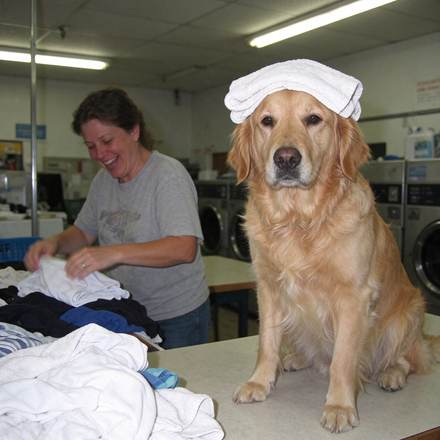</a>

**Made** · 待重做 · [来源](https://www.made.app/models/seedream-5-5)

##### 来源公开 Prompt

```text
Phone photo with direct flash of a golden retriever sitting upright on a laundromat folding table wearing a freshly folded towel on its head like a turban, its owner mid-laugh folding shirts beside it, harsh fluorescent light, real fur texture, candid and unposed, no readable text, logos, or watermark.
```

[核对来源原文](https://www.made.app/models/seedream-5-5)

<a id="web-made-05"></a>
#### [雨夜洗衣店霓虹招牌](cases/web-made-05/README.zh-CN.md)

<a href="cases/web-made-05/README.zh-CN.md">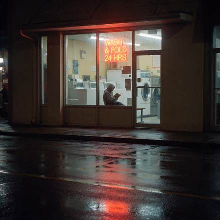</a>

**Made** · 待重做 · [来源](https://www.made.app/models/seedream-5-5)

##### 来源公开 Prompt

```text
Laundromat storefront at night seen from across a rainy street, a neon window sign reading exactly "WASH & FOLD 24 HRS", a person in a hoodie reading a paperback on a bench inside, reflections on the wet asphalt, shot on a phone, slight grain, sharp legible sign, no other words or logos.
```

[核对来源原文](https://www.made.app/models/seedream-5-5)

<a id="web-made-06"></a>
#### [袜子失物招领展示板](cases/web-made-06/README.zh-CN.md)

<a href="cases/web-made-06/README.zh-CN.md">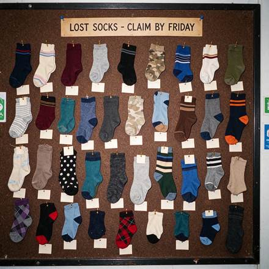</a>

**Made** · 待重做 · [来源](https://www.made.app/models/seedream-5-5)

##### 来源公开 Prompt

```text
Flash photo of a corkboard at a laundromat covered in dozens of single mismatched socks pinned up like butterfly specimens, each with a small blank paper tag, a printed header card at the top reading exactly "LOST SOCKS - CLAIM BY FRIDAY", slight grain, sharp legible header, no other words or logos.
```

[核对来源原文](https://www.made.app/models/seedream-5-5)
