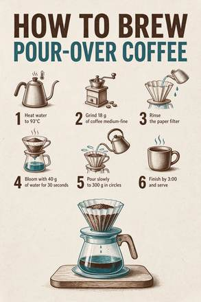

<!-- Generated from external-references/cases.json; not original model output by Raphael. -->
# Infographic with small text

[English](README.md) · [简体中文](README.zh-CN.md)

[Back to external queue](../../README.md)

**Status: pending remake. Model and outputs are source-reported, not independently reproduced.**

## Original reference 1



[Open source image](https://r2.flux1.ai/static/seedream-5-5/infographic.webp)

## Source-published prompt

The website associates this prompt with its output; license, model execution and settings were not independently audited.

```text
A clean printed infographic poster titled 'HOW TO BREW POUR-OVER COFFEE'. Six numbered steps with small line icons: '1 Heat water to 93°C', '2 Grind 18 g of coffee medium-fine', '3 Rinse the paper filter', '4 Bloom with 40 g of water for 30 seconds', '5 Pour slowly to 300 g in circles', '6 Finish by 3:00 and serve'. Off-white paper, dark brown and teal ink, generous margins. No other text.
```

[Check original source](https://flux1.ai/seedream-5-5)

## Remake and rights

- Source: Flux1 AI · [https://flux1.ai/seedream-5-5](https://flux1.ai/seedream-5-5)
- Model evidence: site-self-reported
- Workflow: text-to-image
- Media license: not verified
- Remake status: pending
- Owned replacement files: 0

Put new outputs in the remade directory and update structured status. Clear licensing or remove source-media previews before promotion.

Notes: Source states these are generated samples; edits depend on an original reference image.
