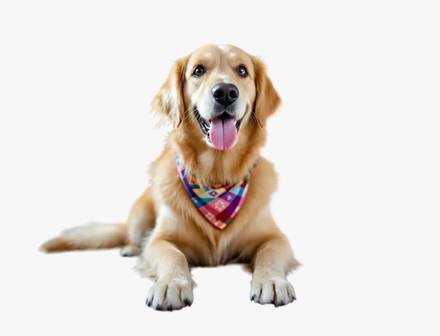

<!-- Generated from external-references/cases.json; not original model output by Raphael. -->
# Cut-out from a photo

[English](README.md) · [简体中文](README.zh-CN.md)

[Back to external queue](../../README.md)

**Status: pending remake. Model and outputs are source-reported, not independently reproduced.**

## Original reference 1



[Open source image](https://r2.flux1.ai/static/seedream-5-5/dog-cutout.webp)

## Source-published prompt

The website associates this prompt with its output; license, model execution and settings were not independently audited.

```text
Cut out the dog with its bandana and return it on a transparent background. Keep the dog, its fur edges, pose and colors exactly as they are.
```

[Check original source](https://flux1.ai/seedream-5-5)

## Remake and rights

- Source: Flux1 AI · [https://flux1.ai/seedream-5-5](https://flux1.ai/seedream-5-5)
- Model evidence: site-self-reported
- Workflow: image-edit-with-reference
- Media license: not verified
- Remake status: pending
- Owned replacement files: 0

Put new outputs in the remade directory and update structured status. Clear licensing or remove source-media previews before promotion.

Notes: Source states these are generated samples; edits depend on an original reference image.
