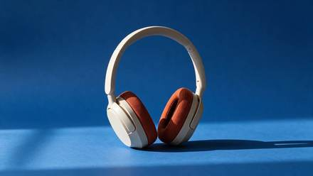

<!-- Generated from external-references/cases.json; not original model output by Raphael. -->
# Change a product backdrop

[English](README.md) · [简体中文](README.zh-CN.md)

[Back to external queue](../../README.md)

**Status: pending remake. Model and outputs are source-reported, not independently reproduced.**

## Original reference 1



[Open source image](https://cdn.froging.ai/frogingai/seedream-5-5/v1-20261111/headphones-cobalt-edit.jpg)

## Source-published prompt

The website associates this prompt with its output; license, model execution and settings were not independently audited.

```text
Replace only the warm-gray seamless paper behind and beneath the headphones with saturated matte cobalt-blue seamless paper. Keep the product in precisely the same position, scale and three-quarter orientation. Preserve the shape of the headband, the ivory plastic, the rust-orange woven cushions, and the original direction of the contact shadow. Keep the same framing and camera angle. Do not add text, accessories, reflections or extra objects.
```

[Check original source](https://www.froging.ai/seedream-5-5-ai-image-generator)

## Remake and rights

- Source: Froging AI · [https://www.froging.ai/seedream-5-5-ai-image-generator](https://www.froging.ai/seedream-5-5-ai-image-generator)
- Model evidence: site-self-reported
- Workflow: image-edit-with-reference
- Media license: not verified
- Remake status: pending
- Owned replacement files: 0

Put new outputs in the remade directory and update structured status. Clear licensing or remove source-media previews before promotion.

Notes: Original headphones input photo is needed to reproduce this edit.
