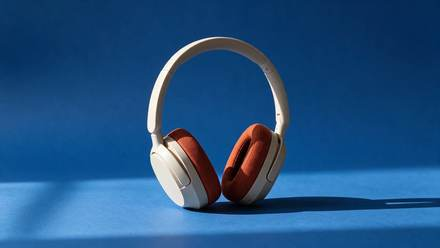

<!-- Generated from external-references/cases.json; not original model output by Raphael. -->
# 耳机背景局部修改

[English](README.md) · [简体中文](README.zh-CN.md)

[返回外部素材库](../../README.zh-CN.md)

**状态：待重做。第三方网站自报模型和结果，本站尚未独立复现。**

## 原始参考图 1



[打开来源图片](https://cdn.froging.ai/frogingai/seedream-5-5/v1-20261111/headphones-cobalt-edit.jpg)

## 来源公开 Prompt

网站将以下文案标注为该结果的提示词；转载许可、生成模型和参数尚未独立审计。

```text
Replace only the warm-gray seamless paper behind and beneath the headphones with saturated matte cobalt-blue seamless paper. Keep the product in precisely the same position, scale and three-quarter orientation. Preserve the shape of the headband, the ivory plastic, the rust-orange woven cushions, and the original direction of the contact shadow. Keep the same framing and camera angle. Do not add text, accessories, reflections or extra objects.
```

[核对来源原文](https://www.froging.ai/seedream-5-5-ai-image-generator)

## 重做与授权

- 来源: Froging AI · [https://www.froging.ai/seedream-5-5-ai-image-generator](https://www.froging.ai/seedream-5-5-ai-image-generator)
- 来源模型归因: site-self-reported
- 工作流: image-edit-with-reference
- 图像许可: not verified
- 重做状态: pending
- 本次重做文件数: 0

后续生成的新图请放到独立 remade 目录并更新结构化状态；对来源图片的转载应在发布前处理授权或删除。

备注：Original headphones input photo is needed to reproduce this edit.
